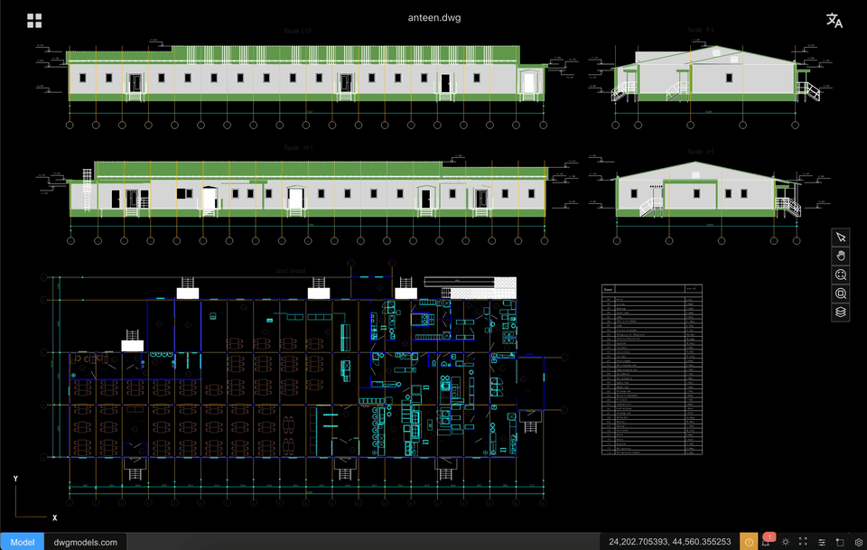

# CAD-Viewer (Čeština)

[English](./README.md) | [简体中文](./README.zh-CN.md) | [日本語](./README.ja.md) | [한국어](./README.ko.md) | [Español](./README.es.md) | [Português](./README.pt.md) | [Русский](./README.ru.md) | [Čeština](./README.cs.md)

[](https://www.npmjs.com/package/@mlightcad/cad-simple-viewer)
[](https://www.npmjs.com/package/@mlightcad/cad-viewer)

<a href="https://trendshift.io/repositories/16129?utm_source=trendshift-badge&amp;utm_medium=badge&amp;utm_campaign=badge-trendshift-16129" target="_blank" rel="noopener noreferrer"></a>

cad-viewer je `první webový prohlížeč a editor DXF/DWG na světě, který běží zcela v prohlížeči a nevyžaduje žádné backendové služby`.
Tím, že parsování DWG/DXF, zpracování geometrie a vykreslování probíhá přímo v prohlížeči, cad-viewer umožňuje skutečné bezserverové prohlížení a úpravy CAD — ideální pro cloudové aplikace, offline použití a pracovní postupy citlivé na soukromí.

Nabízí také něco, co u jiných CAD prohlížečů jen zřídka najdete — **export jedním kliknutím do jediného samostatného souboru HTML**. Stažený soubor `.html` obsahuje snímek výkresu a lehké běhové prostředí prohlížeče, takže příjemci mohou v jakémkoli moderním prohlížeči otevírat, posouvat, přibližovat, přepínat vrstvy a měřit vzdálenosti **bez CAD aplikace, bez serveru a bez instalace**. Většina desktopových i webových CAD prohlížečů umožňuje prohlížení pouze ve vlastním produktu; cad-viewer promění živý výkres v přenosný offline artefakt, který můžete poslat e-mailem, archivovat nebo umístit na statický souborový hosting — ideální pro sdílení s klienty, archivy pro compliance a izolovaná prostředí bez připojení k síti. Offline prohlížeč také spotřebovává výrazně méně paměti než tradiční desktopové nástroje při otevírání stejného výkresu (viz [porovnání paměti](#spotřeba-paměti-samostatného-html) níže).

- [**🌐 Domovská stránka**](https://mlightcad.com/)
- **🌐 Živé demo**: [Netlify](https://mlightcad.netlify.app/) · [GitHub Pages](https://mlightcad.github.io/cad-viewer/)
- **🌐 Dokumentace API**: [Read the Docs](https://cad-viewer.readthedocs.io/en/latest/) (verzovaná) · [MCP server](https://gitmcp.io/mlightcad/cad-viewer)
- [**🌐 Wiki**](https://github.com/mlightcad/cad-viewer/wiki)
- X (Twitter): [@mlightcad](https://x.com/mlightcad)
- YouTube: [@mlightcad](https://www.youtube.com/@mlightcad)
- Medium: [@mlightcad](https://medium.com/@mlightcad)
- DEV.to: [@mlightcad](https://dev.to/mlightcad)
- Juejin(稀土掘金): [@mlightcad](https://juejin.cn/column/7501992214283501579)

### Aplikace postavené na cad-viewer

Tým [Thingraph](https://cad.thingraph.site/) staví produkční prohlížeče DWG/DXF a integrace platforem na základě cad-viewer a obsluhuje desítky tisíc uživatelů po celém světě:

- [DWG Viewer Web App](https://cad.thingraph.site/dwg-viewer) — webový prohlížeč DWG/DXF využívaný inženýrskými týmy po celém světě pro rychlý, bezserverový přístup k výkresům. Instalace pro vaši platformu:
  - [Google Drive](https://workspace.google.com/marketplace/app/dwg_viewer/641533811831) — otevření DWG/DXF z Disku pomocí **Open with**
  - [VS Code](https://marketplace.visualstudio.com/items?itemName=thingraph.dwg-viewer) — vlastní editor pouze pro čtení souborů `.dwg` / `.dxf`
  - [Cursor](https://open-vsx.org/extension/thingraph/dwg-viewer) — stejné rozšíření přes Open VSX
  - [Confluence](https://marketplace.atlassian.com/apps/2890472615/dwg-viewer-for-confluence) — vložení náhledů DWG/DXF na stránky
  - [Windows Explorer](https://cad.thingraph.site/install/windows) — náhled a miniatury v Průzkumníku souborů

Komunitní aplikace a integrace:

- [flyfish-dev/cad-viewer](https://github.com/flyfish-dev/cad-viewer) — produkční webový CAD prohlížeč pro DWG, DXF, DWF, DWFx a XPS ([živé demo](https://cad-viewer-iys.pages.dev))
- [Nextcloud CAD Viewer](https://github.com/ashcoft/nextcloud-cad-viewer) — nativní aplikace Nextcloud pro prohlížení DWG/DXF v prohlížeči ([App Store](https://apps.nextcloud.com/apps/cad_viewer))

Komunitní desktopové balíčky pro Linux:

- [CAD Viewer AppImage](https://github.com/pass-wind/cad-viewer-appimage) — AppImage založená na Electronu pro Linux (~114 MB), testováno na Fedoře
- [cad-viewer (AUR)](https://aur.archlinux.org/packages/cad-viewer) — zdrojový balíček pro Arch Linux využívající systémový Electron (~5,4 MB)
- [cad-viewer-bin (AUR)](https://aur.archlinux.org/packages/cad-viewer-bin) — binární balíček pro Arch Linux se součástí fontů/šablon pro plně offline otevírání výkresů

### Demo aplikace (Demo Apps)

Oficiální ukázkové aplikace, které ukazují, jak integrovat cad-viewer do vlastního produktu:

- [cad-simple-viewer-example](https://github.com/mlightcad/cad-simple-viewer-example) — Minimální vanilla TypeScript host pro [`@mlightcad/cad-simple-viewer`](https://www.npmjs.com/package/@mlightcad/cad-simple-viewer): otevření lokálních nebo CDN DXF/DWG, ovládání příkazů malým toolbarem a líné načítání pluginů pro export HTML/PDF/SVG bez plného Vue UI.
- [cad-viewer-example](https://github.com/mlightcad/cad-viewer-example) — Plnohodnotná Vue 3 aplikace na [`@mlightcad/cad-viewer`](https://www.npmjs.com/package/@mlightcad/cad-viewer) s nabídkami, ribbonem, dialogy, příkazovým řádkem a stavovým řádkem ([živé demo](https://mlightcad.github.io/cad-viewer-example/)).
- [cad-viewer-nextjs-demo](https://github.com/mlightcad/cad-viewer-nextjs-demo) — Next.js demo „CAD disk“: obnovitelné chunkované nahrávání DWG/DXF, seznam souborů v SQLite s náhledy a otevření výkresů buď **živým parsováním v prohlížeči** (`cad-simple-viewer`), nebo **serverovým ACEX prerenderem** (rychlejší otevření, méně paměti).



## Funkce

- **Vysoký výkon** — prohlížení rozsáhlých souborů DWG/DXF s plynulým vykreslováním 60+ FPS
- **Bez backendu** — soubory se parsují a zpracovávají zcela v prohlížeči
- **Vyšší bezpečnost dat** — soubory nikdy neopustí vaše zařízení, zajištění úplného soukromí
- **Snadná integrace** — není potřeba nastavení serveru ani backendové infrastruktury
- Modulární architektura pro bezproblémovou integraci třetích stran
- **Systém pluginů** — Rozšiřitelná architektura pluginů s oficiálními pluginy pro UI, AI asistenta a export do HTML/PDF/SVG; viz [průvodce systémem pluginů](https://mlightcad.com/cad-viewer/docs/cs/development/plugin-system.html)
- **Mobilní rozložení a dotykové ovládání** — responzivní UI pro telefon/tablet a dotyková gesta (štípnutí pro zoom, posun jedním prstem, klepnutí pro výběr) vestavěná v `@mlightcad/cad-simple-viewer`, bez nutnosti samostatné mobilní aplikace
- **Export do offline HTML** — export aktuálního výkresu jako jediného samostatného souboru `.html` s vloženým prohlížečem (posun/přiblížení, přizpůsobení zobrazení, vrstvy, měření vzdálenosti, UI EN/ZH). Otevírá se offline v jakémkoli prohlížeči; není vyžadována instance cad-viewer ani backend.
- Offline i online editační pracovní postupy
- 3D vykreslovací engine THREE.js s pokročilými optimalizačními technikami
- Navrženo pro rozšiřitelnost a integraci s platformami jako CMS, Notion a WeChat

## Vložení DWG/DXF jedním řádkem kódu

Přidejte prohlížení DWG/DXF na libovolný web jediným `<iframe>` — bez CAD backendu a bez nahrávání výkresů do cizího cloudu. Soubor se načte z **vaší** URL a kompletně zpracuje v prohlížeči návštěvníka; nástroje pro review (posun, zoom, měření, anotace) jsou ihned k dispozici.

```html
<iframe
  src="https://mlightcad.com/embed.html?url=https://example.com/plans/floor.dwg&mode=review&toolbar=1"
  style="width:100%;height:600px;border:0"
  allowfullscreen>
</iframe>
```

Podrobný návod a živé demo: [Embed DWG/DXF on Your Website Without Uploading a Single Byte](https://medium.com/@mlightcad/embed-dwg-dxf-on-your-website-without-uploading-a-single-byte-cf5f6ad484c4).

## Začínáme

### Požadavky

- [Node.js](https://nodejs.org/) >= 24
- [pnpm](https://pnpm.io/) >= 10

### Instalace

```bash
git clone https://github.com/mlightcad/cad-viewer.git
cd cad-viewer
pnpm install
```

### Vývoj

```bash
# Spustit plnohodnotný prohlížeč (cad-viewer)
pnpm dev

# Nebo spustit jednoduchý prohlížeč
pnpm dev:simple
```

### Sestavení

```bash
pnpm build
```

### Náhled

```bash
# Náhled plnohodnotného prohlížeče
pnpm preview

# Náhled jednoduchého prohlížeče
pnpm preview:simple
```

## Jak používat

Jste v CAD Viewer noví? **[Uživatelská příručka](https://mlightcad.com/cad-viewer/docs/)** nabízí podrobné návody k rozhraní prohlížeče, ovládání na počítači i dotykových zařízeních a k nástrojům pro poznámky a měření.

### Ovládání v desktopovém prohlížeči
- **Výběr**: levé tlačítko myši na entitách
- **Přiblížení/oddálení**: kolečko myši nahoru/dolů
- **Posun**: podržte prostřední tlačítko myši a táhněte
- **Smazání**: vyberte entity a stiskněte klávesu `Del`

### Ovládání v prohlížeči na tabletu/mobilu
- **Výběr**: klepněte na entity
- **Přiblížení**: stažení dvěma prsty
- **Posun**: tažení jedním prstem

## Výkon

CAD-Viewer je navržen pro **výjimečný výkon** a zvládne velmi rozsáhlé soubory DXF/DWG při zachování vysoké snímkové frekvence. Využívá několik pokročilých vykreslovacích technologií pro optimalizaci výkonu:

- **Vlastní shader materiály**: GPU-akcelerované shader materiály pro efektivní vykreslování složitých typů čar a vzorů výplně šrafování
- **Dávkování geometrie**: slučování bodů, čar a ploch se stejným materiálem pro výrazné snížení počtu draw callů
- **Instancované vykreslování**: optimalizace vykreslování opakující se geometrie pomocí instancing technik
- **Optimalizace buffer geometrie**: efektivní správa paměti a slučování geometrie pro snížení GPU režie
- **Cache materiálů**: opakované použití materiálů u podobných entit pro minimalizaci změn stavu
- **WebGL optimalizace**: využití moderních WebGL funkcí pro hardwarově akcelerované vykreslování

Tyto optimalizace umožňují CAD-Viewer plynule vykreslovat složité CAD výkresy s tisíci entitami při zachování responzivní interakce s uživatelem.

#### Spotřeba paměti samostatného HTML

Při otevírání ukázkového výkresu [`canteen.dwg`](https://cdn.jsdelivr.net/gh/mlightcad/cad-data@main/data/canteen.dwg) je spotřeba paměti zhruba:

| Prohlížeč | Spotřeba paměti |
|--------|-------------|
| AutoCAD 2020 | 320 MB |
| GstarCAD Viewer (浩辰看图王) | 246 MB |
| Samostatné HTML (režim měření) | 56 MB |
| Samostatné HTML (režim prohlížení) | 33 MB |

Offline HTML prohlížeč spotřebovává přibližně o **83 % méně paměti než AutoCAD 2020** a v režimu prohlížení o **77 % méně než GstarCAD Viewer**, přičemž stále podporuje posun/přiblížení, přepínání vrstev a měření vzdálenosti (režim měření).

## Známé problémy

Výchozí open-source cesta pro DWG je založena na [LibreDWG](https://github.com/LibreDWG/libredwg) prostřednictvím volitelného balíčku `@mlightcad/libredwg-converter`. Funguje dobře pro mnoho výkresů, ale pokrytí entit je stále omezené, WASM balíček je mnohem větší, spuštění je pomalejší, spotřeba paměti je vysoká a velmi rozsáhlé soubory DWG mohou skončit chybou nedostatku paměti. Také zavádí licenční aspekty GPL pro komerční produkty s uzavřeným zdrojovým kódem. `@mlightcad/cad-simple-viewer` na tomto konvertoru **nezávisí** a ve výchozím stavu jej neregistruje — hostitelské aplikace (viz ukázkové balíčky) se připojují explicitně.

Pokud potřebujete lepší kompatibilitu, nižší spotřebu paměti, podporu velkých souborů nebo čistší komerční licenční model, podívejte se na náš [**vlastní parser DWG**](./PROPRIETARY-PARSER.md).

| Položka | Parser založený na LibreDWG | Vlastní parser DWG |
|------|------------------------|------------------------|
| Podporované entity | Omezené pokrytí | Širší pokrytí |
| Velikost balíčku | ~13 MB | ~437 KB |
| Rychlost načítání | Pomalejší spuštění | Výrazně rychlejší spuštění |
| Spotřeba paměti | Vyšší | Nižší |
| Velké soubory DWG | U velkých souborů může dojít k OOM | Žádný takový problém |
| Licence | Riziko šíření GPL | Bez rizika šíření GPL |

## Plán vývoje

Cílem tohoto projektu je vytvořit plnohodnotný **2D systém podobný AutoCADu v prohlížeči** (prohlížeč + editor) s modulární architekturou a integrací nezávislou na frameworku.

Legenda:
- [x] Dokončeno
- [ ] Plánováno
- [ ] ⏳ Probíhá

### Jádro souborů a datové vrstvy

#### Podpora souborů

* [x] Načítání DXF
* [x] Načítání DWG
* [x] Export do samostatného offline HTML (vložený prohlížeč)
* [x] Streamování / přírůstkové načítání velkých souborů
* [ ] ⏳ Kompatibilita verzí souborů (R12–Latest)

#### Datový model

* [x] Jednotný datový model entit
* [x] Podpora tabulky vrstev
* [x] Struktura bloků / vložení
* [ ] ⏳ Správa handle a object ID: v současnosti je objectId stejný jako handle a reprezentován jako jeden řetězec místo bigint (int64).
* [ ] ⏳ Podpora XData / rozšiřujícího slovníku
* [ ] Zpracování proxy entit

### Vykreslování a výkon

#### Vykreslovací engine

* [x] Vykreslování založené na WebGL (Three.js)
* [x] Pipeline optimalizovaná pouze pro 2D
* [x] Organizace scény podle vrstev
* [x] Vykreslování layoutu / papírového prostoru
* [ ] Podpora entit viewportu

#### Optimalizace výkonu

* [x] Slučování a dávkování geometrie
* [x] Prostorové indexování (základní)
* [x] Pokročilý prostorový index (R-tree / BVH)
* [ ] Vykreslování s úrovní detailu (LOD)
* [ ] Více pláten / dlaždicové vykreslování pro velmi rozsáhlé výkresy

### Prohlížení a navigace

#### Ovládání zobrazení

* [x] Posun
* [x] Přiblížení (kolečko / rámečkové přiblížení)
* [x] Přizpůsobení zobrazení / rozsah
* [ ] Pojmenovaná zobrazení
* [ ] Historie zobrazení (zpět / vpřed u změn zobrazení)

#### Ovládání zobrazení obsahu

* [x] Viditelnost vrstev zap/vyp
* [x] Zmrazení / uzamčení vrstev
* [x] Zobrazení tloušťky čar
* [ ] Měřítko typů čar
* [x] Přepínání pozadí / motivu

### Výběr a interakce

#### Výběr

* [x] Výběr jedné entity
* [x] Zvýraznění vybraných entit
* [x] Výběr oknem
* [x] Křížový výběr
* [x] Filtry výběru (podle typu / vrstvy)
* [x] Cyklický výběr

#### Přichycení (OSNAP)

* [x] Koncový bod
* [x] Střed
* [x] Střed kružnice
* [x] Průsečík
* [ ] Kolmice / tečna
* [x] Nejbližší
* [ ] Sledování přichycení


### Úpravy a modifikace

#### Základní úpravy

* [x] Rámec pro úpravu entit
* [x] Posun
* [x] Kopírování
* [x] Otočení
* [ ] Měřítko
* [x] Smazání
* [x] Zpět / vpřed

#### Úpravy geometrie

* [x] Úchopové body
* [ ] Protažení
* [ ] Oříznutí
* [ ] Prodloužení
* [x] Odsazení
* [ ] Rozložení
* [ ] Spojení / zaoblení / zkosení (2D)

### Kreslení a nástroje pro tvorbu

#### Základní entity

* [x] Čára
* [x] Polyline
* [x] Spline
* [x] Kružnice
* [x] Oblouk
* [x] Elipsa
* [x] Obdélník / polygon

#### Pokročilé entity

* [x] Šrafování
* [ ] Text (jednořádkový / víceřádkový)
* [ ] Kóty (lineární, zarovnané, úhlové)
* [ ] Vytváření a vkládání bloků

### Měření

* [x] Vzdálenost
* [x] Délka oblouku
* [x] Plocha
* [x] Úhel
* [ ] Souřadnice
* [ ] Statistiky entit (délka, plocha, počet)

### Kóty

* [x] Lineární kóta
* [ ] Úhlová kóta
* [ ] Souřadnice

### Vlastnosti a UI panely

#### Paleta vlastností

* [x] Vlastnosti vybrané entity
* [ ] Úprava vrstvy, barvy, typu čáry
* [x] Živá aktualizace při změně

#### Panely a UI

* [x] Správce vrstev
* [ ] Správce bloků
* [x] Historie příkazů / konzole
* [x] Stavový řádek (přichycení, orto, mřížka)

#### Systém příkazů

* [x] Registr příkazů
* [x] Aliasy příkazů
* [x] Výzvy příkazů (ve stylu AutoCADu)

### Integrace a rozšiřitelnost

#### Integrace frameworků

* [x] Jádro nezávislé na frameworku
* [ ] Příklad integrace React
* [x] Příklad integrace Vue
* [ ] Integrace OpenLayers / Map
* [ ] Vkládání do CMS / Notion

#### Systém pluginů

* [x] Plugin API
* [ ] Podpora vlastních entit
* [x] Vlastní příkaz

### Offline a online úpravy

#### Offline editor

* [x] Lokální úpravy v prohlížeči
* [x] Uložení do DXF
* [ ] Uložení sady změn / diff
* [ ] Perzistence IndexedDB

#### Online editor

* [ ] Návrh backend API
* [ ] Autentizace uživatelů
* [ ] Verzování souborů
* [ ] Řízení přístupu pro více uživatelů
* [ ] Real-time spolupráce (budoucnost)

### Cílové platformy

* [x] Integrace Google Drive (datový zdroj Picker; Drive „Open with“ jako volitelné pokračování)
* [ ] Prohlížeč pro WeChat Mini Program
* [x] Podpora mobilního prohlížeče (responzivní rozložení a dotykové ovládání)

### Dokumentace a komunita

* [x] Dokumentace architektury
* [x] Referenční dokumentace API
* [ ] Průvodce pro přispěvatele
* [x] Ukázkové projekty
* [x] Údržba plánu vývoje a changelogu

Tento plán vývoje je záměrně podrobný, aby přispěvatelé jasně viděli, **co existuje**, **co chybí** a **kde je potřeba pomoc**.

## Přispívání

Příspěvky jsou vítány! Otevírejte issue nebo pull requesty pro opravy chyb, nové funkce nebo návrhy. U hlášení chyb pomůže poskytnutí odkazu na problematický výkres při reprodukci a opravě problému.

## Licence

Monorepo cad-viewer je primárně licencováno pod [MIT](LICENSE).

Načítání DXF používá vestavěný MIT parser v `@mlightcad/data-model`. Načítání DWG je **opt-in**: `@mlightcad/cad-simple-viewer` nezávisí na GPL balíčcích LibreDWG. Hostitelé, kteří chtějí open-source podporu DWG, si sami přidají `@mlightcad/libredwg-converter` (GPL-3.0), nasadí jeho worker + wasm a zaregistrují konvertor. Pokud dodáváte produkt s uzavřeným zdrojovým kódem a nemůžete zákazníkům distribuovat GPL kód, použijte místo toho [**vlastní parser DWG**](./PROPRIETARY-PARSER.md).

→ **Komerční parser:** [PROPRIETARY-PARSER.md](./PROPRIETARY-PARSER.md) (rozsah, licencování, ceny, integrace, soulad s GPL, podpora)
