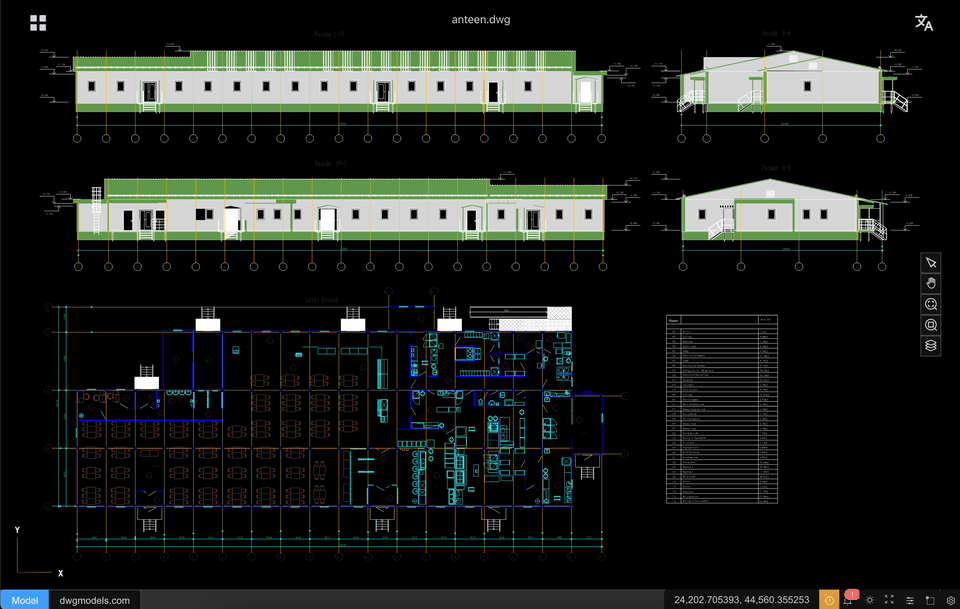

# MLightCAD (Español)

[English](./README.md) | [简体中文](./README.zh-CN.md) | [日本語](./README.ja.md) | [한국어](./README.ko.md) | [Español](./README.es.md) | [Português](./README.pt.md) | [Русский](./README.ru.md) | [Čeština](./README.cs.md)

[](https://www.npmjs.com/package/@mlightcad/cad-simple-viewer)
[](https://www.npmjs.com/package/@mlightcad/cad-viewer)

<a href="https://trendshift.io/repositories/16129?utm_source=trendshift-badge&amp;utm_medium=badge&amp;utm_campaign=badge-trendshift-16129" target="_blank" rel="noopener noreferrer"></a>

MLightCAD es `la primera plataforma web de visualización, comparación y edición de DXF/DWG del mundo que funciona completamente en el navegador, sin depender de ningún servicio backend`.
Al realizar el análisis de DWG/DXF, el procesamiento geométrico y el renderizado directamente en el navegador, MLightCAD permite una visualización y edición CAD verdaderamente sin servidor, ideal para aplicaciones en la nube, uso sin conexión y flujos de trabajo sensibles a la privacidad.

MLightCAD no es solo un visor CAD, sino una **infraestructura CAD nativa del navegador**. Sobre un mismo motor ofrece tres formas de producto listas para usar:

| Subproyecto | Función | Paquete |
| --- | --- | --- |
| **CAD Viewer** | Visualización y revisión: abra DWG/DXF, desplace, haga zoom, mida y anote; también puede usarse como SDK dentro de su propio producto | [`@mlightcad/cad-simple-viewer`](https://www.npmjs.com/package/@mlightcad/cad-simple-viewer) |
| **CAD Diff Viewer** | Comparación de revisiones: lado a lado o superpuestas—gris sin cambios, rojo eliminado, verde añadido—y nubes de revisión generadas a partir de los conjuntos de cambios | [`@mlightcad/cad-diff-viewer`](https://github.com/mlightcad/cad-viewer/tree/main/packages/cad-diff-viewer) |
| **CAD Editor** | Edición y dibujo: menús, cinta, línea de comandos y barra de estado al estilo AutoCAD; abra un dibujo y modifique la geometría directamente | [`@mlightcad/cad-editor`](https://www.npmjs.com/package/@mlightcad/cad-editor) |

Los tres comparten el mismo modelo de entidades, motor de renderizado y bus de plugins. La interfaz, la exportación y las capacidades de IA se cargan bajo demanda en lugar de reimplementarse: visualizar, comparar y editar son formas de producto de un mismo núcleo CAD, no herramientas inconexas.

Además, MLightCAD ofrece algo que rara vez encontrará en otro software CAD: **exportación con un solo clic a un único archivo HTML autocontenido**. El `.html` descargado incorpora la instantánea del dibujo y un visor ligero en tiempo de ejecución, de modo que los destinatarios pueden abrir, desplazar, hacer zoom, alternar capas y medir distancias en cualquier navegador moderno **sin aplicación CAD, sin servidor y sin instalación**. La mayoría de los visores CAD de escritorio y web solo permiten ver dentro de su propio producto; MLightCAD convierte un dibujo activo en un artefacto portable y sin conexión que puede enviar por correo, archivar o alojar en un servidor de archivos estático, ideal para compartir con clientes, archivos de cumplimiento normativo y flujos de trabajo en entornos aislados. El visor sin conexión también utiliza mucha menos memoria que las herramientas de escritorio tradicionales al abrir el mismo dibujo (consulte la [comparación de memoria](#uso-de-memoria-del-html-autocontenido) más abajo).

MLightCAD también admite la **prerrepresentación del lado del servidor**. El dibujo se analiza y procesa una sola vez en el servidor, y el cliente simplemente muestra el resultado prerrepresentado sin volver a analizar el DWG/DXF ni reconstruir la geometría. Esto reduce drásticamente el uso de memoria en el cliente y hace que las aperturas posteriores del mismo dibujo sean mucho más rápidas, algo especialmente adecuado para visualizar planos en dispositivos móviles.

- [**🌐 Página de inicio**](https://mlightcad.com/)
- **🌐 Demo en vivo**: [Netlify](https://mlightcad.netlify.app/) · [GitHub Pages](https://mlightcad.github.io/cad-viewer/)
- **🌐 Documentación de la API**: [Read the Docs](https://cad-viewer.readthedocs.io/en/latest/) (versionada) · [Servidor MCP](https://gitmcp.io/mlightcad/cad-viewer)
- [**🌐 Wiki**](https://github.com/mlightcad/cad-viewer/wiki)
- X (Twitter): [@mlightcad](https://x.com/mlightcad)
- YouTube: [@mlightcad](https://www.youtube.com/@mlightcad)
- Medium: [@mlightcad](https://medium.com/@mlightcad)
- DEV.to: [@mlightcad](https://dev.to/mlightcad)
- Juejin(稀土掘金): [@mlightcad](https://juejin.cn/column/7501992214283501579)

### Aplicaciones creadas con MLightCAD

El equipo de [Thingraph](https://cad.thingraph.site/) construye visores DWG/DXF de producción e integraciones de plataforma sobre MLightCAD, atendiendo a decenas de miles de usuarios en todo el mundo:

- [DWG Viewer Web App](https://cad.thingraph.site/dwg-viewer) — Visor DWG/DXF basado en navegador utilizado por equipos de ingeniería de todo el mundo para un acceso rápido y sin servidor a los dibujos. Instálelo para su plataforma:
  - [Google Drive](https://workspace.google.com/marketplace/app/dwg_viewer/641533811831) — abra DWG/DXF desde Drive con **Abrir con**
  - [VS Code](https://marketplace.visualstudio.com/items?itemName=thingraph.dwg-viewer) — editor personalizado de solo lectura para `.dwg` / `.dxf`
  - [Cursor](https://open-vsx.org/extension/thingraph/dwg-viewer) — la misma extensión a través de Open VSX
  - [Confluence](https://marketplace.atlassian.com/apps/2890472615/dwg-viewer-for-confluence) — incruste vistas previas de DWG/DXF en las páginas
  - [Windows Explorer](https://cad.thingraph.site/install/windows) — miniatura y vista previa en el Explorador de archivos

Aplicaciones e integraciones de la comunidad:

- [flyfish-dev/cad-viewer](https://github.com/flyfish-dev/cad-viewer) — Visor CAD en navegador orientado a producción para DWG, DXF, DWF, DWFx y XPS ([demo en vivo](https://cad-viewer-iys.pages.dev))
- [Nextcloud CAD Viewer](https://github.com/ashcoft/nextcloud-cad-viewer) — Aplicación nativa de Nextcloud para ver DWG/DXF en el navegador ([App Store](https://apps.nextcloud.com/apps/cad_viewer))

Aplicación de escritorio oficial:

- [MLightCAD Studio](https://github.com/mlightcad/mlightcad-studio) — la edición de escritorio oficial de MLightCAD, que envuelve [`@mlightcad/cad-editor`](https://www.npmjs.com/package/@mlightcad/cad-editor) en un shell de [Tauri 2](https://v2.tauri.app/) y funciona totalmente sin conexión; incluye instaladores para Windows (NSIS / MSI), Linux (AppImage / deb) y macOS (DMG universal, Apple Silicon + Intel)—[descargar aquí](https://github.com/mlightcad/mlightcad-studio/releases/).

### Aplicaciones de demostración (Demo Apps)

Aplicaciones de ejemplo oficiales que muestran cómo integrar MLightCAD en su propio producto:

- [cad-simple-viewer-demo](https://github.com/mlightcad/cad-simple-viewer-example) — Host mínimo en TypeScript vanilla para [`@mlightcad/cad-simple-viewer`](https://www.npmjs.com/package/@mlightcad/cad-simple-viewer): abra DXF/DWG locales o desde CDN, ejecute comandos desde una barra de herramientas compacta y cargue de forma diferida plugins de exportación HTML/PDF/SVG sin la UI Vue completa.
- [cad-editor-demo](https://github.com/mlightcad/cad-viewer-example) — Aplicación Vue 3 completa basada en [`@mlightcad/cad-editor`](https://www.npmjs.com/package/@mlightcad/cad-editor) con menús, cintas, diálogos, línea de comandos y barra de estado ([demo en vivo](https://mlightcad.github.io/cad-viewer-example/)).
- [cad-viewer-nextjs-demo](https://github.com/mlightcad/cad-viewer-nextjs-demo) — Demo tipo «unidad CAD» en Next.js: carga reanudable por fragmentos de DWG/DXF, lista de archivos con SQLite y miniaturas de vista previa, y apertura con **análisis en vivo en el navegador** (`cad-simple-viewer`) o **prerenderizado ACEX en el servidor** (carga más rápida, menos memoria).



## Características

- Visualización **de alto rendimiento** de archivos DWG/DXF grandes con renderizado fluido a más de 60 FPS
- **No requiere backend** — Los archivos se analizan y procesan completamente en el navegador
- **Mayor seguridad de los datos** — Los archivos nunca abandonan su dispositivo, garantizando privacidad total
- **Integración sencilla** — No se necesita configuración de servidor ni infraestructura backend
- Arquitectura modular para una integración fluida con terceros
- **Sistema de plugins** — Arquitectura de plugins extensible con plugins oficiales para UI, asistente de IA y exportación a HTML/PDF/SVG; consulte la [guía del sistema de plugins](https://mlightcad.com/cad-viewer/docs/development/plugin-system.html)
- **Diseño móvil y gestos táctiles** — Interfaz responsive para teléfono/tableta y gestos táctiles (pellizcar para zoom, arrastrar con un dedo, tocar para seleccionar) integrados en `@mlightcad/cad-simple-viewer`, sin necesidad de una app móvil aparte
- **Exportación a HTML sin conexión** — Exporte el dibujo actual como un único archivo `.html` autocontenido con un visor integrado (desplazamiento/zoom, zoom a extensión, capas, medición de distancias, interfaz EN/ZH). Se abre sin conexión en cualquier navegador; no requiere instancia de MLightCAD ni backend.
- Flujos de trabajo de edición sin conexión y en línea
- Motores de renderizado 3D THREE.js con técnicas avanzadas de optimización
- Diseñado para extensibilidad e integración con plataformas como CMS, Notion y WeChat

- **Arquitectura por capas clara** — modelo → renderizado → vista → UI / plugins, donde los paquetes de bajo nivel nunca dependen de los de alto nivel, además de exportadores headless y una CLI desplegables por separado; consulte la [descripción general de la arquitectura](https://mlightcad.com/cad-viewer/docs/development/architecture-overview.html)

## Capacidades de IA

MLightCAD incluye un conjunto integrado de capacidades CAD orientadas a la IA. Los scripts y las llamadas a herramientas se ejecutan por completo en local, por lo que los datos del plano nunca salen de tu equipo.

### Scripts de CAD
- Un runtime de scripts JavaScript en modo sandbox que consulta entidades, dibuja, modifica, mide y exporta a través de una API host unificada `cad.*`
- Un solo script puede filtrar, medir, modificar y autoverificar en una sola llamada, evitando numerosos viajes de herramientas y consumo de tokens
- Validación AST antes de la ejecución: se bloquean `import`, `eval`, el acceso a red y a la página, con presupuestos de pasos/tiempo y un límite de número de instantáneas
- Una consola de scripts permite escribir y ejecutar scripts directamente sin que intervenga ningún modelo; los scripts pueden exportar a DXF / PDF / HTML y otros formatos

### Agente de IA
- Un panel de conversación en lenguaje natural: describe lo que necesitas y el modelo escribe y ejecuta scripts `cad.*` para dibujar, consultar y editar
- Basado en Vercel AI SDK; los modelos y las claves API se configuran en un panel unificado de ajustes del modelo de IA
- Dos modos de razonamiento, Simple y High; en el modo High, el agente captura una pantalla tras las tareas complejas y realiza una comprobación visual

### MCP
- Expone el mismo catálogo de herramientas de script como un servidor MCP stdio a través de `@mlightcad/cad-mcp-server` para clientes de IA externos (p. ej. Claude Desktop, Cursor)
- Los asistentes externos pueden abrir planos, consultar entidades, ejecutar scripts y guardar resultados, con las mismas capacidades que el agente integrado

### Bloques inteligentes
- Encuentra automáticamente todas las copias idénticas de los objetos seleccionados y las convierte en referencias de bloque
- Encuentra objetos repetidos en todo el dibujo y los convierte por lotes en bloques
- Las copias que solo difieren en el texto (p. ej. números de habitación) pueden convertirse automáticamente en atributos de bloque, con un umbral de beneficio mínimo configurable

### Recuperación de planos desde PDF
- Importa geometría vectorial de páginas PDF y reconstruye entidades CAD reales — círculos/arcos/elipses/splines, polilíneas con bulbo, grosores de línea y tipos de línea discontinuos, estilos de texto, rellenos sólidos y de tramas, e imágenes; los Form XObject dibujados repetidamente se restauran automáticamente como referencias de bloque
- Calibra la escala del dibujo importado utilizando una distancia conocida
- Reconoce el texto que se ha descompuesto en líneas y lo devuelve a entidades de texto CAD: primero un diccionario de glifos integrado realiza el reconocimiento local, y el resto se reconoce por lotes mediante OCR / un modelo de visión
- Recupera cotas lineales, de radio, de diámetro y angulares a partir de flechas, líneas de cota y texto, con un panel de revisión para confirmar valores y seleccionar o crear un estilo de cota

## Incruste DWG/DXF con una línea de código

Añada visualización DWG/DXF a cualquier sitio con un solo `<iframe>`: sin backend CAD ni subir planos a la nube de un tercero. El archivo se obtiene desde **su** URL y se analiza por completo en el navegador del visitante, con herramientas de revisión (desplazamiento, zoom, medición, anotación) listas de inmediato.

```html
<iframe
  src="https://mlightcad.com/embed.html?url=https://example.com/plans/floor.dwg&mode=review&toolbar=1
  style="width:100%;height:600px;border:0"
  allowfullscreen>
</iframe>
```

Guía y demostración en vivo: [Embed DWG/DXF on Your Website Without Uploading a Single Byte](https://medium.com/@mlightcad/embed-dwg-dxf-on-your-website-without-uploading-a-single-byte-cf5f6ad484c4).

## Primeros pasos

### Requisitos previos

- [Node.js](https://nodejs.org/) >= 24
- [pnpm](https://pnpm.io/) >= 10

### Instalación

```bash
git clone https://github.com/mlightcad/cad-viewer.git
cd cad-viewer
pnpm install
```

### Desarrollo

```bash
# Iniciar el visor completo (cad-viewer)
pnpm dev

# O iniciar el visor simple
pnpm dev:simple

# O iniciar el visor de comparación de dibujos (cad-diff-viewer)
pnpm dev:diff
```

### Compilación

```bash
pnpm build
```

### Vista previa

```bash
# Vista previa del visor completo
pnpm preview

# Vista previa del visor simple
pnpm preview:simple
```

## Cómo usar

¿Es nuevo en MLightCAD? La **[guía de usuario](https://mlightcad.com/cad-viewer/docs/)** ofrece instrucciones paso a paso sobre la interfaz del visor, las operaciones en escritorio y táctiles, y las herramientas de marcas y medición.

### Operaciones en navegador de escritorio
- **Seleccionar**: Clic izquierdo en las entidades
- **Acercar/alejar**: Rueda del ratón hacia arriba/abajo
- **Desplazar**: Mantenga pulsado el botón central del ratón y arrastre
- **Borrar**: Seleccione entidades y pulse la tecla `Del`

### Operaciones en navegador de tableta/móvil
- **Seleccionar**: Toque las entidades
- **Zoom**: Pellizco con dos dedos
- **Desplazar**: Arrastre con un dedo

## Rendimiento

MLightCAD está diseñado para un **rendimiento excepcional** y puede manejar archivos DXF/DWG muy grandes manteniendo altas tasas de fotogramas. Emplea múltiples tecnologías avanzadas de renderizado para optimizar el rendimiento:

- **Materiales de shader personalizados**: Utiliza materiales de shader acelerados por GPU para renderizar tipos de línea complejos y patrones de sombreado de forma eficiente
- **Agrupación de geometría**: Fusiona puntos, líneas y áreas con el mismo material para reducir drásticamente las draw calls
- **Renderizado instanciado**: Optimiza el renderizado de geometrías repetidas mediante técnicas de instanciación
- **Optimización de geometría en búfer**: Gestión eficiente de memoria y fusión de geometría para reducir la sobrecarga de GPU
- **Caché de materiales**: Reutiliza materiales entre entidades similares para minimizar los cambios de estado
- **Optimización WebGL**: Aprovecha las funciones modernas de WebGL para renderizado acelerado por hardware

Estas optimizaciones permiten que MLightCAD renderice sin problemas dibujos CAD complejos con miles de entidades manteniendo interacciones de usuario fluidas.

#### Uso de memoria del HTML autocontenido

Al abrir el dibujo de ejemplo [`canteen.dwg`](https://cdn.jsdelivr.net/gh/mlightcad/cad-data@main/data/canteen.dwg), el consumo de memoria es aproximadamente:

| Visor | Consumo de memoria |
|--------|-------------|
| AutoCAD 2020 | 320 MB |
| GstarCAD Viewer (浩辰看图王) | 246 MB |
| HTML autocontenido (modo medición) | 56 MB |
| HTML autocontenido (modo vista) | 33 MB |

El visor HTML sin conexión utiliza aproximadamente un **83 % menos de memoria que AutoCAD 2020** y aproximadamente un **77 % menos que GstarCAD Viewer** en modo vista, manteniendo soporte para desplazamiento/zoom, alternancia de capas y medición de distancias (modo medición).

## Problemas conocidos

La ruta DWG de código abierto predeterminada se basa en [LibreDWG](https://github.com/LibreDWG/libredwg) a través del paquete opcional `@mlightcad/libredwg-converter`. Funciona bien para muchos dibujos, pero su cobertura de entidades sigue siendo limitada, el paquete WASM es mucho más grande, el arranque es más lento, el uso de memoria es alto y los archivos DWG muy grandes pueden provocar errores de falta de memoria. También introduce consideraciones de licencia GPL para productos comerciales de código cerrado. `@mlightcad/cad-simple-viewer` **no** depende de ni registra ese convertidor de forma predeterminada: las aplicaciones host (véanse los paquetes de ejemplo) se adhieren de forma explícita.

Si necesita mejor compatibilidad, menor uso de memoria, soporte para archivos grandes o una historia de licencias comerciales más limpia, consulte nuestro [**analizador DWG propietario**](./PROPRIETARY-PARSER.md).

| Elemento | Analizador basado en LibreDWG | Analizador DWG propietario |
|------|------------------------|------------------------|
| Entidades compatibles | Cobertura limitada | Cobertura más amplia |
| Tamaño del paquete | ~13 MB | ~437 KB |
| Velocidad de carga | Arranque más lento | Arranque mucho más rápido |
| Uso de memoria | Mayor | Menor |
| Archivos DWG grandes | Puede quedarse sin memoria en archivos grandes | Sin ese problema |
| Licencia | Riesgo de propagación GPL | Sin problema de propagación GPL |

## Hoja de ruta

El objetivo de MLightCAD es un sistema CAD 2D completo, modular e independiente del framework que se ejecuta en el navegador: visualización, comparación y edición sobre el mismo núcleo.

La hoja de ruta se mantiene en la Wiki. Incluye el trabajo de plataforma aún en curso (renderizado LOD, vistas con nombre, entidades personalizadas, etc.) y las líneas de IA en las que estamos avanzando (comprensión de dibujos, revisión automatizada, reconocimiento de planos escaneados, edición en lenguaje natural verificada, etc.):

→ **[Hoja de ruta (Wiki)](https://github.com/mlightcad/cad-viewer/wiki/Roadmap)**

## Contribuir

¡Las contribuciones son bienvenidas! Abra issues o pull requests para correcciones de errores, nuevas funciones o sugerencias. Para informes de errores, proporcionar un enlace al dibujo problemático ayudará a reproducir y corregir el problema.

## Licencia

El monorepo MLightCAD está principalmente bajo licencia [MIT](LICENSE).

La carga de DXF utiliza el analizador MIT integrado en `@mlightcad/data-model`. La carga de DWG es **opt-in**: `@mlightcad/cad-simple-viewer` no depende de paquetes GPL de LibreDWG. Las aplicaciones host que deseen soporte DWG de código abierto añaden `@mlightcad/libredwg-converter` (GPL-3.0) ellas mismas, despliegan su worker + wasm y registran el convertidor. Si distribuye un producto de código cerrado y no puede distribuir código GPL a sus clientes, utilice el [**analizador DWG propietario**](./PROPRIETARY-PARSER.md) en su lugar.

→ **Analizador comercial:** [PROPRIETARY-PARSER.md](./PROPRIETARY-PARSER.md) (alcance, licencias, precios, integración, cumplimiento GPL, soporte)
