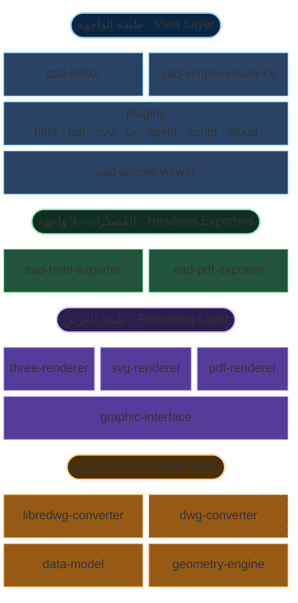

# نظرة عامة على البنية

يعمل MLightCAD بالكامل داخل المتصفح **دون أي اعتماد على خادم خلفي**. تُحلَّل ملفات DWG/DXF وتُعالَج محليًا باستخدام WebAssembly وJavaScript، مما يضمن:

- **عدم الحاجة إلى خادم** — انشره في أي مكان باستخدام استضافة الملفات الثابتة فقط
- **خصوصية كاملة للبيانات** — لا تغادر الملفات جهاز المستخدم أبدًا
- **دمج فوري** — لا حاجة إلى إعداد خلفي معقد أو تهيئة API
- **العمل دون اتصال** — يعمل بدون اتصال بالإنترنت

هذا المستودع هو monorepo من نوع TypeScript يعتمد على `pnpm` + `nx`. الحزم الرئيسية المتعلقة بالعرض والتحرير هي:

| الحزمة | المسؤولية |
| --- | --- |
| [`@mlightcad/cad-simple-viewer`](https://github.com/mlightcad/cad-viewer/tree/main/packages/cad-simple-viewer) | إدارة المستندات ومكدس الأوامر ومدير الإضافات ولوحة الرسم؛ **بدون اعتماد على إطار واجهة مستخدم** |
| [`@mlightcad/cad-editor`](https://github.com/mlightcad/cad-viewer/tree/main/packages/cad-editor) | واجهة Vue 3 كاملة فوق `cad-simple-viewer` (القوائم وRibbon وسطر الأوامر وشريط الحالة) |
| [`@mlightcad/cad-simple-viewer-cli`](https://github.com/mlightcad/cad-viewer/tree/main/packages/cad-simple-viewer-cli) | واجهة سطر أوامر بلا واجهة: تشغّل `cad-simple-viewer` داخل Playwright / Chromium لتنفيذ سكربتات `.scr` |
| [`@mlightcad/three-renderer`](https://github.com/mlightcad/cad-viewer/tree/main/packages/three-renderer) | عرض تفاعلي ثنائي/ثلاثي الأبعاد باستخدام THREE.js |
| `svg-renderer` ([`cad-svg-plugin`](https://github.com/mlightcad/cad-viewer/tree/main/packages/cad-svg-plugin)) | إخراج SVG متجهي عبر واجهة العرض نفسها |
| [`@mlightcad/pdf-renderer`](https://github.com/mlightcad/cad-viewer/tree/main/packages/pdf-renderer) | خلفية إخراج PDF متجهي عبر واجهة العرض نفسها |
| [`@mlightcad/cad-html-exporter`](https://github.com/mlightcad/cad-viewer/tree/main/packages/cad-html-exporter) / [`@mlightcad/cad-pdf-exporter`](https://github.com/mlightcad/cad-viewer/tree/main/packages/cad-pdf-exporter) | تصدير HTML / PDF بلا واجهة في Node (دون الحاجة إلى عارض داخل المتصفح) |
| `*-plugin` | ميزات اختيارية (واجهة، تصدير، سكربت، وكيل، مصادر بيانات سحابية)، تُحمَّل كسولًا بواسطة مدير الإضافات |

قاعدة الطبقات: `data-model` (خارجي) → محركات العرض → `cad-simple-viewer` → واجهة المستخدم / الإضافات / CLI. **يجب ألا تعتمد الحزم ذات المستوى الأدنى على الحزم ذات المستوى الأعلى.**

## البنية العامة

يُقسَّم النظام حسب المسؤولية إلى طبقات **النموذج** و**العرض** و**الواجهة**، إضافة إلى **مُصدِّرات بلا واجهة** قابلة للنشر بشكل مستقل وواجهة CLI تدفع نواة العارض نفسها.

تحافظ هذه البنية الطبقية على قابلية توسع MLightCAD عبر أحجام بيانات مختلفة وأهداف عرض وأشكال نشر (مكوّن متصفح أو CLI بلا واجهة أو تصدير Node خالص).

### طبقة النموذج

تعيش طبقة النموذج في المستودع المنفصل [`realdwg-web`](https://github.com/mlightcad/realdwg-web) وتُستهلك هنا كاعتماد خارجي:

- [`@mlightcad/data-model`](https://github.com/mlightcad/realdwg-web) يعرّف **Data Model** موحّدًا لبيانات CAD بعد التحليل (الكيانات الهندسية والطبقات ومعلمات العرض وغيرها).
- [`AcDbDatabaseConverter`](https://github.com/mlightcad/realdwg-web/blob/main/packages/data-model/src/database/AcDbDatabaseConverter.ts) يوفّر واجهة تحويل ملفات CAD موحّدة بحيث تنتج المحوّلات المختلفة نفس نموذج البيانات.
- [`@mlightcad/libredwg-converter`](https://github.com/mlightcad/realdwg-web) يوفّر تحليل DWG مفتوح المصدر مبنيًا على LibreDWG (WebAssembly) إلى ذلك النموذج. يجب على المضيف تسجيل المحوّل بنفسه (`cad-simple-viewer` لا يضمّن محلّل GPL).
- **`@mlightcad/dwg-converter`** وحدة تحليل DWG **تجارية مغلقة المصدر** تنفّذ نفس واجهة `AcDbDatabaseConverter` ويمكنها أن تحل محل `libredwg-converter` للحصول على توافق واكتمال أعلى. تُوزَّع بشكل خاص عبر GitHub Packages ولا تُنشر مفتوحة المصدر مع هذا المستودع. راجع [تثبيت واستخدام محوّل DWG الخاص](./install-and-use-proprietary-dwg-converter) للإعداد، و[PROPRIETARY-PARSER.md](https://github.com/mlightcad/cad-viewer/blob/main/PROPRIETARY-PARSER.md) للترخيص والتجربة.
- يتولى تحليل DXF مسار التحويل المدمج في `data-model` (كان تاريخيًا مبنيًا على [`@mlightcad/dxf-json`](https://github.com/mlightcad/dxf-json)).
- [`@mlightcad/geometry-engine`](https://github.com/mlightcad/realdwg-web) يوفّر الهندسة والرياضيات (نقاط وخطوط ومتعددات خطوط ومنحنيات spline ودوائر/أقواس وقطوع ناقصة ومتجهات ومصفوفات).

لماذا تعريف `AcDbDatabaseConverter`؟ أدوات DXF/DWG الحالية غالبًا غير مكتملة. المسار مفتوح المصدر يستخدم `libredwg-converter`؛ ولدقة أعلى يمكن تسجيل `dwg-converter` المغلق المصدر بدلًا منه دون تغيير كود العارض الأعلى. يمكن أيضًا تنفيذ نفس الواجهة فوق محركات تجارية مثل [ODA](https://www.opendesign.com/products/drawings).

### طبقة العرض

- [`@mlightcad/graphic-interface`](https://github.com/mlightcad/realdwg-web) (`realdwg-web`) يعرّف واجهة عرض الكيانات الموحّدة (`AcGiRenderer` وما يتصل بها).
- [`@mlightcad/three-renderer`](https://github.com/mlightcad/cad-viewer) ينفّذ هذه الواجهة باستخدام THREE.js للعرض التفاعلي على اللوحة (التجميع وتظليل أنواع الخطوط/التظليل وغيرها). هذا هو الخلفية الافتراضية لـ `cad-simple-viewer`.
- **`svg-renderer`** (`AcSvgRenderer`) ينفّذ الواجهة نفسها ويُخرج SVG قابلًا للتحجيم. التنفيذ الحالي موجود في [`@mlightcad/cad-svg-plugin`](https://github.com/mlightcad/cad-viewer/tree/main/packages/cad-svg-plugin) وتستخدمه أوامر مثل `csvg`؛ كما يعيد تصدير PDF المتجهي استخدام بعض قدرات الرسم فيه.
- [`@mlightcad/pdf-renderer`](https://github.com/mlightcad/cad-viewer) ينفّذ الواجهة نفسها ويُصدر تدفقات محتوى PDF متجهية؛ تستخدمه `cad-pdf-core` / `cad-pdf-plugin` / `cad-pdf-exporter`.

### طبقة الواجهة

- **`cad-simple-viewer`** هو النواة: دورة حياة المستند ومكدس الأوامر وإدخال المستخدم / jig والتنسيق مع `three-renderer` وآلية الإضافات **`AcApPluginManager`**. لا يوفّر واجهة تطبيق خارج اللوحة.
- **الإضافات** تُنشر كحزم npm مستقلة تنفّذ `AcApPlugin` وتُربَط عبر `registerLazyPlugin` / `loadPlugin`. تغطي الإضافات الرسمية تصدير HTML / PDF / SVG وواجهة بسيطة ووحدة تحكم سكربت ووكيل ذكاء اصطناعي وOneDrive / Google Drive وغيرها. راجع [نظام الإضافات](./plugin-system) و[الإضافات المدمجة](./built-in-plugins).
- **`cad-editor`** (كان سابقًا `@mlightcad/cad-viewer`، وأُعيدت تسميته في 1.8.0) يضيف واجهة Vue 3 كاملة فوق `cad-simple-viewer` ويسجّل الإضافات الكسولة الشائعة أثناء الإقلاع.
- **`cad-simple-viewer-cli`** يشغّل نواة العارض نفسها في Chromium بلا واجهة عبر Playwright وينفّذ سكربتات `.scr` بأسلوب AutoCAD (مثل `-chtml` / `-cpdf`)، وهو مناسب لـ CI وخدمات التحويل. راجع [إنشاء عارض ويب سحابي لملفات DWG](./cloud-dwg-web-viewer).

### المُصدِّرات بلا واجهة

تشارك إضافات المتصفح ومُصدِّرات Node مسارات التصدير في حزم `*-core` حتى لا يحتاج الخادم إلى تشغيل عارض كامل:

| المسار | النواة المشتركة | خلفية العرض | نقاط الدخول النموذجية |
| --- | --- | --- | --- |
| HTML | `@mlightcad/cad-html-core` | `three-renderer` (لقطة ثم تغليف) | المتصفح: `cad-html-plugin` (`chtml`)؛ Node: `cad-html-exporter` (`exportFileToHtml`) |
| PDF | `@mlightcad/cad-pdf-core` | `pdf-renderer` | المتصفح: `cad-pdf-plugin` (`cpdf`)؛ Node: `cad-pdf-exporter` (`exportFileToPdf`) |

حزم `*-core` **لا** تعتمد على `cad-simple-viewer` / DOM؛ وتتولى حزم `*-exporter` تحميل الخطوط وتسجيل DWG ودخل/خرج الملفات في Node. لقدرة سكربت الأوامر الكاملة (وليس فقط ملف → HTML/PDF) استخدم `cad-simple-viewer-cli`.

## محرك العرض

يطرح عرض DXF/DWG عدة تحديات:

- عرض عالي الأداء للرسومات ذات العدد الكبير من الكيانات
- إعادة إنتاج عرض نصوص AutoCAD
- دعم أنواع الخطوط وأنماط التظليل

### العرض عالي الأداء

في الرسومات الكبيرة يكون المفتاح دمج النقاط والخطوط والوجوه لتقليل **Draw Call**. يحل [BatchedMesh](https://threejs.org/docs/index.html?q=Mesh#api/en/objects/BatchedMesh) في THREE.js دمج المثلثات جزئيًا فقط ولا يدعم دمج النقاط/الخطوط. لذلك نفّذنا فئات تجميع مستوحاة من `BatchedMesh`؛ راجع [`packages/three-renderer/src/batch`](https://github.com/mlightcad/cad-viewer/tree/main/packages/three-renderer/src/batch).

### عرض النص

يستخدم AutoCAD [`MText`](https://ezdxf.mozman.at/docs/dxfinternals/entities/mtext.html) للنص الغني وخطوط [SHX](https://help.autodesk.com/view/OARX/2023/ENU/?guid=GUID-DE941DB5-7044-433C-AA68-2A9AE98A5713) المبنية على الخطوط للعرض الأسرع. الحزم ذات الصلة في مستودعات منفصلة:

- **تحليل MText** — [`@mlightcad/mtext-parser`](https://github.com/mlightcad/mtext-parser)
- **تحليل SHX** — [`@mlightcad/shx-parser`](https://github.com/mlightcad/shx-parser)
- **عرض MText** — [`@mlightcad/mtext-renderer`](https://github.com/mlightcad/mtext-renderer)؛ تُخزَّن الخطوط المحلَّلة في IndexedDB بالمتصفح لتجنب إعادة التنزيل والتحليل

لتصحيح عرض النص يمكن استخدام محرر النص الغني المبني على THREE.js [mtext-editor](https://github.com/mlightcad/mtext-editor).

### أنواع الخطوط وأنماط التظليل

يدعم AutoCAD أنواع خطوط وأنماط تظليل مخصصة. نفّذنا جزءًا منها. تستخدم أنواع الخطوط والتعبئة على اللوحة التفاعلية `ShaderMaterial` من THREE.js؛ راجع [`packages/three-renderer/src/style`](https://github.com/mlightcad/cad-viewer/tree/main/packages/three-renderer/src/style). يعيد مسار PDF المظهر المقابل بشكل متجهي في `pdf-renderer`.
