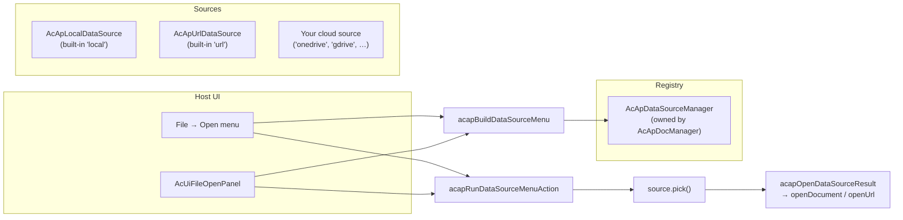

# إضافة مصدر البيانات

تشرح هذه الصفحة آلية **إضافة مصدر البيانات** في `@mlightcad/cad-simple-viewer` — الطبقة القابلة للتوصيل التي تقرر **من أين تأتي الرسومات** (القرص المحلي، عنوان URL عبر HTTP، OneDrive، Google Drive، …). وتغطي كيفية عمل الآلية، وكيفية إنشاء مصدر بيانات خاص بك، وكيفية تسجيله واستخدامه.

تعيش الآلية في `packages/cad-simple-viewer/src/app/dataSource`. ويُشحن تنفيذ مرجعي كامل كحزمة npm منفصلة: `@mlightcad/cad-onedrive-plugin` (`packages/cad-onedrive-plugin`)، ويستخدمها التطبيق التجريبي في `packages/cad-simple-viewer-example`.

> بالنسبة لـ **إضافات الأوامر** (أوامر التصدير مثل `cpdf` و`chtml`)، راجع [نظام الإضافات](./plugin-system). إضافة مصدر البيانات *هي* `AcApPlugin` — لكنها تستخدم `onLoad` لتسجيل مصدر بيانات بدلًا من أمر.

---

## نظرة عامة

**مصدر البيانات** كائن ينفّذ `AcApDataSource`: أصل قابل للتوصيل لرسومات CAD. لا تعرف نواة العارض شيئًا عن البائعين — فهي تعرف فقط السجل (`AcApDataSourceManager`) ومجموعة صغيرة من مساعدات القوائم. يبقى كل المنطق الخاص بالبائع (نوافذ تسجيل الدخول المنبثقة، منتقيات الملفات، التنزيلات) **داخل** مصدر البيانات.



قواعد التصميم الأساسية:

- **المضيفون ينسّقون فقط.** يجب على واجهة المستخدم المضيفة (قائمة Open في الشريط، `AcUiFileOpenPanel`، أشرطة الأدوات) أن تقتصر فقط على (1) سرد المصادر عبر `AcApDataSourceManager`، (2) بناء التسميات عبر `acapBuildDataSourceMenu`، (3) تشغيل النقرات عبر `acapRunDataSourceMenuAction` / `acapInvokeDataSourceMenuAction`. ويجب **ألا** تفتح منتقيات ملفات خاصة بالبائع أو تنزّل عناوين URL أو تعرض واجهة تسجيل دخول خاصة بمزوّد.
- **تسجيل الدخول والاختيار لا يُسلسَلان أبدًا.** تسمح المتصفحات بـ `window.open` فقط في لحظة إيماءة مستخدم مباشرة. إذا كان معالج النقر ينتظر (`await`) تسجيل دخول MSAL *ثم* يفتح نافذة منتقي منبثقة، فستُحجب النافذة الثانية. لذلك تعرض القائمة **تسجيل الدخول** و**فتح من …** كعنصرين منفصلين.
- **قوائم تكيّفية.** يوجّه `getAuthState()` ما تعرضه القائمة، فلا يحتاج المضيف إلى واجهة مستخدم خاصة بمزوّد.

---

## الأنواع الأساسية

جميع الأنواع أدناه مُصدَّرة من `@mlightcad/cad-simple-viewer`.

### `AcApDataSource`

الواجهة التي يجب أن ينفّذها كل مصدر بيانات:

| العضو | مطلوب | الوصف |
|--------|----------|-------------|
| `id` | ✓ | معرّف ثابت يُستخدم في القوائم والبحث في السجل (`local`، `url`، `onedrive`، …) |
| `labelKey` | ✓ | مفتاح i18n لاسم العرض (مثل `main.dataSource.onedrive`) |
| `icon?` | | سلسلة SVG مضمّنة اختيارية أو عنوان URL |
| `requiresAuth` | ✓ | ما إذا كان المصدر يحتاج مصادقة المستخدم |
| `requiresUserGesture` | ✓ | عندما تكون `true`، يجب أن يشغّل `pick()` الدالة `window.open` في لحظة النقر المباشرة (منتقيات ملفات السحابة) |
| `getAuthState()` | ✓ | يعيد `'none'` \| `'signed-out'` \| `'signed-in'` |
| `getAccountLabel?()` | | تسمية قصيرة للمسجّل الدخول للقوائم (البريد الإلكتروني / اسم العرض) |
| `getAccountProfile?()` | | `{ displayName, email?, avatarUrl? }` لصفحة الهبوط / واجهة الحساب |
| `restoreSession?()` | | استعادة جلسة مخزّنة مؤقتًا بعد التسجيل (حسابات MSAL والرموز و…). يجب استدعاء `notifyAuthChanged` عند الانتهاء حتى تتحدّث قوائم Open |
| `signIn()` | ✓ | تسجيل دخول تفاعلي. عملية لا تفعل شيئًا عندما تكون `requiresAuth` مساوية `false` |
| `signOut()` | ✓ | تسجيل خروج. عملية لا تفعل شيئًا عندما تكون `requiresAuth` مساوية `false` |
| `pick()` | ✓ | يفتح منتقي الملفات / الحوار الخاص بالمصدر، وينزّل عند الحاجة، ويعيد الرسم المختار — أو `null` عند إلغاء المستخدم |

### `AcApDataSourceFile`

نتيجة `pick()` الناجحة:

| الحقل | الوصف |
|-------|-------------|
| `name` | اسم الملف مع الامتداد (مثل `drawing.dwg`) |
| `content?` | بايتات الملف الخام (`ArrayBuffer`). تُستخدم عند حذف `url` |
| `url?` | عنوان URL بعيد يُفتح عبر `AcApDocManager.openUrl` (جلب HTTP مع التقدّم) |

فضّل `content` للبايتات الموجودة بالفعل في الذاكرة؛ وفضّل `url` عندما يجب فتح المصدر عبر `openUrl`.

### `AcApDataSourceManager`

السجل، مملوك لـ `AcApDocManager` (`AcApDocManager.instance.dataSourceManager`). يسجّل `AcApDocManager.createInstance()` المصدرين المدمجين تلقائيًا:

- `local` — `AcApLocalDataSource` (منتقي `<input type="file">` لـ `.dwg` / `.dxf`)
- `url` — `AcApUrlDataSource` (حوار URL، يُفتح عبر `openUrl`)

تسجّل إضافات السحابة نفسها في `AcApPlugin.onLoad` وتلغي التسجيل في `onUnload`.

| واجهة البرمجة | الوصف |
|-----|-------------|
| `register(source)` | تسجيل مصدر (يستبدل أي مصدر موجود بالمعرّف نفسه) |
| `unregister(id)` | إزالة مصدر بالمعرّف |
| `list()` | المصادر المسجّلة بترتيب التسجيل |
| `get(id)` | البحث عن مصدر بالمعرّف |
| `notifyAuthChanged(sourceId)` | تستدعيها إضافات السحابة بعد نجاح `signIn` / `signOut` |
| `on` / `off` | الاشتراك في حدثي `changed` و`auth-changed` |

---

## مساعدات القوائم

لا يصنع المضيفون قوائم Open يدويًا. تحدد ثلاثة مساعدات العقد:

### 1. `acapBuildDataSourceMenu(sources)`

يبني `AcApDataSourceMenuItem[]` من السجل الحالي. القواعد (آمنة تجاه حاجب النوافذ المنبثقة):

| حالة المصادقة | عناصر القائمة |
|------------|------------|
| لا تتطلب مصادقة (`'none'`) | عنصر **اختيار** واحد (مثل *ملف محلي*، *من URL*) |
| تتطلب مصادقة، **مسجّل الخروج** | عنصر **تسجيل دخول** واحد فقط (لا يُسلسَل أبدًا مع الاختيار) |
| تتطلب مصادقة، **مسجّل الدخول** | **اختيار** (*فتح من OneDrive*) + **تسجيل خروج** (*تسجيل الخروج من OneDrive (user@host)*) |

### 2. `acapRunDataSourceMenuAction(item, options?, manager?)`

يشغّل إجراء عنصر قائمة و**يفتح نتائج الاختيار تلقائيًا** (`acapOpenDataSourceResult`: `openUrl` عندما تكون `file.url` مضبوطة، وإلا `openDocument` مع `file.content`). استخدم هذا في قوائم Open داخل العارض. لا يسلسل تسجيل الدخول مع الاختيار أبدًا.

### 3. `acapInvokeDataSourceMenuAction(source, item)`

يشغّل الإجراء مقابل مصدر تم حله بالفعل **دون** فتح الملف. استخدم هذا في صفحات الهبوط التي تملك مدير مصدر بيانات قبل وجود `AcApDocManager`، أو عندما تريد فتح النتيجة بنفسك.

### الأدوات المساعدة

| المساعد | الغرض |
|--------|---------|
| `acapOpenCenteredPopup(name, width?, height?)` | يفتح نافذة منبثقة مسماة في وسط الشاشة — استخدمه داخل `pick()` حتى تُفتح النافذة في لحظة النقر نفسها |
| `acapWithDataSourceBusy(work, message?)` | يغلّف عمل التنزيل / ما بعد الاختيار في طبقة انشغال (مؤشر انشغال DocManager، أو `AcApProgress` مؤقت على `document.body` لصفحات الهبوط) |
| `acapOpenDataSourceResult(file, options?)` | يفتح نتيجة `pick()` عبر DocManager (`openUrl` / `openDocument`) |
| `acapIsSingleLocalOpen(sources)` | ما إذا كانت واجهة Open يجب أن تنهار إلى إجراء "فتح" واحد (المصدر المحلي المدمج فقط) |

---

## إنشاء إضافة مصدر بيانات

إضافة مصدر البيانات هي `AcApPlugin` عادية (راجع [نظام الإضافات](./plugin-system)) يسجّل `onLoad` فيها مصدر `AcApDataSource`. يحاكي تخطيط الحزمة الموصى به `cad-onedrive-plugin`:

```
my-cad-datasource-plugin/
  package.json          # name: @myorg/cad-my-datasource-plugin
  src/
    AcApMyDataSource.ts # implements AcApDataSource
    AcApMyPlugin.ts     # implements AcApPlugin, registers the source
    myClient.ts         # vendor API client (auth, picker, download)
    register.ts         # registerMyPlugin(pluginManager, options)
    index.ts            # public exports
```

**اصطلاحات `package.json`:**

- اضبط `"type": "module"`
- أدرج `@mlightcad/cad-simple-viewer` (و`@mlightcad/data-model` عند الحاجة) كـ **peerDependencies**
- ابنِ باستخدام `tsc` + `vite` مثل الإضافات الحالية

### الخطوة 1 — تنفيذ `AcApDataSource`

```typescript
import {
  type AcApDataSource,
  type AcApDataSourceAccountProfile,
  type AcApDataSourceAuthState,
  type AcApDataSourceFile,
  type AcApDataSourceManager,
  acapOpenCenteredPopup,
  acapWithDataSourceBusy
} from '@mlightcad/cad-simple-viewer'

/** Stable id used in menus and registry lookups. */
export const ACAP_MY_DATA_SOURCE_ID = 'mycloud'

export class AcApMyDataSource implements AcApDataSource {
  readonly id = ACAP_MY_DATA_SOURCE_ID
  readonly labelKey = 'main.dataSource.mycloud'
  readonly requiresAuth = true
  // true because pick() opens a File Picker popup via window.open
  readonly requiresUserGesture = true

  private readonly dataSourceManager: AcApDataSourceManager

  constructor(dataSourceManager: AcApDataSourceManager) {
    this.dataSourceManager = dataSourceManager
  }

  getAuthState(): AcApDataSourceAuthState {
    return this.client.isAuthenticated ? 'signed-in' : 'signed-out'
  }

  getAccountLabel(): string | undefined {
    return this.client.userInfo?.email
  }

  getAccountProfile(): AcApDataSourceAccountProfile | undefined {
    if (!this.client.isAuthenticated) return undefined
    const info = this.client.userInfo!
    return { displayName: info.name || info.email, email: info.email }
  }

  /** Restore cached tokens after registration so menus show signed-in state. */
  async restoreSession(): Promise<void> {
    await this.client.initialize()
    this.notifyAuthChanged()
  }

  async signIn(): Promise<void> {
    await this.client.authenticate()
    this.notifyAuthChanged()
  }

  async signOut(): Promise<void> {
    await this.client.signOut()
    this.notifyAuthChanged()
  }

  async pick(): Promise<AcApDataSourceFile | null> {
    // Open the popup in this click tick. Any `await` first loses the gesture.
    const popup = acapOpenCenteredPopup('MyCloudPicker', 1080, 680)
    if (!popup) {
      throw new Error('Popup blocked. Allow popups for this site and try again.')
    }
    try {
      await this.client.initialize()
      if (!this.client.isAuthenticated) {
        throw new Error('Sign in first, then choose a file (popup blocker).')
      }
      const picked = await this.client.openFilePicker(popup)
      const content = await acapWithDataSourceBusy(() =>
        this.client.downloadFile(picked)
      )
      return { name: picked.name, content }
    } catch (error) {
      try {
        if (!popup.closed) popup.close()
      } catch {
        // ignore
      }
      if (error instanceof Error && error.message === 'Picker cancelled') {
        return null // user cancelled — not an error
      }
      throw error
    }
  }

  private notifyAuthChanged(): void {
    this.dataSourceManager.notifyAuthChanged(this.id)
  }
}
```

ملاحظات التنفيذ:

- **يجب أن يفتح `pick()` النافذة المنبثقة بشكل متزامن** في لحظة النقر (`requiresUserGesture = true`). نفّذ أي `await` (تهيئة SDK، فحص المصادقة) *بعد* `window.open`.
- استدعِ `acapWithDataSourceBusy` حول التنزيلات حتى يحصل المستخدمون على تغذية راجعة للتقدّم في العارض وصفحات الهبوط.
- أرجِع `null` عند إلغاء المستخدم؛ وارمِ استثناءً عند الفشل الحقيقي.
- بعد تغيّر حالة المصادقة، استدعِ دائمًا `dataSourceManager.notifyAuthChanged(id)` حتى تتحدّث قوائم Open.
- بالنسبة للمصادر غير المنبثقة (مثل حوار داخل الصفحة)، اضبط `requiresUserGesture = false`.
- أضف `labelKey` الخاص بك (مثل `main.dataSource.mycloud`) إلى موارد i18n — راجع [الترجمة المحلية](./localization).

### الخطوة 2 — التغليف في `AcApPlugin`

```typescript
import {
  AcApContext,
  AcApDocManager,
  AcApPlugin,
  AcEdCommandStack
} from '@mlightcad/cad-simple-viewer'

import packageJson from '../package.json'
import { ACAP_MY_DATA_SOURCE_ID, AcApMyDataSource } from './AcApMyDataSource'

export class AcApMyPlugin implements AcApPlugin {
  name = 'MyDataSourcePlugin'
  version = packageJson.version
  description = 'Open DWG/DXF files from MyCloud'

  private source: AcApMyDataSource | null = null
  private createdSource = false

  onLoad(_context: AcApContext, _commandManager: AcEdCommandStack): void {
    const dsm = AcApDocManager.instance.dataSourceManager
    const existing = dsm.get(ACAP_MY_DATA_SOURCE_ID)
    if (existing) {
      // Already registered (e.g. HMR or double load) — just restore the session.
      void existing.restoreSession?.().catch(() => undefined)
      return
    }
    this.source = new AcApMyDataSource(dsm)
    this.createdSource = true
    dsm.register(this.source)
    // Restore cached session so File → Open shows Open/Sign out, not Sign in.
    void this.source.restoreSession().catch(() => undefined)
  }

  onUnload(_context: AcApContext, _commandManager: AcEdCommandStack): void {
    if (this.createdSource) {
      AcApDocManager.instance.dataSourceManager.unregister(ACAP_MY_DATA_SOURCE_ID)
    }
    this.source = null
    this.createdSource = false
  }
}
```

### الخطوة 3 — تصدير مساعد تسجيل

يجب أن تكون مصادر البيانات مرئية **فورًا** (تسردها قوائم Open قبل فتح أي مستند)، لذلك حمّلها فوريًا عبر `pluginManager.loadPlugin`:

```typescript
// src/register.ts
import type { AcApPluginManager } from '@mlightcad/cad-simple-viewer'

import { AcApMyPlugin } from './AcApMyPlugin'

export const MY_PLUGIN_NAME = 'MyDataSourcePlugin'

export async function registerMyPlugin(
  pluginManager: AcApPluginManager,
  options: { clientId: string; /* … */ }
): Promise<void> {
  if (!options.clientId) {
    throw new Error('registerMyPlugin requires options.clientId')
  }
  await pluginManager.loadPlugin(new AcApMyPlugin(options))
}
```

> يمكن أن تُستورد SDKs على طراز MSAL بشكل كسول *داخل* `signIn` / `pick` — التسجيل نفسه فقط يحتاج إلى أن يكون فوريًا.

---

## استخدام إضافة مصدر بيانات

### 1. تسجيلها في تطبيقك

استدعِ مساعد التسجيل بعد `AcApDocManager.createInstance()`:

```typescript
import { AcApDocManager } from '@mlightcad/cad-simple-viewer'
import { registerOneDrivePlugin } from '@mlightcad/cad-onedrive-plugin/register'

AcApDocManager.createInstance({ container: document.getElementById('cad-container')! })

await registerOneDrivePlugin(AcApDocManager.instance.pluginManager, {
  clientId: import.meta.env.VITE_MSAL_CLIENT_ID,
  tenantId: import.meta.env.VITE_MSAL_TENANT_ID || 'common',
  redirectUri: import.meta.env.VITE_MSAL_REDIRECT_URI // optional
})
```

أبقِ كعب التسجيل في الحزمة الأولية بالاستيراد من المسار الفرعي `/register` والاستيراد الديناميكي للباقي (راجع `packages/cad-simple-viewer-example/src/register.ts`):

```typescript
const { registerOneDrivePlugin } = await import('@mlightcad/cad-onedrive-plugin/register')
```

هذا كل ما يحتاجه التطبيق عند استخدام واجهة المستخدم المدمجة (الشريط / شريط الأدوات / `AcUiFileOpenPanel`): تُعاد قائمة Open بناؤها من `dataSourceManager` وتعرض الآن، على سبيل المثال:

| حالة المصادقة | عناصر القائمة |
|------------|------------|
| مسجّل الخروج | تسجيل الدخول إلى OneDrive |
| مسجّل الدخول | فتح من OneDrive، تسجيل الخروج من OneDrive (user@contoso.com) |

### 2. واجهة مستخدم مضيفة مخصصة (قائمة داخل العارض)

إذا بنيت قائمة Open الخاصة بك، فاستخدم المساعدات — ولا تستدعِ `signIn` / `pick` مباشرةً:

```typescript
import {
  AcApDocManager,
  acapBuildDataSourceMenu,
  acapRunDataSourceMenuAction
} from '@mlightcad/cad-simple-viewer'

const dsm = AcApDocManager.instance.dataSourceManager

function rebuildOpenMenu() {
  const items = acapBuildDataSourceMenu(dsm.list())
  renderMenu(items, item => {
    void acapRunDataSourceMenuAction(item, openOptions)
  })
}

rebuildOpenMenu()
dsm.on('changed', rebuildOpenMenu)
dsm.on('auth-changed', rebuildOpenMenu)
```

### 3. صفحات الهبوط (قبل وجود العارض)

غالبًا ما تتيح صفحات الهبوط للمستخدمين اختيار ملف قبل إنشاء `AcApDocManager`. `AcUiFileOpenPanel` ينفّذ هذا النمط بالفعل: مرّر `onDataSourceAction` وشغّل العنصر بمجرد أن يصبح العارض جاهزًا. عندما تستدعي واجهة الهبوط الخاصة بك مصدرًا مباشرةً، استخدم `acapInvokeDataSourceMenuAction` + `acapOpenDataSourceResult`:

```typescript
import { acapInvokeDataSourceMenuAction, acapOpenDataSourceResult } from '@mlightcad/cad-simple-viewer'

const source = myDataSourceManager.get('onedrive') // or the built-in 'local' / 'url'
const file = await acapInvokeDataSourceMenuAction(source, menuItem)
if (file) {
  await acapOpenDataSourceResult(file, openOptions)
}
```

**مأزق إيماءة المستخدم** (من `cad-simple-viewer-example/src/main.ts`): إذا كان معالج النقر يجب أن ينتظر (`await`) تهيئة العارض قبل تشغيل إجراء `pick`، فستفقد إيماءة المستخدم وتُحجب النافذة المنبثقة. إما أن تشغّل الإجراء بشكل متزامن عندما يكون التهيئة مكتملًا، أو أن تعرض تلميحًا *سجّل الدخول أولًا، ثم افتح* لعناصر `pick` (راجع `handleDataSourceMenuAction` في التطبيق النموذجي).

---

## مرجع واقعي: OneDrive

`@mlightcad/cad-onedrive-plugin` هو مصدر بيانات السحابة المرجعي:

| الجزء | الملف | ما يفعله |
|-------|------|--------------|
| `AcApOneDriveDataSource` | `src/AcApOneDriveDataSource.ts` | ينفّذ `AcApDataSource` فوق Microsoft File Picker v8 + MSAL؛ يفتح `pick` النافذة المنبثقة بشكل متزامن، ثم ينزّل تحت طبقة انشغال |
| `AcApOneDrivePlugin` | `src/AcApOneDrivePlugin.ts` | `AcApPlugin` يسجّل/يلغي تسجيل المصدر ويستعيد جلسة MSAL المخزّنة مؤقتًا عند التحميل |
| `OneDriveClient` | `src/oneDriveClient.ts` | مصادقة MSAL + مراسلات File Picker v8 + تنزيل Graph |
| `registerOneDrivePlugin` | `src/register.ts` | مساعد تسجيل فوري (يتحقق من `clientId`) |
| `createOneDrivePlugin` | `src/createOneDrivePlugin.ts` | مصنع غير متزامن لنسخة الإضافة |

يوصّل التطبيق النموذجي ذلك عبر إعداد البيئة (`packages/cad-simple-viewer-example/src/onedriveEnv.ts`): عندما تكون `VITE_MSAL_CLIENT_ID` مضبوطة، يسجّل `registerOneDriveFromEnv` الإضافة؛ وتسرد لوحة الهبوط عنصر *تسجيل الدخول إلى OneDrive* عبر `extraMenuItems` في `AcUiFileOpenPanel`.

**إعداد تطبيق Azure** (لـ OneDrive): سجّل **تطبيق صفحة واحدة (Single-page application)** في Microsoft Entra ID، وأضف URI لإعادة التوجيه يطابق أصل تطبيقك، وامنح أذونات Graph المفوَّضة `User.Read` + `Files.Read.All` (رموز منتقي OneDrive الشخصي تغطي أيضًا `OneDrive.ReadOnly`).

---

## استكشاف الأخطاء وإصلاحها

| العرض | السبب المحتمل |
|---------|----------------|
| المصدر مفقود من قائمة Open | الإضافة غير مسجّلة، أو سُجّلت قبل `AcApDocManager.createInstance()` / بعد التدمير؛ أو استبدل `register` مصدرًا موجودًا بالمعرّف نفسه |
| نافذة المنتقي محجوبة | انتظر `pick()` (`await`) قبل `window.open`، أو سُلسِل تسجيل الدخول مع الاختيار في معالج النقر نفسه |
| لا تزال القائمة تعرض *تسجيل الدخول* بعد تسجيل الدخول | لم يُستدعَ `notifyAuthChanged` بعد تغيّر حالة المصادقة؛ أو لم يُستدعَ `restoreSession` عند التحميل |
| لا تتحدّث القائمة بعد التسجيل/إلغاء التسجيل | خزّن المضيف قائمة العناصر مؤقتًا بدلًا من إعادة بنائها عند حدثي `changed` / `auth-changed` |
| يتوقف التنزيل دون تغذية راجعة | التنزيل غير مغلّف في `acapWithDataSourceBusy` |
| الملف المفتوح ليس فيه بايتات ولا URL | أعاد `pick()` ملفًا ليس فيه `content` ولا `url` |

---

## وثائق ذات صلة

- [نظام الإضافات](./plugin-system) — `AcApPlugin`، تسجيل الأوامر، التحميل الكسول
- [دمج Simple Viewer](./integrate-simple-cad-viewer) — تضمين `cad-simple-viewer`
- [الترجمة المحلية](./localization) — إضافة مفاتيح i18n مثل `main.dataSource.*`
- [نظرة عامة على البنية](./architecture-overview) — تخطيط الوحدات
