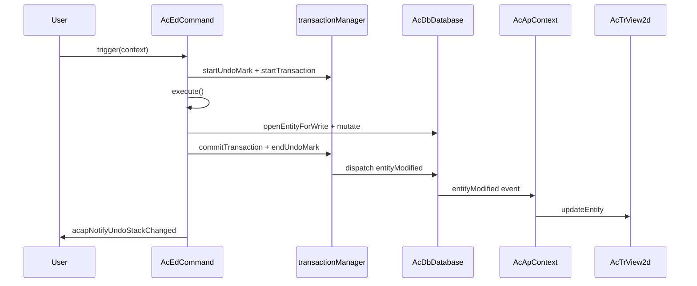

# أفضل ممارسات تعديل الكيانات

تشرح هذه الصفحة كيفية تعديل كيانات الرسم في **MLightCAD** بحيث تُتتبَّع التغييرات بشكل صحيح، ويعمل **التراجع/الإعادة** كما هو متوقع، ويبقى **العرض متزامنًا** مع قاعدة البيانات.

تأتي طبقة قاعدة البيانات من [`@mlightcad/data-model`](https://github.com/mlightcad/realdwg-web). ويضيف MLightCAD مساعدات تطبيقية ويربط أحداث قاعدة البيانات بمحرك العرض.

---

## نظرة عامة

يتبع تعديل الكيان الصحيح ثلاث طبقات:

| الطبقة | المسؤولية |
|-------|----------------|
| **قاعدة البيانات** (`AcDbDatabase`) | تخزّن الكيانات وتسجّل التغييرات |
| **المعاملة / التراجع** (`transactionManager`) | تجمّع التغييرات وتدعم التراجع/الإعادة |
| **العرض** (`AcTrView2d`) | يعرض الهندسة؛ ويُحدَّث عبر أحداث قاعدة البيانات |

**قاعدة عملية:** عدّل قاعدة البيانات عبر واجهات API المعاملات. ودع `AcApContext` ينشر التغييرات إلى العرض. لا تستدعِ `view.updateEntity()` بعد تعديل عادي في قاعدة البيانات إلا في حالة خاصة (مثل هندسة معاينة مؤقتة).

---

## آلية المعاملات

يدير `AcDbDatabase.transactionManager` (`AcDbDatabaseTransactionManager`) المعاملات وسجل التراجع لرسم واحد. ويتبع تصميمه دلالات `AcDbTransactionManager` في AutoCAD ObjectARX.

### واجهات API الأساسية

| API | الغرض |
|-----|---------|
| `startTransaction()` | بدء تسجيل التغييرات |
| `commitTransaction()` | إنهاء المعاملة الحالية وإرسال الأحداث |
| `abortTransaction()` | التراجع عن جميع التغييرات في المعاملة الحالية |
| `hasTransaction()` | يعيد ما إذا كانت هناك معاملة نشطة |
| `isRecording()` | يعيد ما إذا كانت التغييرات تُسجَّل (false أثناء إعادة تشغيل التراجع/الإعادة) |
| `openEntityForWrite(id \| entity)` | يفتح كيانًا للكتابة **عبر** المعاملة النشطة |

### ما الذي يُسجَّل

طالما كان `isRecording()` صحيحًا، يسجّل مدير المعاملات:

- **تغييرات الخصائص** على كائنات قاعدة البيانات (`kind: 'modify'`)
- **إلحاق / إزالة** الكائنات في سجلات جدول الكتل أو جداول الرموز أو القواميس
- تغييرات **متغيرات النظام**

عندما تُثبَّت المعاملة الخارجية، تُنهى التغييرات المسجّلة وتُرسل أحداث قاعدة البيانات ذات الصلة.

### المعاملات المتداخلة

يمكن أن تتداخل المعاملات. تدمج المعاملات الداخلية مسجّلها في المعاملة الأب. فقط **`commitTransaction()` الخارجية** ترسل الأحداث وتضيف سجل التراجع إلى قائمة الانتظار.

### فتح الكائنات للكتابة

استخدم دائمًا `database.openEntityForWrite(...)` (أو `openObjectForWrite`) بدلًا من تعديل مرجع كيان مخزَّن مؤقتًا مباشرة:

```typescript
const opened = db.openEntityForWrite(entityOrObjectId)
if (!opened) return
opened.color = newColor
```

عندما تكون هناك معاملة نشطة، يوجّه `openEntityForWrite` الكائن عبر المعاملة حتى يُتتبَّع التغيير. وبدون معاملة نشطة، يعود المساعد إلى بحث مباشر وقد يكون التغيير **غير قابل للتراجع**.

### الوضع الصارم

يمكن لـ `transactionManager.strictMode` (افتراضي في data-model) أن يفرض حدوث جميع التغييرات داخل معاملة نشطة. ويُستثنى إعادة تشغيل التراجع/الإعادة حتى يتمكن مطبّق التغييرات من استعادة الحالة. عمليًا، تنشئ أوامر MLightCAD و`acapRunDatabaseEdit` دائمًا معاملة قبل التعديل.

---

## آلية التراجع / الإعادة

يُبنى التراجع/الإعادة على **علامات التراجع** و**سجلات التراجع**.

### علامات التراجع

| API | الغرض |
|-----|---------|
| `startUndoMark(label?)` | يفتح مجموعة؛ تصبح عمليات التثبيت المتعددة داخل العلامة الواحدة **خطوة واحدة** في التراجع |
| `endUndoMark()` | يغلق المجموعة ويضيف سجل تراجع عند وجود تغييرات |
| `cancelUndoMark()` | يتجاهل المجموعة دون إنشاء سجل تراجع |

### عمليات التراجع / الإعادة

| API | الغرض |
|-----|---------|
| `undo()` | يعكس أحدث سجل تراجع |
| `redo()` | يعيد تطبيق أحدث سجل تم التراجع عنه |
| `canUndo()` / `canRedo()` | يستعلم عن حالة المكدسات |
| `clearUndoStack()` | يمسح كلا المكدسين |

عند تشغيل التراجع أو الإعادة، يعيد `AcDbChangeApplier` تشغيل التغييرات المخزنة بالترتيب الأمامي أو العكسي ويرسل أحداث الكيانات المناسبة حتى يتحدّث العرض تلقائيًا.

### كيف تحصل الأوامر على التراجع تلقائيًا

يغلّف `AcEdCommand.trigger()` تنفيذ الأمر في علامة تراجع واحدة ومعاملة واحدة عندما يكون تسجيل التراجع مفعّلًا:

```typescript
// AcEdCommand.trigger() — simplified
if (recordUndo) {
  tm.startUndoMark(this.globalName || this.localName)
  tm.startTransaction()
}
try {
  await this.execute(context)
} catch (error) {
  if (undoTransactionActive) {
    tm.abortTransaction()
    tm.cancelUndoMark()
  }
  throw error
} finally {
  if (undoTransactionActive) {
    tm.commitTransaction()
    tm.endUndoMark()
    acapNotifyUndoStackChanged()
  }
}
```

يُفعَّل تسجيل التراجع عندما تكون **جميع** الشروط التالية صحيحة:

- `command.recordsUndoStack === true` (افتراضي)
- `context.doc.openMode >= AcEdOpenMode.Review`
- `command.mode >= AcEdOpenMode.Review`

عيّن `recordsUndoStack = false` للأوامر الوصفية التي لا ينبغي أن تنشئ خطوة تراجع خاصة بها (مثل `AcApUndoCmd` و`AcApRedoCmd`).

### إشعار واجهة المستخدم

بعد تغيّر إمكانية التراجع/الإعادة، استدعِ `acapNotifyUndoStackChanged()` من `@mlightcad/cad-simple-viewer`. فذلك يصدر `undo-stack-changed` على ناقل الأحداث العام حتى تتمكن مكوّنات مثل `useUndoRedo` من تحديث حالة شريط الأدوات.

الأوامر التي تمر عبر `AcEdCommand.trigger()` تستدعي هذا تلقائيًا عند التثبيت الناجح. كما تُشعر التعديلات المستقلة عبر `acapRunDatabaseEdit` المستمعين عند إنشاء علامة تراجع جديدة.

---

## الأحداث المتعلقة بالكيانات

يكشف `AcDbDatabase.events` عن إشعارات قاعدة البيانات الرئيسية:

| الحدث | متى يُطلق |
|-------|----------------|
| `entityAppended` | إضافة كيان إلى مساحة النموذج/الورقة |
| `entityModified` | تغيّر خصائص الكيان أو هندسته |
| `entityErased` | إزالة كيان من الرسم |
| `layerAppended` | إنشاء طبقة جديدة |
| `layerModified` | تغيّر سمات الطبقة |
| `layerErased` | إزالة طبقة |
| `dictObjetSet` | تخزين كائن في قاموس مسمّى |
| `dictObjectErased` | إزالة كائن من قاموس |

### حمولة الحدث

يحتوي `AcDbEntityEventArgs` على:

- `database` — قاعدة البيانات المصدر
- `entity` — كيان واحد أو مصفوفة كيانات

يوسّع MLightCAD أحداث التعديل بحقل `changes` اختياري (`AcDbEntityModifiedEventArgs` في `AcApEntityUpdate`) حتى يتمكن العرض من تطبيق تحديثات خفيفة (مثل تبديل الظهور فقط) دون إعادة بناء الهندسة.

### تزامن العرض

يشترك `AcApContext` في أحداث الكيانات ويبقي العرض متوافقًا:

- `entityAppended` → `view.addEntity(...)`
- `entityModified` → `view.updateEntity(...)` (أو `updateEntityVisibility` للتغييرات المتعلقة بالظهور فقط)
- `entityErased` → `view.removeEntity(...)`

بسبب هذا الربط، **لا ينبغي لشيفرة التطبيق عادةً تحديث المشهد يدويًا** بعد تعديل مثبَّت في قاعدة البيانات.

### تجميع الأحداث

يكتم `database.beginEventBatch()` / `endEventBatch()` الأحداث ويدمجها أثناء العمليات الكبيرة. وتُفرِّغ `endEventBatch()` الخارجية إشعارات `entityAppended` و`entityErased` و`entityModified` المتراكمة. فُضّل التجميع عند استيراد رسومات كبيرة أو إعادة إنشائها.

### الاستماع من واجهة المستخدم أو الإضافات

يمكنك الاشتراك في الأحداث نفسها للوحات الخصائص أو حالة الشريط أو الأدوات المخصصة:

```typescript
const db = AcApDocManager.instance.curDocument.database

const onModified = (args: AcDbEntityEventArgs) => {
  // React to entity changes
}

db.events.entityModified.addEventListener(onModified)

// Remember to remove the listener on teardown
db.events.entityModified.removeEventListener(onModified)
```

---

## تعديل الكيانات داخل أمر

لأوامر التحرير التفاعلية (Move وRotate وErase وDraw وغيرها)، ورّث من `AcEdCommand` ونفّذ جميع التغييرات الدائمة داخل `execute()`.

### قائمة التحقق

1. **عيّن وضع الأمر** — استخدم `AcEdOpenMode.Review` لأوامر التعديل أو `AcEdOpenMode.Write` لأوامر الإنشاء حتى يُسمح بتسجيل التراجع.
2. **أبقِ `recordsUndoStack` على `true`** إلا إذا كان الأمر هو التراجع/الإعادة نفسه.
3. **لا** تستدعِ `startTransaction()` / `commitTransaction()` يدويًا — فـ `trigger()` يغلّف طريقة `execute()` الخاصة بك بالفعل.
4. **افتح الكيانات للكتابة** قبل تغيير الهندسة أو الخصائص.
5. **استخدم jigs للمعاينة فقط** — حدّث الهندسة المؤقتة في jig؛ وثبّت في قاعدة البيانات بمجرد تأكيد المستخدم.

### مثال: أمر النقل

`AcApMoveCmd` هو النمط المرجعي لتعديلات الهندسة:

```typescript
export class AcApMoveCmd extends AcEdCommand {
  constructor() {
    super()
    this.mode = AcEdOpenMode.Review
  }

  async execute(context: AcApContext) {
    // ... selection and point prompts ...

    const matrix = new AcGeMatrix3d().makeTranslation(dx, dy, dz)
    sourceEntities.forEach(entity => {
      const opened = context.doc.database.openEntityForWrite(entity)
      if (!opened) return
      opened.transformBy(matrix)
    })
  }
}
```

### مثال: أمر المسح

```typescript
private eraseEntities(db: AcDbDatabase, objectIds: AcDbObjectId[]) {
  objectIds.forEach(objectId => {
    const entity = db.openEntityForWrite(objectId)
    entity?.erase()
  })
}
```

### مثال: أمر الإنشاء

ألحق كيانات جديدة عبر سجلات جدول الكتل داخل `execute()`. وتسجّل معاملة الأمر النشطة عملية الإلحاق:

```typescript
const segment = new AcDbLine(startPoint, endPoint)
db.tables.blockTable.modelSpace.appendEntity(segment)
```

سيضيف `entityAppended` الكيان إلى العرض. ويُعدّ استدعاء `view.addEntity` إضافةً اختياريًا يُستخدم أساسًا في بعض أوامر الرسم للحصول على تغذية راجعة فورية؛ فمسار الأحداث هو آلية المزامنة المعتمدة.

### المعاينة مقابل التثبيت (jigs)

أثناء الإدخال التفاعلي، **لا** تكتب تحويلات المعاينة إلى قاعدة البيانات. استخدم jig (مثل `AcApMovePreviewJig`) لتحويل هندسة المعاينة المؤقتة أو المقيمة على GPU. وبعد تأكيد المستخدم فقط، استدعِ `openEntityForWrite` وطبّق التغيير النهائي.

### معالجة الأخطاء

إذا رمى `execute()` استثناءً، يُلغي `AcEdCommand.trigger()` المعاملة ويلغي علامة التراجع. ولا تحتاج إلى منطق تراجع إضافي في معظم الأوامر.

---

## تعديل الكيانات خارج أمر

معالجات الشريط وتحرير المقابض ومحررات النصوص المضمّنة واستدعاءات الحوارات **ليست** مغلّفة بـ `AcEdCommand.trigger()`. استخدم مساعد التطبيق:

### `acapRunDatabaseEdit`

```typescript
import { acapRunDatabaseEdit } from '@mlightcad/cad-simple-viewer'

acapRunDatabaseEdit(db, 'Color', () => {
  const entity = db.openEntityForWrite(objectId)
  if (!entity) return
  entity.color = newColor
})
```

هذه الدالة:

1. تُفوّض إلى `db.runDatabaseEdit(label, fn)` في data-model
2. تنشئ **علامة تراجع واحدة** عبر `transactionManager.runUndoable` عندما لا يكون التسجيل جاريًا بالفعل
3. **تتخطى** علامة تراجع متداخلة عند استدعائها من داخل معاملة أمر نشطة
4. تستدعي `acapNotifyUndoStackChanged()` عند إنشاء سجل تراجع جديد

استخدم `label` قصيرًا موجّهًا للمستخدم (مثل `'Grip Edit'` أو `'Hatch Properties'` أو `'Replace Image'`) — فهو يحدد الخطوة في سجل التراجع.

### متى تستخدم أي API

| السيناريو | API الموصى به |
|----------|-----------------|
| أمر CAD تفاعلي | ورّث من `AcEdCommand`؛ عدّل في `execute()` |
| تثبيت سحب المقبض | `acapRunDatabaseEdit` |
| الشريط / لوحة الخصائص | `acapRunDatabaseEdit` |
| معالج OK في حوار | `acapRunDatabaseEdit` |
| دفعة برمجية خارج واجهة المستخدم | `db.runDatabaseEdit` أو `transactionManager.runUndoable` |
| من داخل `execute()` لأمر بالفعل | `openEntityForWrite` / `appendEntity` مباشرة (المعاملة نشطة بالفعل) |

### مثال: جلسة تحرير المقبض

```typescript
acapRunDatabaseEdit(db, 'Grip Edit', () => {
  const entity = db.openEntityForWrite(this._entity)
  if (!entity) return
  entity.subMoveGripPointsAt([gripIndex], offset)
})
```

### مثال: تغيير اللون من الشريط

```typescript
acapRunDatabaseEdit(db, 'Color', () => {
  db.cecolor = value
  selectedIds.forEach(id => {
    const entity = db.openEntityForWrite(id)
    if (entity) entity.color = value
  })
})
```

### بديل أدنى مستوى

إذا كنت تبني شيفرة مكتبة فوق data-model فقط (دون واجهة MLightCAD)، استدعِ:

```typescript
db.runDatabaseEdit('My Operation', () => {
  // openEntityForWrite + mutations
})
```

أو:

```typescript
db.transactionManager.runUndoable('My Operation', () => {
  // mutations
})
```

تذكّر أن تستدعي `acapNotifyUndoStackChanged()` بنفسك عند التكامل مع واجهة MLightCAD.

---

## أخطاء شائعة

| الخطأ | سبب فشله | الحل |
|---------|--------------|-----|
| تعديل `entity.color = ...` على مرجع قديم | يتجاوز تسجيل المعاملة | `openEntityForWrite` ثم التعديل |
| استدعاء `view.updateEntity` بعد كل تعديل | يكرر العمل؛ وقد يتعارض مع التحديثات المدفوعة بالأحداث | اعتمد على `entityModified` إلا عند المعاينة |
| الكتابة إلى قاعدة البيانات داخل `update()` في jig | ينشئ ضوضاء في التراجع وتثبيتات بطيئة | عاين مؤقتًا؛ وثبّت مرة واحدة عند التأكيد |
| مكدسات تراجع يدوية (مصفوفات مخصصة من النسخ) | تتجاوز التراجع/الإعادة الموحّد؛ وتُفسد الدمج | استخدم `transactionManager` |
| نسيان `acapRunDatabaseEdit` خارج الأوامر | قد لا تكون التغييرات قابلة للتراجع | غلّف التعديلات في `acapRunDatabaseEdit` |
| ضبط `recordsUndoStack = false` في أوامر تعديل عادية | لا يستطيع المستخدم التراجع عن العملية | أبقِ القيمة الافتراضية `true` |

---

## التدفق من البداية إلى النهاية



للتعديلات خارج الأوامر، استبدل `AcEdCommand.trigger` بـ `acapRunDatabaseEdit`؛ فمسار الحدث والعرض هو نفسه.

---

## صفحات ذات صلة

- [الأمر](./command) — دورة حياة الأمر وتسجيله
- [نظام Jig](./jig-system) — معاينة تفاعلية دون كتابة في قاعدة البيانات
- [أساسيات MLightCAD](./cad-viewer-basics) — مفاهيم المستند وقاعدة البيانات والعرض
- [نظرة عامة على البنية](./architecture-overview) — كيفية ترابط الوحدات
