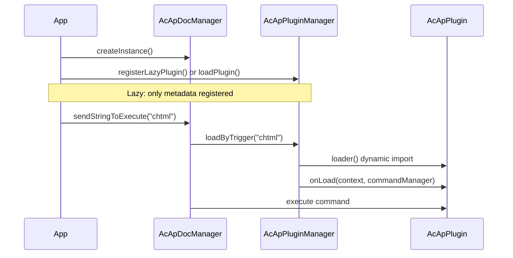

# نظام الإضافات

تشرح هذه الصفحة كيفية بناء **إضافة** لـ MLightCAD وتسجيلها واستخدامها. تُوسّع الإضافات العارض عبر تسجيل الأوامر والوصول إلى المستند والعرض النشطين والتنظيف عند إلغاء التحميل.

يعيش نظام الإضافات في `@mlightcad/cad-simple-viewer` (`packages/cad-simple-viewer/src/plugin`). تُشحن الإضافات الرسمية (واجهة المستخدم، وكيل الذكاء الاصطناعي، وحدة تحكم النصوص، تصدير HTML/PDF/SVG، مصادر بيانات OneDrive/Google Drive) كحزم npm منفصلة — راجع [الإضافات المدمجة](./built-in-plugins) للقائمة الكاملة.

---

## نظرة عامة

الإضافة وحدة صغيرة تنفّذ `AcApPlugin`. **مدير الإضافات** (`AcApPluginManager`) مملوك لـ `AcApDocManager` وهو:

- يستدعي `onLoad()` عند تحميل إضافة (تسجيل الأوامر والخطافات وغيرها)
- يستدعي `onUnload()` عند إزالة إضافة (إلغاء تسجيل الأوامر وتحرير الموارد)
- يدعم **التسجيل الكسول**: لا تُنزَّل شيفرة الإضافة حتى يشغّل المستخدم **أمر تشغيل**



---

## الأنواع الأساسية

### `AcApPlugin`

يجب على كل إضافة توفير:

| الحقل / الطريقة | الوصف |
|----------------|-------------|
| `name` | معرّف فريد (مطلوب). يجب أن يطابق `name` في التسجيل الكسول عند استخدام التحميل الكسول. |
| `version?` | سلسلة إصدار اختيارية |
| `description?` | وصف اختياري مقروء للبشر |
| `onLoad(context, commandManager)` | تسجيل الأوامر وتهيئة الموارد |
| `onUnload(context, commandManager)` | إزالة الأوامر وتحرير الموارد |

`context` هو `AcApContext` (`doc` و`view` الحاليان). `commandManager` هو `AcEdCommandStack` — المكدس نفسه الذي تستخدمه الأوامر المدمجة.

التنفيذ المرجعي: `AcApExamplePlugin` في `packages/cad-simple-viewer/src/plugin/AcApPluginExample.ts`.

### `AcApLazyPluginRegistration`

لتقسيم الشيفرة، سجّل واصفًا بدلًا من تحميل الإضافة فورًا:

| الحقل | الوصف |
|-------|-------------|
| `name` | يجب أن يساوي `AcApPlugin.name` الذي يعيده `loader` |
| `triggers` | أسماء الأوامر التي تحمّل هذه الإضافة (غير حساسة لحالة الأحرف) |
| `loader` | مصنع غير متزامن يعيد نسخة إضافة |

---

## الخطوة 1 — تنفيذ أمر

تعرض الإضافات عادةً أمرًا واحدًا أو أكثر. وسّع `AcEdCommand` ونفّذ `execute(context)`:

```typescript
import { AcApContext, AcEdCommand } from '@mlightcad/cad-simple-viewer'

export class AcApMyExportCmd extends AcEdCommand {
  async execute(context: AcApContext) {
    const fileName = context.doc.fileName || context.doc.docTitle
    // ... export logic using context.doc.database, context.view, etc.
  }
}
```

راجع [الأوامر](./command) للمطالبات والوصول إلى المحرر وإنشاء الكيانات.

---

## الخطوة 2 — تنفيذ `AcApPlugin`

تتبّع كل أمر تسجّله حتى يتمكن `onUnload` من إزالته:

```typescript
import {
  AcApContext,
  AcApPlugin,
  AcEdCommandStack
} from '@mlightcad/cad-simple-viewer'

import { AcApMyExportCmd } from './AcApMyExportCmd'

export class AcApMyPlugin implements AcApPlugin {
  name = 'MyPlugin'
  version = '1.0.0'
  description = 'My custom export command'

  private registeredCommands: Array<{ group: string; name: string }> = []

  onLoad(_context: AcApContext, commandManager: AcEdCommandStack): void {
    const group = AcEdCommandStack.SYSTEMT_COMMAND_GROUP_NAME
    commandManager.addCommand(group, 'myexport', 'myexport', new AcApMyExportCmd())
    this.registeredCommands.push({ group, name: 'myexport' })
  }

  onUnload(_context: AcApContext, commandManager: AcEdCommandStack): void {
    for (const cmd of this.registeredCommands) {
      commandManager.removeCmd(cmd.group, cmd.name)
    }
    this.registeredCommands = []
  }
}
```

تتبع الإضافات الرسمية النمط نفسه:

- `AcApHtmlPlugin` — يسجّل `chtml`
- `AcApPdfPlugin` — يسجّل `cpdf` و`ipdf`
- `AcApSvgPlugin` — يسجّل `csvg`

استخدم `AcEdCommandStack.SYSTEMT_COMMAND_GROUP_NAME` للأوامر على مستوى العارض (المجموعة نفسها المستخدمة في التكبير والطبقات وغيرها).

---

## الخطوة 3 — النشر كحزمة npm (اختياري)

حاكِ بنية `cad-html-plugin` أو `cad-pdf-plugin` أو `cad-svg-plugin`:

```
my-cad-plugin/
  package.json          # name: @myorg/cad-my-plugin
  src/
    AcApMyPlugin.ts
    AcApMyExportCmd.ts
    registerLazyMyPlugin.ts
    index.ts            # public exports
```

**اصطلاحات `package.json`:**

- اضبط `"type": "module"`
- أدرج `@mlightcad/cad-simple-viewer` كـ **peerDependency** (وغيرها من المكتبات المشتركة مثل `@mlightcad/data-model` و`three` إذا لزم الأمر)
- ابنِ باستخدام `tsc` + `vite` مثل الإضافات الحالية
- صدّر المساعدات من `src/index.ts`: فئة الإضافة، `createMyPlugin`، `registerLazyMyPlugin`، ثوابت التشغيل

**وحدة التحميل الكسول** (`registerLazyMyPlugin.ts`):

```typescript
import type { AcApPluginManager } from '@mlightcad/cad-simple-viewer'

export const MY_PLUGIN_NAME = 'MyPlugin'
export const MY_PLUGIN_TRIGGERS = ['myexport'] as const

export async function createMyPlugin() {
  const { AcApMyPlugin } = await import('./AcApMyPlugin')
  return new AcApMyPlugin()
}

export function registerLazyMyPlugin(pluginManager: AcApPluginManager): void {
  pluginManager.registerLazyPlugin({
    name: MY_PLUGIN_NAME,
    triggers: [...MY_PLUGIN_TRIGGERS],
    loader: createMyPlugin
  })
}
```

يبقي `import('./AcApMyPlugin')` الديناميكي حزمة الإضافة الثقيلة خارج الحزمة الأولية حتى يُشغَّل `myexport`.

---

## تسجيل الإضافات

هناك أربعة مسارات تسجيل شائعة. اختر واحدًا بناءً على حاجتك إلى التحميل الكسول ومن يملك تهيئة التطبيق.

### أ. التسجيل الكسول (موصى به للميزات الاختيارية)

سجّل بعد `AcApDocManager.createInstance()`. تُحمَّل وحدة الإضافة عند أول أمر تشغيل.

```typescript
import { AcApDocManager } from '@mlightcad/cad-simple-viewer'
import { registerLazyHtmlPlugin } from '@mlightcad/cad-html-plugin'
import { registerLazyPdfPlugin } from '@mlightcad/cad-pdf-plugin'
import { registerLazySvgPlugin } from '@mlightcad/cad-svg-plugin'

AcApDocManager.createInstance({
  container: document.getElementById('cad-container')!,
  htmlViewerRuntimeUrl: './viewer-runtime.iife.js' // required for chtml export
})

const pm = AcApDocManager.instance.pluginManager
registerLazyHtmlPlugin(pm)
registerLazyPdfPlugin(pm)
registerLazySvgPlugin(pm)
```

التطبيق النموذجي: `packages/cad-simple-viewer-demo/src/main.ts`.

عندما يشغّل المستخدم أمر تشغيل، يستدعي `AcApDocManager` تلقائيًا `loadByTrigger` إذا لم يكن الأمر مسجّلًا بعد:

```typescript
AcApDocManager.instance.sendStringToExecute('chtml')
AcApDocManager.instance.sendStringToExecute('cpdf')
```

**لا** تحتاج إلى استدعاء `loadByTrigger` يدويًا عند استخدام `sendStringToExecute`، إلا إذا أردت تحميل الإضافة مسبقًا قبل التنفيذ (انظر أدناه).

### ب. التسجيل الكسول المضمّن (مكوّن cad-viewer)

يسجّل `@mlightcad/cad-viewer` إضافات PDF/HTML/SVG في `registerLazyPlugins()` (`packages/cad-editor/src/app/register.ts`)، ويُستدعى ذلك من `initializeCadViewer()` في `app.ts`. يحصل مستخدمو مكوّن Vue على الإضافات الكسولة دون إعداد إضافي.

### ج. التحميل الفوري عبر `pluginManager.loadPlugin()`

حمّل فورًا بعد إنشاء مدير المستند:

```typescript
import { AcApDocManager } from '@mlightcad/cad-simple-viewer'
import { AcApExamplePlugin } from '@mlightcad/cad-simple-viewer' // AcApExamplePlugin export

AcApDocManager.createInstance({ container: el })
await AcApDocManager.instance.pluginManager.loadPlugin(new AcApExamplePlugin())
```

استخدم هذا عندما تكون الإضافة صغيرة أو يجب أن تكون متاحة قبل أي إجراء من المستخدم.

### د. التحميل الفوري عبر `createInstance({ plugins })`

مرّر الإضافات عند التهيئة؛ يحمّلها `AcApDocManager` بشكل غير متزامن أثناء بدء التشغيل.

**من النسخ أو المصانع:**

```typescript
AcApDocManager.createInstance({
  container: el,
  plugins: {
    fromConfig: [
      new AcApExamplePlugin(),
      () => new AcApAnotherPlugin()
    ]
  }
})
```

**من مجلد (استيراد ديناميكي):**

```typescript
AcApDocManager.createInstance({
  container: el,
  plugins: {
    fromFolder: {
      folderPath: './plugins',
      pluginList: ['MyPlugin.js'],
      continueOnError: true
    }
  }
})
```

في المتصفح يجب توفير `pluginList` (لا توجد واجهة برمجة لسرد الأدلة). يجب أن يصدّر كل ملف افتراضيًا نسخة إضافة أو فئة إضافة أو دالة مصنع.

---

## استخدام الإضافات في وقت التشغيل

### تنفيذ أمر إضافة

بعد تحميل الإضافة (فوريًا أو عبر تشغيل كسول):

```typescript
// Command line / script style
AcApDocManager.instance.sendStringToExecute('chtml')

// Or via editor API
await AcApDocManager.instance.editor.executeCommand('cpdf')
```

### التحميل المسبق لإضافة كسولة (اختياري)

بعض مسارات واجهة المستخدم تُحمّل مسبقًا قبل `sendStringToExecute` لتجنب تأخير في التشغيل الأول:

```typescript
const pluginManager = AcApDocManager.instance.pluginManager
await pluginManager.loadByTrigger('cpdf')
AcApDocManager.instance.sendStringToExecute('cpdf')
```

يستخدم `cad-viewer` هذا النمط لتصدير PDF من الشريط (`MlRibbonCommands.vue` → `runLazyCommand`).

### التحقق من حالة التحميل

```typescript
const pm = AcApDocManager.instance.pluginManager

pm.isPluginLoaded('HtmlPlugin')        // true after first chtml
pm.isLazyPluginTrigger('chtml')        // true if lazy registration exists
pm.getLoadedPlugins()                  // ['HtmlPlugin', ...]
await pm.unloadPlugin('HtmlPlugin')
await pm.unloadAllPlugins()            // called when destroying the view
```

### إلغاء التحميل

```typescript
await AcApDocManager.instance.pluginManager.unloadPlugin('MyPlugin')
```

يجب أن يزيل `onUnload` كل أمر مسجّل في `onLoad`. عدم القيام بذلك يترك أوامر قديمة في المكدس.

---

## مرجع الإضافات المدمجة

يأتي المستودع الأحادي (monorepo) مع عدة إضافات رسمية: `AcApHtmlPlugin` (`chtml`)، و`AcApPdfPlugin` (`cpdf`، `ipdf`)، و`AcApSvgPlugin` (`csvg`)، بالإضافة إلى إضافات واجهة المستخدم والوكيل ووحدة تحكم النصوص ومصادر البيانات.

للحصول على القائمة الكاملة مع أوامر كل إضافة وواجهتها العامة وتهيئتها وروابط ملف README لكل حزمة، راجع [الإضافات المدمجة](./built-in-plugins).

---

## قائمة التحقق للتكامل

1. **اعتمد على** `@mlightcad/cad-simple-viewer` (اعتمادية أقران للإضافات المنشورة).
2. **نفّذ** `AcApPlugin` + `AcEdCommand` (أو أكثر).
3. **صدّر** `registerLazy*Plugin` + `create*Plugin` من نقطة دخول حزمتك.
4. **سجّل** بعد `AcApDocManager.createInstance()` (أو عبر `plugins.fromConfig` / `fromFolder`).
5. **شغّل** الأوامر عبر `sendStringToExecute` أو واجهة مستخدم تستدعي أسماء الأوامر نفسها.
6. **الحزم**: استخدم `import()` الديناميكي في `loader` الكسول حتى يقسّم Vite/Rollup حزمة الإضافة.
7. **التنظيف**: أزل جميع الأوامر في `onUnload`.
8. **أوامر تشغيل فريدة**: لا يمكن أن يُخطَّط أمر تشغيل واحد إلى إضافتين كسولتين (`registerLazyPlugin` يرمي استثناءً عند التعارض).
9. **اتساق الاسم**: يجب أن يطابق `AcApLazyPluginRegistration.name` قيمة `plugin.name` من `loader()`.

---

## استكشاف الأخطاء وإصلاحها

| العرض | السبب المحتمل |
|---------|----------------|
| `Command 'chtml' not found` | الإضافة الكسولة غير مسجّلة، أو سُجّلت بعد التدمير |
| الإضافة الكسولة لا تُحمَّل أبدًا | عدم تطابق اسم التشغيل (تحقق من التطبيع إلى أحرف كبيرة)؛ اسم `name` خاطئ في loader مقابل التسجيل |
| فشل تصدير HTML في وقت التشغيل | `htmlViewerRuntimeUrl` مفقود أو `viewer-runtime.iife.js` غير منشور على ذلك العنوان |
| `Plugin 'X' is already loaded` | استدعاء `loadPlugin` مرتين دون `unloadPlugin` |
| أمر التشغيل مسجّل مسبقًا | إضافتان سجّلتا أمر التشغيل نفسه |

---

## وثائق ذات صلة

- [الإضافات المدمجة](./built-in-plugins) — جميع الإضافات الرسمية المرفقة مع MLightCAD
- [الأوامر](./command) — دورة حياة الأمر و`AcEdCommand`
- [إضافة مصدر البيانات](./data-source-plugin) — أصول الرسومات القابلة للتوصيل (محلي، URL، OneDrive، …)
- [دمج Simple Viewer](./integrate-simple-cad-viewer) — تضمين `cad-simple-viewer`
- [دمج مكوّن Vue](./integrate-cad-viewer-component) — مكوّن Vue و`initializeCadViewer`
- [نظرة عامة على البنية](./architecture-overview) — تخطيط الوحدات
