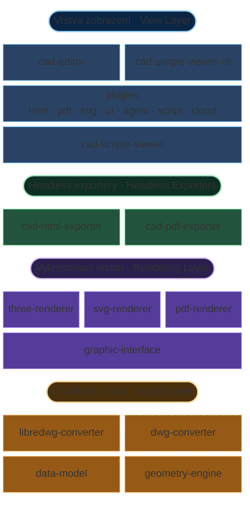

# Přehled architektury

MLightCAD běží výhradně v prohlížeči a **nemá žádné závislosti na backendu**. Soubory DWG/DXF se parsují a zpracovávají lokálně pomocí WebAssembly a JavaScriptu, což zajišťuje:

- **Žádné požadavky na server** — nasazení kdekoli jen se statickým hostingem
- **Úplné soukromí dat** — soubory nikdy neopustí zařízení uživatele
- **Okamžitá integrace** — bez složitého backendu nebo konfigurace API
- **Offline provoz** — funguje bez připojení k internetu

Tento repozitář je TypeScript monorepo postavené na `pnpm` + `nx`. Hlavní balíčky související se zobrazením a editací:

| Balíček | Odpovědnost |
| --- | --- |
| [`@mlightcad/cad-simple-viewer`](https://github.com/mlightcad/cad-viewer/tree/main/packages/cad-simple-viewer) | Správa dokumentů, zásobník příkazů, správce pluginů a plátno; **bez závislosti na UI frameworku** |
| [`@mlightcad/cad-editor`](https://github.com/mlightcad/cad-viewer/tree/main/packages/cad-editor) | Kompletní Vue 3 UI nad `cad-simple-viewer` (menu, ribbon, příkazový řádek, stavový řádek) |
| [`@mlightcad/cad-simple-viewer-cli`](https://github.com/mlightcad/cad-viewer/tree/main/packages/cad-simple-viewer-cli) | Headless CLI: řídí `cad-simple-viewer` v Playwright / Chromium a spouští skripty `.scr` |
| [`@mlightcad/three-renderer`](https://github.com/mlightcad/cad-viewer/tree/main/packages/three-renderer) | Interaktivní 2D/3D vykreslování pomocí THREE.js |
| `svg-renderer` ([`cad-svg-plugin`](https://github.com/mlightcad/cad-viewer/tree/main/packages/cad-svg-plugin)) | Vektorový výstup SVG přes stejné vykreslovací rozhraní |
| [`@mlightcad/pdf-renderer`](https://github.com/mlightcad/cad-viewer/tree/main/packages/pdf-renderer) | Vektorový PDF backend přes stejné vykreslovací rozhraní |
| [`@mlightcad/cad-html-exporter`](https://github.com/mlightcad/cad-viewer/tree/main/packages/cad-html-exporter) / [`@mlightcad/cad-pdf-exporter`](https://github.com/mlightcad/cad-viewer/tree/main/packages/cad-pdf-exporter) | Headless Node export HTML / PDF (bez prohlížečového vieweru) |
| `*-plugin` | Volitelné funkce (UI, export, skripty, agent, cloudové zdroje dat), lazy-loadované správcem pluginů |

Pravidlo vrstev: `data-model` (externí) → renderery → `cad-simple-viewer` → UI / pluginy / CLI. **Nižší balíčky nesmí záviset na vyšších.**

## Celková architektura

Systém je podle odpovědností rozdělen na vrstvy **model**, **vykreslování** a **zobrazení**, plus samostatně nasaditelné **headless exportéry** a CLI pohánějící stejné jádro vieweru.

Tato vrstvená architektura udržuje MLightCAD škálovatelný při různých objemech dat, cílech vykreslování a formách nasazení (komponenta v prohlížeči, headless CLI nebo čistý Node export).

### Modelová vrstva

Modelová vrstva žije v samostatném repozitáři [`realdwg-web`](https://github.com/mlightcad/realdwg-web) a zde se používá jako externí závislost:

- [`@mlightcad/data-model`](https://github.com/mlightcad/realdwg-web) definuje jednotný **Data Model** pro parsovaná CAD data (geometrické entity, hladiny, parametry pohledu atd.).
- [`AcDbDatabaseConverter`](https://github.com/mlightcad/realdwg-web/blob/main/packages/data-model/src/database/AcDbDatabaseConverter.ts) poskytuje jednotné rozhraní pro převod CAD souborů, aby různé převodníky produkovaly stejný datový model.
- [`@mlightcad/libredwg-converter`](https://github.com/mlightcad/realdwg-web) poskytuje open-source parsování DWG založené na LibreDWG (WebAssembly) do tohoto modelu. Hostitel musí převodník zaregistrovat sám (`cad-simple-viewer` GPL parser nepřibaluje).
- **`@mlightcad/dwg-converter`** je **uzavřený komerční** modul pro parsování DWG, který implementuje stejné rozhraní `AcDbDatabaseConverter` a může nahradit `libredwg-converter` pro vyšší kompatibilitu a úplnost. Distribuuje se soukromě přes GitHub Packages a není open-source součástí tohoto repozitáře. Instalace a registrace: [Instalace a použití proprietárního převodníku DWG](./install-and-use-proprietary-dwg-converter); licence a zkušební přístup: [PROPRIETARY-PARSER.md](https://github.com/mlightcad/cad-viewer/blob/main/PROPRIETARY-PARSER.md).
- Parsování DXF zajišťuje vestavěná převodní pipeline v `data-model` (historicky založená na [`@mlightcad/dxf-json`](https://github.com/mlightcad/dxf-json)).
- [`@mlightcad/geometry-engine`](https://github.com/mlightcad/realdwg-web) poskytuje geometrii a matematiku (body, úsečky, křivky, splajny, kružnice/oblouky, elipsy, vektory a matice).

Proč existuje `AcDbDatabaseConverter`? Existující nástroje pro DXF/DWG bývají neúplné. Open-source cesta používá `libredwg-converter`; pro vyšší věrnost lze místo něj zaregistrovat uzavřený `dwg-converter` bez změny kódu horního vieweru. Stejné rozhraní lze také implementovat nad komerčními enginy jako [ODA](https://www.opendesign.com/products/drawings).

### Vykreslovací vrstva

- [`@mlightcad/graphic-interface`](https://github.com/mlightcad/realdwg-web) (`realdwg-web`) definuje jednotné rozhraní pro vykreslování entit (`AcGiRenderer` atd.).
- [`@mlightcad/three-renderer`](https://github.com/mlightcad/cad-viewer) toto rozhraní implementuje pomocí THREE.js pro interaktivní plátno (dávkování, shadery typů čar/výplní atd.). Je to výchozí backend pro `cad-simple-viewer`.
- **`svg-renderer`** (`AcSvgRenderer`) implementuje stejné rozhraní a produkuje škálovatelné SVG. Aktuální implementace je v [`@mlightcad/cad-svg-plugin`](https://github.com/mlightcad/cad-viewer/tree/main/packages/cad-svg-plugin) a používají ji příkazy jako `csvg`; vektorový export PDF také znovu používá část jeho kreslicích schopností.
- [`@mlightcad/pdf-renderer`](https://github.com/mlightcad/cad-viewer) implementuje stejné rozhraní a generuje vektorové PDF content streamy; používají jej `cad-pdf-core` / `cad-pdf-plugin` / `cad-pdf-exporter`.

### Vrstva zobrazení

- **`cad-simple-viewer`** je jádro: životní cyklus dokumentu, zásobník příkazů, uživatelský vstup / jig, koordinace s `three-renderer` a **pluginový systém `AcApPluginManager`**. Kromě plátna neposkytuje aplikační UI.
- **Pluginy** se publikují jako samostatné npm balíčky implementující `AcApPlugin` a připojují se přes `registerLazyPlugin` / `loadPlugin`. Oficiální pluginy pokrývají export HTML / PDF / SVG, jednoduché UI, skriptovací konzoli, AI agenta, OneDrive / Google Drive a další. Viz [Systém pluginů](./plugin-system) a [Vestavěné pluginy](./built-in-plugins).
- **`cad-editor`** (dříve `@mlightcad/cad-viewer`, přejmenováno v 1.8.0) přidává nad `cad-simple-viewer` kompletní Vue 3 UI a při bootstrapu registruje běžné lazy pluginy.
- **`cad-simple-viewer-cli`** spouští stejné jádro vieweru v headless Chromium přes Playwright a běží AutoCAD-style skripty `.scr` (např. `-chtml` / `-cpdf`), vhodné pro CI a převodní služby. Viz [Vytvoření cloudového webového prohlížeče DWG](./cloud-dwg-web-viewer).

### Headless exportéry

Prohlížečové pluginy a Node exportéry sdílejí exportní pipeline v balíčcích `*-core`, takže server nemusí spouštět celý viewer:

| Cesta | Sdílené jádro | Vykreslovací backend | Typické vstupy |
| --- | --- | --- | --- |
| HTML | `@mlightcad/cad-html-core` | `three-renderer` (snapshot a zabalení) | Prohlížeč: `cad-html-plugin` (`chtml`); Node: `cad-html-exporter` (`exportFileToHtml`) |
| PDF | `@mlightcad/cad-pdf-core` | `pdf-renderer` | Prohlížeč: `cad-pdf-plugin` (`cpdf`); Node: `cad-pdf-exporter` (`exportFileToPdf`) |

Balíčky `*-core` **ne**závisí na `cad-simple-viewer` / DOM; `*-exporter` v Node řeší načítání fontů, registraci DWG a souborové I/O. Pro plnou schopnost příkazových skriptů (nejen soubor → HTML/PDF) použijte `cad-simple-viewer-cli`.

## Vykreslovací engine

Vykreslování DXF/DWG přináší několik výzev:

- vysoce výkonné vykreslení výkresů s velkým počtem entit
- reprodukce textového vykreslování AutoCAD
- podpora typů čar a šrafovacích vzorů

### Vysoce výkonné vykreslování

U velkých výkresů je klíčové sloučit body, čáry a plochy a snížit počet **draw callů**. THREE.js [BatchedMesh](https://threejs.org/docs/index.html?q=Mesh#api/en/objects/BatchedMesh) řeší slučování trojúhelníků jen částečně a nepodporuje body/čáry. Proto jsme podle `BatchedMesh` implementovali dávkovací třídy; viz [`packages/three-renderer/src/batch`](https://github.com/mlightcad/cad-viewer/tree/main/packages/three-renderer/src/batch).

### Vykreslování textu

AutoCAD používá [`MText`](https://ezdxf.mozman.at/docs/dxfinternals/entities/mtext.html) pro rich text a [SHX](https://help.autodesk.com/view/OARX/2023/ENU/?guid=GUID-DE941DB5-7044-433C-AA68-2A9AE98A5713) stroke fonty pro rychlejší zobrazení. Související balíčky jsou v samostatných repozitářích:

- **Parsování MText** — [`@mlightcad/mtext-parser`](https://github.com/mlightcad/mtext-parser)
- **Parsování SHX** — [`@mlightcad/shx-parser`](https://github.com/mlightcad/shx-parser)
- **Vykreslení MText** — [`@mlightcad/mtext-renderer`](https://github.com/mlightcad/mtext-renderer); parsované fonty se ukládají do IndexedDB prohlížeče, aby se zabránilo opakovanému stahování a parsování

Pro ladění textového vykreslování použijte rich text editor založený na THREE.js [mtext-editor](https://github.com/mlightcad/mtext-editor).

### Typy čar a šrafovací vzory

AutoCAD podporuje vlastní typy čar a šrafovací vzory. Implementovali jsme jejich část. Typy čar a výplně na interaktivním plátně používají THREE.js `ShaderMaterial`; viz [`packages/three-renderer/src/style`](https://github.com/mlightcad/cad-viewer/tree/main/packages/three-renderer/src/style). PDF cesta odpovídající vzhled reprodukuje vektorově v `pdf-renderer`.
