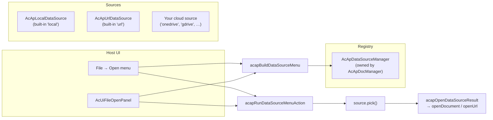

# Plugin datového zdroje

Tato stránka vysvětluje mechanismus **pluginu datového zdroje** v `@mlightcad/cad-simple-viewer` — zásuvnou vrstvu, která rozhoduje o tom, **odkud výkresy pocházejí** (lokální disk, HTTP URL, OneDrive, Google Drive, …). Popisuje, jak mechanismus funguje, jak vytvořit vlastní datový zdroj a jak jej zaregistrovat a používat.

Mechanismus žije v `packages/cad-simple-viewer/src/app/dataSource`. Kompletní referenční implementace je dodávána jako samostatný balíček npm: `@mlightcad/cad-onedrive-plugin` (`packages/cad-onedrive-plugin`), který používá ukázková aplikace v `packages/cad-simple-viewer-example`.

> Pro **pluginy příkazů** (exportní příkazy jako `cpdf`, `chtml`) viz [Systém pluginů](./plugin-system). Plugin datového zdroje *je* `AcApPlugin` — pouze používá `onLoad` k registraci datového zdroje namísto příkazu.

---

## Přehled

**Datový zdroj** je objekt implementující `AcApDataSource`: zásuvný původ výkresů CAD. Jádro prohlížeče neví nic o dodavatelích — zná pouze registr (`AcApDataSourceManager`) a malou sadu pomocníků pro nabídky. Veškerá logika specifická pro dodavatele (přihlašovací popupy, File Pickery, stahování) zůstává **uvnitř** datového zdroje.



Klíčová pravidla návrhu:

- **Hostitelé pouze orchestrují.** Hostitelské UI (nabídka Open v ribbonu, `AcUiFileOpenPanel`, panely nástrojů) smí pouze (1) vypsat zdroje přes `AcApDataSourceManager`, (2) sestavit popisky pomocí `acapBuildDataSourceMenu`, (3) spustit kliknutí pomocí `acapRunDataSourceMenuAction` / `acapInvokeDataSourceMenuAction`. **Nesmí** otevírat File Pickery dodavatele, stahovat URL ani zobrazovat přihlašovací prvky specifické pro poskytovatele.
- **Přihlášení a výběr nejsou nikdy řetězeny.** Prohlížeče povolují `window.open` pouze v přímém tiknutí uživatelského gesta. Pokud obsluha kliknutí `await`uje přihlášení MSAL a *poté* otevře popup pro výběr, druhý popup je zablokován. Nabídka proto nabízí **Přihlásit se** a **Otevřít z …** jako samostatné položky.
- **Adaptivní nabídky.** `getAuthState()` řídí, co nabídka zobrazuje, takže hostitel nepotřebuje UI specifické pro poskytovatele.

---

## Základní typy

Všechny níže uvedené typy jsou exportovány z `@mlightcad/cad-simple-viewer`.

### `AcApDataSource`

Rozhraní, které musí každý datový zdroj implementovat:

| Člen | Povinné | Popis |
|--------|----------|-------------|
| `id` | ✓ | Stabilní ID používané v nabídkách a při vyhledávání v registru (`local`, `url`, `onedrive`, …) |
| `labelKey` | ✓ | Klíč i18n pro zobrazovaný název (např. `main.dataSource.onedrive`) |
| `icon?` | | Volitelný inline SVG řetězec nebo URL |
| `requiresAuth` | ✓ | Zda zdroj vyžaduje autentizaci uživatele |
| `requiresUserGesture` | ✓ | Když je `true`, `pick()` musí spustit `window.open` v přímém tiknutí kliknutí (cloudové File Pickery) |
| `getAuthState()` | ✓ | Vrací `'none'` \| `'signed-out'` \| `'signed-in'` |
| `getAccountLabel?()` | | Krátký popisek přihlášeného účtu pro nabídky (e-mail / zobrazované jméno) |
| `getAccountProfile?()` | | `{ displayName, email?, avatarUrl? }` pro landing / chrome účtu |
| `restoreSession?()` | | Obnoví cachovanou relaci po registraci (účty MSAL, tokeny, …). Po dokončení musí zavolat `notifyAuthChanged`, aby se nabídky Open obnovily |
| `signIn()` | ✓ | Interaktivní přihlášení. Bez akce, když je `requiresAuth` `false` |
| `signOut()` | ✓ | Odhlášení. Bez akce, když je `requiresAuth` `false` |
| `pick()` | ✓ | Otevře File Picker / dialog specifický pro zdroj, v případě potřeby stáhne soubor a vrátí vybraný výkres — nebo `null`, když uživatel zruší |

### `AcApDataSourceFile`

Výsledek úspěšného `pick()`:

| Pole | Popis |
|-------|-------------|
| `name` | Název souboru včetně přípony (např. `drawing.dwg`) |
| `content?` | Surové bajty souboru (`ArrayBuffer`). Použije se, když je `url` vynecháno |
| `url?` | Vzdálená URL otevřená přes `AcApDocManager.openUrl` (HTTP fetch s průběhem) |

Upřednostněte `content` pro bajty již v paměti; upřednostněte `url`, pokud má být zdroj otevřen přes `openUrl`.

### `AcApDataSourceManager`

Registr vlastněný `AcApDocManager` (`AcApDocManager.instance.dataSourceManager`). `AcApDocManager.createInstance()` automaticky registruje dva vestavěné zdroje:

- `local` — `AcApLocalDataSource` (výběr `<input type="file">` pro `.dwg` / `.dxf`)
- `url` — `AcApUrlDataSource` (dialog URL, otevírá přes `openUrl`)

Cloudové pluginy se registrují v `AcApPlugin.onLoad` a odregistrují v `onUnload`.

| API | Popis |
|-----|-------------|
| `register(source)` | Zaregistruje zdroj (nahradí jakýkoli existující zdroj se stejným ID) |
| `unregister(id)` | Odebere zdroj podle ID |
| `list()` | Registrované zdroje v pořadí registrace |
| `get(id)` | Vyhledá zdroj podle ID |
| `notifyAuthChanged(sourceId)` | Cloudové pluginy volají po úspěšném `signIn` / `signOut` |
| `on` / `off` | Odběr událostí `changed` a `auth-changed` |

---

## Pomocníci nabídky

Hostitelé si nabídky Open nepíší sami. Smlouvu definují tři pomocníci:

### 1. `acapBuildDataSourceMenu(sources)`

Sestaví `AcApDataSourceMenuItem[]` z aktuálního registru. Pravidla (bezpečná vůči blokování popupů):

| Stav autentizace | Položky nabídky |
|------------|------------|
| Bez požadavku na autentizaci (`'none'`) | Jedna položka **výběru** (např. *Lokální soubor*, *Z URL*) |
| Vyžaduje autentizaci, **nepřihlášen** | Pouze jedna položka **přihlášení** (nikdy neřetězená do výběru) |
| Vyžaduje autentizaci, **přihlášen** | **výběr** (*Otevřít z OneDrive*) + **odhlášení** (*Odhlásit z OneDrive (user@host)*) |

### 2. `acapRunDataSourceMenuAction(item, options?, manager?)`

Spustí akci pro položku nabídky a **automaticky otevře výsledky výběru** (`acapOpenDataSourceResult`: `openUrl`, když je nastaveno `file.url`, jinak `openDocument` s `file.content`). Použijte v nabídkách Open uvnitř prohlížeče. Nikdy neřetězí přihlášení do výběru.

### 3. `acapInvokeDataSourceMenuAction(source, item)`

Spustí akci vůči již rozpoznanému zdroji **bez** otevření souboru. Použijte na vstupních stránkách, které vlastní správce datových zdrojů dříve, než `AcApDocManager` existuje, nebo když chcete výsledek otevřít sami.

### Pomocné nástroje

| Pomocník | Účel |
|--------|---------|
| `acapOpenCenteredPopup(name, width?, height?)` | Otevře pojmenovaný popup vycentrovaný na obrazovce — použijte uvnitř `pick()`, aby se popup otevřel ve stejném tiknutí kliknutí |
| `acapWithDataSourceBusy(work, message?)` | Zabalí práci stahování / po výběru do překryvu zaneprázdnění (indikátor zaneprázdnění DocManageru, nebo dočasný `AcApProgress` na `document.body` pro vstupní stránky) |
| `acapOpenDataSourceResult(file, options?)` | Otevře výsledek `pick()` přes DocManager (`openUrl` / `openDocument`) |
| `acapIsSingleLocalOpen(sources)` | Zda se má UI Open sbalit na jedinou akci „Open“ (pouze vestavěný lokální zdroj) |

---

## Vytvoření pluginu datového zdroje

Plugin datového zdroje je běžný `AcApPlugin` (viz [Systém pluginů](./plugin-system)), jehož `onLoad` registruje `AcApDataSource`. Doporučené rozvržení balíčku zrcadlí `cad-onedrive-plugin`:

```
my-cad-datasource-plugin/
  package.json          # name: @myorg/cad-my-datasource-plugin
  src/
    AcApMyDataSource.ts # implements AcApDataSource
    AcApMyPlugin.ts     # implements AcApPlugin, registers the source
    myClient.ts         # vendor API client (auth, picker, download)
    register.ts         # registerMyPlugin(pluginManager, options)
    index.ts            # public exports
```

**Konvence `package.json`:**

- Nastavte `"type": "module"`
- Uveďte `@mlightcad/cad-simple-viewer` (a případně `@mlightcad/data-model`) jako **peerDependencies**
- Sestavujte pomocí `tsc` + `vite` jako stávající pluginy

### Krok 1 — Implementace `AcApDataSource`

```typescript
import {
  type AcApDataSource,
  type AcApDataSourceAccountProfile,
  type AcApDataSourceAuthState,
  type AcApDataSourceFile,
  type AcApDataSourceManager,
  acapOpenCenteredPopup,
  acapWithDataSourceBusy
} from '@mlightcad/cad-simple-viewer'

/** Stable id used in menus and registry lookups. */
export const ACAP_MY_DATA_SOURCE_ID = 'mycloud'

export class AcApMyDataSource implements AcApDataSource {
  readonly id = ACAP_MY_DATA_SOURCE_ID
  readonly labelKey = 'main.dataSource.mycloud'
  readonly requiresAuth = true
  // true because pick() opens a File Picker popup via window.open
  readonly requiresUserGesture = true

  private readonly dataSourceManager: AcApDataSourceManager

  constructor(dataSourceManager: AcApDataSourceManager) {
    this.dataSourceManager = dataSourceManager
  }

  getAuthState(): AcApDataSourceAuthState {
    return this.client.isAuthenticated ? 'signed-in' : 'signed-out'
  }

  getAccountLabel(): string | undefined {
    return this.client.userInfo?.email
  }

  getAccountProfile(): AcApDataSourceAccountProfile | undefined {
    if (!this.client.isAuthenticated) return undefined
    const info = this.client.userInfo!
    return { displayName: info.name || info.email, email: info.email }
  }

  /** Restore cached tokens after registration so menus show signed-in state. */
  async restoreSession(): Promise<void> {
    await this.client.initialize()
    this.notifyAuthChanged()
  }

  async signIn(): Promise<void> {
    await this.client.authenticate()
    this.notifyAuthChanged()
  }

  async signOut(): Promise<void> {
    await this.client.signOut()
    this.notifyAuthChanged()
  }

  async pick(): Promise<AcApDataSourceFile | null> {
    // Open the popup in this click tick. Any `await` first loses the gesture.
    const popup = acapOpenCenteredPopup('MyCloudPicker', 1080, 680)
    if (!popup) {
      throw new Error('Popup blocked. Allow popups for this site and try again.')
    }
    try {
      await this.client.initialize()
      if (!this.client.isAuthenticated) {
        throw new Error('Sign in first, then choose a file (popup blocker).')
      }
      const picked = await this.client.openFilePicker(popup)
      const content = await acapWithDataSourceBusy(() =>
        this.client.downloadFile(picked)
      )
      return { name: picked.name, content }
    } catch (error) {
      try {
        if (!popup.closed) popup.close()
      } catch {
        // ignore
      }
      if (error instanceof Error && error.message === 'Picker cancelled') {
        return null // user cancelled — not an error
      }
      throw error
    }
  }

  private notifyAuthChanged(): void {
    this.dataSourceManager.notifyAuthChanged(this.id)
  }
}
```

Poznámky k implementaci:

- **`pick()` musí otevřít popup synchronně** v tiknutí kliknutí (`requiresUserGesture = true`). Jakékoli `await` (inicializace SDK, kontrola autentizace) provádějte *po* `window.open`.
- Volajte `acapWithDataSourceBusy` okolo stahování, aby uživatelé dostali zpětnou vazbu o průběhu jak v prohlížeči, tak na vstupních stránkách.
- Vracejte `null`, když uživatel zruší; u skutečných selhání vyhazujte výjimku.
- Po změně stavu autentizace vždy volejte `dataSourceManager.notifyAuthChanged(id)`, aby se nabídky Open obnovily.
- Pro zdroje bez popupu (např. dialog na stránce) nastavte `requiresUserGesture = false`.
- Přidejte svůj `labelKey` (např. `main.dataSource.mycloud`) do zdrojů i18n — viz [Lokalizace](./localization).

### Krok 2 — Zabalení do `AcApPlugin`

```typescript
import {
  AcApContext,
  AcApDocManager,
  AcApPlugin,
  AcEdCommandStack
} from '@mlightcad/cad-simple-viewer'

import packageJson from '../package.json'
import { ACAP_MY_DATA_SOURCE_ID, AcApMyDataSource } from './AcApMyDataSource'

export class AcApMyPlugin implements AcApPlugin {
  name = 'MyDataSourcePlugin'
  version = packageJson.version
  description = 'Open DWG/DXF files from MyCloud'

  private source: AcApMyDataSource | null = null
  private createdSource = false

  onLoad(_context: AcApContext, _commandManager: AcEdCommandStack): void {
    const dsm = AcApDocManager.instance.dataSourceManager
    const existing = dsm.get(ACAP_MY_DATA_SOURCE_ID)
    if (existing) {
      // Already registered (e.g. HMR or double load) — just restore the session.
      void existing.restoreSession?.().catch(() => undefined)
      return
    }
    this.source = new AcApMyDataSource(dsm)
    this.createdSource = true
    dsm.register(this.source)
    // Restore cached session so File → Open shows Open/Sign out, not Sign in.
    void this.source.restoreSession().catch(() => undefined)
  }

  onUnload(_context: AcApContext, _commandManager: AcEdCommandStack): void {
    if (this.createdSource) {
      AcApDocManager.instance.dataSourceManager.unregister(ACAP_MY_DATA_SOURCE_ID)
    }
    this.source = null
    this.createdSource = false
  }
}
```

### Krok 3 — Export pomocníka pro registraci

Datové zdroje musí být viditelné **okamžitě** (nabídky Open je vypisují dříve, než je otevřen jakýkoli dokument), proto je načítejte eager pomocí `pluginManager.loadPlugin`:

```typescript
// src/register.ts
import type { AcApPluginManager } from '@mlightcad/cad-simple-viewer'

import { AcApMyPlugin } from './AcApMyPlugin'

export const MY_PLUGIN_NAME = 'MyDataSourcePlugin'

export async function registerMyPlugin(
  pluginManager: AcApPluginManager,
  options: { clientId: string; /* … */ }
): Promise<void> {
  if (!options.clientId) {
    throw new Error('registerMyPlugin requires options.clientId')
  }
  await pluginManager.loadPlugin(new AcApMyPlugin(options))
}
```

> SDK ve stylu MSAL lze stále importovat líně *uvnitř* `signIn` / `pick` — eager musí být pouze samotná registrace.

---

## Použití pluginu datového zdroje

### 1. Registrace ve vaší aplikaci

Zavolejte pomocníka pro registraci po `AcApDocManager.createInstance()`:

```typescript
import { AcApDocManager } from '@mlightcad/cad-simple-viewer'
import { registerOneDrivePlugin } from '@mlightcad/cad-onedrive-plugin/register'

AcApDocManager.createInstance({ container: document.getElementById('cad-container')! })

await registerOneDrivePlugin(AcApDocManager.instance.pluginManager, {
  clientId: import.meta.env.VITE_MSAL_CLIENT_ID,
  tenantId: import.meta.env.VITE_MSAL_TENANT_ID || 'common',
  redirectUri: import.meta.env.VITE_MSAL_REDIRECT_URI // optional
})
```

Udržujte registrační stub v počátečním bundlu importem z podcesty `/register` a zbytek importujte dynamicky (viz `packages/cad-simple-viewer-example/src/register.ts`):

```typescript
const { registerOneDrivePlugin } = await import('@mlightcad/cad-onedrive-plugin/register')
```

To je vše, co aplikace potřebuje, když používá vestavěné UI (ribbon / panel nástrojů / `AcUiFileOpenPanel`): nabídka Open se obnoví z `dataSourceManager` a nyní zobrazí například:

| Stav autentizace | Položky nabídky |
|------------|------------|
| Nepřihlášen | Přihlásit se k OneDrive |
| Přihlášen | Otevřít z OneDrive, Odhlásit z OneDrive (user@contoso.com) |

### 2. Vlastní hostitelské UI (nabídka v prohlížeči)

Pokud si stavíte vlastní nabídku Open, používejte pomocníky — nevolajte `signIn` / `pick` přímo:

```typescript
import {
  AcApDocManager,
  acapBuildDataSourceMenu,
  acapRunDataSourceMenuAction
} from '@mlightcad/cad-simple-viewer'

const dsm = AcApDocManager.instance.dataSourceManager

function rebuildOpenMenu() {
  const items = acapBuildDataSourceMenu(dsm.list())
  renderMenu(items, item => {
    void acapRunDataSourceMenuAction(item, openOptions)
  })
}

rebuildOpenMenu()
dsm.on('changed', rebuildOpenMenu)
dsm.on('auth-changed', rebuildOpenMenu)
```

### 3. Vstupní stránky (před existencí prohlížeče)

Vstupní stránky často umožňují vybrat soubor ještě před vytvořením `AcApDocManager`. `AcUiFileOpenPanel` tento vzor již implementuje: předejte `onDataSourceAction` a položku spusťte, jakmile je prohlížeč připraven. Když vaše vlastní vstupní UI vyvolává zdroj přímo, použijte `acapInvokeDataSourceMenuAction` + `acapOpenDataSourceResult`:

```typescript
import { acapInvokeDataSourceMenuAction, acapOpenDataSourceResult } from '@mlightcad/cad-simple-viewer'

const source = myDataSourceManager.get('onedrive') // or the built-in 'local' / 'url'
const file = await acapInvokeDataSourceMenuAction(source, menuItem)
if (file) {
  await acapOpenDataSourceResult(file, openOptions)
}
```

**Úskalí uživatelského gesta** (z `cad-simple-viewer-example/src/main.ts`): pokud obsluha kliknutí musí nejprve `await`ovat inicializaci prohlížeče, než spustí akci `pick`, uživatelské gesto se ztratí a popup je zablokován. Buď spusťte akci synchronně, když je již inicializováno, nebo u položek `pick` zobrazte nápovědu *nejprve se přihlaste, poté otevřete* (viz `handleDataSourceMenuAction` v ukázkové aplikaci).

---

## Reálná reference: OneDrive

`@mlightcad/cad-onedrive-plugin` je kanonický cloudový datový zdroj:

| Část | Soubor | Co dělá |
|-------|------|--------------|
| `AcApOneDriveDataSource` | `src/AcApOneDriveDataSource.ts` | Implementuje `AcApDataSource` nad Microsoft File Picker v8 + MSAL; `pick` otevře popup synchronně a poté stahuje pod překryvem zaneprázdnění |
| `AcApOneDrivePlugin` | `src/AcApOneDrivePlugin.ts` | `AcApPlugin`, který registruje/odregistruje zdroj a při načtení obnoví cachovanou relaci MSAL |
| `OneDriveClient` | `src/oneDriveClient.ts` | Autentizace MSAL + komunikace s File Picker v8 + stahování přes Graph |
| `registerOneDrivePlugin` | `src/register.ts` | Eager pomocník pro registraci (validuje `clientId`) |
| `createOneDrivePlugin` | `src/createOneDrivePlugin.ts` | Asynchronní továrna pro instanci pluginu |

Ukázková aplikace jej zapojuje přes konfiguraci prostředí (`packages/cad-simple-viewer-example/src/onedriveEnv.ts`): když je nastaven `VITE_MSAL_CLIENT_ID`, `registerOneDriveFromEnv` plugin zaregistruje; vstupní panel vypisuje položku *Přihlásit se k OneDrive* prostřednictvím `extraMenuItems` panelu `AcUiFileOpenPanel`.

**Nastavení aplikace Azure** (pro OneDrive): zaregistrujte **Single-page application** v Microsoft Entra ID, přidejte redirect URI odpovídající původu vaší aplikace a udělte delegovaná oprávnění Graph `User.Read` + `Files.Read.All` (tokeny osobního výběru OneDrive pokrývají také `OneDrive.ReadOnly`).

---

## Řešení potíží

| Příznak | Pravděpodobná příčina |
|---------|----------------|
| Zdroj chybí v nabídce Open | Plugin není zaregistrován, nebo byl zaregistrován před `AcApDocManager.createInstance()` / po zničení; nebo `register` nahradil existující zdroj se stejným ID |
| Popup výběru je zablokován | `pick()` `await`oval před `window.open`, nebo bylo přihlášení v téže obsluze kliknutí řetězeno do výběru |
| Nabídka po přihlášení stále zobrazuje *Přihlásit se* | Po změně stavu autentizace nebylo voláno `notifyAuthChanged`; nebo při načtení nebylo vyvoláno `restoreSession` |
| Nabídka se po registraci/odregistraci neaktualizuje | Hostitel cachoval seznam položek namísto obnovení při událostech `changed` / `auth-changed` |
| Stahování visí bez zpětné vazby | Stahování není zabaleno v `acapWithDataSourceBusy` |
| Otevřený soubor nemá bajty ani URL | `pick()` vrátil soubor bez `content` i `url` |

---

## Související dokumentace

- [Systém pluginů](./plugin-system) — `AcApPlugin`, registrace příkazů, líné načítání
- [Integrace Simple Viewer](./integrate-simple-cad-viewer) — vložení `cad-simple-viewer`
- [Lokalizace](./localization) — přidávání klíčů i18n, jako `main.dataSource.*`
- [Přehled architektury](./architecture-overview) — rozvržení modulů
