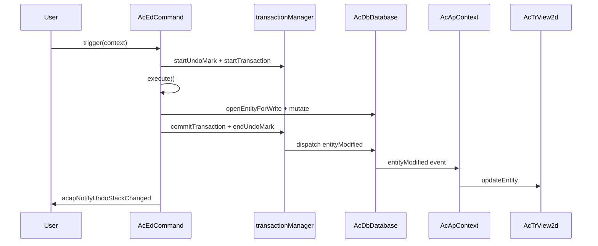

# Osvědčené postupy pro úpravy entit

Tato stránka vysvětluje, jak upravovat entity výkresu v **MLightCAD** tak, aby byly změny správně sledovány, aby **undo/redo** fungovalo podle očekávání a aby **zobrazení zůstalo synchronizované** s databází.

Databázová vrstva pochází z [`@mlightcad/data-model`](https://github.com/mlightcad/realdwg-web). MLightCAD přidává pomocné funkce aplikace a propojuje databázové události s rendererem.

---

## Přehled

Správná úprava entity prochází třemi vrstvami:

| Vrstva | Odpovědnost |
|-------|----------------|
| **Databáze** (`AcDbDatabase`) | Uchovává entity a zaznamenává změny |
| **Transakce / undo** (`transactionManager`) | Seskupuje změny a podporuje undo/redo |
| **Zobrazení** (`AcTrView2d`) | Vykresluje geometrii; aktualizováno prostřednictvím databázových událostí |

**Základní pravidlo:** měňte databázi prostřednictvím transakčních API. Nechte `AcApContext` šířit změny do zobrazení. Po běžné úpravě databáze nevolajte `view.updateEntity()`, pokud nemáte speciální případ (například přechodnou geometrii náhledu).

---

## Transakční mechanismus

`AcDbDatabase.transactionManager` (`AcDbDatabaseTransactionManager`) spravuje transakce a historii undo pro jeden výkres. Jeho design vychází ze sémantiky `AcDbTransactionManager` v AutoCAD ObjectARX.

### Základní API

| API | Účel |
|-----|---------|
| `startTransaction()` | Zahájí zaznamenávání změn |
| `commitTransaction()` | Dokončí aktuální transakci a odešle události |
| `abortTransaction()` | Vrátí zpět všechny změny v aktuální transakci |
| `hasTransaction()` | Vrací, zda je transakce aktivní |
| `isRecording()` | Vrací, zda se zaznamenávají změny (false během přehrávání undo/redo) |
| `openEntityForWrite(id \| entity)` | Otevře entitu pro zápis **prostřednictvím** aktivní transakce |

### Co se zaznamenává

Zatímco je `isRecording()` true, správce transakcí zaznamenává:

- **Změny vlastností** objektů databáze (`kind: 'modify'`)
- **Přidání / odebrání** objektů v záznamech tabulky bloků, tabulkách symbolů nebo slovnících
- Změny **systémových proměnných**

Když se potvrdí nejvzdálenější transakce, zaznamenané změny se dokončí a odešlou se příslušné databázové události.

### Vnořené transakce

Transakce mohou být vnořené. Vnitřní transakce slučují svůj záznam do nadřazené. Události odesílá a historii undo zařazuje pouze **nejvzdálenější** `commitTransaction()`.

### Otevírání objektů pro zápis

Vždy používejte `database.openEntityForWrite(...)` (nebo `openObjectForWrite`) namísto přímé změny uložené reference entity:

```typescript
const opened = db.openEntityForWrite(entityOrObjectId)
if (!opened) return
opened.color = newColor
```

Když je transakce aktivní, `openEntityForWrite` směruje objekt přes transakci, takže je změna sledována. Bez aktivní transakce se pomocná funkce uchýlí k přímému vyhledání a změna **nemusí** být vratná pomocí undo.

### Přísný režim

`transactionManager.strictMode` (výchozí v data-model) může vyžadovat, aby všechny změny probíhaly v aktivní transakci. Přehrávání undo/redo je vyjmuto, aby applier změn mohl obnovit stav. V praxi příkazy MLightCAD a `acapRunDatabaseEdit` vždy před úpravou vytvoří transakci.

---

## Mechanismus undo / redo

Undo/redo je postaveno na **značkách undo** a **záznamech undo**.

### Značky undo

| API | Účel |
|-----|---------|
| `startUndoMark(label?)` | Otevře skupinu; více potvrzení v jedné značce se stane **jedním** krokem undo |
| `endUndoMark()` | Uzavře skupinu a při existujících změnách zařadí záznam undo |
| `cancelUndoMark()` | Zahodí skupinu bez vytvoření záznamu undo |

### Operace undo / redo

| API | Účel |
|-----|---------|
| `undo()` | Vrátí nejnovější záznam undo |
| `redo()` | Znovu použije naposledy vrácený záznam |
| `canUndo()` / `canRedo()` | Dotaz na stav zásobníku |
| `clearUndoStack()` | Vymaže oba zásobníky |

Když se spustí undo nebo redo, `AcDbChangeApplier` přehraje uložené změny v dopředném nebo inverzním pořadí a odešle příslušné události entit, takže se zobrazení aktualizuje automaticky.

### Jak příkazy získají undo automaticky

`AcEdCommand.trigger()` obalí provádění příkazu jednou značkou undo a jednou transakcí, pokud je povoleno zaznamenávání undo:

```typescript
// AcEdCommand.trigger() — simplified
if (recordUndo) {
  tm.startUndoMark(this.globalName || this.localName)
  tm.startTransaction()
}
try {
  await this.execute(context)
} catch (error) {
  if (undoTransactionActive) {
    tm.abortTransaction()
    tm.cancelUndoMark()
  }
  throw error
} finally {
  if (undoTransactionActive) {
    tm.commitTransaction()
    tm.endUndoMark()
    acapNotifyUndoStackChanged()
  }
}
```

Zaznamenávání undo je povoleno, pokud platí **všechny** následující podmínky:

- `command.recordsUndoStack === true` (výchozí)
- `context.doc.openMode >= AcEdOpenMode.Review`
- `command.mode >= AcEdOpenMode.Review`

Nastavte `recordsUndoStack = false` u meta-příkazů, které by neměly vytvářet vlastní krok undo (například `AcApUndoCmd` a `AcApRedoCmd`).

### Oznámení UI

Poté, co se změní dostupnost undo/redo, zavolejte `acapNotifyUndoStackChanged()` z `@mlightcad/cad-simple-viewer`. Tím se na globální sběrnici událostí vyšle `undo-stack-changed`, takže komponenty jako `useUndoRedo` mohou obnovit stav panelu nástrojů.

Příkazy procházející `AcEdCommand.trigger()` volají tuto funkci automaticky při úspěšném potvrzení. Samostatné úpravy přes `acapRunDatabaseEdit` také upozorní posluchače, když vytvoří novou značku undo.

---

## Události související s entitami

`AcDbDatabase.events` vystavuje hlavní databázová oznámení:

| Událost | Kdy se vyvolá |
|-------|----------------|
| `entityAppended` | Entita přidána do modelového/prostoru výkresu |
| `entityModified` | Změněny vlastnosti nebo geometrie entity |
| `entityErased` | Entita odstraněna z výkresu |
| `layerAppended` | Vytvořena nová hladina |
| `layerModified` | Změněny atributy hladiny |
| `layerErased` | Hladina odstraněna |
| `dictObjetSet` | Objekt uložen do pojmenovaného slovníku |
| `dictObjectErased` | Objekt odstraněn ze slovníku |

### Datová zátěž události

`AcDbEntityEventArgs` obsahuje:

- `database` — zdrojová databáze
- `entity` — jednu entitu nebo pole entit

MLightCAD rozšiřuje události úprav o volitelné pole `changes` (`AcDbEntityModifiedEventArgs` v `AcApEntityUpdate`), aby zobrazení mohlo aplikovat odlehčené aktualizace (například přepnutí pouze viditelnosti) bez opětovného sestavení geometrie.

### Synchronizace zobrazení

`AcApContext` se přihlašuje k událostem entit a udržuje zobrazení v souladu:

- `entityAppended` → `view.addEntity(...)`
- `entityModified` → `view.updateEntity(...)` (nebo `updateEntityVisibility` pro změny pouze viditelnosti)
- `entityErased` → `view.removeEntity(...)`

Díky tomuto propojení by **aplikační kód po potvrzené úpravě databáze neměl běžně ručně obnovovat scénu**.

### Dávkování událostí

`database.beginEventBatch()` / `endEventBatch()` potlačují a slučují události během hromadných operací. Nejvzdálenější `endEventBatch()` vyprázdní nahromaděná oznámení `entityAppended`, `entityErased` a `entityModified`. Při importu nebo regeneraci velkých výkresů upřednostněte dávkování.

### Naslouchání z UI nebo pluginů

Ke stejným událostem se můžete přihlásit pro panely vlastností, stav Ribbonu nebo vlastní nástroje:

```typescript
const db = AcApDocManager.instance.curDocument.database

const onModified = (args: AcDbEntityEventArgs) => {
  // React to entity changes
}

db.events.entityModified.addEventListener(onModified)

// Remember to remove the listener on teardown
db.events.entityModified.removeEventListener(onModified)
```

---

## Úpravy entit uvnitř příkazu

Pro interaktivní editační příkazy (Move, Rotate, Erase, Draw atd.) dědte z `AcEdCommand` a provádějte všechny trvalé změny uvnitř `execute()`.

### Kontrolní seznam

1. **Nastavte režim příkazu** — použijte `AcEdOpenMode.Review` u upravujících příkazů nebo `AcEdOpenMode.Write` u vytvářejících příkazů, aby bylo povoleno zaznamenávání undo.
2. **Ponechte `recordsUndoStack` na `true`**, pokud příkaz není sám undo/redo.
3. **Nevolejte** `startTransaction()` / `commitTransaction()` ručně — `trigger()` již obaluje vaši metodu `execute()`.
4. **Otevřete entity pro zápis** před změnou geometrie nebo vlastností.
5. **Používejte jigy pouze pro náhled** — aktualizujte přechodnou geometrii v jigu; do databáze potvrďte, až když uživatel potvrdí.

### Příklad: Příkaz Move

`AcApMoveCmd` je referenční vzor pro úpravy geometrie:

```typescript
export class AcApMoveCmd extends AcEdCommand {
  constructor() {
    super()
    this.mode = AcEdOpenMode.Review
  }

  async execute(context: AcApContext) {
    // ... selection and point prompts ...

    const matrix = new AcGeMatrix3d().makeTranslation(dx, dy, dz)
    sourceEntities.forEach(entity => {
      const opened = context.doc.database.openEntityForWrite(entity)
      if (!opened) return
      opened.transformBy(matrix)
    })
  }
}
```

### Příklad: Příkaz Erase

```typescript
private eraseEntities(db: AcDbDatabase, objectIds: AcDbObjectId[]) {
  objectIds.forEach(objectId => {
    const entity = db.openEntityForWrite(objectId)
    entity?.erase()
  })
}
```

### Příklad: Příkaz Create

Připojujte nové entity prostřednictvím záznamů tabulky bloků uvnitř `execute()`. Aktivní transakce příkazu zaznamená přidání:

```typescript
const segment = new AcDbLine(startPoint, endPoint)
db.tables.blockTable.modelSpace.appendEntity(segment)
```

`entityAppended` přidá entitu do zobrazení. Volání `view.addEntity` navíc je volitelné a používá se hlavně v některých kreslicích příkazech pro okamžitou zpětnou vazbu; kanonickým synchronizačním mechanismem je cesta událostí.

### Náhled vs. potvrzení (jigy)

Během interaktivního vstupu **nezapisujte** transformace náhledu do databáze. Pomocí jigu (například `AcApMovePreviewJig`) transformujte přechodnou nebo v GPU uloženou geometrii náhledu. Teprve po potvrzení uživatelem byste měli zavolat `openEntityForWrite` a použít finální změnu.

### Zpracování chyb

Pokud `execute()` vyhodí výjimku, `AcEdCommand.trigger()` přeruší transakci a zruší značku undo. Ve většině příkazů nepotřebujete další logiku vrácení změn.

---

## Úpravy entit mimo příkaz

Obslužné rutiny Ribbonu, úpravy pomocí gripů, vložené textové editory a zpětné volání dialogů **nejsou** obaleny `AcEdCommand.trigger()`. Použijte pomocnou funkci aplikace:

### `acapRunDatabaseEdit`

```typescript
import { acapRunDatabaseEdit } from '@mlightcad/cad-simple-viewer'

acapRunDatabaseEdit(db, 'Color', () => {
  const entity = db.openEntityForWrite(objectId)
  if (!entity) return
  entity.color = newColor
})
```

Tato funkce:

1. Deleguje na `db.runDatabaseEdit(label, fn)` v data-model
2. Vytvoří **jednu** značku undo prostřednictvím `transactionManager.runUndoable`, pokud se ještě nezaznamenává
3. **Přeskočí** vnořenou značku undo, pokud je volána zevnitř aktivní transakce příkazu
4. Zavolá `acapNotifyUndoStackChanged()`, když se vytvoří nový záznam undo

Použijte krátký, uživatelsky srozumitelný `label` (například `'Grip Edit'`, `'Hatch Properties'`, `'Replace Image'`) — identifikuje krok v historii undo.

### Kdy použít které API

| Scénář | Doporučené API |
|----------|-----------------|
| Interaktivní CAD příkaz | Děděte z `AcEdCommand`; měňte v `execute()` |
| Potvrzení tahu gripu | `acapRunDatabaseEdit` |
| Ribbon / panel vlastností | `acapRunDatabaseEdit` |
| Obsluha OK v dialogu | `acapRunDatabaseEdit` |
| Programová dávka mimo UI | `db.runDatabaseEdit` nebo `transactionManager.runUndoable` |
| Již uvnitř `execute()` příkazu | Přímo `openEntityForWrite` / `appendEntity` (transakce je již aktivní) |

### Příklad: Relace úpravy gripu

```typescript
acapRunDatabaseEdit(db, 'Grip Edit', () => {
  const entity = db.openEntityForWrite(this._entity)
  if (!entity) return
  entity.subMoveGripPointsAt([gripIndex], offset)
})
```

### Příklad: Změna barvy na Ribbonu

```typescript
acapRunDatabaseEdit(db, 'Color', () => {
  db.cecolor = value
  selectedIds.forEach(id => {
    const entity = db.openEntityForWrite(id)
    if (entity) entity.color = value
  })
})
```

### Alternativa na nižší úrovni

Pokud vytváříte knihovní kód pouze nad data-model (bez UI MLightCAD), zavolejte:

```typescript
db.runDatabaseEdit('My Operation', () => {
  // openEntityForWrite + mutations
})
```

nebo:

```typescript
db.transactionManager.runUndoable('My Operation', () => {
  // mutations
})
```

Při integraci s UI MLightCAD nezapomeňte sami zavolat `acapNotifyUndoStackChanged()`.

---

## Časté chyby

| Chyba | Proč selhává | Oprava |
|---------|--------------|-----|
| Změna `entity.color = ...` na zastaralé referenci | Obchází zaznamenávání transakcí | `openEntityForWrite`, poté změnit |
| Volání `view.updateEntity` po každé úpravě | Zdvojuje práci; může kolidovat s aktualizacemi řízenými událostmi | Spolehněte se na `entityModified`, pokud neprovádíte náhled |
| Zápis do databáze uvnitř `update()` jigu | Vytváří šum v undo a pomalá potvrzení | Náhled provádějte přechodně; potvrďte jednou při potvrzení uživatelem |
| Ruční zásobníky undo (vlastní pole klonů) | Obchází jednotné undo/redo; narušuje slučování | Použijte `transactionManager` |
| Zapomenutí `acapRunDatabaseEdit` mimo příkazy | Změny nemusí být vratné pomocí undo | Obalte úpravy do `acapRunDatabaseEdit` |
| Nastavení `recordsUndoStack = false` u běžných editačních příkazů | Uživatel nemůže operaci vrátit | Ponechte výchozí `true` |

---

## Kompletní tok



U úprav mimo příkazy nahraďte `AcEdCommand.trigger` funkcí `acapRunDatabaseEdit`; cesta událostí a zobrazení je stejná.

---

## Související stránky

- [Příkaz](./command) — životní cyklus a registrace příkazů
- [Systém Jig](./jig-system) — interaktivní náhled bez zápisů do databáze
- [Základy MLightCAD](./cad-viewer-basics) — koncepty dokumentu, databáze a zobrazení
- [Přehled architektury](./architecture-overview) — jak jsou moduly propojeny

