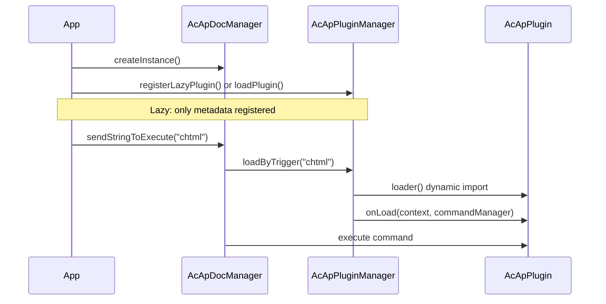

# Systém pluginů

Tato stránka vysvětluje, jak pro MLightCAD vytvořit, zaregistrovat a používat **plugin**. Pluginy rozšiřují prohlížeč registrací příkazů, přístupem k aktivnímu dokumentu a zobrazení a úklidem při uvolnění.

Systém pluginů žije v `@mlightcad/cad-simple-viewer` (`packages/cad-simple-viewer/src/plugin`). Oficiální pluginy (UI, AI agent, konzole skriptů, export HTML/PDF/SVG, datové zdroje OneDrive/Google Drive) jsou dodávány jako samostatné balíčky npm — úplný seznam viz [Vestavěné pluginy](./built-in-plugins).

---

## Přehled

Plugin je malý modul, který implementuje `AcApPlugin`. **Správce pluginů** (`AcApPluginManager`) je vlastněn `AcApDocManager` a:

- Volá `onLoad()`, když je plugin načten (registrace příkazů, hooků atd.)
- Volá `onUnload()`, když je plugin odebrán (odregistrace příkazů, uvolnění zdrojů)
- Podporuje **línou registraci**: kód pluginu se nestahuje, dokud uživatel nespustí **spouštěcí příkaz**



---

## Základní typy

### `AcApPlugin`

Každý plugin musí poskytovat:

| Pole / metoda | Popis |
|----------------|-------------|
| `name` | Jedinečný identifikátor (povinný). Při líném načítání musí odpovídat `name` z líné registrace. |
| `version?` | Volitelný řetězec verze |
| `description?` | Volitelný popis čitelný pro člověka |
| `onLoad(context, commandManager)` | Registrace příkazů a inicializace zdrojů |
| `onUnload(context, commandManager)` | Odstranění příkazů a uvolnění zdrojů |

`context` je `AcApContext` (aktuální `doc` a `view`). `commandManager` je `AcEdCommandStack` — stejný zásobník, jaký používají vestavěné příkazy.

Referenční implementace: `AcApExamplePlugin` v `packages/cad-simple-viewer/src/plugin/AcApPluginExample.ts`.

### `AcApLazyPluginRegistration`

Pro rozdělení kódu zaregistrujte deskriptor namísto okamžitého načtení pluginu:

| Pole | Popis |
|-------|-------------|
| `name` | Musí se rovnat `AcApPlugin.name` vrácenému z `loader` |
| `triggers` | Názvy příkazů, které načtou tento plugin (bez ohledu na velikost písmen) |
| `loader` | Asynchronní továrna, která vrací instanci pluginu |

---

## Krok 1 — Implementace příkazu

Pluginy obvykle nabízejí jeden nebo více **příkazů**. Rozšiřte `AcEdCommand` a implementujte `execute(context)`:

```typescript
import { AcApContext, AcEdCommand } from '@mlightcad/cad-simple-viewer'

export class AcApMyExportCmd extends AcEdCommand {
  async execute(context: AcApContext) {
    const fileName = context.doc.fileName || context.doc.docTitle
    // ... export logic using context.doc.database, context.view, etc.
  }
}
```

Výzvy, přístup k editoru a vytváření entit najdete v části [Příkaz](./command).

---

## Krok 2 — Implementace `AcApPlugin`

Sledujte každý příkaz, který zaregistrujete, aby jej `onUnload` mohl odebrat:

```typescript
import {
  AcApContext,
  AcApPlugin,
  AcEdCommandStack
} from '@mlightcad/cad-simple-viewer'

import { AcApMyExportCmd } from './AcApMyExportCmd'

export class AcApMyPlugin implements AcApPlugin {
  name = 'MyPlugin'
  version = '1.0.0'
  description = 'My custom export command'

  private registeredCommands: Array<{ group: string; name: string }> = []

  onLoad(_context: AcApContext, commandManager: AcEdCommandStack): void {
    const group = AcEdCommandStack.SYSTEMT_COMMAND_GROUP_NAME
    commandManager.addCommand(group, 'myexport', 'myexport', new AcApMyExportCmd())
    this.registeredCommands.push({ group, name: 'myexport' })
  }

  onUnload(_context: AcApContext, commandManager: AcEdCommandStack): void {
    for (const cmd of this.registeredCommands) {
      commandManager.removeCmd(cmd.group, cmd.name)
    }
    this.registeredCommands = []
  }
}
```

Oficiální pluginy dodržují stejný vzor:

- `AcApHtmlPlugin` — registruje `chtml`
- `AcApPdfPlugin` — registruje `cpdf`, `ipdf`
- `AcApSvgPlugin` — registruje `csvg`

Pro příkazy platné v celém prohlížeči (stejná skupina jako zoom, hladina atd.) používejte `AcEdCommandStack.SYSTEMT_COMMAND_GROUP_NAME`.

---

## Krok 3 — Publikování jako balíček npm (volitelné)

Napodobte strukturu `cad-html-plugin`, `cad-pdf-plugin` nebo `cad-svg-plugin`:

```
my-cad-plugin/
  package.json          # name: @myorg/cad-my-plugin
  src/
    AcApMyPlugin.ts
    AcApMyExportCmd.ts
    registerLazyMyPlugin.ts
    index.ts            # public exports
```

**Konvence `package.json`:**

- Nastavte `"type": "module"`
- Uveďte `@mlightcad/cad-simple-viewer` jako **peerDependency** (a další sdílené knihovny, jako `@mlightcad/data-model`, `three`, pokud je potřeba)
- Sestavujte pomocí `tsc` + `vite` jako stávající pluginy
- Exportujte pomocníky ze `src/index.ts`: třídu pluginu, `createMyPlugin`, `registerLazyMyPlugin`, konstanty spouštěčů

**Modul líného načítače** (`registerLazyMyPlugin.ts`):

```typescript
import type { AcApPluginManager } from '@mlightcad/cad-simple-viewer'

export const MY_PLUGIN_NAME = 'MyPlugin'
export const MY_PLUGIN_TRIGGERS = ['myexport'] as const

export async function createMyPlugin() {
  const { AcApMyPlugin } = await import('./AcApMyPlugin')
  return new AcApMyPlugin()
}

export function registerLazyMyPlugin(pluginManager: AcApPluginManager): void {
  pluginManager.registerLazyPlugin({
    name: MY_PLUGIN_NAME,
    triggers: [...MY_PLUGIN_TRIGGERS],
    loader: createMyPlugin
  })
}
```

Dynamický `import('./AcApMyPlugin')` udržuje těžký chunk pluginu mimo počáteční bundle, dokud se nespustí `myexport`.

---

## Registrace pluginů

Existují čtyři běžné cesty registrace. Vyberte jednu podle toho, zda potřebujete líné načítání a kdo vlastní bootstrap aplikace.

### A. Líná registrace (doporučeno pro volitelné funkce)

Registrujte po `AcApDocManager.createInstance()`. Modul pluginu se načte při prvním spouštěcím příkazu.

```typescript
import { AcApDocManager } from '@mlightcad/cad-simple-viewer'
import { registerLazyHtmlPlugin } from '@mlightcad/cad-html-plugin'
import { registerLazyPdfPlugin } from '@mlightcad/cad-pdf-plugin'
import { registerLazySvgPlugin } from '@mlightcad/cad-svg-plugin'

AcApDocManager.createInstance({
  container: document.getElementById('cad-container')!,
  htmlViewerRuntimeUrl: './viewer-runtime.iife.js' // required for chtml export
})

const pm = AcApDocManager.instance.pluginManager
registerLazyHtmlPlugin(pm)
registerLazyPdfPlugin(pm)
registerLazySvgPlugin(pm)
```

Ukázková aplikace: `packages/cad-simple-viewer-example/src/main.ts`.

Když uživatel spustí spouštěcí příkaz, `AcApDocManager` automaticky zavolá `loadByTrigger`, pokud příkaz ještě není zaregistrován:

```typescript
AcApDocManager.instance.sendStringToExecute('chtml')
AcApDocManager.instance.sendStringToExecute('cpdf')
```

Při použití `sendStringToExecute` **nemusíte** volat `loadByTrigger` ručně, pokud ovšem nechcete plugin předběžně načíst před provedením (viz níže).

### B. Inline líná registrace (komponenta cad-viewer)

`@mlightcad/cad-viewer` registruje pluginy PDF/HTML/SVG v `registerLazyPlugins()` (`packages/cad-viewer/src/app/register.ts`), která je volána z `initializeCadViewer()` v `app.ts`. Spotřebitelé komponenty Vue získají líné pluginy bez dalšího nastavení.

### C. Okamžité načtení pomocí `pluginManager.loadPlugin()`

Načtěte ihned po vytvoření správce dokumentu:

```typescript
import { AcApDocManager } from '@mlightcad/cad-simple-viewer'
import { AcApExamplePlugin } from '@mlightcad/cad-simple-viewer' // AcApExamplePlugin export

AcApDocManager.createInstance({ container: el })
await AcApDocManager.instance.pluginManager.loadPlugin(new AcApExamplePlugin())
```

Použijte, když je plugin malý nebo musí být k dispozici před jakoukoli akcí uživatele.

### D. Okamžité načtení pomocí `createInstance({ plugins })`

Předejte pluginy při inicializaci; `AcApDocManager` je během spuštění načte asynchronně.

**Z instancí nebo továren:**

```typescript
AcApDocManager.createInstance({
  container: el,
  plugins: {
    fromConfig: [
      new AcApExamplePlugin(),
      () => new AcApAnotherPlugin()
    ]
  }
})
```

**Ze složky (dynamický import):**

```typescript
AcApDocManager.createInstance({
  container: el,
  plugins: {
    fromFolder: {
      folderPath: './plugins',
      pluginList: ['MyPlugin.js'],
      continueOnError: true
    }
  }
})
```

V prohlížeči musíte dodat `pluginList` (neexistuje API pro výpis adresáře). Každý soubor by měl ve výchozím exportu vyvážet instanci pluginu, třídu pluginu nebo tovární funkci.

---

## Používání pluginů za běhu

### Spuštění příkazu pluginu

Poté, co je plugin načten (okamžitě nebo přes líný spouštěč):

```typescript
// Command line / script style
AcApDocManager.instance.sendStringToExecute('chtml')

// Or via editor API
await AcApDocManager.instance.editor.executeCommand('cpdf')
```

### Předběžné načtení líného pluginu (volitelné)

Některé cesty uživatelského rozhraní načítají plugin před `sendStringToExecute`, aby se vyhnuly zpoždění při prvním spuštění:

```typescript
const pluginManager = AcApDocManager.instance.pluginManager
await pluginManager.loadByTrigger('cpdf')
AcApDocManager.instance.sendStringToExecute('cpdf')
```

`cad-viewer` používá tento vzor pro export do PDF z ribbonu (`MlRibbonCommands.vue` → `runLazyCommand`).

### Kontrola stavu načtení

```typescript
const pm = AcApDocManager.instance.pluginManager

pm.isPluginLoaded('HtmlPlugin')        // true after first chtml
pm.isLazyPluginTrigger('chtml')        // true if lazy registration exists
pm.getLoadedPlugins()                  // ['HtmlPlugin', ...]
await pm.unloadPlugin('HtmlPlugin')
await pm.unloadAllPlugins()            // called when destroying the view
```

### Uvolnění

```typescript
await AcApDocManager.instance.pluginManager.unloadPlugin('MyPlugin')
```

`onUnload` musí odebrat každý příkaz zaregistrovaný v `onLoad`. V opačném případě zůstanou v zásobníku zastaralé příkazy.

---

## Přehled vestavěných pluginů

Monorepo přibaluje několik oficiálních pluginů: `AcApHtmlPlugin` (`chtml`), `AcApPdfPlugin` (`cpdf`, `ipdf`), `AcApSvgPlugin` (`csvg`) a dále pluginy pro UI, agenta, konzoli skriptů a datové zdroje.

Úplný seznam s příkazy, veřejným API a konfigurací jednotlivých pluginů a s odkazy na README každého balíčku najdete v části [Vestavěné pluginy](./built-in-plugins).

---

## Kontrolní seznam integrace

1. **Závislost** na `@mlightcad/cad-simple-viewer` (pro publikované pluginy peer závislost).
2. **Implementace** `AcApPlugin` + `AcEdCommand`(ů).
3. **Export** `registerLazy*Plugin` + `create*Plugin` ze vstupního bodu balíčku.
4. **Registrace** po `AcApDocManager.createInstance()` (nebo přes `plugins.fromConfig` / `fromFolder`).
5. **Spouštění** příkazů pomocí `sendStringToExecute` nebo uživatelského rozhraní, které volá stejné názvy příkazů.
6. **Bundlování**: používejte dynamický `import()` v líném `loader`, aby Vite/Rollup rozdělil chunk pluginu.
7. **Úklid**: odeberte všechny příkazy v `onUnload`.
8. **Jedinečné spouštěče**: jeden spouštěcí příkaz nemůže mapovat na dva líné pluginy (`registerLazyPlugin` při konfliktu vyhodí výjimku).
9. **Konzistence názvů**: `AcApLazyPluginRegistration.name` musí odpovídat `plugin.name` z `loader()`.

---

## Řešení potíží

| Příznak | Pravděpodobná příčina |
|---------|----------------|
| `Command 'chtml' not found` | Líný plugin není zaregistrován, nebo byl zaregistrován až po zničení |
| Líný plugin se nikdy nenačte | Nesoulad názvu spouštěče (zkontrolujte normalizaci velkých písmen); nesprávný `name` v loaderu vs. registraci |
| Export HTML za běhu selhává | Chybí `htmlViewerRuntimeUrl`, nebo `viewer-runtime.iife.js` není nasazen na této adrese |
| `Plugin 'X' is already loaded` | Volání `loadPlugin` dvakrát bez `unloadPlugin` |
| Trigger already registered | Dva pluginy zaregistrovaly stejný spouštěcí příkaz |

---

## Související dokumentace

- [Vestavěné pluginy](./built-in-plugins) — všechny oficiální pluginy MLightCADu
- [Příkaz](./command) — životní cyklus příkazu a `AcEdCommand`
- [Plugin datového zdroje](./data-source-plugin) — zásuvné zdroje výkresů (lokální, URL, OneDrive, …)
- [Integrace Simple Viewer](./integrate-simple-cad-viewer) — vložení `cad-simple-viewer`
- [Integrace komponenty Vue](./integrate-cad-viewer-component) — komponenta Vue a `initializeCadViewer`
- [Přehled architektury](./architecture-overview) — rozvržení modulů
