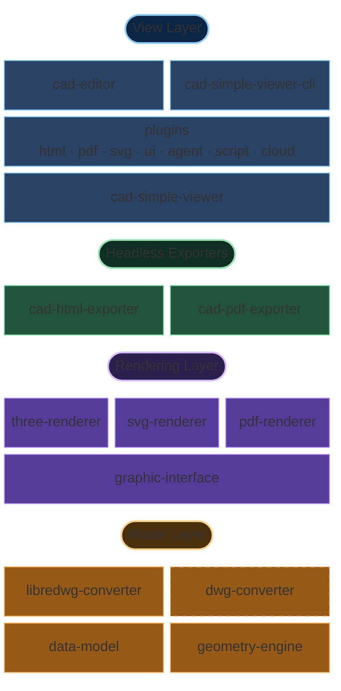

# Architecture Overview

MLightCAD runs entirely in the browser with **no backend dependencies**. DWG/DXF files are parsed and processed locally with WebAssembly and JavaScript, which ensures:

- **Zero server requirements** — deploy anywhere with static file hosting only
- **Complete data privacy** — files never leave the user's device
- **Instant integration** — no complex backend setup or API configuration
- **Offline capability** — works without internet connectivity

This repository is a `pnpm` + `nx` TypeScript monorepo. The main packages related to viewing and editing are:

| Package | Responsibility |
| --- | --- |
| [`@mlightcad/cad-simple-viewer`](https://github.com/mlightcad/cad-viewer/tree/main/packages/cad-simple-viewer) | Document management, command stack, plugin manager, and canvas; **no UI framework dependency** |
| [`@mlightcad/cad-editor`](https://github.com/mlightcad/cad-viewer/tree/main/packages/cad-editor) | Full Vue 3 UI on top of `cad-simple-viewer` (menus, ribbon, command line, status bar) |
| [`@mlightcad/cad-simple-viewer-cli`](https://github.com/mlightcad/cad-viewer/tree/main/packages/cad-simple-viewer-cli) | Headless CLI: drives `cad-simple-viewer` in Playwright / Chromium to run `.scr` scripts |
| [`@mlightcad/three-renderer`](https://github.com/mlightcad/cad-viewer/tree/main/packages/three-renderer) | Interactive 2D/3D rendering with THREE.js |
| `svg-renderer` ([`cad-svg-plugin`](https://github.com/mlightcad/cad-viewer/tree/main/packages/cad-svg-plugin)) | SVG vector output via the same rendering interface |
| [`@mlightcad/pdf-renderer`](https://github.com/mlightcad/cad-viewer/tree/main/packages/pdf-renderer) | Vector PDF output backend via the same rendering interface |
| [`@mlightcad/cad-html-exporter`](https://github.com/mlightcad/cad-viewer/tree/main/packages/cad-html-exporter) / [`@mlightcad/cad-pdf-exporter`](https://github.com/mlightcad/cad-viewer/tree/main/packages/cad-pdf-exporter) | Headless Node HTML / PDF export (no in-browser viewer required) |
| `*-plugin` | Optional features (UI, export, scripting, agent, cloud data sources), lazy-loaded by the plugin manager |

Layering rule: `data-model` (external) → renderers → `cad-simple-viewer` → UI / plugins / CLI. **Lower-level packages must not depend on higher-level ones.**

## Overall architecture

The system is split by responsibility into the **model**, **rendering**, and **view** layers, plus independently deployable **headless exporters** and a CLI that drives the same viewer core.

This layered design keeps MLightCAD scalable across different data sizes, rendering targets, and deployment shapes (browser component, headless CLI, or pure Node export).

### Model layer

The model layer lives in the separate [`realdwg-web`](https://github.com/mlightcad/realdwg-web) repository and is consumed here as an external dependency:

- [`@mlightcad/data-model`](https://github.com/mlightcad/realdwg-web) defines the unified **Data Model** for parsed CAD data (geometric entities, layers, view parameters, and so on).
- [`AcDbDatabaseConverter`](https://github.com/mlightcad/realdwg-web/blob/main/packages/data-model/src/database/AcDbDatabaseConverter.ts) provides a unified CAD file conversion interface so different converters can produce the same data model.
- [`@mlightcad/libredwg-converter`](https://github.com/mlightcad/realdwg-web) provides open-source LibreDWG-based DWG parsing (WebAssembly) into that model. Hosts must register the converter themselves (`cad-simple-viewer` does not bundle the GPL parser).
- **`@mlightcad/dwg-converter`** is a **closed-source commercial** DWG parsing module that implements the same `AcDbDatabaseConverter` interface and can replace `libredwg-converter` for higher compatibility and completeness. It is distributed privately via GitHub Packages and is not open-sourced with this repository. See [Install and Use Proprietary DWG Converter](./install-and-use-proprietary-dwg-converter) for setup, and [PROPRIETARY-PARSER.md](https://github.com/mlightcad/cad-viewer/blob/main/PROPRIETARY-PARSER.md) for licensing and trial details.
- DXF parsing is handled by the built-in conversion pipeline in `data-model` (historically based on [`@mlightcad/dxf-json`](https://github.com/mlightcad/dxf-json)).
- [`@mlightcad/geometry-engine`](https://github.com/mlightcad/realdwg-web) provides geometry and math (points, lines, polylines, splines, circles/arcs, ellipses, plus vectors and matrices).

Why define `AcDbDatabaseConverter`? Existing DXF/DWG tools are often incomplete. The open-source path uses `libredwg-converter`; for higher fidelity you can register closed-source `dwg-converter` instead without changing upper viewer code. You can also implement the same interface on top of commercial engines such as [ODA](https://www.opendesign.com/products/drawings).

### Rendering layer

- [`@mlightcad/graphic-interface`](https://github.com/mlightcad/realdwg-web) (`realdwg-web`) defines the unified entity rendering interface (`AcGiRenderer` and related types).
- [`@mlightcad/three-renderer`](https://github.com/mlightcad/cad-viewer) implements that interface with THREE.js for interactive canvas rendering (batching, linetype/hatch shaders, and so on). This is the default backend for `cad-simple-viewer`.
- **`svg-renderer`** (`AcSvgRenderer`) implements the same interface and outputs scalable SVG. The current implementation lives in [`@mlightcad/cad-svg-plugin`](https://github.com/mlightcad/cad-viewer/tree/main/packages/cad-svg-plugin) and is used by commands such as `csvg`; PDF vector export also reuses some of its drawing capabilities.
- [`@mlightcad/pdf-renderer`](https://github.com/mlightcad/cad-viewer) implements the same interface and emits vector PDF content streams; used by `cad-pdf-core` / `cad-pdf-plugin` / `cad-pdf-exporter`.

### View layer

- **`cad-simple-viewer`** is the core: document lifecycle, command stack, user input / jigs, coordination with `three-renderer`, and the **`AcApPluginManager` plugin system**. It provides no application UI beyond the canvas.
- **Plugins** ship as separate npm packages implementing `AcApPlugin`, attached via `registerLazyPlugin` / `loadPlugin`. Official plugins cover HTML / PDF / SVG export, simple UI, script console, AI agent, OneDrive / Google Drive, and more. See [Plugin System](./plugin-system) and [Built-in Plugins](./built-in-plugins).
- **`cad-editor`** (formerly `@mlightcad/cad-viewer`, renamed in 1.8.0) adds a full Vue 3 UI on top of `cad-simple-viewer` and registers common lazy plugins during bootstrap.
- **`cad-simple-viewer-cli`** starts the same viewer core in headless Chromium via Playwright and runs AutoCAD-style `.scr` scripts (for example `-chtml` / `-cpdf`), suitable for CI and conversion services. See [Build a Cloud DWG Web Viewer](./cloud-dwg-web-viewer).

### Headless exporters

Browser plugins and Node exporters share export pipelines in `*-core` packages so the server does not need to spin up a full viewer:

| Path | Shared core | Rendering backend | Typical entry points |
| --- | --- | --- | --- |
| HTML | `@mlightcad/cad-html-core` | `three-renderer` (snapshot then pack) | Browser: `cad-html-plugin` (`chtml`); Node: `cad-html-exporter` (`exportFileToHtml`) |
| PDF | `@mlightcad/cad-pdf-core` | `pdf-renderer` | Browser: `cad-pdf-plugin` (`cpdf`); Node: `cad-pdf-exporter` (`exportFileToPdf`) |

`*-core` packages do **not** depend on `cad-simple-viewer` / DOM; `*-exporter` packages handle font loading, DWG registration, and file I/O in Node. For full command-script capability (not only file → HTML/PDF), use `cad-simple-viewer-cli`.

## Rendering engine

Rendering DXF/DWG drawings poses several challenges:

- High-performance rendering of drawings with large entity counts
- Reproducing AutoCAD text rendering
- Supporting linetypes and hatch patterns

### High-performance rendering

For large drawings, the key is merging points, lines, and faces to reduce **draw calls**. THREE.js [BatchedMesh](https://threejs.org/docs/index.html?q=Mesh#api/en/objects/BatchedMesh) only partially solves triangle merging and does not support point/line merging. We therefore implemented batching classes inspired by `BatchedMesh`; see [`packages/three-renderer/src/batch`](https://github.com/mlightcad/cad-viewer/tree/main/packages/three-renderer/src/batch).

### Text rendering

AutoCAD uses [`MText`](https://ezdxf.mozman.at/docs/dxfinternals/entities/mtext.html) for rich text and [SHX](https://help.autodesk.com/view/OARX/2023/ENU/?guid=GUID-DE941DB5-7044-433C-AA68-2A9AE98A5713) stroke fonts for faster display. Related packages live in separate repositories:

- **Parse MText** — [`@mlightcad/mtext-parser`](https://github.com/mlightcad/mtext-parser)
- **Parse SHX** — [`@mlightcad/shx-parser`](https://github.com/mlightcad/shx-parser)
- **Render MText** — [`@mlightcad/mtext-renderer`](https://github.com/mlightcad/mtext-renderer); parsed fonts are cached in IndexedDB to avoid repeated download and parse

For debugging text rendering, use the THREE.js-based rich text editor [mtext-editor](https://github.com/mlightcad/mtext-editor).

### Linetypes and hatch patterns

AutoCAD supports custom linetypes and hatch patterns. We have implemented a subset of them. Interactive canvas linetypes and fills use THREE.js `ShaderMaterial`; see [`packages/three-renderer/src/style`](https://github.com/mlightcad/cad-viewer/tree/main/packages/three-renderer/src/style). The PDF path reproduces the corresponding look vectorially in `pdf-renderer`.
