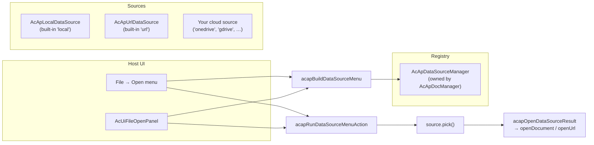

# Data Source Plugin

This page explains the **data source plugin** mechanism in `@mlightcad/cad-simple-viewer` — the pluggable layer that decides **where drawings come from** (local disk, HTTP URL, OneDrive, Google Drive, …). It covers how the mechanism works, how to create your own data source, and how to register and use it.

The mechanism lives in `packages/cad-simple-viewer/src/app/dataSource`. A complete reference implementation ships as a separate npm package: `@mlightcad/cad-onedrive-plugin` (`packages/cad-onedrive-plugin`), used by the demo app in `packages/cad-simple-viewer-example`.

> For **command plugins** (export commands like `cpdf`, `chtml`), see [Plugin System](./plugin-system). A data source plugin *is* an `AcApPlugin` — it just uses `onLoad` to register a data source instead of a command.

---

## Overview

A **data source** is an object implementing `AcApDataSource`: a pluggable origin for CAD drawings. The viewer core knows nothing about vendors — it only knows the registry (`AcApDataSourceManager`) and a small set of menu helpers. All vendor-specific logic (login popups, File Pickers, downloads) stays **inside** the data source.



Key design rules:

- **Hosts only orchestrate.** Host UI (ribbon Open menu, `AcUiFileOpenPanel`, toolbars) must only (1) list sources via `AcApDataSourceManager`, (2) build labels with `acapBuildDataSourceMenu`, (3) run clicks with `acapRunDataSourceMenuAction` / `acapInvokeDataSourceMenuAction`. They must **not** open vendor File Pickers, download URLs, or show provider-specific login chrome.
- **Sign-in and pick are never chained.** Browsers only allow `window.open` in a direct user-gesture tick. If a click handler `await`s MSAL login and *then* opens a picker popup, the second popup is blocked. The menu therefore exposes **Sign in** and **Open from …** as separate items.
- **Adaptive menus.** `getAuthState()` drives what the menu shows, so the host needs no provider-specific UI.

---

## Core types

All types below are exported from `@mlightcad/cad-simple-viewer`.

### `AcApDataSource`

The interface every data source must implement:

| Member | Required | Description |
|--------|----------|-------------|
| `id` | ✓ | Stable id used in menus and registry lookups (`local`, `url`, `onedrive`, …) |
| `labelKey` | ✓ | i18n key for the display name (e.g. `main.dataSource.onedrive`) |
| `icon?` | | Optional inline SVG string or URL |
| `requiresAuth` | ✓ | Whether the source needs user authentication |
| `requiresUserGesture` | ✓ | When `true`, `pick()` must run `window.open` in the direct click tick (cloud File Pickers) |
| `getAuthState()` | ✓ | Returns `'none'` \| `'signed-out'` \| `'signed-in'` |
| `getAccountLabel?()` | | Short signed-in label for menus (email / display name) |
| `getAccountProfile?()` | | `{ displayName, email?, avatarUrl? }` for landing / account chrome |
| `restoreSession?()` | | Restore a cached session after registration (MSAL accounts, tokens, …). Must call `notifyAuthChanged` when finished so Open menus refresh |
| `signIn()` | ✓ | Interactive sign-in. No-op when `requiresAuth` is `false` |
| `signOut()` | ✓ | Sign out. No-op when `requiresAuth` is `false` |
| `pick()` | ✓ | Opens the source-specific File Picker / dialog, downloads if needed, and returns the chosen drawing — or `null` when the user cancels |

### `AcApDataSourceFile`

The result of a successful `pick()`:

| Field | Description |
|-------|-------------|
| `name` | File name including extension (e.g. `drawing.dwg`) |
| `content?` | Raw file bytes (`ArrayBuffer`). Used when `url` is omitted |
| `url?` | Remote URL opened via `AcApDocManager.openUrl` (HTTP fetch with progress) |

Prefer `content` for bytes already in memory; prefer `url` when the source should be opened via `openUrl`.

### `AcApDataSourceManager`

The registry, owned by `AcApDocManager` (`AcApDocManager.instance.dataSourceManager`). `AcApDocManager.createInstance()` registers the two built-in sources automatically:

- `local` — `AcApLocalDataSource` (`<input type="file">` picker for `.dwg` / `.dxf`)
- `url` — `AcApUrlDataSource` (URL dialog, opens via `openUrl`)

Cloud plugins register themselves in `AcApPlugin.onLoad` and unregister in `onUnload`.

| API | Description |
|-----|-------------|
| `register(source)` | Register a source (replaces any existing source with the same id) |
| `unregister(id)` | Remove a source by id |
| `list()` | Registered sources in registration order |
| `get(id)` | Look up a source by id |
| `notifyAuthChanged(sourceId)` | Cloud plugins call this after successful `signIn` / `signOut` |
| `on` / `off` | Subscribe to `changed` and `auth-changed` events |

---

## Menu helpers

Hosts do not hand-roll Open menus. Three helpers define the contract:

### 1. `acapBuildDataSourceMenu(sources)`

Builds `AcApDataSourceMenuItem[]` from the current registry. Rules (popup-blocker safe):

| Auth state | Menu items |
|------------|------------|
| No auth required (`'none'`) | One **pick** item (e.g. *Local file*, *From URL*) |
| Requires auth, **signed out** | One **sign-in** item only (never chained into pick) |
| Requires auth, **signed in** | **pick** (*Open from OneDrive*) + **sign-out** (*Sign out of OneDrive (user@host)*) |

### 2. `acapRunDataSourceMenuAction(item, options?, manager?)`

Runs the action for a menu item and **opens pick results automatically** (`acapOpenDataSourceResult`: `openUrl` when `file.url` is set, otherwise `openDocument` with `file.content`). Use this in in-viewer Open menus. It never chains sign-in into pick.

### 3. `acapInvokeDataSourceMenuAction(source, item)`

Runs the action against an already-resolved source **without** opening the file. Use this on landing pages that own a data source manager before `AcApDocManager` exists, or when you want to open the result yourself.

### Supporting utilities

| Helper | Purpose |
|--------|---------|
| `acapOpenCenteredPopup(name, width?, height?)` | Opens a named popup centered on screen — use inside `pick()` so the popup opens in the same click tick |
| `acapWithDataSourceBusy(work, message?)` | Wraps download / post-picker work in a busy overlay (DocManager's busy indicator, or a temporary `AcApProgress` on `document.body` for landing pages) |
| `acapOpenDataSourceResult(file, options?)` | Opens a `pick()` result via DocManager (`openUrl` / `openDocument`) |
| `acapIsSingleLocalOpen(sources)` | Whether the Open UI should collapse to a single "Open" action (only the built-in local source) |

---

## Creating a data source plugin

A data source plugin is a normal `AcApPlugin` (see [Plugin System](./plugin-system)) whose `onLoad` registers an `AcApDataSource`. The recommended package layout mirrors `cad-onedrive-plugin`:

```
my-cad-datasource-plugin/
  package.json          # name: @myorg/cad-my-datasource-plugin
  src/
    AcApMyDataSource.ts # implements AcApDataSource
    AcApMyPlugin.ts     # implements AcApPlugin, registers the source
    myClient.ts         # vendor API client (auth, picker, download)
    register.ts         # registerMyPlugin(pluginManager, options)
    index.ts            # public exports
```

**`package.json` conventions:**

- Set `"type": "module"`
- List `@mlightcad/cad-simple-viewer` (and `@mlightcad/data-model` if needed) as **peerDependencies**
- Build with `tsc` + `vite` like existing plugins

### Step 1 — Implement `AcApDataSource`

```typescript
import {
  type AcApDataSource,
  type AcApDataSourceAccountProfile,
  type AcApDataSourceAuthState,
  type AcApDataSourceFile,
  type AcApDataSourceManager,
  acapOpenCenteredPopup,
  acapWithDataSourceBusy
} from '@mlightcad/cad-simple-viewer'

/** Stable id used in menus and registry lookups. */
export const ACAP_MY_DATA_SOURCE_ID = 'mycloud'

export class AcApMyDataSource implements AcApDataSource {
  readonly id = ACAP_MY_DATA_SOURCE_ID
  readonly labelKey = 'main.dataSource.mycloud'
  readonly requiresAuth = true
  // true because pick() opens a File Picker popup via window.open
  readonly requiresUserGesture = true

  private readonly dataSourceManager: AcApDataSourceManager

  constructor(dataSourceManager: AcApDataSourceManager) {
    this.dataSourceManager = dataSourceManager
  }

  getAuthState(): AcApDataSourceAuthState {
    return this.client.isAuthenticated ? 'signed-in' : 'signed-out'
  }

  getAccountLabel(): string | undefined {
    return this.client.userInfo?.email
  }

  getAccountProfile(): AcApDataSourceAccountProfile | undefined {
    if (!this.client.isAuthenticated) return undefined
    const info = this.client.userInfo!
    return { displayName: info.name || info.email, email: info.email }
  }

  /** Restore cached tokens after registration so menus show signed-in state. */
  async restoreSession(): Promise<void> {
    await this.client.initialize()
    this.notifyAuthChanged()
  }

  async signIn(): Promise<void> {
    await this.client.authenticate()
    this.notifyAuthChanged()
  }

  async signOut(): Promise<void> {
    await this.client.signOut()
    this.notifyAuthChanged()
  }

  async pick(): Promise<AcApDataSourceFile | null> {
    // Open the popup in this click tick. Any `await` first loses the gesture.
    const popup = acapOpenCenteredPopup('MyCloudPicker', 1080, 680)
    if (!popup) {
      throw new Error('Popup blocked. Allow popups for this site and try again.')
    }
    try {
      await this.client.initialize()
      if (!this.client.isAuthenticated) {
        throw new Error('Sign in first, then choose a file (popup blocker).')
      }
      const picked = await this.client.openFilePicker(popup)
      const content = await acapWithDataSourceBusy(() =>
        this.client.downloadFile(picked)
      )
      return { name: picked.name, content }
    } catch (error) {
      try {
        if (!popup.closed) popup.close()
      } catch {
        // ignore
      }
      if (error instanceof Error && error.message === 'Picker cancelled') {
        return null // user cancelled — not an error
      }
      throw error
    }
  }

  private notifyAuthChanged(): void {
    this.dataSourceManager.notifyAuthChanged(this.id)
  }
}
```

Implementation notes:

- **`pick()` must open the popup synchronously** in the click tick (`requiresUserGesture = true`). Do any `await` (SDK init, auth check) *after* `window.open`.
- Call `acapWithDataSourceBusy` around downloads so users get progress feedback on both viewer and landing pages.
- Return `null` when the user cancels; throw for real failures.
- After auth state changes, always call `dataSourceManager.notifyAuthChanged(id)` so Open menus refresh.
- For non-popup sources (e.g. an in-page dialog), set `requiresUserGesture = false`.
- Add your `labelKey` (e.g. `main.dataSource.mycloud`) to the i18n resources — see [Localization](./localization).

### Step 2 — Wrap in `AcApPlugin`

```typescript
import {
  AcApContext,
  AcApDocManager,
  AcApPlugin,
  AcEdCommandStack
} from '@mlightcad/cad-simple-viewer'

import packageJson from '../package.json'
import { ACAP_MY_DATA_SOURCE_ID, AcApMyDataSource } from './AcApMyDataSource'

export class AcApMyPlugin implements AcApPlugin {
  name = 'MyDataSourcePlugin'
  version = packageJson.version
  description = 'Open DWG/DXF files from MyCloud'

  private source: AcApMyDataSource | null = null
  private createdSource = false

  onLoad(_context: AcApContext, _commandManager: AcEdCommandStack): void {
    const dsm = AcApDocManager.instance.dataSourceManager
    const existing = dsm.get(ACAP_MY_DATA_SOURCE_ID)
    if (existing) {
      // Already registered (e.g. HMR or double load) — just restore the session.
      void existing.restoreSession?.().catch(() => undefined)
      return
    }
    this.source = new AcApMyDataSource(dsm)
    this.createdSource = true
    dsm.register(this.source)
    // Restore cached session so File → Open shows Open/Sign out, not Sign in.
    void this.source.restoreSession().catch(() => undefined)
  }

  onUnload(_context: AcApContext, _commandManager: AcEdCommandStack): void {
    if (this.createdSource) {
      AcApDocManager.instance.dataSourceManager.unregister(ACAP_MY_DATA_SOURCE_ID)
    }
    this.source = null
    this.createdSource = false
  }
}
```

### Step 3 — Export a registration helper

Data sources must be visible **immediately** (Open menus list them before any document is open), so load eagerly via `pluginManager.loadPlugin`:

```typescript
// src/register.ts
import type { AcApPluginManager } from '@mlightcad/cad-simple-viewer'

import { AcApMyPlugin } from './AcApMyPlugin'

export const MY_PLUGIN_NAME = 'MyDataSourcePlugin'

export async function registerMyPlugin(
  pluginManager: AcApPluginManager,
  options: { clientId: string; /* … */ }
): Promise<void> {
  if (!options.clientId) {
    throw new Error('registerMyPlugin requires options.clientId')
  }
  await pluginManager.loadPlugin(new AcApMyPlugin(options))
}
```

> MSAL-style SDKs can still be imported lazily *inside* `signIn` / `pick` — only the registration itself needs to be eager.

---

## Using a data source plugin

### 1. Register it in your app

Call the registration helper after `AcApDocManager.createInstance()`:

```typescript
import { AcApDocManager } from '@mlightcad/cad-simple-viewer'
import { registerOneDrivePlugin } from '@mlightcad/cad-onedrive-plugin/register'

AcApDocManager.createInstance({ container: document.getElementById('cad-container')! })

await registerOneDrivePlugin(AcApDocManager.instance.pluginManager, {
  clientId: import.meta.env.VITE_MSAL_CLIENT_ID,
  tenantId: import.meta.env.VITE_MSAL_TENANT_ID || 'common',
  redirectUri: import.meta.env.VITE_MSAL_REDIRECT_URI // optional
})
```

Keep the registration stub in the initial bundle by importing from the `/register` subpath and dynamic-importing the rest (see `packages/cad-simple-viewer-example/src/register.ts`):

```typescript
const { registerOneDrivePlugin } = await import('@mlightcad/cad-onedrive-plugin/register')
```

That's all an app needs when it uses the built-in UI (ribbon / toolbar / `AcUiFileOpenPanel`): the Open menu rebuilds from `dataSourceManager` and now shows, for example:

| Auth state | Menu items |
|------------|------------|
| Signed out | Sign in to OneDrive |
| Signed in | Open from OneDrive, Sign out of OneDrive (user@contoso.com) |

### 2. Custom host UI (in-viewer menu)

If you build your own Open menu, use the helpers — do not call `signIn` / `pick` directly:

```typescript
import {
  AcApDocManager,
  acapBuildDataSourceMenu,
  acapRunDataSourceMenuAction
} from '@mlightcad/cad-simple-viewer'

const dsm = AcApDocManager.instance.dataSourceManager

function rebuildOpenMenu() {
  const items = acapBuildDataSourceMenu(dsm.list())
  renderMenu(items, item => {
    void acapRunDataSourceMenuAction(item, openOptions)
  })
}

rebuildOpenMenu()
dsm.on('changed', rebuildOpenMenu)
dsm.on('auth-changed', rebuildOpenMenu)
```

### 3. Landing pages (before the viewer exists)

Landing pages often let users pick a file before `AcApDocManager` is created. `AcUiFileOpenPanel` already implements this pattern: pass `onDataSourceAction` and run the item once the viewer is ready. When your own landing UI invokes a source directly, use `acapInvokeDataSourceMenuAction` + `acapOpenDataSourceResult`:

```typescript
import { acapInvokeDataSourceMenuAction, acapOpenDataSourceResult } from '@mlightcad/cad-simple-viewer'

const source = myDataSourceManager.get('onedrive') // or the built-in 'local' / 'url'
const file = await acapInvokeDataSourceMenuAction(source, menuItem)
if (file) {
  await acapOpenDataSourceResult(file, openOptions)
}
```

**User-gesture pitfall** (from `cad-simple-viewer-example/src/main.ts`): if the click handler must first `await` viewer initialization before running a `pick` action, the user gesture is lost and the popup is blocked. Either run the action synchronously when already initialized, or show a *sign in first, then open* hint for `pick` items (see `handleDataSourceMenuAction` in the example app).

---

## Real-world reference: OneDrive

`@mlightcad/cad-onedrive-plugin` is the canonical cloud data source:

| Piece | File | What it does |
|-------|------|--------------|
| `AcApOneDriveDataSource` | `src/AcApOneDriveDataSource.ts` | Implements `AcApDataSource` over Microsoft File Picker v8 + MSAL; `pick` opens the popup synchronously, then downloads under a busy overlay |
| `AcApOneDrivePlugin` | `src/AcApOneDrivePlugin.ts` | `AcApPlugin` that registers/unregisters the source and restores the cached MSAL session on load |
| `OneDriveClient` | `src/oneDriveClient.ts` | MSAL auth + File Picker v8 messaging + Graph download |
| `registerOneDrivePlugin` | `src/register.ts` | Eager registration helper (validates `clientId`) |
| `createOneDrivePlugin` | `src/createOneDrivePlugin.ts` | Async factory for the plugin instance |

The example app wires it up via env config (`packages/cad-simple-viewer-example/src/onedriveEnv.ts`): when `VITE_MSAL_CLIENT_ID` is set, `registerOneDriveFromEnv` registers the plugin; the landing panel lists a *Sign in to OneDrive* item through `AcUiFileOpenPanel`'s `extraMenuItems`.

**Azure app setup** (for OneDrive): register a **Single-page application** in Microsoft Entra ID, add a redirect URI matching your app origin, grant delegated Graph permissions `User.Read` + `Files.Read.All` (personal OneDrive picker tokens also cover `OneDrive.ReadOnly`).

---

## Troubleshooting

| Symptom | Likely cause |
|---------|----------------|
| Source missing from Open menu | Plugin not registered, or registered before `AcApDocManager.createInstance()` / after destroy; or `register` replaced an existing source with the same id |
| Picker popup blocked | `pick()` `await`ed before `window.open`, or sign-in was chained into pick in the same click handler |
| Menu still shows *Sign in* after login | `notifyAuthChanged` not called after auth state change; or `restoreSession` not invoked on load |
| Menu doesn't update after register/unregister | Host cached the item list instead of rebuilding on `changed` / `auth-changed` events |
| Download hangs with no feedback | Download not wrapped in `acapWithDataSourceBusy` |
| Opened file has neither bytes nor URL error | `pick()` returned a file with neither `content` nor `url` |

---

## Related documentation

- [Plugin System](./plugin-system) — `AcApPlugin`, command registration, lazy loading
- [Integrate Simple CAD Viewer](./integrate-simple-cad-viewer) — embedding `cad-simple-viewer`
- [Localization](./localization) — adding i18n keys such as `main.dataSource.*`
- [Architecture Overview](./architecture-overview) — module layout


