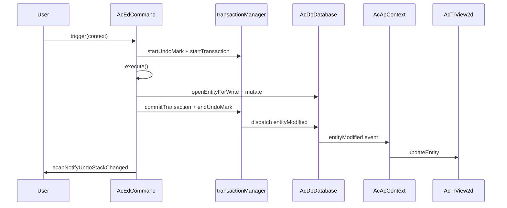

# Entity Modification Best Practices

This page explains how to modify drawing entities in **MLightCAD** so that changes are tracked correctly, **undo/redo** works as expected, and the **view stays in sync** with the database.

The database layer comes from [`@mlightcad/data-model`](https://github.com/mlightcad/realdwg-web). MLightCAD adds application helpers and wires database events to the renderer.

---

## Overview

A correct entity edit follows three layers:

| Layer | Responsibility |
|-------|----------------|
| **Database** (`AcDbDatabase`) | Stores entities and records mutations |
| **Transaction / undo** (`transactionManager`) | Groups changes and supports undo/redo |
| **View** (`AcTrView2d`) | Renders geometry; updated via database events |

**Rule of thumb:** mutate the database through the transaction APIs. Let `AcApContext` propagate changes to the view. Do not call `view.updateEntity()` after a normal database edit unless you have a special case (for example transient preview geometry).

---

## Transaction Mechanism

`AcDbDatabase.transactionManager` (`AcDbDatabaseTransactionManager`) manages transactions and undo history for one drawing. Its design follows AutoCAD ObjectARX `AcDbTransactionManager` semantics.

### Core APIs

| API | Purpose |
|-----|---------|
| `startTransaction()` | Begin recording mutations |
| `commitTransaction()` | Finalize the current transaction and dispatch events |
| `abortTransaction()` | Roll back all changes in the current transaction |
| `hasTransaction()` | Returns whether a transaction is active |
| `isRecording()` | Returns whether mutations are being recorded (false during undo/redo replay) |
| `openEntityForWrite(id \| entity)` | Open an entity for write **through** the active transaction |

### What gets recorded

While `isRecording()` is true, the transaction manager records:

- **Property changes** on database objects (`kind: 'modify'`)
- **Append / remove** of objects in block table records, symbol tables, or dictionaries
- **System variable** changes

When the outermost transaction commits, recorded changes are finalized and relevant database events are dispatched.

### Nested transactions

Transactions can be nested. Inner transactions merge their recorder into the parent. Only the **outermost** `commitTransaction()` dispatches events and enqueues undo history.

### Opening objects for write

Always use `database.openEntityForWrite(...)` (or `openObjectForWrite`) instead of mutating a cached entity reference directly:

```typescript
const opened = db.openEntityForWrite(entityOrObjectId)
if (!opened) return
opened.color = newColor
```

When a transaction is active, `openEntityForWrite` routes the object through the transaction so the change is tracked. Without an active transaction, the helper falls back to a direct lookup and the change may **not** be undoable.

### Strict mode

`transactionManager.strictMode` (default in data-model) can require that all mutations happen inside an active transaction. Undo/redo replay is exempt so the change applier can restore state. In practice, MLightCAD commands and `acapRunDatabaseEdit` always establish a transaction before editing.

---

## Undo / Redo Mechanism

Undo/redo is built on **undo marks** and **undo records**.

### Undo marks

| API | Purpose |
|-----|---------|
| `startUndoMark(label?)` | Open a group; multiple commits inside one mark become **one** undo step |
| `endUndoMark()` | Close the group and push an undo record when changes exist |
| `cancelUndoMark()` | Discard the group without creating an undo record |

### Undo / redo operations

| API | Purpose |
|-----|---------|
| `undo()` | Revert the most recent undo record |
| `redo()` | Re-apply the most recently undone record |
| `canUndo()` / `canRedo()` | Query stack state |
| `clearUndoStack()` | Clear both stacks |

When undo or redo runs, `AcDbChangeApplier` replays stored changes in forward or inverse order and dispatches the appropriate entity events so the view updates automatically.

### How commands get undo for free

`AcEdCommand.trigger()` wraps command execution in one undo mark and one transaction when undo recording is enabled:

```typescript
// AcEdCommand.trigger() — simplified
if (recordUndo) {
  tm.startUndoMark(this.globalName || this.localName)
  tm.startTransaction()
}
try {
  await this.execute(context)
} catch (error) {
  if (undoTransactionActive) {
    tm.abortTransaction()
    tm.cancelUndoMark()
  }
  throw error
} finally {
  if (undoTransactionActive) {
    tm.commitTransaction()
    tm.endUndoMark()
    acapNotifyUndoStackChanged()
  }
}
```

Undo recording is enabled when **all** of the following are true:

- `command.recordsUndoStack === true` (default)
- `context.doc.openMode >= AcEdOpenMode.Review`
- `command.mode >= AcEdOpenMode.Review`

Set `recordsUndoStack = false` for meta-commands that should not create their own undo step (for example `AcApUndoCmd` and `AcApRedoCmd`).

### UI notification

After undo/redo availability changes, call `acapNotifyUndoStackChanged()` from `@mlightcad/cad-simple-viewer`. This emits `undo-stack-changed` on the global event bus so components such as `useUndoRedo` can refresh toolbar state.

Commands that go through `AcEdCommand.trigger()` call this automatically on successful commit. Standalone edits via `acapRunDatabaseEdit` also notify listeners when they create a new undo mark.

---

## Entity-Related Events

`AcDbDatabase.events` exposes the main database notifications:

| Event | When it fires |
|-------|----------------|
| `entityAppended` | Entity added to model/paper space |
| `entityModified` | Entity properties or geometry changed |
| `entityErased` | Entity removed from the drawing |
| `layerAppended` | New layer created |
| `layerModified` | Layer attributes changed |
| `layerErased` | Layer removed |
| `dictObjetSet` | Object stored in a named dictionary |
| `dictObjectErased` | Object removed from a dictionary |

### Event payload

`AcDbEntityEventArgs` contains:

- `database` — the source database
- `entity` — one entity or an array of entities

MLightCAD extends modified events with an optional `changes` field (`AcDbEntityModifiedEventArgs` in `AcApEntityUpdate`) so the view can apply lightweight updates (for example visibility-only toggles) without rebuilding geometry.

### View synchronization

`AcApContext` subscribes to entity events and keeps the view aligned:

- `entityAppended` → `view.addEntity(...)`
- `entityModified` → `view.updateEntity(...)` (or `updateEntityVisibility` for visibility-only changes)
- `entityErased` → `view.removeEntity(...)`

Because of this wiring, **application code normally should not manually refresh the scene** after a committed database edit.

### Event batching

`database.beginEventBatch()` / `endEventBatch()` suppress and coalesce events during bulk operations. The outermost `endEventBatch()` flushes accumulated `entityAppended`, `entityErased`, and `entityModified` notifications. Prefer batching when importing or regenerating large drawings.

### Listening from UI or plugins

You can subscribe to the same events for property panels, ribbon state, or custom tooling:

```typescript
const db = AcApDocManager.instance.curDocument.database

const onModified = (args: AcDbEntityEventArgs) => {
  // React to entity changes
}

db.events.entityModified.addEventListener(onModified)

// Remember to remove the listener on teardown
db.events.entityModified.removeEventListener(onModified)
```

---

## Modifying Entities Inside a Command

For interactive editing commands (Move, Rotate, Erase, Draw, and so on), extend `AcEdCommand` and perform all persistent mutations inside `execute()`.

### Checklist

1. **Set the command mode** — use `AcEdOpenMode.Review` for modify commands or `AcEdOpenMode.Write` for create commands so undo recording is allowed.
2. **Keep `recordsUndoStack` at `true`** unless the command is undo/redo itself.
3. **Do not** call `startTransaction()` / `commitTransaction()` manually — `trigger()` already wraps your `execute()` method.
4. **Open entities for write** before changing geometry or properties.
5. **Use jigs for preview only** — update transient geometry in the jig; commit to the database once the user confirms.

### Example: Move command

`AcApMoveCmd` is the reference pattern for geometry edits:

```typescript
export class AcApMoveCmd extends AcEdCommand {
  constructor() {
    super()
    this.mode = AcEdOpenMode.Review
  }

  async execute(context: AcApContext) {
    // ... selection and point prompts ...

    const matrix = new AcGeMatrix3d().makeTranslation(dx, dy, dz)
    sourceEntities.forEach(entity => {
      const opened = context.doc.database.openEntityForWrite(entity)
      if (!opened) return
      opened.transformBy(matrix)
    })
  }
}
```

### Example: Erase command

```typescript
private eraseEntities(db: AcDbDatabase, objectIds: AcDbObjectId[]) {
  objectIds.forEach(objectId => {
    const entity = db.openEntityForWrite(objectId)
    entity?.erase()
  })
}
```

### Example: Create command

Append new entities through block table records inside `execute()`. The active command transaction records the append:

```typescript
const segment = new AcDbLine(startPoint, endPoint)
db.tables.blockTable.modelSpace.appendEntity(segment)
```

`entityAppended` will add the entity to the view. Calling `view.addEntity` in addition is optional and mainly used in some draw commands for immediate feedback; the event path is the canonical sync mechanism.

### Preview vs. commit (jigs)

During interactive input, **do not** write preview transforms to the database. Use a jig (for example `AcApMovePreviewJig`) to transform transient or GPU-resident preview geometry. Only after the user confirms should you call `openEntityForWrite` and apply the final change.

### Error handling

If `execute()` throws, `AcEdCommand.trigger()` aborts the transaction and cancels the undo mark. You do not need extra rollback logic in most commands.

---

## Modifying Entities Outside a Command

Ribbon handlers, grip editing, inline text editors, and dialog callbacks are **not** wrapped by `AcEdCommand.trigger()`. Use the application helper:

### `acapRunDatabaseEdit`

```typescript
import { acapRunDatabaseEdit } from '@mlightcad/cad-simple-viewer'

acapRunDatabaseEdit(db, 'Color', () => {
  const entity = db.openEntityForWrite(objectId)
  if (!entity) return
  entity.color = newColor
})
```

This function:

1. Delegates to `db.runDatabaseEdit(label, fn)` in data-model
2. Creates **one** undo mark via `transactionManager.runUndoable` when not already recording
3. **Skips** a nested undo mark when called from inside an active command transaction
4. Calls `acapNotifyUndoStackChanged()` when a new undo record is created

Use a short, user-facing `label` (for example `'Grip Edit'`, `'Hatch Properties'`, `'Replace Image'`) — it identifies the step in undo history.

### When to use which API

| Scenario | Recommended API |
|----------|-----------------|
| Interactive CAD command | Extend `AcEdCommand`; mutate in `execute()` |
| Grip drag commit | `acapRunDatabaseEdit` |
| Ribbon / property panel | `acapRunDatabaseEdit` |
| Dialog OK handler | `acapRunDatabaseEdit` |
| Programmatic batch outside UI | `db.runDatabaseEdit` or `transactionManager.runUndoable` |
| Already inside `execute()` of a command | Direct `openEntityForWrite` / `appendEntity` (transaction already active) |

### Example: grip edit session

```typescript
acapRunDatabaseEdit(db, 'Grip Edit', () => {
  const entity = db.openEntityForWrite(this._entity)
  if (!entity) return
  entity.subMoveGripPointsAt([gripIndex], offset)
})
```

### Example: ribbon color change

```typescript
acapRunDatabaseEdit(db, 'Color', () => {
  db.cecolor = value
  selectedIds.forEach(id => {
    const entity = db.openEntityForWrite(id)
    if (entity) entity.color = value
  })
})
```

### Lower-level alternative

If you are building library code on top of data-model only (without MLightCAD UI), call:

```typescript
db.runDatabaseEdit('My Operation', () => {
  // openEntityForWrite + mutations
})
```

or:

```typescript
db.transactionManager.runUndoable('My Operation', () => {
  // mutations
})
```

Remember to call `acapNotifyUndoStackChanged()` yourself when integrating with MLightCAD UI.

---

## Common Mistakes

| Mistake | Why it fails | Fix |
|---------|--------------|-----|
| Mutating `entity.color = ...` on a stale reference | Bypasses transaction recording | `openEntityForWrite` then mutate |
| Calling `view.updateEntity` after every edit | Duplicates work; can fight event-driven updates | Rely on `entityModified` unless previewing |
| Writing to the database inside a jig `update()` | Creates undo noise and slow commits | Preview transiently; commit once on confirm |
| Manual undo stacks (custom arrays of clones) | Bypasses unified undo/redo; breaks coalescing | Use `transactionManager` |
| Forgetting `acapRunDatabaseEdit` outside commands | Changes may not be undoable | Wrap edits in `acapRunDatabaseEdit` |
| Setting `recordsUndoStack = false` on normal edit commands | User cannot undo the operation | Keep default `true` |

---

## End-to-End Flow



For non-command edits, replace `AcEdCommand.trigger` with `acapRunDatabaseEdit`; the event and view path is the same.

---

## Related Pages

- [Command](./command) — command lifecycle and registration
- [Jig System](./jig-system) — interactive preview without database writes
- [MLightCAD Basics](./cad-viewer-basics) — document, database, and view concepts
- [Architecture Overview](./architecture-overview) — how modules connect


