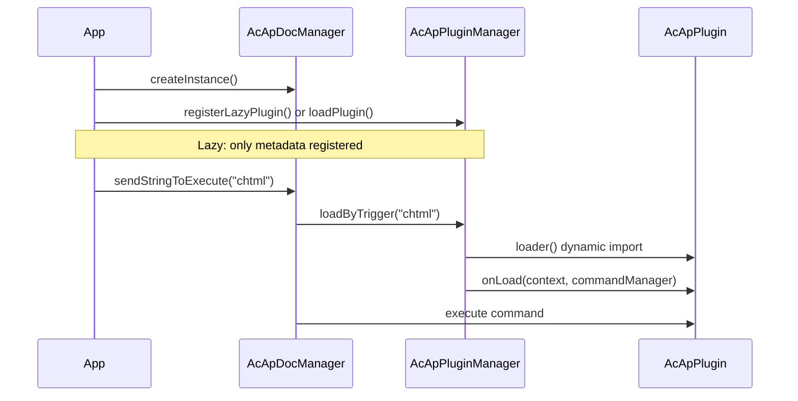

# Plugin System

This page explains how to build, register, and use a **plugin** for MLightCAD. Plugins extend the viewer by registering commands, accessing the active document and view, and cleaning up when unloaded.

The plugin system lives in `@mlightcad/cad-simple-viewer` (`packages/cad-simple-viewer/src/plugin`). First-party plugins (UI, AI agent, script console, HTML/PDF/SVG export, OneDrive/Google Drive data sources) ship as separate npm packages — see [Built-in Plugins](./built-in-plugins) for the full list.

---

## Overview

A plugin is a small module that implements `AcApPlugin`. The **plugin manager** (`AcApPluginManager`) is owned by `AcApDocManager` and:

- Calls `onLoad()` when a plugin is loaded (register commands, hooks, etc.)
- Calls `onUnload()` when a plugin is removed (unregister commands, release resources)
- Supports **lazy registration**: the plugin code is not downloaded until the user runs a **trigger command**



---

## Core types

### `AcApPlugin`

Every plugin must provide:

| Field / method | Description |
|----------------|-------------|
| `name` | Unique identifier (required). Must match lazy registration `name` when using lazy load. |
| `version?` | Optional version string |
| `description?` | Optional human-readable description |
| `onLoad(context, commandManager)` | Register commands and initialize resources |
| `onUnload(context, commandManager)` | Remove commands and release resources |

`context` is `AcApContext` (current `doc` and `view`). `commandManager` is `AcEdCommandStack` — the same stack used by built-in commands.

Reference implementation: `AcApExamplePlugin` in `packages/cad-simple-viewer/src/plugin/AcApPluginExample.ts`.

### `AcApLazyPluginRegistration`

For code-splitting, register a descriptor instead of loading the plugin immediately:

| Field | Description |
|-------|-------------|
| `name` | Must equal `AcApPlugin.name` returned by `loader` |
| `triggers` | Command names that load this plugin (case-insensitive) |
| `loader` | Async factory that returns a plugin instance |

---

## Step 1 — Implement a command

Plugins usually expose one or more **commands**. Extend `AcEdCommand` and implement `execute(context)`:

```typescript
import { AcApContext, AcEdCommand } from '@mlightcad/cad-simple-viewer'

export class AcApMyExportCmd extends AcEdCommand {
  async execute(context: AcApContext) {
    const fileName = context.doc.fileName || context.doc.docTitle
    // ... export logic using context.doc.database, context.view, etc.
  }
}
```

See [Command](./command) for prompts, editor access, and entity creation.

---

## Step 2 — Implement `AcApPlugin`

Track every command you register so `onUnload` can remove them:

```typescript
import {
  AcApContext,
  AcApPlugin,
  AcEdCommandStack
} from '@mlightcad/cad-simple-viewer'

import { AcApMyExportCmd } from './AcApMyExportCmd'

export class AcApMyPlugin implements AcApPlugin {
  name = 'MyPlugin'
  version = '1.0.0'
  description = 'My custom export command'

  private registeredCommands: Array<{ group: string; name: string }> = []

  onLoad(_context: AcApContext, commandManager: AcEdCommandStack): void {
    const group = AcEdCommandStack.SYSTEMT_COMMAND_GROUP_NAME
    commandManager.addCommand(group, 'myexport', 'myexport', new AcApMyExportCmd())
    this.registeredCommands.push({ group, name: 'myexport' })
  }

  onUnload(_context: AcApContext, commandManager: AcEdCommandStack): void {
    for (const cmd of this.registeredCommands) {
      commandManager.removeCmd(cmd.group, cmd.name)
    }
    this.registeredCommands = []
  }
}
```

Official plugins follow the same pattern:

- `AcApHtmlPlugin` — registers `chtml`
- `AcApPdfPlugin` — registers `cpdf`, `ipdf`
- `AcApSvgPlugin` — registers `csvg`

Use `AcEdCommandStack.SYSTEMT_COMMAND_GROUP_NAME` for viewer-wide commands (same group as zoom, layer, etc.).

---

## Step 3 — Publish as an npm package (optional)

Mirror the structure of `cad-html-plugin`, `cad-pdf-plugin`, or `cad-svg-plugin`:

```
my-cad-plugin/
  package.json          # name: @myorg/cad-my-plugin
  src/
    AcApMyPlugin.ts
    AcApMyExportCmd.ts
    registerLazyMyPlugin.ts
    index.ts            # public exports
```

**`package.json` conventions:**

- Set `"type": "module"`
- List `@mlightcad/cad-simple-viewer` as a **peerDependency** (and other shared libs such as `@mlightcad/data-model`, `three` if needed)
- Build with `tsc` + `vite` like existing plugins
- Export helpers from `src/index.ts`: plugin class, `createMyPlugin`, `registerLazyMyPlugin`, trigger constants

**Lazy loader module** (`registerLazyMyPlugin.ts`):

```typescript
import type { AcApPluginManager } from '@mlightcad/cad-simple-viewer'

export const MY_PLUGIN_NAME = 'MyPlugin'
export const MY_PLUGIN_TRIGGERS = ['myexport'] as const

export async function createMyPlugin() {
  const { AcApMyPlugin } = await import('./AcApMyPlugin')
  return new AcApMyPlugin()
}

export function registerLazyMyPlugin(pluginManager: AcApPluginManager): void {
  pluginManager.registerLazyPlugin({
    name: MY_PLUGIN_NAME,
    triggers: [...MY_PLUGIN_TRIGGERS],
    loader: createMyPlugin
  })
}
```

Dynamic `import('./AcApMyPlugin')` keeps the heavy plugin chunk out of the initial bundle until `myexport` runs.

---

## Registering plugins

There are four common registration paths. Pick one based on whether you need lazy loading and who owns the app bootstrap.

### A. Lazy registration (recommended for optional features)

Register after `AcApDocManager.createInstance()`. The plugin module loads on first trigger command.

```typescript
import { AcApDocManager } from '@mlightcad/cad-simple-viewer'
import { registerLazyHtmlPlugin } from '@mlightcad/cad-html-plugin'
import { registerLazyPdfPlugin } from '@mlightcad/cad-pdf-plugin'
import { registerLazySvgPlugin } from '@mlightcad/cad-svg-plugin'

AcApDocManager.createInstance({
  container: document.getElementById('cad-container')!,
  htmlViewerRuntimeUrl: './viewer-runtime.iife.js' // required for chtml export
})

const pm = AcApDocManager.instance.pluginManager
registerLazyHtmlPlugin(pm)
registerLazyPdfPlugin(pm)
registerLazySvgPlugin(pm)
```

Example app: `packages/cad-simple-viewer-example/src/main.ts`.

When the user runs a trigger command, `AcApDocManager` automatically calls `loadByTrigger` if the command is not yet registered:

```typescript
AcApDocManager.instance.sendStringToExecute('chtml')
AcApDocManager.instance.sendStringToExecute('cpdf')
```

You do **not** need to call `loadByTrigger` manually when using `sendStringToExecute`, unless you want to preload the plugin before execution (see below).

### B. Inline lazy registration (cad-viewer component)

`@mlightcad/cad-viewer` registers PDF/HTML/SVG plugins in `registerLazyPlugins()` (`packages/cad-viewer/src/app/register.ts`), invoked from `initializeCadViewer()` in `app.ts`. Consumers of the Vue component get lazy plugins without extra setup.

### C. Eager load via `pluginManager.loadPlugin()`

Load immediately after creating the document manager:

```typescript
import { AcApDocManager } from '@mlightcad/cad-simple-viewer'
import { AcApExamplePlugin } from '@mlightcad/cad-simple-viewer' // AcApExamplePlugin export

AcApDocManager.createInstance({ container: el })
await AcApDocManager.instance.pluginManager.loadPlugin(new AcApExamplePlugin())
```

Use when the plugin is small or must be available before any user action.

### D. Eager load via `createInstance({ plugins })`

Pass plugins at initialization; `AcApDocManager` loads them asynchronously during startup.

**From instances or factories:**

```typescript
AcApDocManager.createInstance({
  container: el,
  plugins: {
    fromConfig: [
      new AcApExamplePlugin(),
      () => new AcApAnotherPlugin()
    ]
  }
})
```

**From a folder (dynamic import):**

```typescript
AcApDocManager.createInstance({
  container: el,
  plugins: {
    fromFolder: {
      folderPath: './plugins',
      pluginList: ['MyPlugin.js'],
      continueOnError: true
    }
  }
})
```

In the browser you must supply `pluginList` (no directory listing API). Each file should default-export a plugin instance, a plugin class, or a factory function.

---

## Using plugins at runtime

### Execute a plugin command

After the plugin is loaded (eagerly or via lazy trigger):

```typescript
// Command line / script style
AcApDocManager.instance.sendStringToExecute('chtml')

// Or via editor API
await AcApDocManager.instance.editor.executeCommand('cpdf')
```

### Preload a lazy plugin (optional)

Some UI paths preload before `sendStringToExecute` to avoid a delay on first run:

```typescript
const pluginManager = AcApDocManager.instance.pluginManager
await pluginManager.loadByTrigger('cpdf')
AcApDocManager.instance.sendStringToExecute('cpdf')
```

`cad-viewer` uses this pattern for PDF export from the ribbon (`MlRibbonCommands.vue` → `runLazyCommand`).

### Check load state

```typescript
const pm = AcApDocManager.instance.pluginManager

pm.isPluginLoaded('HtmlPlugin')        // true after first chtml
pm.isLazyPluginTrigger('chtml')        // true if lazy registration exists
pm.getLoadedPlugins()                  // ['HtmlPlugin', ...]
await pm.unloadPlugin('HtmlPlugin')
await pm.unloadAllPlugins()            // called when destroying the view
```

### Unload

```typescript
await AcApDocManager.instance.pluginManager.unloadPlugin('MyPlugin')
```

`onUnload` must remove every command registered in `onLoad`. Failing to do so leaves stale commands on the stack.

---

## Built-in plugin reference

The monorepo ships several first-party plugins: `AcApHtmlPlugin` (`chtml`), `AcApPdfPlugin` (`cpdf`, `ipdf`), `AcApSvgPlugin` (`csvg`), plus UI, agent, script console, and data source plugins.

For the complete list with per-plugin commands, public API, configuration, and links to each package README, see [Built-in Plugins](./built-in-plugins).

---

## Integration checklist

1. **Depend on** `@mlightcad/cad-simple-viewer` (peer dependency for published plugins).
2. **Implement** `AcApPlugin` + `AcEdCommand`(s).
3. **Export** `registerLazy*Plugin` + `create*Plugin` from your package entry.
4. **Register** after `AcApDocManager.createInstance()` (or via `plugins.fromConfig` / `fromFolder`).
5. **Trigger** commands with `sendStringToExecute` or UI that calls the same command names.
6. **Bundle**: use dynamic `import()` in the lazy `loader` so Vite/Rollup splits the plugin chunk.
7. **Cleanup**: remove all commands in `onUnload`.
8. **Unique triggers**: one trigger command cannot map to two lazy plugins (`registerLazyPlugin` throws on conflict).
9. **Name consistency**: `AcApLazyPluginRegistration.name` must match `plugin.name` from `loader()`.

---

## Troubleshooting

| Symptom | Likely cause |
|---------|----------------|
| `Command 'chtml' not found` | Lazy plugin not registered, or registration after destroy |
| Lazy plugin never loads | Trigger name mismatch (check uppercase normalization); wrong `name` in loader vs registration |
| HTML export fails at runtime | Missing `htmlViewerRuntimeUrl` or `viewer-runtime.iife.js` not deployed to that URL |
| `Plugin 'X' is already loaded` | Calling `loadPlugin` twice without `unloadPlugin` |
| Trigger already registered | Two plugins registered the same trigger command |

---

## Related documentation

- [Built-in Plugins](./built-in-plugins) — all first-party plugins shipped with MLightCAD
- [Command](./command) — command lifecycle and `AcEdCommand`
- [Data Source Plugin](./data-source-plugin) — pluggable drawing origins (local, URL, OneDrive, …)
- [Integrate Simple Viewer](./integrate-simple-cad-viewer) — embedding `cad-simple-viewer`
- [Integrate Vue Component](./integrate-cad-viewer-component) — Vue component and `initializeCadViewer`
- [Architecture Overview](./architecture-overview) — module layout


