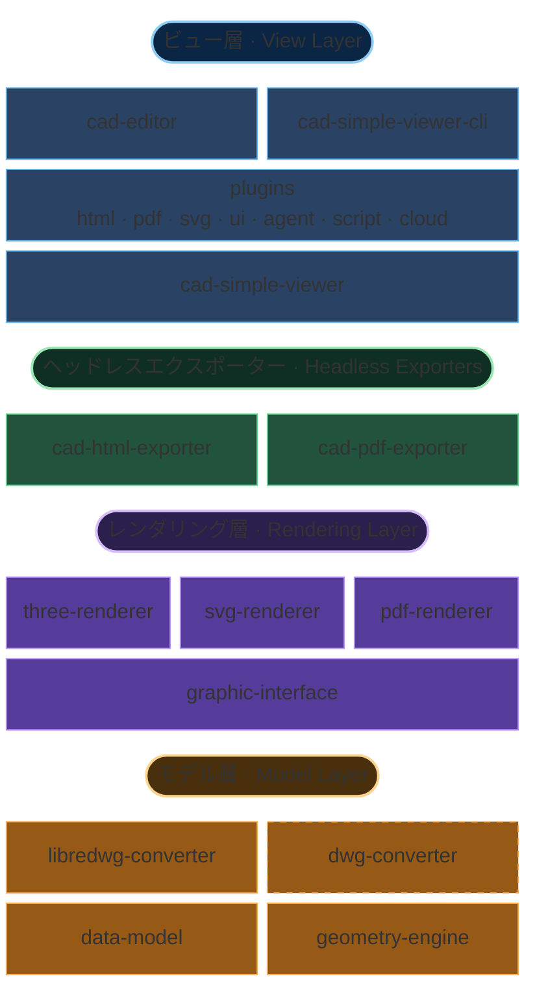

# アーキテクチャ概要

MLightCAD は完全にブラウザ上で動作し、**バックエンドへの依存はありません**。DWG/DXF ファイルは WebAssembly と JavaScript でローカルに解析・処理され、次を保証します。

- **サーバー不要** — 静的ファイルホスティングだけでどこにでもデプロイ可能
- **完全なデータプライバシー** — ファイルがユーザーのデバイスから外に出ることはない
- **即時統合** — 複雑なバックエンド構築や API 設定は不要
- **オフライン動作** — インターネット接続なしでも動作する

このリポジトリは `pnpm` + `nx` の TypeScript monorepo です。表示 / 編集に関する主なパッケージは次のとおりです。

| パッケージ | 責務 |
| --- | --- |
| [`@mlightcad/cad-simple-viewer`](https://github.com/mlightcad/cad-viewer/tree/main/packages/cad-simple-viewer) | ドキュメント管理、コマンドスタック、プラグインマネージャ、キャンバス。**UI フレームワーク非依存** |
| [`@mlightcad/cad-editor`](https://github.com/mlightcad/cad-viewer/tree/main/packages/cad-editor) | `cad-simple-viewer` 上の完全な Vue 3 UI（メニュー、Ribbon、コマンドライン、ステータスバー） |
| [`@mlightcad/cad-simple-viewer-cli`](https://github.com/mlightcad/cad-viewer/tree/main/packages/cad-simple-viewer-cli) | ヘッドレス CLI：Playwright / Chromium 上で `cad-simple-viewer` を駆動し `.scr` スクリプトを実行 |
| [`@mlightcad/three-renderer`](https://github.com/mlightcad/cad-viewer/tree/main/packages/three-renderer) | THREE.js によるインタラクティブな 2D/3D レンダリング |
| `svg-renderer`（[`cad-svg-plugin`](https://github.com/mlightcad/cad-viewer/tree/main/packages/cad-svg-plugin)） | 同一レンダリングインタフェースによる SVG ベクター出力 |
| [`@mlightcad/pdf-renderer`](https://github.com/mlightcad/cad-viewer/tree/main/packages/pdf-renderer) | 同一レンダリングインタフェースによるベクター PDF 出力バックエンド |
| [`@mlightcad/cad-html-exporter`](https://github.com/mlightcad/cad-viewer/tree/main/packages/cad-html-exporter) / [`@mlightcad/cad-pdf-exporter`](https://github.com/mlightcad/cad-viewer/tree/main/packages/cad-pdf-exporter) | Node ヘッドレス HTML / PDF エクスポート（ブラウザ内ビューア不要） |
| `*-plugin` | オプション機能（UI、エクスポート、スクリプト、エージェント、クラウドデータソース）。プラグインマネージャが遅延ロード |

階層ルール：`data-model`（外部） → レンダラ → `cad-simple-viewer` → UI / プラグイン / CLI。**下位パッケージが上位パッケージに依存してはいけません。**

## 全体アーキテクチャ

システムは責務ごとに**モデル層・レンダリング層・ビュー層**に分かれ、さらに独立して配備できる**ヘッドレスエクスポーター**と、同じビューアコアを駆動する CLI があります。

この階層設計により、データ規模・レンダリング対象・配備形態（ブラウザコンポーネント、ヘッドレス CLI、純粋な Node エクスポート）が異なっても拡張性を保てます。

### モデル層

モデル層は独立リポジトリ [`realdwg-web`](https://github.com/mlightcad/realdwg-web) にあり、本リポジトリからは外部依存として参照します。

- [`@mlightcad/data-model`](https://github.com/mlightcad/realdwg-web) は、解析済み CAD データ（幾何エンティティ、レイヤ、ビューパラメータなど）を表す統一 **Data Model** を定義します。
- [`AcDbDatabaseConverter`](https://github.com/mlightcad/realdwg-web/blob/main/packages/data-model/src/database/AcDbDatabaseConverter.ts) は統一 CAD ファイル変換インタフェースを提供し、異なるコンバータが同じデータモデルを出力できるようにします。
- [`@mlightcad/libredwg-converter`](https://github.com/mlightcad/realdwg-web) は LibreDWG ベースのオープンソース DWG 解析（WebAssembly）を提供し、DWG を統一データモデルへ変換します。ホスト側でコンバータを登録する必要があります（`cad-simple-viewer` 自体は GPL パーサを同梱しません）。
- **`@mlightcad/dwg-converter`** は**クローズドソースの商用** DWG 解析モジュールで、同じ `AcDbDatabaseConverter` インタフェースを実装し、より高い互換性と完全性のために `libredwg-converter` の代替として使えます。GitHub Packages 経由でプライベート配布され、本リポジトリではオープンソース公開されません。セットアップは[独自 DWG コンバーターのインストールと使用](./install-and-use-proprietary-dwg-converter)、ライセンスとトライアルは [PROPRIETARY-PARSER.md](https://github.com/mlightcad/cad-viewer/blob/main/PROPRIETARY-PARSER.md) を参照してください。
- DXF 解析は `data-model` 内蔵の変換パイプラインが担当します（歴史的には [`@mlightcad/dxf-json`](https://github.com/mlightcad/dxf-json) を基にしています）。
- [`@mlightcad/geometry-engine`](https://github.com/mlightcad/realdwg-web) は幾何と数学演算（点、線、ポリライン、スプライン、円/弧、楕円、およびベクトル・行列）を提供します。

`AcDbDatabaseConverter` を定義する理由：既存の DXF/DWG ツールは不完全なことが多いためです。オープンソース経路は `libredwg-converter`、より高い忠実度が必要な場合はクローズドソースの `dwg-converter` を登録し直すだけでよく、上位ビューアコードの変更は不要です。下位では [ODA](https://www.opendesign.com/products/drawings) などの商用エンジン上に同じインタフェースを自前実装することもできます。

### レンダリング層

- [`@mlightcad/graphic-interface`](https://github.com/mlightcad/realdwg-web)（`realdwg-web`）は統一エンティティレンダリングインタフェース（`AcGiRenderer` など）を定義します。
- [`@mlightcad/three-renderer`](https://github.com/mlightcad/cad-viewer) がそのインタフェースを実装し、THREE.js でインタラクティブなキャンバス描画（バッチ処理、線種/ハッチシェーダなど）を行います。`cad-simple-viewer` のデフォルトバックエンドです。
- **`svg-renderer`**（`AcSvgRenderer`）は同じインタフェースを実装し、スケーラブルな SVG を出力します。現在の実装は [`@mlightcad/cad-svg-plugin`](https://github.com/mlightcad/cad-viewer/tree/main/packages/cad-svg-plugin) にあり、`csvg` などのエクスポートコマンドが使用します。PDF ベクターエクスポートも一部の描画能力を再利用します。
- [`@mlightcad/pdf-renderer`](https://github.com/mlightcad/cad-viewer) は同じインタフェースを実装し、ベクター PDF コンテンツストリームを出力します。`cad-pdf-core` / `cad-pdf-plugin` / `cad-pdf-exporter` が使用します。

### ビュー層

- **`cad-simple-viewer`** がコアです。ドキュメントライフサイクル、コマンドスタック、ユーザー入力 / jig、`three-renderer` との連携、および **`AcApPluginManager` プラグイン機構**を提供します。キャンバス以外のアプリケーション UI はありません。
- **プラグイン**は `AcApPlugin` を実装する独立 npm パッケージとして公開され、`registerLazyPlugin` / `loadPlugin` で同じプラグインマネージャに接続されます。公式プラグインには HTML / PDF / SVG エクスポート、簡易 UI、スクリプトコンソール、AI エージェント、OneDrive / Google Drive などがあります。詳細は[プラグインシステム](./plugin-system)と[組み込みプラグイン](./built-in-plugins)を参照してください。
- **`cad-editor`**（旧 `@mlightcad/cad-viewer`、1.8.0 で改名）は `cad-simple-viewer` 上に完全な Vue 3 UI を提供し、起動時に一般的な遅延ロードプラグインを登録します。
- **`cad-simple-viewer-cli`** は Playwright でヘッドレス Chromium 上に同じビューアコアを起動し、AutoCAD 風の `.scr` スクリプト（例：`-chtml` / `-cpdf`）を実行します。CI や変換サービスに適しています。詳細は[クラウド DWG Web ビューアの構築](./cloud-dwg-web-viewer)を参照してください。

### ヘッドレスエクスポーター

ブラウザプラグインと Node エクスポーターは `*-core` パッケージのエクスポートパイプラインを共有し、サーバ側で完全なビューアを起動する必要をなくします。

| 経路 | 共有コア | レンダリングバックエンド | 代表的な入口 |
| --- | --- | --- | --- |
| HTML | `@mlightcad/cad-html-core` | `three-renderer`（スナップショット生成後にパック） | ブラウザ：`cad-html-plugin`（`chtml`）；Node：`cad-html-exporter`（`exportFileToHtml`） |
| PDF | `@mlightcad/cad-pdf-core` | `pdf-renderer` | ブラウザ：`cad-pdf-plugin`（`cpdf`）；Node：`cad-pdf-exporter`（`exportFileToPdf`） |

`*-core` は `cad-simple-viewer` / DOM に**依存しません**。`*-exporter` は Node でフォント読み込み、DWG 登録、ファイル I/O を行います。ファイル → HTML/PDF だけでなく完全なコマンドスクリプト能力が必要な場合は、引き続き `cad-simple-viewer-cli` を使ってください。

## レンダリングエンジン

DXF/DWG のレンダリングには次のような課題があります。

- 大量のエンティティを含む図面の高性能レンダリング
- AutoCAD の文字レンダリングの再現
- 線種とハッチパターンのサポート

### 高性能レンダリング

大規模図面では、点・線・面をマージして **Draw Call** を減らすことが鍵です。THREE.js の [BatchedMesh](https://threejs.org/docs/index.html?q=Mesh#api/en/objects/BatchedMesh) は三角形マージを部分的にしか解決せず、点/線のマージもサポートしません。そのため `BatchedMesh` を参考に点・線・面のバッチ処理クラスを実装しました。コードは [`packages/three-renderer/src/batch`](https://github.com/mlightcad/cad-viewer/tree/main/packages/three-renderer/src/batch) を参照してください。

### 文字レンダリング

AutoCAD はリッチテキストに [`MText`](https://ezdxf.mozman.at/docs/dxfinternals/entities/mtext.html)、高速表示に [SHX](https://help.autodesk.com/view/OARX/2023/ENU/?guid=GUID-DE941DB5-7044-433C-AA68-2A9AE98A5713) ストロークフォントを使います。関連機能は独立リポジトリにあります。

- **MText の解析** — [`@mlightcad/mtext-parser`](https://github.com/mlightcad/mtext-parser)
- **SHX の解析** — [`@mlightcad/shx-parser`](https://github.com/mlightcad/shx-parser)
- **MText のレンダリング** — [`@mlightcad/mtext-renderer`](https://github.com/mlightcad/mtext-renderer)。解析済みフォントはブラウザの IndexedDB にキャッシュされ、再ダウンロードと再解析を避けます

文字レンダリングのデバッグには、THREE.js ベースのリッチテキストエディタ [mtext-editor](https://github.com/mlightcad/mtext-editor) を使えます。

### 線種とハッチパターン

AutoCAD はカスタム線種とハッチパターンをサポートします。その一部を実装済みです。インタラクティブキャンバス上の線種と塗りは THREE.js の `ShaderMaterial` で実装しています。コードは [`packages/three-renderer/src/style`](https://github.com/mlightcad/cad-viewer/tree/main/packages/three-renderer/src/style) を参照してください。PDF 経路では `pdf-renderer` が対応する見た目をベクターで再現します。
