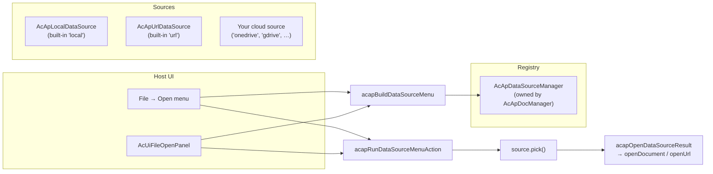

# データソースプラグイン

このページでは、`@mlightcad/cad-simple-viewer` の**データソースプラグイン**の仕組みを説明します。これは、**図面をどこから取得するか**（ローカルディスク、HTTP URL、OneDrive、Google Drive など）を決定するプラグイン可能な層です。仕組みの動作、独自のデータソースの作成方法、登録と使用方法を扱います。

この仕組みは `packages/cad-simple-viewer/src/app/dataSource` にあります。完全な参照実装は別の npm パッケージ `@mlightcad/cad-onedrive-plugin`（`packages/cad-onedrive-plugin`）として提供されており、`packages/cad-simple-viewer-demo` のデモアプリで使用されています。

> **コマンドプラグイン**（`cpdf`、`chtml` などのエクスポートコマンド）については、[プラグインシステム](./plugin-system)を参照してください。データソースプラグインも `AcApPlugin` であり、コマンドの代わりに `onLoad` でデータソースを登録するだけです。

---

## 概要

**データソース**は、`AcApDataSource` を実装するオブジェクトであり、CAD 図面のプラグイン可能な取得元です。ビューアのコアはベンダーについて何も知りません。コアが知っているのは、レジストリ（`AcApDataSourceManager`）と少数のメニューヘルパーだけです。ベンダー固有のロジック（ログインポップアップ、ファイルピッカー、ダウンロード）はすべてデータソースの**内部**に留まります。



主要な設計ルール：

- **ホストはオーケストレーションのみを行う。** ホスト UI（リボンの Open メニュー、`AcUiFileOpenPanel`、ツールバー）は、(1) `AcApDataSourceManager` を介したソースの一覧表示、(2) `acapBuildDataSourceMenu` によるラベルの構築、(3) `acapRunDataSourceMenuAction` / `acapInvokeDataSourceMenuAction` によるクリックの実行のみを行う必要があります。ベンダーのファイルピッカーを開いたり、URL をダウンロードしたり、プロバイダー固有のログイン UI を表示したりしては**いけません**。
- **サインインとピックは決して連鎖させない。** ブラウザーは、直接のユーザー操作のタイミングでのみ `window.open` を許可します。クリックハンドラーが MSAL のサインインを `await` してからピッカーポップアップを開くと、2 つ目のポップアップはブロックされます。そのため、メニューは**サインイン**と **...から開く**を別々の項目として公開します。
- **適応型メニュー。** `getAuthState()` がメニューの表示内容を決定するため、ホストはプロバイダー固有の UI を必要としません。

---

## コアの型

以下の型はすべて `@mlightcad/cad-simple-viewer` からエクスポートされています。

### `AcApDataSource`

すべてのデータソースが実装する必要があるインターフェース：

| メンバー | 必須 | 説明 |
|--------|----------|-------------|
| `id` | ✓ | メニューとレジストリの検索で使用される安定した ID（`local`、`url`、`onedrive` など） |
| `labelKey` | ✓ | 表示名の i18n キー（例：`main.dataSource.onedrive`） |
| `icon?` | | 省略可能なインライン SVG 文字列または URL |
| `requiresAuth` | ✓ | ソースがユーザー認証を必要とするかどうか |
| `requiresUserGesture` | ✓ | `true` の場合、`pick()` は直接のクリックのタイミングで `window.open` を実行する必要がある（クラウドのファイルピッカー） |
| `getAuthState()` | ✓ | `'none'` \| `'signed-out'` \| `'signed-in'` を返す |
| `getAccountLabel?()` | | メニュー用の短いサインインラベル（メール / 表示名） |
| `getAccountProfile?()` | | ランディング / アカウント UI 用の `{ displayName, email?, avatarUrl? }` |
| `restoreSession?()` | | 登録後にキャッシュされたセッションを復元する（MSAL アカウント、トークンなど）。完了時に `notifyAuthChanged` を呼び出して Open メニューを更新する必要がある |
| `signIn()` | ✓ | 対話型サインイン。`requiresAuth` が `false` の場合は何もしない |
| `signOut()` | ✓ | サインアウト。`requiresAuth` が `false` の場合は何もしない |
| `pick()` | ✓ | ソース固有のファイルピッカー / ダイアログを開き、必要に応じてダウンロードし、選択された図面を返す。ユーザーがキャンセルした場合は `null` を返す |

### `AcApDataSourceFile`

`pick()` が成功した結果：

| フィールド | 説明 |
|-------|-------------|
| `name` | 拡張子を含むファイル名（例：`drawing.dwg`） |
| `content?` | 生のファイルバイト（`ArrayBuffer`）。`url` が省略された場合に使用される |
| `url?` | `AcApDocManager.openUrl` で開かれるリモート URL（進捗付きの HTTP フェッチ） |

すでにメモリにあるバイトには `content` を優先し、`openUrl` で開くべき場合は `url` を優先します。

### `AcApDataSourceManager`

レジストリであり、`AcApDocManager` によって所有されます（`AcApDocManager.instance.dataSourceManager`）。`AcApDocManager.createInstance()` は 2 つの組み込みソースを自動的に登録します。

- `local` — `AcApLocalDataSource`（`.dwg` / `.dxf` 用の `<input type="file">` ピッカー）
- `url` — `AcApUrlDataSource`（URL ダイアログ、`openUrl` で開く）

クラウドプラグインは `AcApPlugin.onLoad` で自身を登録し、`onUnload` で登録解除します。

| API | 説明 |
|-----|-------------|
| `register(source)` | ソースを登録する（同じ id の既存ソースを置き換える） |
| `unregister(id)` | id によってソースを削除する |
| `list()` | 登録順にソースを返す |
| `get(id)` | id によってソースを検索する |
| `notifyAuthChanged(sourceId)` | クラウドプラグインが `signIn` / `signOut` の成功後に呼び出す |
| `on` / `off` | `changed` および `auth-changed` イベントを購読する |

---

## メニューヘルパー

ホストは Open メニューを独自に実装しません。3 つのヘルパーが契約を定義します。

### 1. `acapBuildDataSourceMenu(sources)`

現在のレジストリから `AcApDataSourceMenuItem[]` を構築します。ルール（ポップアップブロッカーに対応）：

| 認証状態 | メニュー項目 |
|------------|------------|
| 認証不要（`'none'`） | 1 つの**選択**項目（例：*ローカルファイル*、*URL から*） |
| 認証が必要、**サインアウト済み** | **サインイン**項目のみ（ピックに連鎖させない） |
| 認証が必要、**サインイン済み** | **選択**（*OneDrive から開く*）+ **サインアウト**（*OneDrive からサインアウト (user@host)*） |

### 2. `acapRunDataSourceMenuAction(item, options?, manager?)`

メニュー項目のアクションを実行し、**ピック結果を自動的に開きます**（`acapOpenDataSourceResult`：`file.url` が設定されている場合は `openUrl`、それ以外の場合は `file.content` で `openDocument`）。ビューア内の Open メニューで使用します。サインインをピックに連鎖させることはありません。

### 3. `acapInvokeDataSourceMenuAction(source, item)`

すでに解決済みのソースに対して、ファイルを開かずにアクションを実行します。`AcApDocManager` が存在する前にデータソースマネージャーを所有するランディングページや、結果を自分で開きたい場合に使用します。

### サポートユーティリティ

| ヘルパー | 目的 |
|--------|---------|
| `acapOpenCenteredPopup(name, width?, height?)` | 画面中央に名前付きポップアップを開く。`pick()` 内で使用して、同じクリックのタイミングでポップアップを開く |
| `acapWithDataSourceBusy(work, message?)` | ダウンロード / ピッカー後の処理をビジーオーバーレイで包む（DocManager のビジーインジケーター、またはランディングページ用に `document.body` 上の一時的な `AcApProgress`） |
| `acapOpenDataSourceResult(file, options?)` | DocManager を介して `pick()` の結果を開く（`openUrl` / `openDocument`） |
| `acapIsSingleLocalOpen(sources)` | Open UI を単一の「開く」アクションに折りたたむべきかどうか（組み込みのローカルソースのみの場合） |

---

## データソースプラグインの作成

データソースプラグインは通常の `AcApPlugin` であり（[プラグインシステム](./plugin-system)参照）、その `onLoad` で `AcApDataSource` を登録します。推奨されるパッケージ構成は `cad-onedrive-plugin` に準拠します。

```
my-cad-datasource-plugin/
  package.json          # name: @myorg/cad-my-datasource-plugin
  src/
    AcApMyDataSource.ts # implements AcApDataSource
    AcApMyPlugin.ts     # implements AcApPlugin, registers the source
    myClient.ts         # vendor API client (auth, picker, download)
    register.ts         # registerMyPlugin(pluginManager, options)
    index.ts            # public exports
```

**`package.json` の規約：**

- `"type": "module"` を設定する
- `@mlightcad/cad-simple-viewer`（必要に応じて `@mlightcad/data-model`）を **peerDependencies** としてリストする
- 既存のプラグインと同様に `tsc` + `vite` でビルドする

### ステップ 1 — `AcApDataSource` を実装する

```typescript
import {
  type AcApDataSource,
  type AcApDataSourceAccountProfile,
  type AcApDataSourceAuthState,
  type AcApDataSourceFile,
  type AcApDataSourceManager,
  acapOpenCenteredPopup,
  acapWithDataSourceBusy
} from '@mlightcad/cad-simple-viewer'

/** Stable id used in menus and registry lookups. */
export const ACAP_MY_DATA_SOURCE_ID = 'mycloud'

export class AcApMyDataSource implements AcApDataSource {
  readonly id = ACAP_MY_DATA_SOURCE_ID
  readonly labelKey = 'main.dataSource.mycloud'
  readonly requiresAuth = true
  // true because pick() opens a File Picker popup via window.open
  readonly requiresUserGesture = true

  private readonly dataSourceManager: AcApDataSourceManager

  constructor(dataSourceManager: AcApDataSourceManager) {
    this.dataSourceManager = dataSourceManager
  }

  getAuthState(): AcApDataSourceAuthState {
    return this.client.isAuthenticated ? 'signed-in' : 'signed-out'
  }

  getAccountLabel(): string | undefined {
    return this.client.userInfo?.email
  }

  getAccountProfile(): AcApDataSourceAccountProfile | undefined {
    if (!this.client.isAuthenticated) return undefined
    const info = this.client.userInfo!
    return { displayName: info.name || info.email, email: info.email }
  }

  /** Restore cached tokens after registration so menus show signed-in state. */
  async restoreSession(): Promise<void> {
    await this.client.initialize()
    this.notifyAuthChanged()
  }

  async signIn(): Promise<void> {
    await this.client.authenticate()
    this.notifyAuthChanged()
  }

  async signOut(): Promise<void> {
    await this.client.signOut()
    this.notifyAuthChanged()
  }

  async pick(): Promise<AcApDataSourceFile | null> {
    // Open the popup in this click tick. Any `await` first loses the gesture.
    const popup = acapOpenCenteredPopup('MyCloudPicker', 1080, 680)
    if (!popup) {
      throw new Error('Popup blocked. Allow popups for this site and try again.')
    }
    try {
      await this.client.initialize()
      if (!this.client.isAuthenticated) {
        throw new Error('Sign in first, then choose a file (popup blocker).')
      }
      const picked = await this.client.openFilePicker(popup)
      const content = await acapWithDataSourceBusy(() =>
        this.client.downloadFile(picked)
      )
      return { name: picked.name, content }
    } catch (error) {
      try {
        if (!popup.closed) popup.close()
      } catch {
        // ignore
      }
      if (error instanceof Error && error.message === 'Picker cancelled') {
        return null // user cancelled — not an error
      }
      throw error
    }
  }

  private notifyAuthChanged(): void {
    this.dataSourceManager.notifyAuthChanged(this.id)
  }
}
```

実装上の注意：

- **`pick()` はクリックのタイミングで同期的にポップアップを開く**必要があります（`requiresUserGesture = true`）。`await`（SDK の初期化、認証チェック）は `window.open` の**後**に行ってください。
- ダウンロードの前後で `acapWithDataSourceBusy` を呼び出し、ビューアとランディングページの両方で進捗をフィードバックできるようにします。
- ユーザーがキャンセルした場合は `null` を返し、実際の失敗の場合は例外をスローします。
- 認証状態が変わった後は、常に `dataSourceManager.notifyAuthChanged(id)` を呼び出して Open メニューを更新します。
- ポップアップを使用しないソース（例：ページ内ダイアログ）の場合は、`requiresUserGesture = false` を設定します。
- `labelKey`（例：`main.dataSource.mycloud`）を i18n リソースに追加します。[ローカリゼーション](./localization)を参照してください。

### ステップ 2 — `AcApPlugin` でラップする

```typescript
import {
  AcApContext,
  AcApDocManager,
  AcApPlugin,
  AcEdCommandStack
} from '@mlightcad/cad-simple-viewer'

import packageJson from '../package.json'
import { ACAP_MY_DATA_SOURCE_ID, AcApMyDataSource } from './AcApMyDataSource'

export class AcApMyPlugin implements AcApPlugin {
  name = 'MyDataSourcePlugin'
  version = packageJson.version
  description = 'Open DWG/DXF files from MyCloud'

  private source: AcApMyDataSource | null = null
  private createdSource = false

  onLoad(_context: AcApContext, _commandManager: AcEdCommandStack): void {
    const dsm = AcApDocManager.instance.dataSourceManager
    const existing = dsm.get(ACAP_MY_DATA_SOURCE_ID)
    if (existing) {
      // Already registered (e.g. HMR or double load) — just restore the session.
      void existing.restoreSession?.().catch(() => undefined)
      return
    }
    this.source = new AcApMyDataSource(dsm)
    this.createdSource = true
    dsm.register(this.source)
    // Restore cached session so File → Open shows Open/Sign out, not Sign in.
    void this.source.restoreSession().catch(() => undefined)
  }

  onUnload(_context: AcApContext, _commandManager: AcEdCommandStack): void {
    if (this.createdSource) {
      AcApDocManager.instance.dataSourceManager.unregister(ACAP_MY_DATA_SOURCE_ID)
    }
    this.source = null
    this.createdSource = false
  }
}
```

### ステップ 3 — 登録ヘルパーをエクスポートする

データソースは**即座に**表示される必要がある（Open メニューはドキュメントが開かれる前にそれらを一覧表示する）ため、`pluginManager.loadPlugin` を介して即時にロードします。

```typescript
// src/register.ts
import type { AcApPluginManager } from '@mlightcad/cad-simple-viewer'

import { AcApMyPlugin } from './AcApMyPlugin'

export const MY_PLUGIN_NAME = 'MyDataSourcePlugin'

export async function registerMyPlugin(
  pluginManager: AcApPluginManager,
  options: { clientId: string; /* … */ }
): Promise<void> {
  if (!options.clientId) {
    throw new Error('registerMyPlugin requires options.clientId')
  }
  await pluginManager.loadPlugin(new AcApMyPlugin(options))
}
```

> MSAL スタイルの SDK は、`signIn` / `pick` の**内部**で遅延インポートできます。即時である必要があるのは登録自体だけです。

---

## データソースプラグインの使用

### 1. アプリで登録する

`AcApDocManager.createInstance()` の後に登録ヘルパーを呼び出します。

```typescript
import { AcApDocManager } from '@mlightcad/cad-simple-viewer'
import { registerOneDrivePlugin } from '@mlightcad/cad-onedrive-plugin/register'

AcApDocManager.createInstance({ container: document.getElementById('cad-container')! })

await registerOneDrivePlugin(AcApDocManager.instance.pluginManager, {
  clientId: import.meta.env.VITE_MSAL_CLIENT_ID,
  tenantId: import.meta.env.VITE_MSAL_TENANT_ID || 'common',
  redirectUri: import.meta.env.VITE_MSAL_REDIRECT_URI // optional
})
```

`/register` サブパスからインポートして残りを動的インポートすることで、登録スタブを初期バンドルに含めます（`packages/cad-simple-viewer-demo/src/register.ts` 参照）。

```typescript
const { registerOneDrivePlugin } = await import('@mlightcad/cad-onedrive-plugin/register')
```

組み込み UI（リボン / ツールバー / `AcUiFileOpenPanel`）を使用する場合、アプリに必要なのはこれだけです。Open メニューは `dataSourceManager` から再構築され、たとえば次のように表示されます。

| 認証状態 | メニュー項目 |
|------------|------------|
| サインアウト済み | OneDrive にサインイン |
| サインイン済み | OneDrive から開く、OneDrive からサインアウト (user@contoso.com) |

### 2. カスタムホスト UI（ビューア内メニュー）

独自の Open メニューを構築する場合は、ヘルパーを使用してください。`signIn` / `pick` を直接呼び出さないでください。

```typescript
import {
  AcApDocManager,
  acapBuildDataSourceMenu,
  acapRunDataSourceMenuAction
} from '@mlightcad/cad-simple-viewer'

const dsm = AcApDocManager.instance.dataSourceManager

function rebuildOpenMenu() {
  const items = acapBuildDataSourceMenu(dsm.list())
  renderMenu(items, item => {
    void acapRunDataSourceMenuAction(item, openOptions)
  })
}

rebuildOpenMenu()
dsm.on('changed', rebuildOpenMenu)
dsm.on('auth-changed', rebuildOpenMenu)
```

### 3. ランディングページ（ビューアが存在する前）

ランディングページでは、`AcApDocManager` が作成される前にユーザーがファイルを選択できることがよくあります。`AcUiFileOpenPanel` はすでにこのパターンを実装しています。`onDataSourceAction` を渡し、ビューアの準備ができたら項目を実行します。独自のランディング UI からソースを直接呼び出す場合は、`acapInvokeDataSourceMenuAction` + `acapOpenDataSourceResult` を使用します。

```typescript
import { acapInvokeDataSourceMenuAction, acapOpenDataSourceResult } from '@mlightcad/cad-simple-viewer'

const source = myDataSourceManager.get('onedrive') // or the built-in 'local' / 'url'
const file = await acapInvokeDataSourceMenuAction(source, menuItem)
if (file) {
  await acapOpenDataSourceResult(file, openOptions)
}
```

**ユーザー操作の落とし穴**（`cad-simple-viewer-demo/src/main.ts` より）：クリックハンドラーが `pick` アクションを実行する前にビューアの初期化を `await` する必要がある場合、ユーザー操作が失われ、ポップアップがブロックされます。すでに初期化済みの場合は同期的にアクションを実行するか、`pick` 項目に対して「先にサインインしてから開く」ヒントを表示してください（サンプルアプリの `handleDataSourceMenuAction` 参照）。

---

## 実例：OneDrive

`@mlightcad/cad-onedrive-plugin` は、標準的なクラウドデータソースです。

| 要素 | ファイル | 役割 |
|-------|------|--------------|
| `AcApOneDriveDataSource` | `src/AcApOneDriveDataSource.ts` | Microsoft File Picker v8 + MSAL 上に `AcApDataSource` を実装。`pick` は同期的にポップアップを開き、その後ビジーオーバーレイの下でダウンロードする |
| `AcApOneDrivePlugin` | `src/AcApOneDrivePlugin.ts` | ソースを登録/登録解除し、ロード時にキャッシュされた MSAL セッションを復元する `AcApPlugin` |
| `OneDriveClient` | `src/oneDriveClient.ts` | MSAL 認証 + File Picker v8 メッセージング + Graph ダウンロード |
| `registerOneDrivePlugin` | `src/register.ts` | 即時登録ヘルパー（`clientId` を検証） |
| `createOneDrivePlugin` | `src/createOneDrivePlugin.ts` | プラグインインスタンス用の非同期ファクトリー |

サンプルアプリは環境設定（`packages/cad-simple-viewer-demo/src/onedriveEnv.ts`）を介して接続します。`VITE_MSAL_CLIENT_ID` が設定されている場合、`registerOneDriveFromEnv` がプラグインを登録し、ランディングパネルは `AcUiFileOpenPanel` の `extraMenuItems` を通じて*OneDrive にサインイン*項目を一覧表示します。

**Azure アプリの設定**（OneDrive 用）：Microsoft Entra ID で **Single-page application** を登録し、アプリのオリジンに一致するリダイレクト URI を追加し、委任された Graph 権限 `User.Read` + `Files.Read.All` を付与します（個人用 OneDrive ピッカーのトークンは `OneDrive.ReadOnly` もカバーします）。

---

## トラブルシューティング

| 症状 | 考えられる原因 |
|---------|----------------|
| Open メニューにソースが表示されない | プラグインが登録されていない、または `AcApDocManager.createInstance()` より前に登録された / destroy 後に登録された。あるいは `register` が同じ id の既存ソースを置き換えた |
| ピッカーのポップアップがブロックされる | `pick()` が `window.open` の前に `await` した、または同じクリックハンドラーでサインインをピックに連鎖させた |
| ログイン後もメニューに*サインイン*が表示される | 認証状態の変更後に `notifyAuthChanged` が呼び出されていない、またはロード時に `restoreSession` が呼び出されていない |
| 登録/登録解除後もメニューが更新されない | ホストが `changed` / `auth-changed` イベントで再構築せず、項目リストをキャッシュしている |
| フィードバックなしでダウンロードが停止する | ダウンロードが `acapWithDataSourceBusy` で包まれていない |
| 開いたファイルにバイトも URL もない | `pick()` が `content` も `url` も持たないファイルを返した |

---

## 関連ドキュメント

- [プラグインシステム](./plugin-system) — `AcApPlugin`、コマンド登録、遅延ロード
- [Simple Viewer の統合](./integrate-simple-cad-viewer) — `cad-simple-viewer` の埋め込み
- [ローカリゼーション](./localization) — `main.dataSource.*` などの i18n キーの追加
- [アーキテクチャ概要](./architecture-overview) — モジュール構成

