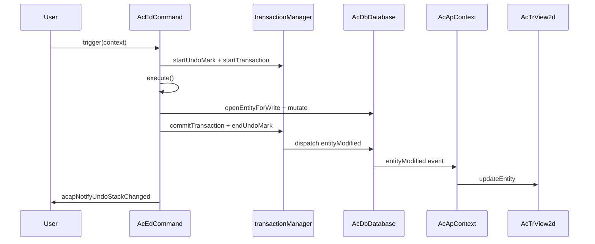

# エンティティ変更のベストプラクティス

このページでは、**MLightCAD** で図面のエンティティを変更する際に、変更が正しく追跡され、**元に戻す/やり直し**が期待どおりに動作し、**ビューがデータベースと同期**した状態を保つ方法について説明します。

データベース層は [`@mlightcad/data-model`](https://github.com/mlightcad/realdwg-web) から提供されます。MLightCAD はアプリケーションヘルパーを追加し、データベースイベントをレンダラーに接続します。

---

## 概要

正しいエンティティ編集は、次の 3 つのレイヤに従います：

| レイヤ | 責務 |
|-------|----------------|
| **データベース**（`AcDbDatabase`） | エンティティを保存し、変更を記録します |
| **トランザクション / undo**（`transactionManager`） | 変更をグループ化し、元に戻す/やり直しをサポートします |
| **ビュー**（`AcTrView2d`） | ジオメトリをレンダリングし、データベースイベントを通じて更新されます |

**経験則：** トランザクション API を通じてデータベースを変更します。`AcApContext` に変更をビューへ伝播させます。通常のデータベース編集後に `view.updateEntity()` を呼び出さないでください。特別なケース（たとえば一時的なプレビュージオメトリ）を除きます。

---

## トランザクションの仕組み

`AcDbDatabase.transactionManager`（`AcDbDatabaseTransactionManager`）は、1 つの図面のトランザクションと undo 履歴を管理します。その設計は AutoCAD ObjectARX の `AcDbTransactionManager` のセマンティクスに従っています。

### コア API

| API | 目的 |
|-----|---------|
| `startTransaction()` | 変更の記録を開始します |
| `commitTransaction()` | 現在のトランザクションを確定し、イベントをディスパッチします |
| `abortTransaction()` | 現在のトランザクション内のすべての変更をロールバックします |
| `hasTransaction()` | トランザクションがアクティブかどうかを返します |
| `isRecording()` | 変更が記録されているかどうかを返します（undo/redo の再生中は false） |
| `openEntityForWrite(id \| entity)` | アクティブなトランザクションを**通じて**エンティティを書き込み用に開きます |

### 記録される内容

`isRecording()` が true の間、トランザクションマネージャーは次を記録します：

- データベースオブジェクトの**プロパティ変更**（`kind: 'modify'`）
- ブロックテーブルレコード、シンボルテーブル、またはディクショナリ内のオブジェクトの**追加/削除**
- **システム変数**の変更

最外側のトランザクションがコミットされると、記録された変更が確定され、関連するデータベースイベントがディスパッチされます。

### ネストされたトランザクション

トランザクションはネストできます。内側のトランザクションはレコーダーを親にマージします。イベントをディスパッチし、undo 履歴をエンキューするのは**最外側**の `commitTransaction()` のみです。

### 書き込み用にオブジェクトを開く

キャッシュされたエンティティ参照を直接変更するのではなく、常に `database.openEntityForWrite(...)`（または `openObjectForWrite`）を使用してください：

```typescript
const opened = db.openEntityForWrite(entityOrObjectId)
if (!opened) return
opened.color = newColor
```

トランザクションがアクティブな場合、`openEntityForWrite` はトランザクションを通じてオブジェクトをルーティングするため、変更が追跡されます。アクティブなトランザクションがない場合、ヘルパーは直接検索にフォールバックし、変更が**元に戻せない**可能性があります。

### 厳格モード

`transactionManager.strictMode`（data-model のデフォルト）は、すべての変更がアクティブなトランザクション内で行われることを要求できます。undo/redo の再生は、変更アプライヤーが状態を復元できるよう除外されます。実際には、MLightCAD のコマンドと `acapRunDatabaseEdit` は常に編集前にトランザクションを確立します。

---

## 元に戻す/やり直しの仕組み

undo/redo は**undo マーク**と**undo レコード**に基づいて構築されています。

### undo マーク

| API | 目的 |
|-----|---------|
| `startUndoMark(label?)` | グループを開きます。1 つのマーク内の複数のコミットが**1 つ**の undo ステップになります |
| `endUndoMark()` | グループを閉じ、変更がある場合に undo レコードをプッシュします |
| `cancelUndoMark()` | undo レコードを作成せずにグループを破棄します |

### undo / redo 操作

| API | 目的 |
|-----|---------|
| `undo()` | 最新の undo レコードを元に戻します |
| `redo()` | 最後に元に戻されたレコードを再適用します |
| `canUndo()` / `canRedo()` | スタックの状態を問い合わせます |
| `clearUndoStack()` | 両方のスタックをクリアします |

undo または redo が実行されると、`AcDbChangeApplier` が保存された変更を順方向または逆方向に再生し、適切なエンティティイベントをディスパッチしてビューが自動的に更新されるようにします。

### コマンドが undo を自動的に取得する方法

undo 記録が有効な場合、`AcEdCommand.trigger()` はコマンド実行を 1 つの undo マークと 1 つのトランザクションでラップします：

```typescript
// AcEdCommand.trigger() — simplified
if (recordUndo) {
  tm.startUndoMark(this.globalName || this.localName)
  tm.startTransaction()
}
try {
  await this.execute(context)
} catch (error) {
  if (undoTransactionActive) {
    tm.abortTransaction()
    tm.cancelUndoMark()
  }
  throw error
} finally {
  if (undoTransactionActive) {
    tm.commitTransaction()
    tm.endUndoMark()
    acapNotifyUndoStackChanged()
  }
}
```

undo 記録は、次の**すべて**が true の場合に有効になります：

- `command.recordsUndoStack === true`（デフォルト）
- `context.doc.openMode >= AcEdOpenMode.Review`
- `command.mode >= AcEdOpenMode.Review`

独自の undo ステップを作成すべきでないメタコマンド（例：`AcApUndoCmd` および `AcApRedoCmd`）では、`recordsUndoStack = false` を設定します。

### UI への通知

undo/redo の可用性が変化した後、`@mlightcad/cad-simple-viewer` から `acapNotifyUndoStackChanged()` を呼び出します。これによりグローバルイベントバスで `undo-stack-changed` が発行され、`useUndoRedo` などのコンポーネントがツールバーの状態を更新できます。

`AcEdCommand.trigger()` を経由するコマンドは、コミットの成功時にこれを自動的に呼び出します。`acapRunDatabaseEdit` を介した単独の編集も、新しい undo マークを作成する際にリスナーに通知します。

---

## エンティティ関連イベント

`AcDbDatabase.events` は、主要なデータベース通知を公開します：

| イベント | 発火するタイミング |
|-------|----------------|
| `entityAppended` | エンティティがモデル空間/ペーパー空間に追加されたとき |
| `entityModified` | エンティティのプロパティまたはジオメトリが変更されたとき |
| `entityErased` | エンティティが図面から削除されたとき |
| `layerAppended` | 新しいレイヤが作成されたとき |
| `layerModified` | レイヤ属性が変更されたとき |
| `layerErased` | レイヤが削除されたとき |
| `dictObjetSet` | オブジェクトが名前付きディクショナリに保存されたとき |
| `dictObjectErased` | オブジェクトがディクショナリから削除されたとき |

### イベントのペイロード

`AcDbEntityEventArgs` には次が含まれます：

- `database` — ソースデータベース
- `entity` — 1 つのエンティティまたはエンティティの配列

MLightCAD は変更イベントをオプションの `changes` フィールド（`AcApEntityUpdate` の `AcDbEntityModifiedEventArgs`）で拡張し、ビューがジオメトリを再構築せずに軽量な更新（たとえば表示のみの切り替え）を適用できるようにします。

### ビューの同期

`AcApContext` はエンティティイベントをサブスクライブし、ビューを整合させます：

- `entityAppended` → `view.addEntity(...)`
- `entityModified` → `view.updateEntity(...)`（または表示のみの変更には `updateEntityVisibility`）
- `entityErased` → `view.removeEntity(...)`

この接続により、**アプリケーションコードは通常、データベース編集のコミット後にシーンを手動で更新すべきではありません**。

### イベントのバッチ処理

`database.beginEventBatch()` / `endEventBatch()` は、一括操作中のイベントを抑制して合算します。最外側の `endEventBatch()` が、蓄積された `entityAppended`、`entityErased`、`entityModified` 通知をフラッシュします。大規模な図面のインポートや再生成時にはバッチ処理を優先してください。

### UI またはプラグインからのリッスン

プロパティパネル、リボンの状態、カスタムツール用に同じイベントをサブスクライブできます：

```typescript
const db = AcApDocManager.instance.curDocument.database

const onModified = (args: AcDbEntityEventArgs) => {
  // React to entity changes
}

db.events.entityModified.addEventListener(onModified)

// Remember to remove the listener on teardown
db.events.entityModified.removeEventListener(onModified)
```

---

## コマンド内でのエンティティ変更

インタラクティブな編集コマンド（移動、回転、消去、描画など）では、`AcEdCommand` を拡張し、`execute()` 内で永続的な変更をすべて実行します。

### チェックリスト

1. **コマンドモードを設定する** — undo 記録を許可するため、変更コマンドには `AcEdOpenMode.Review`、作成コマンドには `AcEdOpenMode.Write` を使用します。
2. コマンド自体が undo/redo でない限り、**`recordsUndoStack` を `true` のまま**にします。
3. `trigger()` がすでに `execute()` メソッドをラップしているため、`startTransaction()` / `commitTransaction()` を手動で呼び出さ**ないでください**。
4. ジオメトリやプロパティを変更する前に、**エンティティを書き込み用に開きます**。
5. **Jig はプレビュー専用に使用します** — Jig 内で一時的なジオメトリを更新し、ユーザーの確認後にデータベースへコミットします。

### 例：移動コマンド

`AcApMoveCmd` はジオメトリ編集の参照パターンです：

```typescript
export class AcApMoveCmd extends AcEdCommand {
  constructor() {
    super()
    this.mode = AcEdOpenMode.Review
  }

  async execute(context: AcApContext) {
    // ... selection and point prompts ...

    const matrix = new AcGeMatrix3d().makeTranslation(dx, dy, dz)
    sourceEntities.forEach(entity => {
      const opened = context.doc.database.openEntityForWrite(entity)
      if (!opened) return
      opened.transformBy(matrix)
    })
  }
}
```

### 例：消去コマンド

```typescript
private eraseEntities(db: AcDbDatabase, objectIds: AcDbObjectId[]) {
  objectIds.forEach(objectId => {
    const entity = db.openEntityForWrite(objectId)
    entity?.erase()
  })
}
```

### 例：作成コマンド

`execute()` 内でブロックテーブルレコードを通じて新しいエンティティを追加します。アクティブなコマンドトランザクションが追加を記録します：

```typescript
const segment = new AcDbLine(startPoint, endPoint)
db.tables.blockTable.modelSpace.appendEntity(segment)
```

`entityAppended` がエンティティをビューに追加します。追加で `view.addEntity` を呼び出すのは任意であり、主に一部の描画コマンドで即時フィードバックを得るために使用されます。イベント経路が正規の同期メカニズムです。

### プレビューとコミット（Jig）

インタラクティブな入力中は、プレビューの変換をデータベースに書き込ま**ないでください**。Jig（例：`AcApMovePreviewJig`）を使用して、一時的な、または GPU 上に存在するプレビュージオメトリを変換します。ユーザーが確認した後にのみ、`openEntityForWrite` を呼び出して最終的な変更を適用してください。

### エラーハンドリング

`execute()` がスローした場合、`AcEdCommand.trigger()` はトランザクションを中止し、undo マークをキャンセルします。ほとんどのコマンドでは、追加のロールバックロジックは不要です。

---

## コマンド外でのエンティティ変更

リボンハンドラー、グリップ編集、インラインテキストエディタ、ダイアログのコールバックは、`AcEdCommand.trigger()` でラップされ**ません**。アプリケーションヘルパーを使用してください：

### `acapRunDatabaseEdit`

```typescript
import { acapRunDatabaseEdit } from '@mlightcad/cad-simple-viewer'

acapRunDatabaseEdit(db, 'Color', () => {
  const entity = db.openEntityForWrite(objectId)
  if (!entity) return
  entity.color = newColor
})
```

この関数は：

1. data-model の `db.runDatabaseEdit(label, fn)` に委譲します
2. まだ記録中でない場合、`transactionManager.runUndoable` を介して**1 つ**の undo マークを作成します
3. アクティブなコマンドトランザクション内から呼び出された場合、ネストされた undo マークを**スキップ**します
4. 新しい undo レコードが作成されたときに `acapNotifyUndoStackChanged()` を呼び出します

短くユーザー向けの `label`（例：`'Grip Edit'`、`'Hatch Properties'`、`'Replace Image'`）を使用してください。これは undo 履歴内のステップを識別します。

### どの API をいつ使用するか

| シナリオ | 推奨 API |
|----------|-----------------|
| インタラクティブな CAD コマンド | `AcEdCommand` を拡張し、`execute()` 内で変更する |
| グリップドラッグのコミット | `acapRunDatabaseEdit` |
| リボン / プロパティパネル | `acapRunDatabaseEdit` |
| ダイアログの OK ハンドラー | `acapRunDatabaseEdit` |
| UI 外でのプログラムによる一括処理 | `db.runDatabaseEdit` または `transactionManager.runUndoable` |
| コマンドの `execute()` 内ですでに実行中 | 直接 `openEntityForWrite` / `appendEntity`（トランザクションはすでにアクティブ） |

### 例：グリップ編集セッション

```typescript
acapRunDatabaseEdit(db, 'Grip Edit', () => {
  const entity = db.openEntityForWrite(this._entity)
  if (!entity) return
  entity.subMoveGripPointsAt([gripIndex], offset)
})
```

### 例：リボンからの色変更

```typescript
acapRunDatabaseEdit(db, 'Color', () => {
  db.cecolor = value
  selectedIds.forEach(id => {
    const entity = db.openEntityForWrite(id)
    if (entity) entity.color = value
  })
})
```

### 低レベルな代替手段

MLightCAD UI なしで data-model のみを基にライブラリコードを構築する場合は、次を呼び出します：

```typescript
db.runDatabaseEdit('My Operation', () => {
  // openEntityForWrite + mutations
})
```

または：

```typescript
db.transactionManager.runUndoable('My Operation', () => {
  // mutations
})
```

MLightCAD UI と統合する際は、`acapNotifyUndoStackChanged()` を自分で呼び出すことを忘れないでください。

---

## よくある間違い

| 間違い | 失敗する理由 | 修正方法 |
|---------|--------------|-----|
| 古い参照で `entity.color = ...` を変更する | トランザクション記録をバイパスします | `openEntityForWrite` で開いてから変更します |
| 編集のたびに `view.updateEntity` を呼び出す | 作業が重複し、イベント駆動の更新と競合する可能性があります | プレビュー中でない限り `entityModified` に任せます |
| Jig の `update()` 内でデータベースに書き込む | undo ノイズが発生し、コミットが遅くなります | 一時的にプレビューし、確認時に一度だけコミットします |
| 手動の undo スタック（クローンのカスタム配列） | 統合された undo/redo をバイパスし、合算が壊れます | `transactionManager` を使用します |
| コマンド外で `acapRunDatabaseEdit` を忘れる | 変更が元に戻せない可能性があります | 編集を `acapRunDatabaseEdit` でラップします |
| 通常の編集コマンドで `recordsUndoStack = false` を設定する | ユーザーが操作を元に戻せません | デフォルトの `true` を維持します |

---

## エンドツーエンドのフロー



非コマンド編集の場合、`AcEdCommand.trigger` を `acapRunDatabaseEdit` に置き換えます。イベントとビューの経路は同じです。

---

## 関連ページ

- [コマンド](./command) — コマンドのライフサイクルと登録
- [Jig システム](./jig-system) — データベースに書き込まないインタラクティブプレビュー
- [MLightCAD の基礎](./cad-viewer-basics) — ドキュメント、データベース、ビューの概念
- [アーキテクチャ概要](./architecture-overview) — モジュール間の接続方法
