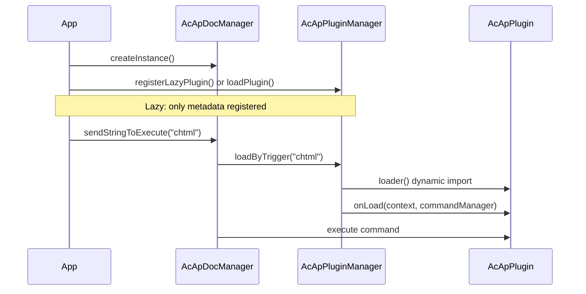

# プラグインシステム

このページでは、CAD-Viewer 用の**プラグイン**を構築、登録、使用する方法を説明します。プラグインは、コマンドの登録、アクティブなドキュメントとビューへのアクセス、アンロード時のクリーンアップを通じてビューアを拡張します。

プラグインシステムは `@mlightcad/cad-simple-viewer`（`packages/cad-simple-viewer/src/plugin`）にあります。公式のエクスポートプラグインは、別々の npm パッケージとして提供されています。

| パッケージ | プラグイン名 | トリガーコマンド | 目的 |
|---------|-------------|------------------|---------|
| `@mlightcad/cad-html-plugin` | `HtmlPlugin` | `chtml` | 図面をオフライン HTML にエクスポート |
| `@mlightcad/cad-pdf-plugin` | `PdfPlugin` | `cpdf`, `ipdf` | PDF へのエクスポート / ベクター PDF のインポート |
| `@mlightcad/cad-svg-plugin` | `SvgPlugin` | `csvg` | 図面を SVG にエクスポート |

---

## 概要

プラグインは、`AcApPlugin` を実装する小さなモジュールです。**プラグインマネージャー**（`AcApPluginManager`）は `AcApDocManager` によって所有され、次のことを行います。

- プラグインのロード時に `onLoad()` を呼び出す（コマンドやフックの登録など）
- プラグインの削除時に `onUnload()` を呼び出す（コマンドの登録解除、リソースの解放）
- **遅延登録**をサポートする。ユーザーが**トリガーコマンド**を実行するまで、プラグインのコードはダウンロードされない



---

## コアの型

### `AcApPlugin`

すべてのプラグインは次のものを提供する必要があります。

| フィールド / メソッド | 説明 |
|----------------|-------------|
| `name` | 一意の識別子（必須）。遅延ロードを使用する場合は、遅延登録の `name` と一致する必要があります。 |
| `version?` | 省略可能なバージョン文字列 |
| `description?` | 省略可能な人間が読める説明 |
| `onLoad(context, commandManager)` | コマンドを登録し、リソースを初期化します |
| `onUnload(context, commandManager)` | コマンドを削除し、リソースを解放します |

`context` は `AcApContext`（現在の `doc` と `view`）です。`commandManager` は `AcEdCommandStack` であり、組み込みコマンドが使用するのと同じスタックです。

参照実装：`packages/cad-simple-viewer/src/plugin/AcApPluginExample.ts` の `AcApExamplePlugin`。

### `AcApLazyPluginRegistration`

コード分割のために、プラグインをすぐにロードする代わりにディスクリプタを登録します。

| フィールド | 説明 |
|-------|-------------|
| `name` | `loader` が返す `AcApPlugin.name` と等しくなければなりません |
| `triggers` | このプラグインをロードするコマンド名（大文字と小文字を区別しない） |
| `loader` | プラグインインスタンスを返す非同期ファクトリー |

---

## ステップ 1 — コマンドを実装する

プラグインは通常、1 つ以上の**コマンド**を公開します。`AcEdCommand` を拡張し、`execute(context)` を実装します。

```typescript
import { AcApContext, AcEdCommand } from '@mlightcad/cad-simple-viewer'

export class AcApMyExportCmd extends AcEdCommand {
  async execute(context: AcApContext) {
    const fileName = context.doc.fileName || context.doc.docTitle
    // ... export logic using context.doc.database, context.view, etc.
  }
}
```

プロンプト、エディタへのアクセス、エンティティの作成については、[コマンド](./command)を参照してください。

---

## ステップ 2 — `AcApPlugin` を実装する

登録したすべてのコマンドを追跡して、`onUnload` でそれらを削除できるようにします。

```typescript
import {
  AcApContext,
  AcApPlugin,
  AcEdCommandStack
} from '@mlightcad/cad-simple-viewer'

import { AcApMyExportCmd } from './AcApMyExportCmd'

export class AcApMyPlugin implements AcApPlugin {
  name = 'MyPlugin'
  version = '1.0.0'
  description = 'My custom export command'

  private registeredCommands: Array<{ group: string; name: string }> = []

  onLoad(_context: AcApContext, commandManager: AcEdCommandStack): void {
    const group = AcEdCommandStack.SYSTEMT_COMMAND_GROUP_NAME
    commandManager.addCommand(group, 'myexport', 'myexport', new AcApMyExportCmd())
    this.registeredCommands.push({ group, name: 'myexport' })
  }

  onUnload(_context: AcApContext, commandManager: AcEdCommandStack): void {
    for (const cmd of this.registeredCommands) {
      commandManager.removeCmd(cmd.group, cmd.name)
    }
    this.registeredCommands = []
  }
}
```

公式プラグインも同じパターンに従っています。

- `AcApHtmlPlugin` — `chtml` を登録
- `AcApPdfPlugin` — `cpdf`、`ipdf` を登録
- `AcApSvgPlugin` — `csvg` を登録

ビューア全体で使用するコマンド（ズーム、レイヤなどと同じグループ）には `AcEdCommandStack.SYSTEMT_COMMAND_GROUP_NAME` を使用します。

---

## ステップ 3 — npm パッケージとして公開する（任意）

`cad-html-plugin`、`cad-pdf-plugin`、または `cad-svg-plugin` の構造を踏襲します。

```
my-cad-plugin/
  package.json          # name: @myorg/cad-my-plugin
  src/
    AcApMyPlugin.ts
    AcApMyExportCmd.ts
    registerLazyMyPlugin.ts
    index.ts            # public exports
```

**`package.json` の規約：**

- `"type": "module"` を設定する
- `@mlightcad/cad-simple-viewer` を **peerDependency** としてリストする（必要に応じて `@mlightcad/data-model`、`three` などの他の共有ライブラリも）
- 既存のプラグインと同様に `tsc` + `vite` でビルドする
- `src/index.ts` からヘルパーをエクスポートする：プラグインクラス、`createMyPlugin`、`registerLazyMyPlugin`、トリガー定数

**遅延ローダーモジュール**（`registerLazyMyPlugin.ts`）：

```typescript
import type { AcApPluginManager } from '@mlightcad/cad-simple-viewer'

export const MY_PLUGIN_NAME = 'MyPlugin'
export const MY_PLUGIN_TRIGGERS = ['myexport'] as const

export async function createMyPlugin() {
  const { AcApMyPlugin } = await import('./AcApMyPlugin')
  return new AcApMyPlugin()
}

export function registerLazyMyPlugin(pluginManager: AcApPluginManager): void {
  pluginManager.registerLazyPlugin({
    name: MY_PLUGIN_NAME,
    triggers: [...MY_PLUGIN_TRIGGERS],
    loader: createMyPlugin
  })
}
```

動的な `import('./AcApMyPlugin')` により、`myexport` が実行されるまで、重いプラグインチャンクが初期バンドルに含まれません。

---

## プラグインの登録

一般的な登録方法は 4 つあります。遅延ロードが必要かどうか、およびアプリのブートストラップを誰が所有するかに基づいて 1 つを選択します。

### A. 遅延登録（オプション機能に推奨）

`AcApDocManager.createInstance()` の後に登録します。プラグインモジュールは最初のトリガーコマンドでロードされます。

```typescript
import { AcApDocManager } from '@mlightcad/cad-simple-viewer'
import { registerLazyHtmlPlugin } from '@mlightcad/cad-html-plugin'
import { registerLazyPdfPlugin } from '@mlightcad/cad-pdf-plugin'
import { registerLazySvgPlugin } from '@mlightcad/cad-svg-plugin'

AcApDocManager.createInstance({
  container: document.getElementById('cad-container')!,
  htmlViewerRuntimeUrl: './viewer-runtime.iife.js' // required for chtml export
})

const pm = AcApDocManager.instance.pluginManager
registerLazyHtmlPlugin(pm)
registerLazyPdfPlugin(pm)
registerLazySvgPlugin(pm)
```

サンプルアプリ：`packages/cad-simple-viewer-example/src/main.ts`。

ユーザーがトリガーコマンドを実行すると、コマンドがまだ登録されていない場合、`AcApDocManager` が自動的に `loadByTrigger` を呼び出します。

```typescript
AcApDocManager.instance.sendStringToExecute('chtml')
AcApDocManager.instance.sendStringToExecute('cpdf')
```

`sendStringToExecute` を使用する場合、実行前にプラグインをプリロードしたい場合（後述）を除き、手動で `loadByTrigger` を呼び出す**必要はありません**。

### B. インラインの遅延登録（cad-viewer コンポーネント）

`@mlightcad/cad-viewer` は、`app.ts` の `initializeCadViewer()` から呼び出される `registerLazyPlugins()`（`packages/cad-viewer/src/app/register.ts`）で PDF/HTML/SVG プラグインを登録します。Vue コンポーネントの利用者は、追加の設定なしで遅延プラグインを利用できます。

### C. `pluginManager.loadPlugin()` による即時ロード

ドキュメントマネージャーの作成直後にロードします。

```typescript
import { AcApDocManager } from '@mlightcad/cad-simple-viewer'
import { AcApExamplePlugin } from '@mlightcad/cad-simple-viewer' // AcApExamplePlugin export

AcApDocManager.createInstance({ container: el })
await AcApDocManager.instance.pluginManager.loadPlugin(new AcApExamplePlugin())
```

プラグインが小さい場合や、ユーザーの操作より前に利用可能にする必要がある場合に使用します。

### D. `createInstance({ plugins })` による即時ロード

初期化時にプラグインを渡します。`AcApDocManager` は起動中に非同期でそれらをロードします。

**インスタンスまたはファクトリーから：**

```typescript
AcApDocManager.createInstance({
  container: el,
  plugins: {
    fromConfig: [
      new AcApExamplePlugin(),
      () => new AcApAnotherPlugin()
    ]
  }
})
```

**フォルダーから（動的インポート）：**

```typescript
AcApDocManager.createInstance({
  container: el,
  plugins: {
    fromFolder: {
      folderPath: './plugins',
      pluginList: ['MyPlugin.js'],
      continueOnError: true
    }
  }
})
```

ブラウザーでは `pluginList` を指定する必要があります（ディレクトリ一覧 API はありません）。各ファイルは、プラグインインスタンス、プラグインクラス、またはファクトリー関数をデフォルトエクスポートする必要があります。

---

## 実行時のプラグインの使用

### プラグインコマンドを実行する

プラグインがロードされた後（即時ロードまたは遅延トリガー経由）：

```typescript
// Command line / script style
AcApDocManager.instance.sendStringToExecute('chtml')

// Or via editor API
await AcApDocManager.instance.editor.executeCommand('cpdf')
```

### 遅延プラグインをプリロードする（任意）

一部の UI 経路では、初回実行時の遅延を避けるため、`sendStringToExecute` の前にプリロードします。

```typescript
const pluginManager = AcApDocManager.instance.pluginManager
await pluginManager.loadByTrigger('cpdf')
AcApDocManager.instance.sendStringToExecute('cpdf')
```

`cad-viewer` は、リボンからの PDF エクスポート（`MlRibbonCommands.vue` → `runLazyCommand`）でこのパターンを使用しています。

### ロード状態を確認する

```typescript
const pm = AcApDocManager.instance.pluginManager

pm.isPluginLoaded('HtmlPlugin')        // true after first chtml
pm.isLazyPluginTrigger('chtml')        // true if lazy registration exists
pm.getLoadedPlugins()                  // ['HtmlPlugin', ...]
await pm.unloadPlugin('HtmlPlugin')
await pm.unloadAllPlugins()            // called when destroying the view
```

### アンロード

```typescript
await AcApDocManager.instance.pluginManager.unloadPlugin('MyPlugin')
```

`onUnload` は、`onLoad` で登録したすべてのコマンドを削除する必要があります。これを怠ると、スタックに古いコマンドが残ります。

---

## 組み込みプラグインリファレンス

### HTML（`@mlightcad/cad-html-plugin`）

| 項目 | 値 |
|------|-------|
| コマンド | `chtml` |
| 追加設定 | `AcApDocManager.createInstance()` の `htmlViewerRuntimeUrl` — `viewer-runtime.iife.js` への URL（パッケージの `dist/` からコピー） |
| パブリック API | `registerLazyHtmlPlugin`、`createHtmlPlugin`、`AcApHtmlConvertor`、`packHtml`、スナップショット型 |

### PDF（`@mlightcad/cad-pdf-plugin`）

| 項目 | 値 |
|------|-------|
| コマンド | `cpdf`（エクスポート）、`ipdf`（インポート） |
| パブリック API | `registerLazyPdfPlugin`、`createPdfPlugin`、コンバーター |

### SVG（`@mlightcad/cad-svg-plugin`）

| 項目 | 値 |
|------|-------|
| コマンド | `csvg` |
| パブリック API | `registerLazySvgPlugin`、`createSvgPlugin`、`AcApSvgConvertor`、SVG レンダラーユーティリティ |

各パッケージの README には、ビルド出力、ピア依存関係、統合の詳細が記載されています。

---

## 統合チェックリスト

1. `@mlightcad/cad-simple-viewer` に**依存する**（公開するプラグインではピア依存関係）。
2. `AcApPlugin` + `AcEdCommand` を**実装する**。
3. パッケージのエントリーから `registerLazy*Plugin` + `create*Plugin` を**エクスポートする**。
4. `AcApDocManager.createInstance()` の後に**登録する**（または `plugins.fromConfig` / `fromFolder` を介して）。
5. `sendStringToExecute` または同じコマンド名を呼び出す UI でコマンドを**トリガーする**。
6. **バンドル**：遅延 `loader` で動的な `import()` を使用し、Vite/Rollup がプラグインチャンクを分割するようにする。
7. **クリーンアップ**：`onUnload` ですべてのコマンドを削除する。
8. **一意のトリガー**：1 つのトリガーコマンドを 2 つの遅延プラグインにマッピングすることはできません（`registerLazyPlugin` は競合時に例外をスローします）。
9. **名前の一貫性**：`AcApLazyPluginRegistration.name` は `loader()` の `plugin.name` と一致する必要があります。

---

## トラブルシューティング

| 症状 | 考えられる原因 |
|---------|----------------|
| `Command 'chtml' not found` | 遅延プラグインが登録されていない、または destroy 後に登録された |
| 遅延プラグインがまったくロードされない | トリガー名の不一致（大文字への正規化を確認）、loader と登録の `name` の不一致 |
| HTML エクスポートが実行時に失敗する | `htmlViewerRuntimeUrl` が欠落している、または `viewer-runtime.iife.js` がその URL にデプロイされていない |
| `Plugin 'X' is already loaded` | `unloadPlugin` なしで `loadPlugin` を 2 回呼び出した |
| トリガーがすでに登録されている | 2 つのプラグインが同じトリガーコマンドを登録した |

---

## 関連ドキュメント

- [コマンド](./command) — コマンドのライフサイクルと `AcEdCommand`
- [データソースプラグイン](./data-source-plugin) — プラグイン可能な図面の取得元（ローカル、URL、OneDrive など）
- [Simple CAD Viewer の統合](./integrate-simple-cad-viewer) — `cad-simple-viewer` の埋め込み
- [CAD Viewer コンポーネントの統合](./integrate-cad-viewer-component) — Vue コンポーネントと `initializeCadViewer`
- [アーキテクチャ概要](./architecture-overview) — モジュール構成
