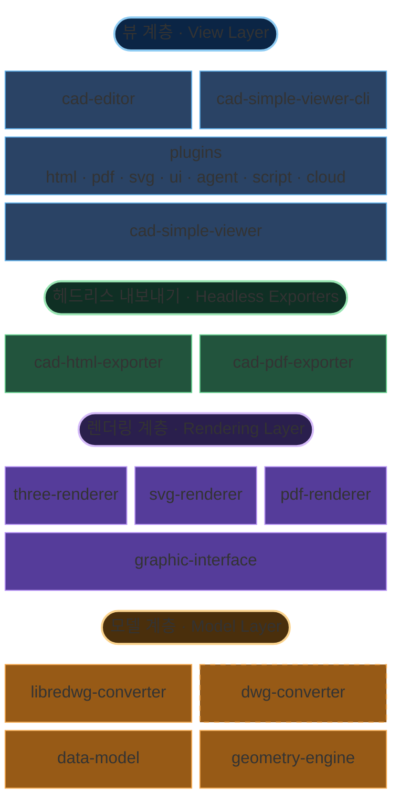

# 아키텍처 개요

MLightCAD는 브라우저에서만 동작하며 **백엔드 의존성이 없습니다**. DWG/DXF 파일은 WebAssembly와 JavaScript로 로컬에서 파싱·처리되어 다음을 보장합니다.

- **서버 불필요** — 정적 파일 호스팅만으로 어디에든 배포 가능
- **완전한 데이터 프라이버시** — 파일이 사용자 기기를 떠나지 않음
- **즉시 통합** — 복잡한 백엔드 구축이나 API 설정 불필요
- **오프라인 동작** — 인터넷 연결 없이도 동작

이 저장소는 `pnpm` + `nx` TypeScript 모노레포입니다. 보기 / 편집과 관련된 주요 패키지는 다음과 같습니다.

| 패키지 | 역할 |
| --- | --- |
| [`@mlightcad/cad-simple-viewer`](https://github.com/mlightcad/cad-viewer/tree/main/packages/cad-simple-viewer) | 문서 관리, 명령 스택, 플러그인 관리자, 캔버스. **UI 프레임워크 비의존** |
| [`@mlightcad/cad-editor`](https://github.com/mlightcad/cad-viewer/tree/main/packages/cad-editor) | `cad-simple-viewer` 위의 완전한 Vue 3 UI(메뉴, Ribbon, 명령줄, 상태 표시줄) |
| [`@mlightcad/cad-simple-viewer-cli`](https://github.com/mlightcad/cad-viewer/tree/main/packages/cad-simple-viewer-cli) | 헤드리스 CLI: Playwright / Chromium에서 `cad-simple-viewer`를 구동해 `.scr` 스크립트 실행 |
| [`@mlightcad/three-renderer`](https://github.com/mlightcad/cad-viewer/tree/main/packages/three-renderer) | THREE.js 기반 대화형 2D/3D 렌더링 |
| `svg-renderer`([`cad-svg-plugin`](https://github.com/mlightcad/cad-viewer/tree/main/packages/cad-svg-plugin)) | 동일 렌더링 인터페이스의 SVG 벡터 출력 |
| [`@mlightcad/pdf-renderer`](https://github.com/mlightcad/cad-viewer/tree/main/packages/pdf-renderer) | 동일 렌더링 인터페이스의 벡터 PDF 출력 백엔드 |
| [`@mlightcad/cad-html-exporter`](https://github.com/mlightcad/cad-viewer/tree/main/packages/cad-html-exporter) / [`@mlightcad/cad-pdf-exporter`](https://github.com/mlightcad/cad-viewer/tree/main/packages/cad-pdf-exporter) | Node 헤드리스 HTML / PDF 내보내기(브라우저 뷰어 불필요) |
| `*-plugin` | 선택 기능(UI, 내보내기, 스크립트, 에이전트, 클라우드 데이터 소스). 플러그인 관리자가 지연 로드 |

계층 원칙: `data-model`(외부) → 렌더러 → `cad-simple-viewer` → UI / 플러그인 / CLI. **하위 패키지는 상위 패키지에 의존해서는 안 됩니다.**

## 전체 아키텍처

시스템은 역할에 따라 **모델 계층, 렌더링 계층, 뷰 계층**으로 나뉘며, 독립 배포 가능한 **헤드리스 내보내기** 경로와 동일한 뷰어 코어를 구동하는 CLI가 있습니다.

이 계층 구조 덕분에 데이터 규모, 렌더링 대상, 배포 형태(브라우저 컴포넌트, 헤드리스 CLI, 순수 Node 내보내기)가 달라도 확장성을 유지할 수 있습니다.

### 모델 계층

모델 계층은 독립 저장소 [`realdwg-web`](https://github.com/mlightcad/realdwg-web)에 있으며, 이 저장소에서는 외부 의존성으로 참조합니다.

- [`@mlightcad/data-model`](https://github.com/mlightcad/realdwg-web)은 파싱된 CAD 데이터(기하 엔티티, 레이어, 뷰 매개변수 등)를 나타내는 통합 **Data Model**을 정의합니다.
- [`AcDbDatabaseConverter`](https://github.com/mlightcad/realdwg-web/blob/main/packages/data-model/src/database/AcDbDatabaseConverter.ts)는 통합 CAD 파일 변환 인터페이스를 제공하여 서로 다른 변환기가 동일한 데이터 모델을 만들 수 있게 합니다.
- [`@mlightcad/libredwg-converter`](https://github.com/mlightcad/realdwg-web)는 LibreDWG 기반 오픈소스 DWG 파싱(WebAssembly)을 제공하여 DWG를 통합 데이터 모델로 변환합니다. 호스트가 변환기를 직접 등록해야 합니다(`cad-simple-viewer` 자체는 GPL 파서를 포함하지 않음).
- **`@mlightcad/dwg-converter`**는 **클로즈드소스 상용** DWG 파싱 모듈로, 동일한 `AcDbDatabaseConverter` 인터페이스를 구현하며 더 높은 호환성과 완성도를 위해 `libredwg-converter`를 대체할 수 있습니다. GitHub Packages로 비공개 배포되며 이 저장소와 함께 오픈소스로 공개되지 않습니다. 설치·등록은 [독점 DWG 변환기 설치 및 사용](./install-and-use-proprietary-dwg-converter), 라이선스·체험은 [PROPRIETARY-PARSER.md](https://github.com/mlightcad/cad-viewer/blob/main/PROPRIETARY-PARSER.md)를 참고하세요.
- DXF 파싱은 `data-model` 내장 변환 파이프라인이 담당합니다(과거에는 [`@mlightcad/dxf-json`](https://github.com/mlightcad/dxf-json) 기반).
- [`@mlightcad/geometry-engine`](https://github.com/mlightcad/realdwg-web)는 기하 및 수학 연산(점, 선, 폴리선, 스플라인, 원/호, 타원, 벡터·행렬)을 제공합니다.

`AcDbDatabaseConverter`를 정의하는 이유: 시중의 DXF/DWG 도구는 불완전한 경우가 많습니다. 오픈소스 경로는 `libredwg-converter`이고, 더 높은 충실도가 필요하면 클로즈드소스 `dwg-converter`로 등록만 바꾸면 되며 상위 뷰어 코드 변경은 필요 없습니다. 하위에서는 [ODA](https://www.opendesign.com/products/drawings) 같은 상용 엔진 위에 동일한 인터페이스를 직접 구현할 수도 있습니다.

### 렌더링 계층

- [`@mlightcad/graphic-interface`](https://github.com/mlightcad/realdwg-web)(`realdwg-web`)는 통합 엔티티 렌더링 인터페이스(`AcGiRenderer` 등)를 정의합니다.
- [`@mlightcad/three-renderer`](https://github.com/mlightcad/cad-viewer)가 그 인터페이스를 구현하여 THREE.js로 대화형 캔버스 렌더링(배칭, 선종/해치 셰이더 등)을 수행합니다. `cad-simple-viewer`의 기본 백엔드입니다.
- **`svg-renderer`**(`AcSvgRenderer`)는 동일 인터페이스를 구현하여 확장 가능한 SVG를 출력합니다. 현재 구현은 [`@mlightcad/cad-svg-plugin`](https://github.com/mlightcad/cad-viewer/tree/main/packages/cad-svg-plugin)에 있으며 `csvg` 등 내보내기 명령이 사용합니다. PDF 벡터 내보내기도 일부 그리기 기능을 재사용합니다.
- [`@mlightcad/pdf-renderer`](https://github.com/mlightcad/cad-viewer)는 동일 인터페이스를 구현하여 벡터 PDF 콘텐츠 스트림을 출력합니다. `cad-pdf-core` / `cad-pdf-plugin` / `cad-pdf-exporter`가 사용합니다.

### 뷰 계층

- **`cad-simple-viewer`**가 핵심입니다. 문서 수명주기, 명령 스택, 사용자 입력 / jig, `three-renderer`와의 조율, 그리고 **`AcApPluginManager` 플러그인 메커니즘**을 제공합니다. 캔버스 외의 애플리케이션 UI는 없습니다.
- **플러그인**은 `AcApPlugin`을 구현하는 독립 npm 패키지로 배포되며 `registerLazyPlugin` / `loadPlugin`으로 같은 플러그인 관리자에 연결됩니다. 공식 플러그인에는 HTML / PDF / SVG 내보내기, 간단 UI, 스크립트 콘솔, AI 에이전트, OneDrive / Google Drive 등이 있습니다. 자세한 내용은 [플러그인 시스템](./plugin-system)과 [내장 플러그인](./built-in-plugins)을 참고하세요.
- **`cad-editor`**(이전 `@mlightcad/cad-viewer`, 1.8.0에서 개명)는 `cad-simple-viewer` 위에 완전한 Vue 3 UI를 제공하고 부트스트랩 시 일반적인 지연 로드 플러그인을 등록합니다.
- **`cad-simple-viewer-cli`**는 Playwright로 헤드리스 Chromium에서 동일한 뷰어 코어를 시작하고 AutoCAD 스타일 `.scr` 스크립트(예: `-chtml` / `-cpdf`)를 실행합니다. CI와 변환 서비스에 적합합니다. 자세한 내용은 [클라우드 DWG 웹 뷰어 구축](./cloud-dwg-web-viewer)을 참고하세요.

### 헤드리스 내보내기

브라우저 플러그인과 Node 내보내기는 `*-core` 패키지의 내보내기 파이프라인을 공유하여 서버에서 전체 뷰어를 띄울 필요가 없습니다.

| 경로 | 공유 코어 | 렌더링 백엔드 | 대표 진입점 |
| --- | --- | --- | --- |
| HTML | `@mlightcad/cad-html-core` | `three-renderer`(스냅샷 생성 후 패키징) | 브라우저: `cad-html-plugin`(`chtml`); Node: `cad-html-exporter`(`exportFileToHtml`) |
| PDF | `@mlightcad/cad-pdf-core` | `pdf-renderer` | 브라우저: `cad-pdf-plugin`(`cpdf`); Node: `cad-pdf-exporter`(`exportFileToPdf`) |

`*-core`는 `cad-simple-viewer` / DOM에 **의존하지 않습니다**. `*-exporter`는 Node에서 글꼴 로딩, DWG 등록, 파일 I/O를 수행합니다. 파일 → HTML/PDF뿐 아니라 완전한 명령 스크립트 능력이 필요하면 `cad-simple-viewer-cli`를 사용하세요.

## 렌더링 엔진

DXF/DWG 렌더링에는 다음 과제가 있습니다.

- 엔티티가 많은 도면의 고성능 렌더링
- AutoCAD 텍스트 렌더링 재현
- 선종 및 해치 패턴 지원

### 고성능 렌더링

대형 도면에서는 점·선·면을 병합해 **Draw Call**을 줄이는 것이 핵심입니다. THREE.js [BatchedMesh](https://threejs.org/docs/index.html?q=Mesh#api/en/objects/BatchedMesh)는 삼각형 병합만 부분적으로 해결하며 점/선 병합은 지원하지 않습니다. 그래서 `BatchedMesh`를 참고해 점·선·면 배칭 클래스를 구현했습니다. 코드는 [`packages/three-renderer/src/batch`](https://github.com/mlightcad/cad-viewer/tree/main/packages/three-renderer/src/batch)를 참고하세요.

### 텍스트 렌더링

AutoCAD는 리치 텍스트에 [`MText`](https://ezdxf.mozman.at/docs/dxfinternals/entities/mtext.html), 빠른 표시에 [SHX](https://help.autodesk.com/view/OARX/2023/ENU/?guid=GUID-DE941DB5-7044-433C-AA68-2A9AE98A5713) 스트로크 폰트를 사용합니다. 관련 기능은 독립 저장소에 있습니다.

- **MText 파싱** — [`@mlightcad/mtext-parser`](https://github.com/mlightcad/mtext-parser)
- **SHX 파싱** — [`@mlightcad/shx-parser`](https://github.com/mlightcad/shx-parser)
- **MText 렌더링** — [`@mlightcad/mtext-renderer`](https://github.com/mlightcad/mtext-renderer). 파싱된 폰트는 브라우저 IndexedDB에 캐시되어 반복 다운로드·파싱을 피합니다

텍스트 렌더링 디버깅에는 THREE.js 기반 리치 텍스트 편집기 [mtext-editor](https://github.com/mlightcad/mtext-editor)를 사용할 수 있습니다.

### 선종과 해치 패턴

AutoCAD는 사용자 정의 선종과 해치 패턴을 지원합니다. 그중 일부를 구현했습니다. 대화형 캔버스의 선종과 채우기는 THREE.js `ShaderMaterial`로 구현되어 있으며 [`packages/three-renderer/src/style`](https://github.com/mlightcad/cad-viewer/tree/main/packages/three-renderer/src/style)를 참고하세요. PDF 경로에서는 `pdf-renderer`가 해당 모양을 벡터로 재현합니다.
