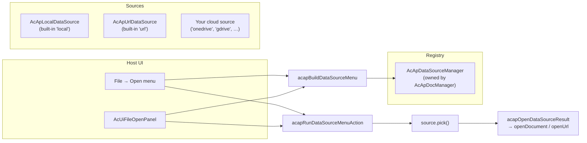

# 데이터 소스 플러그인

이 페이지는 `@mlightcad/cad-simple-viewer`의 **데이터 소스 플러그인** 메커니즘, 즉 **도면이 어디에서 오는지**(로컬 디스크, HTTP URL, OneDrive, Google Drive, …)를 결정하는 플러그 가능한 계층을 설명합니다. 메커니즘의 동작 방식, 사용자 정의 데이터 소스를 만드는 방법, 등록 및 사용 방법을 다룹니다.

이 메커니즘은 `packages/cad-simple-viewer/src/app/dataSource`에 있습니다. 완전한 참조 구현은 별도 npm 패키지인 `@mlightcad/cad-onedrive-plugin`(`packages/cad-onedrive-plugin`)으로 제공되며, `packages/cad-simple-viewer-example`의 데모 앱에서 사용됩니다.

> **명령 플러그인**(`cpdf`, `chtml` 같은 내보내기 명령)에 대해서는 [플러그인 시스템](./plugin-system)을 참조하십시오. 데이터 소스 플러그인도 *바로* `AcApPlugin`이며, 단지 명령 대신 데이터 소스를 등록하기 위해 `onLoad`를 사용할 뿐입니다.

---

## 개요

**데이터 소스**는 `AcApDataSource`를 구현하는 객체입니다. 즉, CAD 도면을 위한 플러그 가능한 원본입니다. 뷰어 코어는 벤더에 대해 아무것도 알지 못하며, 레지스트리(`AcApDataSourceManager`)와 소수의 메뉴 헬퍼만 알고 있습니다. 모든 벤더별 로직(로그인 팝업, 파일 선택기, 다운로드)은 데이터 소스 **내부**에 머뭅니다.



핵심 설계 규칙:

- **호스트는 조율만 합니다.** 호스트 UI(리본 열기 메뉴, `AcUiFileOpenPanel`, 툴바)는 (1) `AcApDataSourceManager`로 소스를 나열하고, (2) `acapBuildDataSourceMenu`로 라벨을 만들고, (3) `acapRunDataSourceMenuAction` / `acapInvokeDataSourceMenuAction`으로 클릭을 실행하는 일만 해야 합니다. 벤더 파일 선택기를 열거나, URL을 다운로드하거나, 공급자별 로그인 화면을 표시해서는 **안 됩니다**.
- **로그인과 선택은 절대 연결되지 않습니다.** 브라우저는 직접적인 사용자 제스처 틱에서만 `window.open`을 허용합니다. 클릭 핸들러가 MSAL 로그인을 `await`한 *후* 선택기 팝업을 열면 두 번째 팝업이 차단됩니다. 따라서 메뉴는 **로그인**과 **…에서 열기**를 별도 항목으로 노출합니다.
- **적응형 메뉴.** `getAuthState()`가 메뉴 표시 내용을 결정하므로 호스트에 공급자별 UI가 필요하지 않습니다.

---

## 핵심 타입

아래 타입은 모두 `@mlightcad/cad-simple-viewer`에서 내보내집니다.

### `AcApDataSource`

모든 데이터 소스가 구현해야 하는 인터페이스:

| 멤버 | 필수 | 설명 |
|--------|----------|-------------|
| `id` | ✓ | 메뉴와 레지스트리 조회에 사용되는 안정적인 id(`local`, `url`, `onedrive`, …) |
| `labelKey` | ✓ | 표시 이름에 대한 i18n 키(예: `main.dataSource.onedrive`) |
| `icon?` | | 선택적 인라인 SVG 문자열 또는 URL |
| `requiresAuth` | ✓ | 소스에 사용자 인증이 필요한지 여부 |
| `requiresUserGesture` | ✓ | `true`이면 `pick()`이 직접 클릭 틱에서 `window.open`을 실행해야 합니다(클라우드 파일 선택기) |
| `getAuthState()` | ✓ | `'none'` \| `'signed-out'` \| `'signed-in'` 반환 |
| `getAccountLabel?()` | | 메뉴용 짧은 로그인 라벨(이메일 / 표시 이름) |
| `getAccountProfile?()` | | 랜딩 / 계정 화면용 `{ displayName, email?, avatarUrl? }` |
| `restoreSession?()` | | 등록 후 캐시된 세션을 복원합니다(MSAL 계정, 토큰, …). 완료 시 `notifyAuthChanged`를 호출하여 열기 메뉴가 새로 고쳐지도록 해야 합니다 |
| `signIn()` | ✓ | 대화형 로그인. `requiresAuth`가 `false`이면 no-op |
| `signOut()` | ✓ | 로그아웃. `requiresAuth`가 `false`이면 no-op |
| `pick()` | ✓ | 소스별 파일 선택기 / 대화상자를 열고, 필요하면 다운로드하고, 선택된 도면을 반환합니다. 사용자가 취소하면 `null` |

### `AcApDataSourceFile`

성공적인 `pick()`의 결과:

| 필드 | 설명 |
|-------|-------------|
| `name` | 확장자를 포함한 파일 이름(예: `drawing.dwg`) |
| `content?` | 원시 파일 바이트(`ArrayBuffer`). `url`이 생략될 때 사용됩니다 |
| `url?` | `AcApDocManager.openUrl`로 여는 원격 URL(진행률이 있는 HTTP 가져오기) |

이미 메모리에 있는 바이트에는 `content`를, 소스를 `openUrl`로 열어야 할 때는 `url`을 선호합니다.

### `AcApDataSourceManager`

`AcApDocManager`가 소유하는 레지스트리입니다(`AcApDocManager.instance.dataSourceManager`). `AcApDocManager.createInstance()`는 두 내장 소스를 자동으로 등록합니다:

- `local` — `AcApLocalDataSource`(`.dwg` / `.dxf`용 `<input type="file">` 선택기)
- `url` — `AcApUrlDataSource`(URL 대화상자, `openUrl`로 열기)

클라우드 플러그인은 `AcApPlugin.onLoad`에서 자신을 등록하고 `onUnload`에서 등록을 해제합니다.

| API | 설명 |
|-----|-------------|
| `register(source)` | 소스 등록(동일한 id의 기존 소스를 대체) |
| `unregister(id)` | id로 소스 제거 |
| `list()` | 등록 순서대로 등록된 소스 |
| `get(id)` | id로 소스 조회 |
| `notifyAuthChanged(sourceId)` | 클라우드 플러그인이 성공적인 `signIn` / `signOut` 후 호출 |
| `on` / `off` | `changed` 및 `auth-changed` 이벤트 구독 |

---

## 메뉴 헬퍼

호스트는 열기 메뉴를 직접 만들지 않습니다. 세 가지 헬퍼가 계약을 정의합니다:

### 1. `acapBuildDataSourceMenu(sources)`

현재 레지스트리로부터 `AcApDataSourceMenuItem[]`을 빌드합니다. 규칙(팝업 차단기 안전):

| 인증 상태 | 메뉴 항목 |
|------------|------------|
| 인증 불필요(`'none'`) | **선택** 항목 하나(예: *로컬 파일*, *URL에서*) |
| 인증 필요, **로그아웃 상태** | **로그인** 항목 하나만(선택과 절대 연결하지 않음) |
| 인증 필요, **로그인 상태** | **선택**(*OneDrive에서 열기*) + **로그아웃**(*OneDrive에서 로그아웃(user@host)*) |

### 2. `acapRunDataSourceMenuAction(item, options?, manager?)`

메뉴 항목에 대한 작업을 실행하고 **선택 결과를 자동으로 엽니다**(`acapOpenDataSourceResult`: `file.url`이 설정되면 `openUrl`, 그렇지 않으면 `file.content`로 `openDocument`). 뷰어 내부 열기 메뉴에서 사용합니다. 로그인을 선택과 연결하지 않습니다.

### 3. `acapInvokeDataSourceMenuAction(source, item)`

이미 확인된 소스에 대해 파일을 열지 **않고** 작업을 실행합니다. `AcApDocManager`가 존재하기 전에 데이터 소스 관리자를 소유한 랜딩 페이지나, 결과를 직접 열고 싶을 때 사용합니다.

### 지원 유틸리티

| 헬퍼 | 목적 |
|--------|---------|
| `acapOpenCenteredPopup(name, width?, height?)` | 화면 중앙에 이름 있는 팝업을 엽니다. `pick()` 내부에서 사용하여 팝업이 동일한 클릭 틱에서 열리도록 합니다 |
| `acapWithDataSourceBusy(work, message?)` | 다운로드 / 선택 후 작업을 바쁨 오버레이로 감쌉니다(DocManager의 바쁨 표시기 또는 랜딩 페이지용 `document.body`의 임시 `AcApProgress`) |
| `acapOpenDataSourceResult(file, options?)` | DocManager(`openUrl` / `openDocument`)를 통해 `pick()` 결과를 엽니다 |
| `acapIsSingleLocalOpen(sources)` | 열기 UI가 단일 "열기" 작업으로 축소되어야 하는지 여부(내장 로컬 소스만 있는 경우) |

---

## 데이터 소스 플러그인 만들기

데이터 소스 플러그인은 `onLoad`에서 `AcApDataSource`를 등록하는 일반 `AcApPlugin`입니다([플러그인 시스템](./plugin-system) 참조). 권장 패키지 레이아웃은 `cad-onedrive-plugin`을 따릅니다:

```
my-cad-datasource-plugin/
  package.json          # name: @myorg/cad-my-datasource-plugin
  src/
    AcApMyDataSource.ts # implements AcApDataSource
    AcApMyPlugin.ts     # implements AcApPlugin, registers the source
    myClient.ts         # vendor API client (auth, picker, download)
    register.ts         # registerMyPlugin(pluginManager, options)
    index.ts            # public exports
```

**`package.json` 규칙:**

- `"type": "module"` 설정
- `@mlightcad/cad-simple-viewer`(필요 시 `@mlightcad/data-model`도)를 **peerDependencies**로 나열
- 기존 플러그인처럼 `tsc` + `vite`로 빌드

### 단계 1 — `AcApDataSource` 구현

```typescript
import {
  type AcApDataSource,
  type AcApDataSourceAccountProfile,
  type AcApDataSourceAuthState,
  type AcApDataSourceFile,
  type AcApDataSourceManager,
  acapOpenCenteredPopup,
  acapWithDataSourceBusy
} from '@mlightcad/cad-simple-viewer'

/** Stable id used in menus and registry lookups. */
export const ACAP_MY_DATA_SOURCE_ID = 'mycloud'

export class AcApMyDataSource implements AcApDataSource {
  readonly id = ACAP_MY_DATA_SOURCE_ID
  readonly labelKey = 'main.dataSource.mycloud'
  readonly requiresAuth = true
  // true because pick() opens a File Picker popup via window.open
  readonly requiresUserGesture = true

  private readonly dataSourceManager: AcApDataSourceManager

  constructor(dataSourceManager: AcApDataSourceManager) {
    this.dataSourceManager = dataSourceManager
  }

  getAuthState(): AcApDataSourceAuthState {
    return this.client.isAuthenticated ? 'signed-in' : 'signed-out'
  }

  getAccountLabel(): string | undefined {
    return this.client.userInfo?.email
  }

  getAccountProfile(): AcApDataSourceAccountProfile | undefined {
    if (!this.client.isAuthenticated) return undefined
    const info = this.client.userInfo!
    return { displayName: info.name || info.email, email: info.email }
  }

  /** Restore cached tokens after registration so menus show signed-in state. */
  async restoreSession(): Promise<void> {
    await this.client.initialize()
    this.notifyAuthChanged()
  }

  async signIn(): Promise<void> {
    await this.client.authenticate()
    this.notifyAuthChanged()
  }

  async signOut(): Promise<void> {
    await this.client.signOut()
    this.notifyAuthChanged()
  }

  async pick(): Promise<AcApDataSourceFile | null> {
    // Open the popup in this click tick. Any `await` first loses the gesture.
    const popup = acapOpenCenteredPopup('MyCloudPicker', 1080, 680)
    if (!popup) {
      throw new Error('Popup blocked. Allow popups for this site and try again.')
    }
    try {
      await this.client.initialize()
      if (!this.client.isAuthenticated) {
        throw new Error('Sign in first, then choose a file (popup blocker).')
      }
      const picked = await this.client.openFilePicker(popup)
      const content = await acapWithDataSourceBusy(() =>
        this.client.downloadFile(picked)
      )
      return { name: picked.name, content }
    } catch (error) {
      try {
        if (!popup.closed) popup.close()
      } catch {
        // ignore
      }
      if (error instanceof Error && error.message === 'Picker cancelled') {
        return null // user cancelled — not an error
      }
      throw error
    }
  }

  private notifyAuthChanged(): void {
    this.dataSourceManager.notifyAuthChanged(this.id)
  }
}
```

구현 참고 사항:

- **`pick()`은 클릭 틱에서 팝업을 동기적으로 열어야 합니다**(`requiresUserGesture = true`). SDK 초기화, 인증 확인 등의 `await`는 `window.open` *이후*에 수행합니다.
- 다운로드 주변에서 `acapWithDataSourceBusy`를 호출하여 사용자가 뷰어와 랜딩 페이지 모두에서 진행률 피드백을 받도록 합니다.
- 사용자가 취소하면 `null`을 반환하고, 실제 실패 시에는 예외를 발생시킵니다.
- 인증 상태가 변경된 후에는 항상 `dataSourceManager.notifyAuthChanged(id)`를 호출하여 열기 메뉴가 새로 고쳐지도록 합니다.
- 팝업을 사용하지 않는 소스(예: 페이지 내 대화상자)의 경우 `requiresUserGesture = false`로 설정합니다.
- i18n 리소스에 `labelKey`(예: `main.dataSource.mycloud`)를 추가합니다. [현지화](./localization)를 참조하십시오.

### 단계 2 — `AcApPlugin`으로 감싸기

```typescript
import {
  AcApContext,
  AcApDocManager,
  AcApPlugin,
  AcEdCommandStack
} from '@mlightcad/cad-simple-viewer'

import packageJson from '../package.json'
import { ACAP_MY_DATA_SOURCE_ID, AcApMyDataSource } from './AcApMyDataSource'

export class AcApMyPlugin implements AcApPlugin {
  name = 'MyDataSourcePlugin'
  version = packageJson.version
  description = 'Open DWG/DXF files from MyCloud'

  private source: AcApMyDataSource | null = null
  private createdSource = false

  onLoad(_context: AcApContext, _commandManager: AcEdCommandStack): void {
    const dsm = AcApDocManager.instance.dataSourceManager
    const existing = dsm.get(ACAP_MY_DATA_SOURCE_ID)
    if (existing) {
      // Already registered (e.g. HMR or double load) — just restore the session.
      void existing.restoreSession?.().catch(() => undefined)
      return
    }
    this.source = new AcApMyDataSource(dsm)
    this.createdSource = true
    dsm.register(this.source)
    // Restore cached session so File → Open shows Open/Sign out, not Sign in.
    void this.source.restoreSession().catch(() => undefined)
  }

  onUnload(_context: AcApContext, _commandManager: AcEdCommandStack): void {
    if (this.createdSource) {
      AcApDocManager.instance.dataSourceManager.unregister(ACAP_MY_DATA_SOURCE_ID)
    }
    this.source = null
    this.createdSource = false
  }
}
```

### 단계 3 — 등록 헬퍼 내보내기

데이터 소스는 **즉시** 표시되어야 하므로(열기 메뉴가 문서를 열기 전에 소스를 나열함), `pluginManager.loadPlugin`을 통해 즉시 로드합니다:

```typescript
// src/register.ts
import type { AcApPluginManager } from '@mlightcad/cad-simple-viewer'

import { AcApMyPlugin } from './AcApMyPlugin'

export const MY_PLUGIN_NAME = 'MyDataSourcePlugin'

export async function registerMyPlugin(
  pluginManager: AcApPluginManager,
  options: { clientId: string; /* … */ }
): Promise<void> {
  if (!options.clientId) {
    throw new Error('registerMyPlugin requires options.clientId')
  }
  await pluginManager.loadPlugin(new AcApMyPlugin(options))
}
```

> MSAL 스타일 SDK는 `signIn` / `pick` **내부에서** 여전히 지연 import할 수 있습니다. 등록 자체만 즉시 수행하면 됩니다.

---

## 데이터 소스 플러그인 사용

### 1. 앱에 등록

`AcApDocManager.createInstance()` 이후에 등록 헬퍼를 호출합니다:

```typescript
import { AcApDocManager } from '@mlightcad/cad-simple-viewer'
import { registerOneDrivePlugin } from '@mlightcad/cad-onedrive-plugin/register'

AcApDocManager.createInstance({ container: document.getElementById('cad-container')! })

await registerOneDrivePlugin(AcApDocManager.instance.pluginManager, {
  clientId: import.meta.env.VITE_MSAL_CLIENT_ID,
  tenantId: import.meta.env.VITE_MSAL_TENANT_ID || 'common',
  redirectUri: import.meta.env.VITE_MSAL_REDIRECT_URI // optional
})
```

`/register` 하위 경로에서 import하고 나머지는 동적 import하여 등록 스텁을 초기 번들에 유지합니다(`packages/cad-simple-viewer-example/src/register.ts` 참조):

```typescript
const { registerOneDrivePlugin } = await import('@mlightcad/cad-onedrive-plugin/register')
```

내장 UI(리본 / 툴바 / `AcUiFileOpenPanel`)를 사용할 때 앱에 필요한 것은 이것뿐입니다. 열기 메뉴가 `dataSourceManager`로부터 재구성되어 예를 들어 다음을 표시합니다:

| 인증 상태 | 메뉴 항목 |
|------------|------------|
| 로그아웃 상태 | Sign in to OneDrive |
| 로그인 상태 | Open from OneDrive, Sign out of OneDrive (user@contoso.com) |

### 2. 사용자 정의 호스트 UI(뷰어 내부 메뉴)

자체 열기 메뉴를 만드는 경우 `signIn` / `pick`을 직접 호출하지 말고 헬퍼를 사용합니다:

```typescript
import {
  AcApDocManager,
  acapBuildDataSourceMenu,
  acapRunDataSourceMenuAction
} from '@mlightcad/cad-simple-viewer'

const dsm = AcApDocManager.instance.dataSourceManager

function rebuildOpenMenu() {
  const items = acapBuildDataSourceMenu(dsm.list())
  renderMenu(items, item => {
    void acapRunDataSourceMenuAction(item, openOptions)
  })
}

rebuildOpenMenu()
dsm.on('changed', rebuildOpenMenu)
dsm.on('auth-changed', rebuildOpenMenu)
```

### 3. 랜딩 페이지(뷰어가 존재하기 전)

랜딩 페이지는 종종 `AcApDocManager`가 생성되기 전에 사용자가 파일을 선택할 수 있게 합니다. `AcUiFileOpenPanel`은 이미 이 패턴을 구현하고 있습니다. `onDataSourceAction`을 전달하고 뷰어가 준비되면 항목을 실행합니다. 자체 랜딩 UI에서 소스를 직접 호출할 때는 `acapInvokeDataSourceMenuAction` + `acapOpenDataSourceResult`를 사용합니다:

```typescript
import { acapInvokeDataSourceMenuAction, acapOpenDataSourceResult } from '@mlightcad/cad-simple-viewer'

const source = myDataSourceManager.get('onedrive') // or the built-in 'local' / 'url'
const file = await acapInvokeDataSourceMenuAction(source, menuItem)
if (file) {
  await acapOpenDataSourceResult(file, openOptions)
}
```

**사용자 제스처 함정**(`cad-simple-viewer-example/src/main.ts`에서): 클릭 핸들러가 `pick` 작업을 실행하기 전에 먼저 뷰어 초기화를 `await`해야 한다면 사용자 제스처가 상실되어 팝업이 차단됩니다. 이미 초기화된 경우 작업을 동기적으로 실행하거나, `pick` 항목에 대해 *먼저 로그인한 다음 열기* 안내를 표시합니다(예제 앱의 `handleDataSourceMenuAction` 참조).

---

## 실제 사례 참조: OneDrive

`@mlightcad/cad-onedrive-plugin`은 표준 클라우드 데이터 소스입니다:

| 구성 요소 | 파일 | 역할 |
|-------|------|--------------|
| `AcApOneDriveDataSource` | `src/AcApOneDriveDataSource.ts` | Microsoft File Picker v8 + MSAL 위에서 `AcApDataSource`를 구현합니다. `pick`은 팝업을 동기적으로 연 뒤 바쁨 오버레이 아래에서 다운로드합니다 |
| `AcApOneDrivePlugin` | `src/AcApOneDrivePlugin.ts` | 소스를 등록/해제하고 로드 시 캐시된 MSAL 세션을 복원하는 `AcApPlugin` |
| `OneDriveClient` | `src/oneDriveClient.ts` | MSAL 인증 + File Picker v8 메시징 + Graph 다운로드 |
| `registerOneDrivePlugin` | `src/register.ts` | 즉시 등록 헬퍼(`clientId` 검증) |
| `createOneDrivePlugin` | `src/createOneDrivePlugin.ts` | 플러그인 인스턴스용 비동기 팩토리 |

예제 앱은 환경 구성(`packages/cad-simple-viewer-example/src/onedriveEnv.ts`)을 통해 이를 연결합니다. `VITE_MSAL_CLIENT_ID`가 설정되면 `registerOneDriveFromEnv`가 플러그인을 등록하고, 랜딩 패널은 `AcUiFileOpenPanel`의 `extraMenuItems`를 통해 *Sign in to OneDrive* 항목을 나열합니다.

**Azure 앱 설정**(OneDrive용): Microsoft Entra ID에 **Single-page application**을 등록하고, 앱 origin과 일치하는 리디렉션 URI를 추가하고, 위임된 Graph 권한 `User.Read` + `Files.Read.All`을 부여합니다(개인 OneDrive 선택기 토큰은 `OneDrive.ReadOnly`도 포함).

---

## 문제 해결

| 증상 | 가능한 원인 |
|---------|----------------|
| 열기 메뉴에서 소스가 사라짐 | 플러그인이 등록되지 않았거나, `AcApDocManager.createInstance()` 이전 또는 destroy 이후에 등록됨; 또는 `register`가 동일한 id의 기존 소스를 대체함 |
| 선택기 팝업이 차단됨 | `pick()`이 `window.open` 이전에 `await`했거나, 동일한 클릭 핸들러에서 로그인이 선택과 연결됨 |
| 로그인 후에도 메뉴가 *로그인*을 표시 | 인증 상태 변경 후 `notifyAuthChanged`가 호출되지 않음; 또는 로드 시 `restoreSession`이 호출되지 않음 |
| 등록/해제 후 메뉴가 갱신되지 않음 | 호스트가 `changed` / `auth-changed` 이벤트에서 재구성하지 않고 항목 목록을 캐시함 |
| 피드백 없이 다운로드가 멈춤 | 다운로드가 `acapWithDataSourceBusy`로 감싸지지 않음 |
| 연 파일에 바이트나 URL이 모두 없음 | `pick()`이 `content`도 `url`도 없는 파일을 반환함 |

---

## 관련 문서

- [플러그인 시스템](./plugin-system) — `AcApPlugin`, 명령 등록, 지연 로딩
- [Simple Viewer 통합](./integrate-simple-cad-viewer) — `cad-simple-viewer` 포함
- [현지화](./localization) — `main.dataSource.*` 같은 i18n 키 추가
- [아키텍처 개요](./architecture-overview) — 모듈 구성
