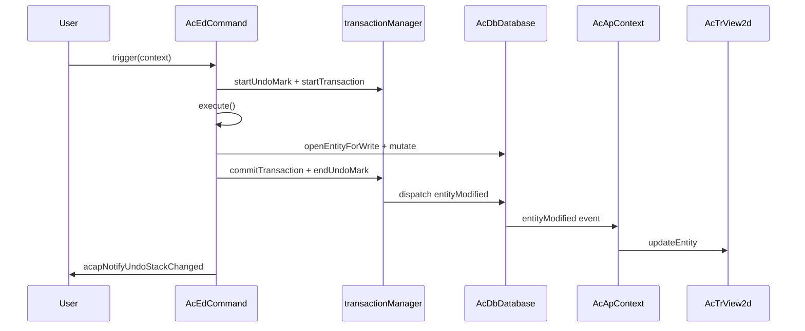

# 엔티티 수정 모범 사례

이 페이지는 **CAD-Viewer**에서 도면 엔티티를 수정할 때 변경 사항이 올바르게 추적되고, **실행 취소/재실행**이 예상대로 동작하며, **뷰가 데이터베이스와 동기화 상태를 유지**하도록 하는 방법을 설명합니다.

데이터베이스 계층은 [`@mlightcad/data-model`](https://github.com/mlightcad/realdwg-web)에서 제공됩니다. CAD-Viewer는 애플리케이션 헬퍼를 추가하고 데이터베이스 이벤트를 렌더러에 연결합니다.

---

## 개요

올바른 엔티티 편집은 세 계층을 따릅니다:

| 계층 | 책임 |
|-------|----------------|
| **데이터베이스**(`AcDbDatabase`) | 엔티티를 저장하고 변경 사항을 기록합니다 |
| **트랜잭션 / 실행 취소**(`transactionManager`) | 변경 사항을 그룹화하고 실행 취소/재실행을 지원합니다 |
| **뷰**(`AcTrView2d`) | 기하를 렌더링하며 데이터베이스 이벤트를 통해 업데이트됩니다 |

**경험칙:** 트랜잭션 API를 통해 데이터베이스를 변경하십시오. `AcApContext`가 변경 사항을 뷰에 전파하도록 하십시오. 특수한 경우(예: 일시적 미리보기 기하)가 아니라면 일반적인 데이터베이스 편집 후에 `view.updateEntity()`를 호출하지 마십시오.

---

## 트랜잭션 메커니즘

`AcDbDatabase.transactionManager`(`AcDbDatabaseTransactionManager`)는 하나의 도면에 대한 트랜잭션과 실행 취소 기록을 관리합니다. 설계는 AutoCAD ObjectARX `AcDbTransactionManager`의 의미 체계를 따릅니다.

### 핵심 API

| API | 목적 |
|-----|---------|
| `startTransaction()` | 변경 기록 시작 |
| `commitTransaction()` | 현재 트랜잭션을 확정하고 이벤트를 발생시킴 |
| `abortTransaction()` | 현재 트랜잭션의 모든 변경 사항을 롤백 |
| `hasTransaction()` | 트랜잭션이 활성 상태인지 반환 |
| `isRecording()` | 변경이 기록 중인지 반환(실행 취소/재실행 재생 중에는 false) |
| `openEntityForWrite(id \| entity)` | 활성 트랜잭션을 **통해** 쓰기용으로 엔티티를 엶 |

### 기록되는 항목

`isRecording()`이 true인 동안 트랜잭션 관리자는 다음을 기록합니다:

-   데이터베이스 객체의 **속성 변경**(`kind: 'modify'`)
-   블록 테이블 레코드, 심볼 테이블 또는 사전에서 객체의 **추가 / 제거**
-   **시스템 변수** 변경

가장 외부 트랜잭션이 커밋되면 기록된 변경 사항이 확정되고 관련 데이터베이스 이벤트가 발생합니다.

### 중첩 트랜잭션

트랜잭션은 중첩될 수 있습니다. 내부 트랜잭션은 레코더를 상위에 병합합니다. **가장 외부** `commitTransaction()`만 이벤트를 발생시키고 실행 취소 기록을 대기열에 추가합니다.

### 쓰기용 객체 열기

캐시된 엔티티 참조를 직접 변경하는 대신 항상 `database.openEntityForWrite(...)`(또는 `openObjectForWrite`)를 사용하십시오:

```typescript
const opened = db.openEntityForWrite(entityOrObjectId)
if (!opened) return
opened.color = newColor
```

트랜잭션이 활성 상태이면 `openEntityForWrite`는 객체를 트랜잭션을 통해 라우팅하여 변경 사항이 추적되도록 합니다. 활성 트랜잭션이 없으면 헬퍼는 직접 조회로 폴백하며 변경 사항이 **실행 취소 불가능**할 수 있습니다.

### 엄격 모드

`transactionManager.strictMode`(data-model의 기본값)는 모든 변경이 활성 트랜잭션 내에서 발생하도록 요구할 수 있습니다. 실행 취소/재실행 재생은 변경 적용기가 상태를 복원할 수 있도록 예외입니다. 실제로 CAD-Viewer 명령과 `acapRunDatabaseEdit`는 편집 전에 항상 트랜잭션을 설정합니다.

---

## 실행 취소 / 재실행 메커니즘

실행 취소/재실행은 **실행 취소 표시**와 **실행 취소 레코드**를 기반으로 구축됩니다.

### 실행 취소 표시

| API | 목적 |
|-----|---------|
| `startUndoMark(label?)` | 그룹을 열며, 하나의 표시 내 여러 커밋은 **하나**의 실행 취소 단계가 됩니다 |
| `endUndoMark()` | 그룹을 닫고 변경이 있으면 실행 취소 레코드를 푸시합니다 |
| `cancelUndoMark()` | 실행 취소 레코드를 생성하지 않고 그룹을 폐기합니다 |

### 실행 취소 / 재실행 작업

| API | 목적 |
|-----|---------|
| `undo()` | 가장 최근 실행 취소 레코드를 되돌립니다 |
| `redo()` | 가장 최근에 실행 취소된 레코드를 다시 적용합니다 |
| `canUndo()` / `canRedo()` | 스택 상태를 조회합니다 |
| `clearUndoStack()` | 두 스택을 모두 지웁니다 |

실행 취소 또는 재실행이 실행되면 `AcDbChangeApplier`는 저장된 변경 사항을 순방향 또는 역순으로 재생하고 적절한 엔티티 이벤트를 발생시켜 뷰가 자동으로 업데이트되도록 합니다.

### 명령이 실행 취소를 자동으로 얻는 방법

`AcEdCommand.trigger()`는 실행 취소 기록이 활성화되면 명령 실행을 하나의 실행 취소 표시와 하나의 트랜잭션으로 감쌉니다:

```typescript
// AcEdCommand.trigger() — simplified
if (recordUndo) {
  tm.startUndoMark(this.globalName || this.localName)
  tm.startTransaction()
}
try {
  await this.execute(context)
} catch (error) {
  if (undoTransactionActive) {
    tm.abortTransaction()
    tm.cancelUndoMark()
  }
  throw error
} finally {
  if (undoTransactionActive) {
    tm.commitTransaction()
    tm.endUndoMark()
    acapNotifyUndoStackChanged()
  }
}
```

실행 취소 기록은 다음 조건이 **모두** true일 때 활성화됩니다:

- `command.recordsUndoStack === true`(기본값)
- `context.doc.openMode >= AcEdOpenMode.Review`
- `command.mode >= AcEdOpenMode.Review`

자체 실행 취소 단계를 생성해서는 안 되는 메타 명령(예: `AcApUndoCmd` 및 `AcApRedoCmd`)의 경우 `recordsUndoStack = false`로 설정하십시오.

### UI 알림

실행 취소/재실행 가능 여부가 변경된 후 `@mlightcad/cad-simple-viewer`의 `acapNotifyUndoStackChanged()`를 호출하십시오. 그러면 전역 이벤트 버스에서 `undo-stack-changed`가 발생하여 `useUndoRedo`와 같은 컴포넌트가 툴바 상태를 새로 고칠 수 있습니다.

`AcEdCommand.trigger()`를 거치는 명령은 성공적으로 커밋될 때 이를 자동으로 호출합니다. `acapRunDatabaseEdit`를 통한 독립 실행형 편집도 새 실행 취소 표시를 생성할 때 리스너에게 알립니다.

---

## 엔티티 관련 이벤트

`AcDbDatabase.events`는 주요 데이터베이스 알림을 노출합니다:

| 이벤트 | 발생 시점 |
|-------|----------------|
| `entityAppended` | 엔티티가 모델/도면 공간에 추가됨 |
| `entityModified` | 엔티티 속성 또는 기하가 변경됨 |
| `entityErased` | 엔티티가 도면에서 제거됨 |
| `layerAppended` | 새 레이어가 생성됨 |
| `layerModified` | 레이어 속성이 변경됨 |
| `layerErased` | 레이어가 제거됨 |
| `dictObjetSet` | 객체가 명명된 사전에 저장됨 |
| `dictObjectErased` | 객체가 사전에서 제거됨 |

### 이벤트 페이로드

`AcDbEntityEventArgs`는 다음을 포함합니다:

- `database` — 소스 데이터베이스
- `entity` — 하나의 엔티티 또는 엔티티 배열

CAD-Viewer는 수정 이벤트를 선택적 `changes` 필드(`AcApEntityUpdate`의 `AcDbEntityModifiedEventArgs`)로 확장하여 뷰가 기하를 재구축하지 않고도 경량 업데이트(예: 가시성 전용 토글)를 적용할 수 있게 합니다.

### 뷰 동기화

`AcApContext`는 엔티티 이벤트를 구독하고 뷰를 정렬 상태로 유지합니다:

- `entityAppended` → `view.addEntity(...)`
- `entityModified` → `view.updateEntity(...)`(또는 가시성 전용 변경의 경우 `updateEntityVisibility`)
- `entityErased` → `view.removeEntity(...)`

이 연결 덕분에 **애플리케이션 코드는 일반적으로 커밋된 데이터베이스 편집 후 장면을 수동으로 새로 고치지 않아야 합니다**.

### 이벤트 배칭

`database.beginEventBatch()` / `endEventBatch()`는 대량 작업 중 이벤트를 억제하고 병합합니다. 가장 외부 `endEventBatch()`는 누적된 `entityAppended`, `entityErased` 및 `entityModified` 알림을 플러시합니다. 대규모 도면을 가져오거나 다시 생성할 때 배칭을 선호하십시오.

### UI 또는 플러그인에서 수신

속성 패널, 리본 상태 또는 사용자 정의 도구를 위해 동일한 이벤트를 구독할 수 있습니다:

```typescript
const db = AcApDocManager.instance.curDocument.database

const onModified = (args: AcDbEntityEventArgs) => {
  // React to entity changes
}

db.events.entityModified.addEventListener(onModified)

// Remember to remove the listener on teardown
db.events.entityModified.removeEventListener(onModified)
```

---

## 명령 내에서 엔티티 수정

대화형 편집 명령(Move, Rotate, Erase, Draw 등)의 경우 `AcEdCommand`를 상속하고 `execute()` 내에서 모든 영구 변경을 수행하십시오.

### 체크리스트

1. **명령 모드 설정** — 실행 취소 기록이 허용되도록 수정 명령에는 `AcEdOpenMode.Review`를, 생성 명령에는 `AcEdOpenMode.Write`를 사용하십시오.
2. 명령이 실행 취소/재실행 자체가 아니라면 **`recordsUndoStack`을 `true`로 유지**하십시오.
3. **`startTransaction()` / `commitTransaction()`을 수동으로 호출하지 마십시오** — `trigger()`가 이미 `execute()` 메서드를 감싸고 있습니다.
4. 기하나 속성을 변경하기 전에 **쓰기용으로 엔티티를 여십시오**.
5. **Jig는 미리보기 전용으로 사용**하십시오 — jig에서 일시적 기하를 업데이트하고 사용자가 확인하면 데이터베이스에 커밋하십시오.

### 예제: Move 명령

`AcApMoveCmd`는 기하 편집의 참조 패턴입니다:

```typescript
export class AcApMoveCmd extends AcEdCommand {
  constructor() {
    super()
    this.mode = AcEdOpenMode.Review
  }

  async execute(context: AcApContext) {
    // ... selection and point prompts ...

    const matrix = new AcGeMatrix3d().makeTranslation(dx, dy, dz)
    sourceEntities.forEach(entity => {
      const opened = context.doc.database.openEntityForWrite(entity)
      if (!opened) return
      opened.transformBy(matrix)
    })
  }
}
```

### 예제: Erase 명령

```typescript
private eraseEntities(db: AcDbDatabase, objectIds: AcDbObjectId[]) {
  objectIds.forEach(objectId => {
    const entity = db.openEntityForWrite(objectId)
    entity?.erase()
  })
}
```

### 예제: Create 명령

`execute()` 내에서 블록 테이블 레코드를 통해 새 엔티티를 추가하십시오. 활성 명령 트랜잭션이 추가를 기록합니다:

```typescript
const segment = new AcDbLine(startPoint, endPoint)
db.tables.blockTable.modelSpace.appendEntity(segment)
```

`entityAppended`가 뷰에 엔티티를 추가합니다. 추가로 `view.addEntity`를 호출하는 것은 선택 사항이며, 주로 일부 그리기 명령에서 즉각적인 피드백을 위해 사용됩니다. 이벤트 경로가 표준 동기화 메커니즘입니다.

### 미리보기와 커밋(jig)

대화형 입력 중에는 미리보기 변환을 데이터베이스에 **기록하지 마십시오**. jig(예: `AcApMovePreviewJig`)를 사용하여 일시적 또는 GPU 상주 미리보기 기하를 변환하십시오. 사용자가 확인한 후에만 `openEntityForWrite`를 호출하고 최종 변경을 적용해야 합니다.

### 오류 처리

`execute()`가 예외를 발생시키면 `AcEdCommand.trigger()`가 트랜잭션을 중단하고 실행 취소 표시를 취소합니다. 대부분의 명령에서 추가 롤백 로직이 필요하지 않습니다.

---

## 명령 외부에서 엔티티 수정

리본 핸들러, 그립 편집, 인라인 텍스트 편집기 및 대화상자 콜백은 `AcEdCommand.trigger()`로 감싸지지 **않습니다**. 애플리케이션 헬퍼를 사용하십시오:

### `acapRunDatabaseEdit`

```typescript
import { acapRunDatabaseEdit } from '@mlightcad/cad-simple-viewer'

acapRunDatabaseEdit(db, 'Color', () => {
  const entity = db.openEntityForWrite(objectId)
  if (!entity) return
  entity.color = newColor
})
```

이 함수는:

1. data-model의 `db.runDatabaseEdit(label, fn)`에 위임합니다
2. 아직 기록 중이 아닐 때 `transactionManager.runUndoable`을 통해 **하나**의 실행 취소 표시를 생성합니다
3. 활성 명령 트랜잭션 내부에서 호출된 경우 중첩된 실행 취소 표시를 **건너뜁니다**
4. 새 실행 취소 레코드가 생성되면 `acapNotifyUndoStackChanged()`를 호출합니다

짧고 사용자에게 표시되는 `label`(예: `'Grip Edit'`, `'Hatch Properties'`, `'Replace Image'`)을 사용하십시오 — 실행 취소 기록에서 해당 단계를 식별합니다.

### 어떤 API를 사용해야 하는지

| 시나리오 | 권장 API |
|----------|-----------------|
| 대화형 CAD 명령 | `AcEdCommand` 상속; `execute()`에서 변경 |
| 그립 드래그 커밋 | `acapRunDatabaseEdit` |
| 리본 / 속성 패널 | `acapRunDatabaseEdit` |
| 대화상자 확인 핸들러 | `acapRunDatabaseEdit` |
| UI 외부의 프로그래밍 방식 배치 | `db.runDatabaseEdit` 또는 `transactionManager.runUndoable` |
| 이미 명령의 `execute()` 내부 | 직접 `openEntityForWrite` / `appendEntity`(트랜잭션이 이미 활성 상태) |

### 예제: 그립 편집 세션

```typescript
acapRunDatabaseEdit(db, 'Grip Edit', () => {
  const entity = db.openEntityForWrite(this._entity)
  if (!entity) return
  entity.subMoveGripPointsAt([gripIndex], offset)
})
```

### 예제: 리본 색상 변경

```typescript
acapRunDatabaseEdit(db, 'Color', () => {
  db.cecolor = value
  selectedIds.forEach(id => {
    const entity = db.openEntityForWrite(id)
    if (entity) entity.color = value
  })
})
```

### 하위 수준 대안

data-model만을 기반으로 라이브러리 코드를 구축하는 경우(CAD-Viewer UI 없이) 다음을 호출하십시오:

```typescript
db.runDatabaseEdit('My Operation', () => {
  // openEntityForWrite + mutations
})
```

또는:

```typescript
db.transactionManager.runUndoable('My Operation', () => {
  // mutations
})
```

CAD-Viewer UI와 통합할 때는 `acapNotifyUndoStackChanged()`를 직접 호출해야 합니다.

---

## 일반적인 실수

| 실수 | 실패하는 이유 | 해결 방법 |
|---------|--------------|-----|
| 오래된 참조에서 `entity.color = ...` 변경 | 트랜잭션 기록을 우회함 | `openEntityForWrite` 후 변경 |
| 모든 편집 후 `view.updateEntity` 호출 | 작업이 중복되고 이벤트 기반 업데이트와 충돌할 수 있음 | 미리보기 중이 아니라면 `entityModified`에 의존 |
| jig `update()` 내부에서 데이터베이스에 쓰기 | 실행 취소 노이즈가 생기고 커밋이 느려짐 | 일시적으로 미리보기하고 확인 시 한 번만 커밋 |
| 수동 실행 취소 스택(사용자 정의 복제본 배열) | 통합 실행 취소/재실행을 우회하고 병합을 깨뜨림 | `transactionManager` 사용 |
| 명령 외부에서 `acapRunDatabaseEdit` 누락 | 변경 사항이 실행 취소 불가능할 수 있음 | 편집을 `acapRunDatabaseEdit`로 감싸기 |
| 일반 편집 명령에서 `recordsUndoStack = false` 설정 | 사용자가 작업을 실행 취소할 수 없음 | 기본값 `true` 유지 |

---

## 종단 간 흐름



명령이 아닌 편집의 경우 `AcEdCommand.trigger`를 `acapRunDatabaseEdit`로 대체하십시오. 이벤트 및 뷰 경로는 동일합니다.

---

## 관련 페이지

- [명령](./command) — 명령 수명 주기 및 등록
- [Jig 시스템](./jig-system) — 데이터베이스 쓰기 없는 대화형 미리보기
- [CAD Viewer 기본](./cad-viewer-basics) — 문서, 데이터베이스 및 뷰 개념
- [아키텍처 개요](./architecture-overview) — 모듈 연결 방식
