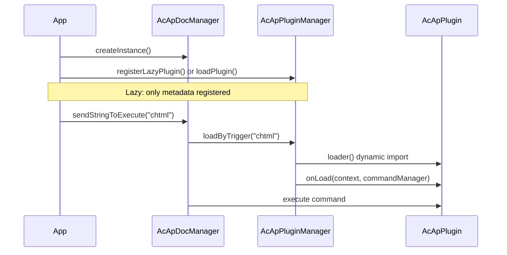

# 플러그인 시스템

이 페이지는 MLightCAD용 **플러그인**을 빌드하고 등록하고 사용하는 방법을 설명합니다. 플러그인은 명령을 등록하고, 활성 문서와 뷰에 접근하고, 언로드 시 정리함으로써 뷰어를 확장합니다.

플러그인 시스템은 `@mlightcad/cad-simple-viewer`(`packages/cad-simple-viewer/src/plugin`)에 있습니다. 공식 플러그인(UI, AI 에이전트, 스크립트 콘솔, HTML/PDF/SVG 내보내기, OneDrive/Google Drive 데이터 소스)은 별도의 npm 패키지로 제공됩니다 — 전체 목록은 [내장 플러그인](./built-in-plugins)을 참조하십시오.

---

## 개요

플러그인은 `AcApPlugin`을 구현하는 작은 모듈입니다. **플러그인 관리자**(`AcApPluginManager`)는 `AcApDocManager`가 소유하며 다음을 수행합니다:

- 플러그인이 로드될 때 `onLoad()`를 호출합니다(명령, 훅 등록 등)
- 플러그인이 제거될 때 `onUnload()`를 호출합니다(명령 등록 해제, 리소스 해제)
- **지연 등록**을 지원합니다: 사용자가 **트리거 명령**을 실행할 때까지 플러그인 코드를 다운로드하지 않습니다



---

## 핵심 타입

### `AcApPlugin`

모든 플러그인은 다음을 제공해야 합니다:

| 필드 / 메서드 | 설명 |
|----------------|-------------|
| `name` | 고유 식별자(필수). 지연 로드를 사용할 때 지연 등록의 `name`과 일치해야 합니다. |
| `version?` | 선택적 버전 문자열 |
| `description?` | 선택적 사람이 읽을 수 있는 설명 |
| `onLoad(context, commandManager)` | 명령을 등록하고 리소스를 초기화합니다 |
| `onUnload(context, commandManager)` | 명령을 제거하고 리소스를 해제합니다 |

`context`는 `AcApContext`(현재 `doc`와 `view`)입니다. `commandManager`는 `AcEdCommandStack`이며, 내장 명령에서 사용하는 것과 동일한 스택입니다.

참조 구현: `packages/cad-simple-viewer/src/plugin/AcApPluginExample.ts`의 `AcApExamplePlugin`.

### `AcApLazyPluginRegistration`

코드 분할을 위해 플러그인을 즉시 로드하는 대신 디스크립터를 등록합니다:

| 필드 | 설명 |
|-------|-------------|
| `name` | `loader`가 반환하는 `AcApPlugin.name`과 같아야 합니다 |
| `triggers` | 이 플러그인을 로드하는 명령 이름(대소문자 구분 없음) |
| `loader` | 플러그인 인스턴스를 반환하는 비동기 팩토리 |

---

## 단계 1 — 명령 구현

플러그인은 보통 하나 이상의 **명령**을 노출합니다. `AcEdCommand`를 확장하고 `execute(context)`를 구현합니다:

```typescript
import { AcApContext, AcEdCommand } from '@mlightcad/cad-simple-viewer'

export class AcApMyExportCmd extends AcEdCommand {
  async execute(context: AcApContext) {
    const fileName = context.doc.fileName || context.doc.docTitle
    // ... export logic using context.doc.database, context.view, etc.
  }
}
```

프롬프트, 편집기 접근, 엔티티 생성에 대해서는 [명령](./command)을 참조하십시오.

---

## 단계 2 — `AcApPlugin` 구현

`onUnload`가 이들을 제거할 수 있도록 등록한 모든 명령을 추적합니다:

```typescript
import {
  AcApContext,
  AcApPlugin,
  AcEdCommandStack
} from '@mlightcad/cad-simple-viewer'

import { AcApMyExportCmd } from './AcApMyExportCmd'

export class AcApMyPlugin implements AcApPlugin {
  name = 'MyPlugin'
  version = '1.0.0'
  description = 'My custom export command'

  private registeredCommands: Array<{ group: string; name: string }> = []

  onLoad(_context: AcApContext, commandManager: AcEdCommandStack): void {
    const group = AcEdCommandStack.SYSTEMT_COMMAND_GROUP_NAME
    commandManager.addCommand(group, 'myexport', 'myexport', new AcApMyExportCmd())
    this.registeredCommands.push({ group, name: 'myexport' })
  }

  onUnload(_context: AcApContext, commandManager: AcEdCommandStack): void {
    for (const cmd of this.registeredCommands) {
      commandManager.removeCmd(cmd.group, cmd.name)
    }
    this.registeredCommands = []
  }
}
```

공식 플러그인도 동일한 패턴을 따릅니다:

- `AcApHtmlPlugin` — `chtml` 등록
- `AcApPdfPlugin` — `cpdf`, `ipdf` 등록
- `AcApSvgPlugin` — `csvg` 등록

뷰어 전역 명령(확대, 레이어 등과 동일한 그룹)에는 `AcEdCommandStack.SYSTEMT_COMMAND_GROUP_NAME`을 사용합니다.

---

## 단계 3 — npm 패키지로 게시(선택 사항)

`cad-html-plugin`, `cad-pdf-plugin` 또는 `cad-svg-plugin`의 구조를 그대로 따릅니다:

```
my-cad-plugin/
  package.json          # name: @myorg/cad-my-plugin
  src/
    AcApMyPlugin.ts
    AcApMyExportCmd.ts
    registerLazyMyPlugin.ts
    index.ts            # public exports
```

**`package.json` 규칙:**

- `"type": "module"` 설정
- `@mlightcad/cad-simple-viewer`를 **peerDependency**로 나열(필요 시 `@mlightcad/data-model`, `three` 같은 다른 공유 라이브러리도 포함)
- 기존 플러그인처럼 `tsc` + `vite`로 빌드
- `src/index.ts`에서 헬퍼 내보내기: 플러그인 클래스, `createMyPlugin`, `registerLazyMyPlugin`, 트리거 상수

**지연 로더 모듈**(`registerLazyMyPlugin.ts`):

```typescript
import type { AcApPluginManager } from '@mlightcad/cad-simple-viewer'

export const MY_PLUGIN_NAME = 'MyPlugin'
export const MY_PLUGIN_TRIGGERS = ['myexport'] as const

export async function createMyPlugin() {
  const { AcApMyPlugin } = await import('./AcApMyPlugin')
  return new AcApMyPlugin()
}

export function registerLazyMyPlugin(pluginManager: AcApPluginManager): void {
  pluginManager.registerLazyPlugin({
    name: MY_PLUGIN_NAME,
    triggers: [...MY_PLUGIN_TRIGGERS],
    loader: createMyPlugin
  })
}
```

동적 `import('./AcApMyPlugin')`는 `myexport`가 실행될 때까지 무거운 플러그인 청크를 초기 번들에서 제외합니다.

---

## 플러그인 등록

일반적인 등록 경로는 네 가지입니다. 지연 로딩이 필요한지와 앱 부트스트랩의 소유자가 누구인지에 따라 하나를 선택합니다.

### A. 지연 등록(선택적 기능에 권장)

`AcApDocManager.createInstance()` 이후에 등록합니다. 플러그인 모듈은 첫 트리거 명령 시 로드됩니다.

```typescript
import { AcApDocManager } from '@mlightcad/cad-simple-viewer'
import { registerLazyHtmlPlugin } from '@mlightcad/cad-html-plugin'
import { registerLazyPdfPlugin } from '@mlightcad/cad-pdf-plugin'
import { registerLazySvgPlugin } from '@mlightcad/cad-svg-plugin'

AcApDocManager.createInstance({
  container: document.getElementById('cad-container')!,
  htmlViewerRuntimeUrl: './viewer-runtime.iife.js' // required for chtml export
})

const pm = AcApDocManager.instance.pluginManager
registerLazyHtmlPlugin(pm)
registerLazyPdfPlugin(pm)
registerLazySvgPlugin(pm)
```

예제 앱: `packages/cad-simple-viewer-demo/src/main.ts`.

사용자가 트리거 명령을 실행할 때 명령이 아직 등록되지 않았다면 `AcApDocManager`가 자동으로 `loadByTrigger`를 호출합니다:

```typescript
AcApDocManager.instance.sendStringToExecute('chtml')
AcApDocManager.instance.sendStringToExecute('cpdf')
```

`sendStringToExecute`를 사용할 때는 수동으로 `loadByTrigger`를 호출할 **필요가 없습니다**. 단, 실행 전에 플러그인을 미리 로드하려는 경우는 예외입니다(아래 참조).

### B. 인라인 지연 등록(cad-viewer 컴포넌트)

`@mlightcad/cad-viewer`는 `registerLazyPlugins()`(`packages/cad-editor/src/app/register.ts`)에서 PDF/HTML/SVG 플러그인을 등록하며, 이는 `app.ts`의 `initializeCadViewer()`에서 호출됩니다. Vue 컴포넌트 소비자는 추가 설정 없이 지연 플러그인을 얻습니다.

### C. `pluginManager.loadPlugin()`을 통한 즉시 로드

문서 관리자를 생성한 직후에 로드합니다:

```typescript
import { AcApDocManager } from '@mlightcad/cad-simple-viewer'
import { AcApExamplePlugin } from '@mlightcad/cad-simple-viewer' // AcApExamplePlugin export

AcApDocManager.createInstance({ container: el })
await AcApDocManager.instance.pluginManager.loadPlugin(new AcApExamplePlugin())
```

플러그인이 작거나 사용자 작업 전에 반드시 사용 가능해야 할 때 사용합니다.

### D. `createInstance({ plugins })`를 통한 즉시 로드

초기화 시 플러그인을 전달합니다. `AcApDocManager`가 시작 중에 비동기적으로 로드합니다.

**인스턴스 또는 팩토리로부터:**

```typescript
AcApDocManager.createInstance({
  container: el,
  plugins: {
    fromConfig: [
      new AcApExamplePlugin(),
      () => new AcApAnotherPlugin()
    ]
  }
})
```

**폴더로부터(동적 import):**

```typescript
AcApDocManager.createInstance({
  container: el,
  plugins: {
    fromFolder: {
      folderPath: './plugins',
      pluginList: ['MyPlugin.js'],
      continueOnError: true
    }
  }
})
```

브라우저에서는 `pluginList`를 반드시 제공해야 합니다(디렉터리 목록 API 없음). 각 파일은 플러그인 인스턴스, 플러그인 클래스 또는 팩토리 함수를 기본 내보내기해야 합니다.

---

## 런타임에서 플러그인 사용

### 플러그인 명령 실행

플러그인이 로드된 후(즉시 또는 지연 트리거를 통해):

```typescript
// Command line / script style
AcApDocManager.instance.sendStringToExecute('chtml')

// Or via editor API
await AcApDocManager.instance.editor.executeCommand('cpdf')
```

### 지연 플러그인 미리 로드(선택 사항)

일부 UI 경로는 첫 실행 시 지연을 피하기 위해 `sendStringToExecute` 전에 미리 로드합니다:

```typescript
const pluginManager = AcApDocManager.instance.pluginManager
await pluginManager.loadByTrigger('cpdf')
AcApDocManager.instance.sendStringToExecute('cpdf')
```

`cad-viewer`는 리본에서 PDF 내보내기 시 이 패턴을 사용합니다(`MlRibbonCommands.vue` → `runLazyCommand`).

### 로드 상태 확인

```typescript
const pm = AcApDocManager.instance.pluginManager

pm.isPluginLoaded('HtmlPlugin')        // true after first chtml
pm.isLazyPluginTrigger('chtml')        // true if lazy registration exists
pm.getLoadedPlugins()                  // ['HtmlPlugin', ...]
await pm.unloadPlugin('HtmlPlugin')
await pm.unloadAllPlugins()            // called when destroying the view
```

### 언로드

```typescript
await AcApDocManager.instance.pluginManager.unloadPlugin('MyPlugin')
```

`onUnload`는 `onLoad`에서 등록한 모든 명령을 제거해야 합니다. 그렇지 않으면 스택에 오래된 명령이 남습니다.

---

## 내장 플러그인 참조

모노레포에는 여러 공식 플러그인이 포함되어 있습니다: `AcApHtmlPlugin`(`chtml`), `AcApPdfPlugin`(`cpdf`, `ipdf`), `AcApSvgPlugin`(`csvg`), 그리고 UI, 에이전트, 스크립트 콘솔, 데이터 소스 플러그인이 있습니다.

플러그인별 명령, 공개 API, 구성 및 각 패키지 README 링크가 포함된 전체 목록은 [내장 플러그인](./built-in-plugins)을 참조하십시오.

---

## 통합 체크리스트

1. `@mlightcad/cad-simple-viewer`에 **의존**합니다(게시된 플러그인의 경우 피어 의존성).
2. `AcApPlugin` + `AcEdCommand`(들)을 **구현**합니다.
3. 패키지 엔트리에서 `registerLazy*Plugin` + `create*Plugin`을 **내보냅니다**.
4. `AcApDocManager.createInstance()` 이후에 **등록**합니다(또는 `plugins.fromConfig` / `fromFolder` 사용).
5. `sendStringToExecute` 또는 동일한 명령 이름을 호출하는 UI로 명령을 **트리거**합니다.
6. **번들링**: 지연 `loader`에서 동적 `import()`를 사용하여 Vite/Rollup이 플러그인 청크를 분할하도록 합니다.
7. **정리**: `onUnload`에서 모든 명령을 제거합니다.
8. **고유 트리거**: 하나의 트리거 명령은 두 개의 지연 플러그인에 매핑될 수 없습니다(`registerLazyPlugin`은 충돌 시 예외를 발생시킵니다).
9. **이름 일관성**: `AcApLazyPluginRegistration.name`은 `loader()`의 `plugin.name`과 일치해야 합니다.

---

## 문제 해결

| 증상 | 가능한 원인 |
|---------|----------------|
| `Command 'chtml' not found` | 지연 플러그인이 등록되지 않았거나, destroy 이후에 등록됨 |
| 지연 플러그인이 로드되지 않음 | 트리거 이름 불일치(대문자 정규화 확인); 로더의 `name`과 등록의 `name` 불일치 |
| 런타임에서 HTML 내보내기 실패 | `htmlViewerRuntimeUrl` 누락 또는 `viewer-runtime.iife.js`가 해당 URL에 배포되지 않음 |
| `Plugin 'X' is already loaded` | `unloadPlugin` 없이 `loadPlugin`을 두 번 호출 |
| 트리거가 이미 등록됨 | 두 플러그인이 동일한 트리거 명령을 등록함 |

---

## 관련 문서

- [내장 플러그인](./built-in-plugins) — MLightCAD와 함께 제공되는 모든 공식 플러그인
- [명령](./command) — 명령 수명 주기와 `AcEdCommand`
- [데이터 소스 플러그인](./data-source-plugin) — 플러그 가능한 도면 원본(로컬, URL, OneDrive, …)
- [Simple Viewer 통합](./integrate-simple-cad-viewer) — `cad-simple-viewer` 포함
- [Vue 컴포넌트 통합](./integrate-cad-viewer-component) — Vue 컴포넌트와 `initializeCadViewer`
- [아키텍처 개요](./architecture-overview) — 모듈 구성
