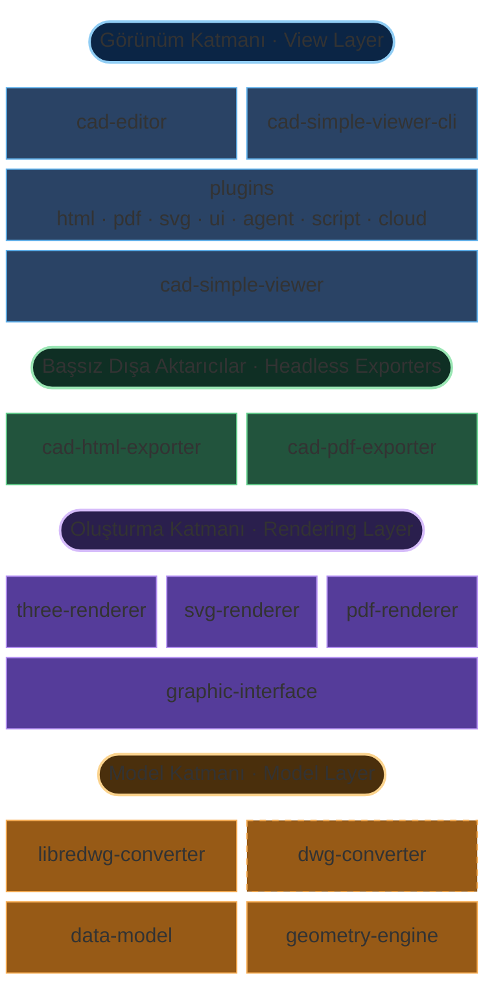

# Mimariye Genel Bakış

MLightCAD tamamen tarayıcıda çalışır ve **arka uç bağımlılığı yoktur**. DWG/DXF dosyaları WebAssembly ve JavaScript ile yerel olarak ayrıştırılıp işlenir; bu da şunları sağlar:

- **Sıfır sunucu gereksinimi** — yalnızca statik dosya barındırma ile her yere dağıtın
- **Tam veri gizliliği** — dosyalar kullanıcının cihazını asla terk etmez
- **Anında entegrasyon** — karmaşık arka uç kurulumu veya API yapılandırması gerekmez
- **Çevrimdışı kullanım** — internet bağlantısı olmadan çalışır

Bu depo bir `pnpm` + `nx` TypeScript monorepo’sudur. Görüntüleme / düzenleme ile ilgili ana paketler:

| Paket | Sorumluluk |
| --- | --- |
| [`@mlightcad/cad-simple-viewer`](https://github.com/mlightcad/cad-viewer/tree/main/packages/cad-simple-viewer) | Belge yönetimi, komut yığını, eklenti yöneticisi ve tuval; **UI çerçevesi bağımlılığı yok** |
| [`@mlightcad/cad-editor`](https://github.com/mlightcad/cad-viewer/tree/main/packages/cad-editor) | `cad-simple-viewer` üzerinde tam Vue 3 UI (menüler, ribbon, komut satırı, durum çubuğu) |
| [`@mlightcad/cad-simple-viewer-cli`](https://github.com/mlightcad/cad-viewer/tree/main/packages/cad-simple-viewer-cli) | Başsız CLI: Playwright / Chromium içinde `cad-simple-viewer`’ı çalıştırarak `.scr` betiklerini yürütür |
| [`@mlightcad/three-renderer`](https://github.com/mlightcad/cad-viewer/tree/main/packages/three-renderer) | THREE.js ile etkileşimli 2D/3D oluşturma |
| `svg-renderer` ([`cad-svg-plugin`](https://github.com/mlightcad/cad-viewer/tree/main/packages/cad-svg-plugin)) | Aynı oluşturma arabirimi üzerinden SVG vektör çıktısı |
| [`@mlightcad/pdf-renderer`](https://github.com/mlightcad/cad-viewer/tree/main/packages/pdf-renderer) | Aynı oluşturma arabirimi üzerinden vektör PDF çıktı arka ucu |
| [`@mlightcad/cad-html-exporter`](https://github.com/mlightcad/cad-viewer/tree/main/packages/cad-html-exporter) / [`@mlightcad/cad-pdf-exporter`](https://github.com/mlightcad/cad-viewer/tree/main/packages/cad-pdf-exporter) | Başsız Node HTML / PDF dışa aktarma (tarayıcıdaki görüntüleyici gerekmez) |
| `*-plugin` | İsteğe bağlı özellikler (UI, dışa aktarma, betik, ajan, bulut veri kaynakları); eklenti yöneticisi tarafından tembel yüklenir |

Katmanlama kuralı: `data-model` (harici) → oluşturucular → `cad-simple-viewer` → UI / eklentiler / CLI. **Alt düzey paketler üst düzey paketlere bağımlı olmamalıdır.**

## Genel mimari

Sistem sorumluluğa göre **model**, **oluşturma** ve **görünüm** katmanlarına ayrılır; ayrıca bağımsız dağıtılabilen **başsız dışa aktarıcılar** ve aynı görüntüleyici çekirdeğini süren bir CLI vardır.

Bu katmanlı tasarım, farklı veri ölçekleri, oluşturma hedefleri ve dağıtım biçimlerinde (tarayıcı bileşeni, başsız CLI veya saf Node dışa aktarma) ölçeklenebilirliği korur.

### Model katmanı

Model katmanı ayrı [`realdwg-web`](https://github.com/mlightcad/realdwg-web) deposunda yaşar ve burada harici bağımlılık olarak kullanılır:

- [`@mlightcad/data-model`](https://github.com/mlightcad/realdwg-web) ayrıştırılmış CAD verisi (geometrik varlıklar, katmanlar, görünüm parametreleri vb.) için birleşik **Data Model**’i tanımlar.
- [`AcDbDatabaseConverter`](https://github.com/mlightcad/realdwg-web/blob/main/packages/data-model/src/database/AcDbDatabaseConverter.ts) farklı dönüştürücülerin aynı veri modelini üretmesi için birleşik CAD dosya dönüştürme arabirimi sağlar.
- [`@mlightcad/libredwg-converter`](https://github.com/mlightcad/realdwg-web) LibreDWG tabanlı açık kaynak DWG ayrıştırması (WebAssembly) sunar. Ana uygulama dönüştürücüyü kendisi kaydetmelidir (`cad-simple-viewer` GPL ayrıştırıcıyı paketlemez).
- **`@mlightcad/dwg-converter`** aynı `AcDbDatabaseConverter` arabirimini uygulayan **kapalı kaynaklı ticari** bir DWG ayrıştırma modülüdür; daha yüksek uyumluluk ve bütünlük için `libredwg-converter` yerine kullanılabilir. GitHub Packages üzerinden özel olarak dağıtılır ve bu depo ile açık kaynak yayınlanmaz. Kurulum için [Tescilli DWG Dönüştürücüsünü Kurma ve Kullanma](./install-and-use-proprietary-dwg-converter); lisans ve deneme için [PROPRIETARY-PARSER.md](https://github.com/mlightcad/cad-viewer/blob/main/PROPRIETARY-PARSER.md).
- DXF ayrıştırması `data-model` içindeki yerleşik dönüştürme hattı tarafından yapılır (tarihsel olarak [`@mlightcad/dxf-json`](https://github.com/mlightcad/dxf-json) tabanlıdır).
- [`@mlightcad/geometry-engine`](https://github.com/mlightcad/realdwg-web) geometri ve matematik (noktalar, çizgiler, polilineler, spline’lar, daire/yay, elips, vektör ve matris) sağlar.

Neden `AcDbDatabaseConverter`? Mevcut DXF/DWG araçları çoğu zaman eksiktir. Açık kaynak yol `libredwg-converter` kullanır; daha yüksek sadakat için kapalı kaynaklı `dwg-converter` kaydı üst görüntüleyici kodunu değiştirmeden değiştirilebilir. Aynı arabirim [ODA](https://www.opendesign.com/products/drawings) gibi ticari motorlar üzerinde de uygulanabilir.

### Oluşturma katmanı

- [`@mlightcad/graphic-interface`](https://github.com/mlightcad/realdwg-web) (`realdwg-web`) birleşik varlık oluşturma arabirimini (`AcGiRenderer` vb.) tanımlar.
- [`@mlightcad/three-renderer`](https://github.com/mlightcad/cad-viewer) bu arabirimi THREE.js ile etkileşimli tuval oluşturma için uygular (toplu işleme, çizgi tipi/tarama gölgelendiricileri vb.). `cad-simple-viewer` için varsayılan arka uçtur.
- **`svg-renderer`** (`AcSvgRenderer`) aynı arabirimi uygular ve ölçeklenebilir SVG üretir. Güncel uygulama [`@mlightcad/cad-svg-plugin`](https://github.com/mlightcad/cad-viewer/tree/main/packages/cad-svg-plugin) içindedir ve `csvg` gibi komutlar tarafından kullanılır; PDF vektör dışa aktarma da çizim yeteneklerinin bir kısmını yeniden kullanır.
- [`@mlightcad/pdf-renderer`](https://github.com/mlightcad/cad-viewer) aynı arabirimi uygular ve vektör PDF içerik akışları üretir; `cad-pdf-core` / `cad-pdf-plugin` / `cad-pdf-exporter` tarafından kullanılır.

### Görünüm katmanı

- **`cad-simple-viewer`** çekirdektir: belge yaşam döngüsü, komut yığını, kullanıcı girişi / jig, `three-renderer` ile eşgüdüm ve **`AcApPluginManager` eklenti mekanizması**. Tuval dışında uygulama UI’si sunmaz.
- **Eklentiler** `AcApPlugin` uygulayan ayrı npm paketleri olarak yayınlanır ve `registerLazyPlugin` / `loadPlugin` ile aynı eklenti yöneticisine bağlanır. Resmi eklentiler HTML / PDF / SVG dışa aktarma, basit UI, betik konsolu, AI ajanı, OneDrive / Google Drive vb. kapsar. Bkz. [Eklenti Sistemi](./plugin-system) ve [Yerleşik Eklentiler](./built-in-plugins).
- **`cad-editor`** (eski `@mlightcad/cad-viewer`, 1.8.0’da yeniden adlandırıldı) `cad-simple-viewer` üzerinde tam Vue 3 UI sağlar ve önyüklemede yaygın tembel eklentileri kaydeder.
- **`cad-simple-viewer-cli`** Playwright ile başsız Chromium’da aynı görüntüleyici çekirdeğini başlatır ve AutoCAD tarzı `.scr` betiklerini (ör. `-chtml` / `-cpdf`) çalıştırır; CI ve dönüştürme hizmetleri için uygundur. Bkz. [Bulut DWG Web Görüntüleyici Oluşturma](./cloud-dwg-web-viewer).

### Başsız dışa aktarıcılar

Tarayıcı eklentileri ile Node dışa aktarıcıları `*-core` paketlerindeki dışa aktarma hatlarını paylaşır; böylece sunucuda tam görüntüleyici ayağa kaldırmak gerekmez:

| Yol | Paylaşılan çekirdek | Oluşturma arka ucu | Tipik girişler |
| --- | --- | --- | --- |
| HTML | `@mlightcad/cad-html-core` | `three-renderer` (anlık görüntü sonra paketleme) | Tarayıcı: `cad-html-plugin` (`chtml`); Node: `cad-html-exporter` (`exportFileToHtml`) |
| PDF | `@mlightcad/cad-pdf-core` | `pdf-renderer` | Tarayıcı: `cad-pdf-plugin` (`cpdf`); Node: `cad-pdf-exporter` (`exportFileToPdf`) |

`*-core` paketleri `cad-simple-viewer` / DOM’a **bağımlı değildir**; `*-exporter` paketleri Node’da yazı tipi yükleme, DWG kaydı ve dosya I/O’sunu üstlenir. Yalnızca dosya → HTML/PDF değil, tam komut betiği yeteneği gerekiyorsa `cad-simple-viewer-cli` kullanın.

## Oluşturma motoru

DXF/DWG oluşturma birkaç zorluk barındırır:

- Çok sayıda varlık içeren çizimlerin yüksek performanslı oluşturulması
- AutoCAD metin oluşturmanın yeniden üretilmesi
- Çizgi tipi ve tarama desenlerinin desteklenmesi

### Yüksek performanslı oluşturma

Büyük çizimlerde nokta, çizgi ve yüzleri birleştirerek **draw call** sayısını azaltmak kritiktir. THREE.js [BatchedMesh](https://threejs.org/docs/index.html?q=Mesh#api/en/objects/BatchedMesh) üçgen birleştirmeyi yalnızca kısmen çözer ve nokta/çizgi birleştirmeyi desteklemez. Bu nedenle `BatchedMesh`’ten esinlenen toplu işleme sınıfları uyguladık; bkz. [`packages/three-renderer/src/batch`](https://github.com/mlightcad/cad-viewer/tree/main/packages/three-renderer/src/batch).

### Metin oluşturma

AutoCAD zengin metin için [`MText`](https://ezdxf.mozman.at/docs/dxfinternals/entities/mtext.html), hızlı görüntüleme için [SHX](https://help.autodesk.com/view/OARX/2023/ENU/?guid=GUID-DE941DB5-7044-433C-AA68-2A9AE98A5713) stroke yazı tiplerini kullanır. İlgili paketler ayrı depolardadır:

- **MText ayrıştırma** — [`@mlightcad/mtext-parser`](https://github.com/mlightcad/mtext-parser)
- **SHX ayrıştırma** — [`@mlightcad/shx-parser`](https://github.com/mlightcad/shx-parser)
- **MText oluşturma** — [`@mlightcad/mtext-renderer`](https://github.com/mlightcad/mtext-renderer); ayrıştırılmış yazı tipleri IndexedDB’de önbelleğe alınır

Metin oluşturmayı hata ayıklamak için THREE.js tabanlı zengin metin düzenleyici [mtext-editor](https://github.com/mlightcad/mtext-editor) kullanılabilir.

### Çizgi tipleri ve tarama desenleri

AutoCAD özel çizgi tipleri ve tarama desenlerini destekler. Bunların bir kısmını uyguladık. Etkileşimli tuvaldeki çizgi tipleri ve dolgular THREE.js `ShaderMaterial` kullanır; bkz. [`packages/three-renderer/src/style`](https://github.com/mlightcad/cad-viewer/tree/main/packages/three-renderer/src/style). PDF yolu karşılık gelen görünümü `pdf-renderer` içinde vektörel olarak yeniden üretir.
