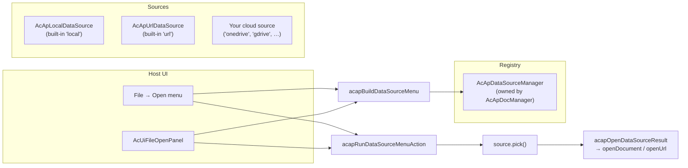

# Veri Kaynağı Eklentisi

Bu sayfa, `@mlightcad/cad-simple-viewer` içindeki **veri kaynağı eklentisi** mekanizmasını açıklar — **çizimlerin nereden geldiğine** karar veren takılabilir katman (yerel disk, HTTP URL, OneDrive, Google Drive, …). Mekanizmanın nasıl çalıştığını, kendi veri kaynağınızı nasıl oluşturacağınızı ve nasıl kaydedip kullanacağınızı kapsar.

Mekanizma `packages/cad-simple-viewer/src/app/dataSource` içinde yer alır. Tam bir başvuru uygulaması ayrı bir npm paketi olarak sunulur: `@mlightcad/cad-onedrive-plugin` (`packages/cad-onedrive-plugin`); `packages/cad-simple-viewer-example` içindeki demo uygulaması tarafından kullanılır.

> **Komut eklentileri** (`cpdf`, `chtml` gibi dışa aktarma komutları) için [Eklenti Sistemi](./plugin-system) sayfasına bakın. Bir veri kaynağı eklentisi *de* bir `AcApPlugin`'tir — yalnızca komut yerine `onLoad` ile bir veri kaynağı kaydeder.

---

## Genel Bakış

Bir **veri kaynağı**, `AcApDataSource` arayüzünü uygulayan bir nesnedir: CAD çizimleri için takılabilir bir kaynak. Görüntüleyici çekirdeği satıcılar hakkında hiçbir şey bilmez — yalnızca kayıt defterini (`AcApDataSourceManager`) ve küçük bir menü yardımcıları kümesini bilir. Satıcıya özgü tüm mantık (giriş açılır pencereleri, File Picker'lar, indirmeler) veri kaynağının **içinde** kalır.



Temel tasarım kuralları:

- **Ana uygulamalar yalnızca orkestrasyon yapar.** Ana uygulama arayüzü (şerit Aç menüsü, `AcUiFileOpenPanel`, araç çubukları) yalnızca (1) `AcApDataSourceManager` üzerinden kaynakları listelemeli, (2) `acapBuildDataSourceMenu` ile etiketler oluşturmalı, (3) tıklamaları `acapRunDataSourceMenuAction` / `acapInvokeDataSourceMenuAction` ile çalıştırmalıdır. Sağlayıcıya özel File Picker'ları açmamalı, URL indirmemeli veya sağlayıcıya özel oturum açma arayüzü göstermemelidir.
- **Oturum açma ve seçme asla zincirlenmez.** Tarayıcılar `window.open` çağrısına yalnızca doğrudan bir kullanıcı hareketi içinde izin verir. Bir tıklama işleyicisi MSAL girişini `await` ile bekleyip *ardından* bir seçici açılır pencere açarsa, ikinci pencere engellenir. Bu nedenle menü, **Oturum aç** ve **Şuradan aç …** seçeneklerini ayrı öğeler olarak sunar.
- **Uyarlanabilir menüler.** `getAuthState()` menünün ne göstereceğini belirler, böylece ana uygulamanın sağlayıcıya özel arayüze ihtiyacı olmaz.

---

## Temel tipler

Aşağıdaki tüm tipler `@mlightcad/cad-simple-viewer` paketinden dışa aktarılır.

### `AcApDataSource`

Her veri kaynağının uygulaması gereken arayüz:

| Üye | Zorunlu | Açıklama |
|--------|----------|-------------|
| `id` | ✓ | Menülerde ve kayıt defteri aramalarında kullanılan kararlı kimlik (`local`, `url`, `onedrive`, …) |
| `labelKey` | ✓ | Görünen ad için i18n anahtarı (ör. `main.dataSource.onedrive`) |
| `icon?` | | İsteğe bağlı satır içi SVG metni veya URL |
| `requiresAuth` | ✓ | Kaynağın kullanıcı kimlik doğrulaması gerektirip gerektirmediği |
| `requiresUserGesture` | ✓ | `true` olduğunda, `pick()` doğrudan tıklama anında `window.open` çalıştırmalıdır (bulut File Picker'ları) |
| `getAuthState()` | ✓ | `'none'` \| `'signed-out'` \| `'signed-in'` döndürür |
| `getAccountLabel?()` | | Menüler için kısa oturum açmış etiketi (e-posta / görünen ad) |
| `getAccountProfile?()` | | Açılış sayfası / hesap arayüzü için `{ displayName, email?, avatarUrl? }` |
| `restoreSession?()` | | Kayıttan sonra önbelleğe alınmış bir oturumu geri yükler (MSAL hesapları, belirteçler, …). Tamamlandığında Aç menülerinin yenilenmesi için `notifyAuthChanged` çağrısı yapmalıdır |
| `signIn()` | ✓ | Etkileşimli oturum açma. `requiresAuth` değeri `false` olduğunda işlem yapmaz |
| `signOut()` | ✓ | Oturumu kapatır. `requiresAuth` değeri `false` olduğunda işlem yapmaz |
| `pick()` | ✓ | Kaynağa özgü File Picker'ı / iletişim kutusunu açar, gerekirse indirir ve seçilen çizimi döndürür — kullanıcı iptal ettiğinde `null` |

### `AcApDataSourceFile`

Başarılı bir `pick()` çağrısının sonucu:

| Alan | Açıklama |
|-------|-------------|
| `name` | Uzantı dahil dosya adı (ör. `drawing.dwg`) |
| `content?` | Ham dosya baytları (`ArrayBuffer`). `url` atlandığında kullanılır |
| `url?` | `AcApDocManager.openUrl` ile açılan uzak URL (ilerleme gösteren HTTP getirme) |

Bellekte zaten bulunan baytlar için `content` tercih edin; kaynağın `openUrl` üzerinden açılması gerektiğinde `url` tercih edin.

### `AcApDataSourceManager`

Kayıt defteri `AcApDocManager`'a aittir (`AcApDocManager.instance.dataSourceManager`). `AcApDocManager.createInstance()` iki yerleşik kaynağı otomatik olarak kaydeder:

- `local` — `AcApLocalDataSource` (`.dwg` / `.dxf` için `<input type="file">` seçici)
- `url` — `AcApUrlDataSource` (URL iletişim kutusu, `openUrl` ile açar)

Bulut eklentileri kendilerini `AcApPlugin.onLoad` içinde kaydeder ve `onUnload` içinde kayıttan çıkarır.

| API | Açıklama |
|-----|-------------|
| `register(source)` | Bir kaynak kaydeder (aynı kimliğe sahip mevcut kaynağın yerini alır) |
| `unregister(id)` | Bir kaynağı kimliğine göre kaldırır |
| `list()` | Kayıtlı kaynakları kayıt sırasına göre döndürür |
| `get(id)` | Bir kaynağı kimliğine göre arar |
| `notifyAuthChanged(sourceId)` | Bulut eklentileri başarılı `signIn` / `signOut` sonrasında bunu çağırır |
| `on` / `off` | `changed` ve `auth-changed` olaylarına abone olun |

---

## Menü yardımcıları

Ana uygulamalar Aç menülerini elle oluşturmaz. Sözleşmeyi üç yardımcı tanımlar:

### 1. `acapBuildDataSourceMenu(sources)`

Geçerli kayıt defterinden `AcApDataSourceMenuItem[]` oluşturur. Kurallar (açılır pencere engelleyiciye karşı güvenli):

| Kimlik doğrulama durumu | Menü öğeleri |
|------------|------------|
| Kimlik doğrulama gerekmez (`'none'`) | Tek bir **seçme** öğesi (ör. *Yerel dosya*, *URL'den*) |
| Kimlik doğrulama gerekir, **oturum kapalı** | Yalnızca bir **oturum açma** öğesi (asla seçme ile zincirlenmez) |
| Kimlik doğrulama gerekir, **oturum açık** | **seçme** (*OneDrive'dan aç*) + **oturum kapatma** (*OneDrive oturumunu kapat (user@host)*) |

### 2. `acapRunDataSourceMenuAction(item, options?, manager?)`

Bir menü öğesi için eylemi çalıştırır ve **seçme sonuçlarını otomatik olarak açar** (`acapOpenDataSourceResult`: `file.url` ayarlıysa `openUrl`, aksi halde `file.content` ile `openDocument`). Bunu görüntüleyici içi Aç menülerinde kullanın. Oturum açmayı asla seçme işlemine zincirlemez.

### 3. `acapInvokeDataSourceMenuAction(source, item)`

Eylemi, zaten çözümlenmiş bir kaynağa karşı dosyayı **açmadan** çalıştırır. Bunu `AcApDocManager` var olmadan önce bir veri kaynağı yöneticisine sahip açılış sayfalarında veya sonucu kendiniz açmak istediğinizde kullanın.

### Destekleyici yardımcılar

| Yardımcı | Amaç |
|--------|---------|
| `acapOpenCenteredPopup(name, width?, height?)` | Ekranın ortasında adlandırılmış bir açılır pencere açar — açılır pencerenin aynı tıklama anında açılması için `pick()` içinde kullanın |
| `acapWithDataSourceBusy(work, message?)` | İndirme / seçim sonrası işleri bir meşgul katmanında sarar (DocManager'ın meşgul göstergesi veya açılış sayfaları için `document.body` üzerinde geçici bir `AcApProgress`) |
| `acapOpenDataSourceResult(file, options?)` | Bir `pick()` sonucunu DocManager üzerinden açar (`openUrl` / `openDocument`) |
| `acapIsSingleLocalOpen(sources)` | Aç arayüzünün tek bir "Aç" eylemine daralıp daralmayacağını belirtir (yalnızca yerleşik yerel kaynak) |

---

## Veri kaynağı eklentisi oluşturma

Bir veri kaynağı eklentisi, `onLoad` metodunda bir `AcApDataSource` kaydeden normal bir `AcApPlugin`'tir ([Eklenti Sistemi](./plugin-system) sayfasına bakın). Önerilen paket düzeni `cad-onedrive-plugin` paketini yansıtır:

```
my-cad-datasource-plugin/
  package.json          # name: @myorg/cad-my-datasource-plugin
  src/
    AcApMyDataSource.ts # implements AcApDataSource
    AcApMyPlugin.ts     # implements AcApPlugin, registers the source
    myClient.ts         # vendor API client (auth, picker, download)
    register.ts         # registerMyPlugin(pluginManager, options)
    index.ts            # public exports
```

**`package.json` kuralları:**

- `"type": "module"` ayarlayın
- `@mlightcad/cad-simple-viewer` (ve gerekirse `@mlightcad/data-model`) paketini **peerDependencies** olarak listeleyin
- Mevcut eklentiler gibi `tsc` + `vite` ile derleyin

### Adım 1 — `AcApDataSource` uygulayın

```typescript
import {
  type AcApDataSource,
  type AcApDataSourceAccountProfile,
  type AcApDataSourceAuthState,
  type AcApDataSourceFile,
  type AcApDataSourceManager,
  acapOpenCenteredPopup,
  acapWithDataSourceBusy
} from '@mlightcad/cad-simple-viewer'

/** Stable id used in menus and registry lookups. */
export const ACAP_MY_DATA_SOURCE_ID = 'mycloud'

export class AcApMyDataSource implements AcApDataSource {
  readonly id = ACAP_MY_DATA_SOURCE_ID
  readonly labelKey = 'main.dataSource.mycloud'
  readonly requiresAuth = true
  // true because pick() opens a File Picker popup via window.open
  readonly requiresUserGesture = true

  private readonly dataSourceManager: AcApDataSourceManager

  constructor(dataSourceManager: AcApDataSourceManager) {
    this.dataSourceManager = dataSourceManager
  }

  getAuthState(): AcApDataSourceAuthState {
    return this.client.isAuthenticated ? 'signed-in' : 'signed-out'
  }

  getAccountLabel(): string | undefined {
    return this.client.userInfo?.email
  }

  getAccountProfile(): AcApDataSourceAccountProfile | undefined {
    if (!this.client.isAuthenticated) return undefined
    const info = this.client.userInfo!
    return { displayName: info.name || info.email, email: info.email }
  }

  /** Restore cached tokens after registration so menus show signed-in state. */
  async restoreSession(): Promise<void> {
    await this.client.initialize()
    this.notifyAuthChanged()
  }

  async signIn(): Promise<void> {
    await this.client.authenticate()
    this.notifyAuthChanged()
  }

  async signOut(): Promise<void> {
    await this.client.signOut()
    this.notifyAuthChanged()
  }

  async pick(): Promise<AcApDataSourceFile | null> {
    // Open the popup in this click tick. Any `await` first loses the gesture.
    const popup = acapOpenCenteredPopup('MyCloudPicker', 1080, 680)
    if (!popup) {
      throw new Error('Popup blocked. Allow popups for this site and try again.')
    }
    try {
      await this.client.initialize()
      if (!this.client.isAuthenticated) {
        throw new Error('Sign in first, then choose a file (popup blocker).')
      }
      const picked = await this.client.openFilePicker(popup)
      const content = await acapWithDataSourceBusy(() =>
        this.client.downloadFile(picked)
      )
      return { name: picked.name, content }
    } catch (error) {
      try {
        if (!popup.closed) popup.close()
      } catch {
        // ignore
      }
      if (error instanceof Error && error.message === 'Picker cancelled') {
        return null // user cancelled — not an error
      }
      throw error
    }
  }

  private notifyAuthChanged(): void {
    this.dataSourceManager.notifyAuthChanged(this.id)
  }
}
```

Uygulama notları:

- **`pick()` açılır pencereyi tıklama anında eşzamanlı olarak açmalıdır** (`requiresUserGesture = true`). Herhangi bir `await` işlemini (SDK başlatma, kimlik doğrulama kontrolü) `window.open` çağrısından *sonra* yapın.
- Kullanıcıların hem görüntüleyicide hem de açılış sayfalarında ilerleme geri bildirimi alması için indirmelerin etrafında `acapWithDataSourceBusy` çağırın.
- Kullanıcı iptal ettiğinde `null` döndürün; gerçek hatalarda istisna fırlatın.
- Kimlik doğrulama durumu değiştikten sonra, Aç menülerinin yenilenmesi için her zaman `dataSourceManager.notifyAuthChanged(id)` çağırın.
- Açılır pencere kullanmayan kaynaklar için (ör. sayfa içi bir iletişim kutusu), `requiresUserGesture = false` ayarlayın.
- `labelKey` değerinizi (ör. `main.dataSource.mycloud`) i18n kaynaklarına ekleyin — bkz. [Yerelleştirme](./localization).

### Adım 2 — `AcApPlugin` içine sarın

```typescript
import {
  AcApContext,
  AcApDocManager,
  AcApPlugin,
  AcEdCommandStack
} from '@mlightcad/cad-simple-viewer'

import packageJson from '../package.json'
import { ACAP_MY_DATA_SOURCE_ID, AcApMyDataSource } from './AcApMyDataSource'

export class AcApMyPlugin implements AcApPlugin {
  name = 'MyDataSourcePlugin'
  version = packageJson.version
  description = 'Open DWG/DXF files from MyCloud'

  private source: AcApMyDataSource | null = null
  private createdSource = false

  onLoad(_context: AcApContext, _commandManager: AcEdCommandStack): void {
    const dsm = AcApDocManager.instance.dataSourceManager
    const existing = dsm.get(ACAP_MY_DATA_SOURCE_ID)
    if (existing) {
      // Already registered (e.g. HMR or double load) — just restore the session.
      void existing.restoreSession?.().catch(() => undefined)
      return
    }
    this.source = new AcApMyDataSource(dsm)
    this.createdSource = true
    dsm.register(this.source)
    // Restore cached session so File → Open shows Open/Sign out, not Sign in.
    void this.source.restoreSession().catch(() => undefined)
  }

  onUnload(_context: AcApContext, _commandManager: AcEdCommandStack): void {
    if (this.createdSource) {
      AcApDocManager.instance.dataSourceManager.unregister(ACAP_MY_DATA_SOURCE_ID)
    }
    this.source = null
    this.createdSource = false
  }
}
```

### Adım 3 — Bir kayıt yardımcısı dışa aktarın

Veri kaynakları **hemen** görünür olmalıdır (Aç menüleri onları herhangi bir belge açılmadan önce listeler), bu nedenle `pluginManager.loadPlugin` ile hemen yükleyin:

```typescript
// src/register.ts
import type { AcApPluginManager } from '@mlightcad/cad-simple-viewer'

import { AcApMyPlugin } from './AcApMyPlugin'

export const MY_PLUGIN_NAME = 'MyDataSourcePlugin'

export async function registerMyPlugin(
  pluginManager: AcApPluginManager,
  options: { clientId: string; /* … */ }
): Promise<void> {
  if (!options.clientId) {
    throw new Error('registerMyPlugin requires options.clientId')
  }
  await pluginManager.loadPlugin(new AcApMyPlugin(options))
}
```

> MSAL tarzı SDK'lar yine de `signIn` / `pick` *içinde* tembel olarak içe aktarılabilir — yalnızca kaydın kendisi hemen yapılmalıdır.

---

## Veri kaynağı eklentisi kullanma

### 1. Uygulamanızda kaydedin

Kayıt yardımcısını `AcApDocManager.createInstance()` sonrasında çağırın:

```typescript
import { AcApDocManager } from '@mlightcad/cad-simple-viewer'
import { registerOneDrivePlugin } from '@mlightcad/cad-onedrive-plugin/register'

AcApDocManager.createInstance({ container: document.getElementById('cad-container')! })

await registerOneDrivePlugin(AcApDocManager.instance.pluginManager, {
  clientId: import.meta.env.VITE_MSAL_CLIENT_ID,
  tenantId: import.meta.env.VITE_MSAL_TENANT_ID || 'common',
  redirectUri: import.meta.env.VITE_MSAL_REDIRECT_URI // optional
})
```

Kayıt taslağını, `/register` alt yolundan içe aktarıp geri kalanını dinamik olarak içe aktararak ilk pakette tutun (`packages/cad-simple-viewer-example/src/register.ts` dosyasına bakın):

```typescript
const { registerOneDrivePlugin } = await import('@mlightcad/cad-onedrive-plugin/register')
```

Yerleşik arayüzü (şerit / araç çubuğu / `AcUiFileOpenPanel`) kullanan bir uygulama için gereken tek şey budur: Aç menüsü `dataSourceManager` üzerinden yeniden oluşturulur ve artık örneğin şunları gösterir:

| Kimlik doğrulama durumu | Menü öğeleri |
|------------|------------|
| Oturum kapalı | OneDrive'da oturum aç |
| Oturum açık | OneDrive'dan aç, OneDrive oturumunu kapat (user@contoso.com) |

### 2. Özel ana uygulama arayüzü (görüntüleyici içi menü)

Kendi Aç menünüzü oluşturuyorsanız yardımcıları kullanın — `signIn` / `pick` metodlarını doğrudan çağırmayın:

```typescript
import {
  AcApDocManager,
  acapBuildDataSourceMenu,
  acapRunDataSourceMenuAction
} from '@mlightcad/cad-simple-viewer'

const dsm = AcApDocManager.instance.dataSourceManager

function rebuildOpenMenu() {
  const items = acapBuildDataSourceMenu(dsm.list())
  renderMenu(items, item => {
    void acapRunDataSourceMenuAction(item, openOptions)
  })
}

rebuildOpenMenu()
dsm.on('changed', rebuildOpenMenu)
dsm.on('auth-changed', rebuildOpenMenu)
```

### 3. Açılış sayfaları (görüntüleyici var olmadan önce)

Açılış sayfaları genellikle kullanıcıların `AcApDocManager` oluşturulmadan önce bir dosya seçmesine izin verir. `AcUiFileOpenPanel` bu deseni zaten uygular: `onDataSourceAction` geçirin ve görüntüleyici hazır olduğunda öğeyi çalıştırın. Kendi açılış arayüzünüz bir kaynağı doğrudan çağırdığında `acapInvokeDataSourceMenuAction` + `acapOpenDataSourceResult` kullanın:

```typescript
import { acapInvokeDataSourceMenuAction, acapOpenDataSourceResult } from '@mlightcad/cad-simple-viewer'

const source = myDataSourceManager.get('onedrive') // or the built-in 'local' / 'url'
const file = await acapInvokeDataSourceMenuAction(source, menuItem)
if (file) {
  await acapOpenDataSourceResult(file, openOptions)
}
```

**Kullanıcı hareketi tuzağı** (`cad-simple-viewer-example/src/main.ts` dosyasından): tıklama işleyicisinin bir `pick` eylemini çalıştırmadan önce görüntüleyici başlatmayı `await` ile beklemesi gerekiyorsa, kullanıcı hareketi kaybolur ve açılır pencere engellenir. Ya zaten başlatılmışsa eylemi eşzamanlı olarak çalıştırın ya da `pick` öğeleri için *önce oturum aç, sonra aç* ipucu gösterin (örnek uygulamadaki `handleDataSourceMenuAction` fonksiyonuna bakın).

---

## Gerçek dünya başvurusu: OneDrive

`@mlightcad/cad-onedrive-plugin`, kanonik bulut veri kaynağıdır:

| Bileşen | Dosya | Ne yapar |
|-------|------|--------------|
| `AcApOneDriveDataSource` | `src/AcApOneDriveDataSource.ts` | Microsoft File Picker v8 + MSAL üzerinde `AcApDataSource` uygular; `pick` açılır pencereyi eşzamanlı olarak açar, ardından meşgul katmanı altında indirir |
| `AcApOneDrivePlugin` | `src/AcApOneDrivePlugin.ts` | Kaynağı kaydeden/kayıttan çıkaran ve yüklemede önbelleğe alınmış MSAL oturumunu geri yükleyen `AcApPlugin` |
| `OneDriveClient` | `src/oneDriveClient.ts` | MSAL kimlik doğrulama + File Picker v8 mesajlaşma + Graph indirme |
| `registerOneDrivePlugin` | `src/register.ts` | Hemen kayıt yardımcısı (`clientId` doğrular) |
| `createOneDrivePlugin` | `src/createOneDrivePlugin.ts` | Eklenti örneği için asenkron fabrika |

Örnek uygulama bunu ortam yapılandırması aracılığıyla bağlar (`packages/cad-simple-viewer-example/src/onedriveEnv.ts`): `VITE_MSAL_CLIENT_ID` ayarlandığında `registerOneDriveFromEnv` eklentiyi kaydeder; açılış paneli `AcUiFileOpenPanel`'in `extraMenuItems` özelliği aracılığıyla bir *OneDrive'da oturum aç* öğesi listeler.

**Azure uygulama kurulumu** (OneDrive için): Microsoft Entra ID'de bir **Tek sayfalı uygulama** kaydedin, uygulama kaynağınızla eşleşen bir yönlendirme URI'si ekleyin, temsilci Graph izinleri `User.Read` + `Files.Read.All` verin (kişisel OneDrive seçici belirteçleri `OneDrive.ReadOnly` iznini de kapsar).

---

## Sorun giderme

| Belirti | Olası neden |
|---------|----------------|
| Kaynak Aç menüsünde yok | Eklenti kaydedilmemiş veya `AcApDocManager.createInstance()` öncesinde / yok etme sonrasında kaydedilmiş; ya da `register` aynı kimliğe sahip mevcut kaynağın yerini almış |
| Seçici açılır penceresi engellendi | `pick()` `window.open` öncesinde `await` yapmış veya oturum açma aynı tıklama işleyicisinde seçme işlemine zincirlenmiş |
| Giriş sonrası menü hâlâ *Oturum aç* gösteriyor | Kimlik doğrulama durumu değiştikten sonra `notifyAuthChanged` çağrılmamış; ya da yüklemede `restoreSession` çağrılmamış |
| Kayıt/kayıttan çıkarma sonrasında menü güncellenmiyor | Ana uygulama, `changed` / `auth-changed` olaylarında yeniden oluşturmak yerine öğe listesini önbelleğe almış |
| İndirme geri bildirim olmadan takılıyor | İndirme `acapWithDataSourceBusy` ile sarılmamış |
| Açılan dosyada ne bayt ne de URL hatası var | `pick()` ne `content` ne `url` içeren bir dosya döndürmüş |

---

## İlgili sayfalar

- [Eklenti Sistemi](./plugin-system) — `AcApPlugin`, komut kaydı, tembel yükleme
- [Simple Viewer Entegrasyonu](./integrate-simple-cad-viewer) — `cad-simple-viewer` gömme
- [Yerelleştirme](./localization) — `main.dataSource.*` gibi i18n anahtarları ekleme
- [Mimariye Genel Bakış](./architecture-overview) — modül düzeni
