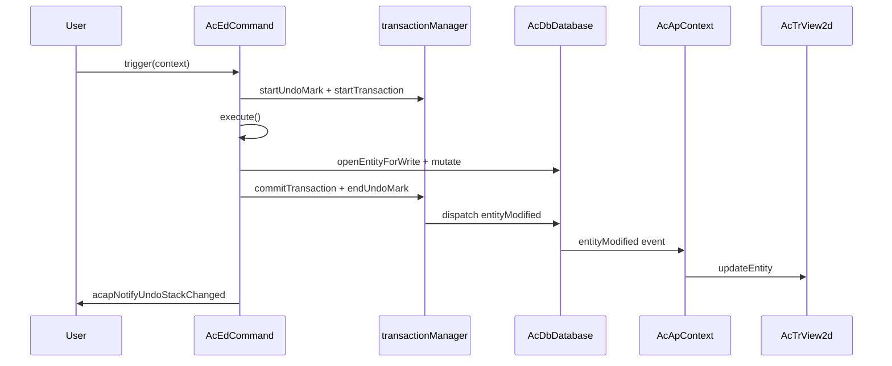

# Varlık Değiştirme En İyi Uygulamaları

Bu sayfa, **CAD-Viewer**'da çizim varlıklarının nasıl değiştirileceğini açıklar; böylece değişiklikler doğru şekilde izlenir, **geri al/yinele** beklendiği gibi çalışır ve **görünüm veritabanıyla senkronize kalır**.

Veritabanı katmanı [`@mlightcad/data-model`](https://github.com/mlightcad/realdwg-web) paketinden gelir. CAD-Viewer, uygulama yardımcıları ekler ve veritabanı olaylarını işleyiciye bağlar.

---

## Genel Bakış

Doğru bir varlık düzenlemesi üç katmanı izler:

| Katman | Sorumluluk |
|-------|----------------|
| **Veritabanı** (`AcDbDatabase`) | Varlıkları saklar ve değişiklikleri kaydeder |
| **İşlem / geri alma** (`transactionManager`) | Değişiklikleri gruplar ve geri al/yinele desteği sağlar |
| **Görünüm** (`AcTrView2d`) | Geometriyi işler; veritabanı olayları aracılığıyla güncellenir |

**Pratik kural:** veritabanını işlem API'leri aracılığıyla değiştirin. Değişikliklerin görünüme yayılmasına `AcApContext` izin verin. Özel bir durumunuz (örneğin geçici önizleme geometrisi) yoksa normal bir veritabanı düzenlemesinden sonra `view.updateEntity()` çağırmayın.

---

## İşlem Mekanizması

`AcDbDatabase.transactionManager` (`AcDbDatabaseTransactionManager`), bir çizim için işlemleri ve geri alma geçmişini yönetir. Tasarımı AutoCAD ObjectARX `AcDbTransactionManager` semantiğini izler.

### Temel API'ler

| API | Amaç |
|-----|---------|
| `startTransaction()` | Değişiklikleri kaydetmeye başlar |
| `commitTransaction()` | Geçerli işlemi sonlandırır ve olayları yayar |
| `abortTransaction()` | Geçerli işlemdeki tüm değişiklikleri geri alır |
| `hasTransaction()` | Etkin bir işlem olup olmadığını döndürür |
| `isRecording()` | Değişikliklerin kaydedilip kaydedilmediğini döndürür (geri al/yinele oynatımı sırasında false) |
| `openEntityForWrite(id \| entity)` | Bir varlığı etkin işlem **aracılığıyla** yazma için açar |

### Neler kaydedilir

`isRecording()` true iken işlem yöneticisi şunları kaydeder:

- Veritabanı nesnelerindeki **özellik değişiklikleri** (`kind: 'modify'`)
- Blok tablosu kayıtlarında, sembol tablolarında veya sözlüklerde nesne **ekleme / kaldırma**
- **Sistem değişkeni** değişiklikleri

En dıştaki işlem commit edildiğinde, kaydedilen değişiklikler sonlandırılır ve ilgili veritabanı olayları yayılır.

### İç içe işlemler

İşlemler iç içe geçebilir. İç işlemler kaydedicilerini üst işleme birleştirir. Yalnızca **en dıştaki** `commitTransaction()` olayları yayar ve geri alma geçmişini kuyruğa ekler.

### Nesneleri yazma için açma

Önbelleğe alınmış bir varlık referansını doğrudan değiştirmek yerine her zaman `database.openEntityForWrite(...)` (veya `openObjectForWrite`) kullanın:

```typescript
const opened = db.openEntityForWrite(entityOrObjectId)
if (!opened) return
opened.color = newColor
```

Bir işlem etkinken `openEntityForWrite`, nesneyi işlem aracılığıyla yönlendirir; böylece değişiklik izlenir. Etkin bir işlem yoksa yardımcı doğrudan aramaya geri döner ve değişiklik **geri alınamayabilir**.

### Katı mod

`transactionManager.strictMode` (data-model'de varsayılan), tüm değişikliklerin etkin bir işlem içinde gerçekleşmesini zorunlu kılabilir. Değişiklik uygulayıcısının durumu geri yükleyebilmesi için geri al/yinele oynatımı muaftır. Pratikte CAD-Viewer komutları ve `acapRunDatabaseEdit` düzenlemeden önce her zaman bir işlem başlatır.

---

## Geri Al / Yinele Mekanizması

Geri al/yinele, **geri alma işaretleri** ve **geri alma kayıtları** üzerine kuruludur.

### Geri alma işaretleri

| API | Amaç |
|-----|---------|
| `startUndoMark(label?)` | Bir grup açar; bir işaret içindeki birden çok commit **tek** geri alma adımı olur |
| `endUndoMark()` | Grubu kapatır ve değişiklik varsa bir geri alma kaydı oluşturur |
| `cancelUndoMark()` | Geri alma kaydı oluşturmadan grubu atar |

### Geri al / yinele işlemleri

| API | Amaç |
|-----|---------|
| `undo()` | En son geri alma kaydını geri alır |
| `redo()` | En son geri alınan kaydı yeniden uygular |
| `canUndo()` / `canRedo()` | Yığın durumunu sorgular |
| `clearUndoStack()` | Her iki yığını temizler |

Geri alma veya yinele çalıştığında, `AcDbChangeApplier` saklanan değişiklikleri ileri veya ters sırayla yeniden oynatır ve görünümün otomatik olarak güncellenmesi için uygun varlık olaylarını yayar.

### Komutlar geri almayı nasıl bedavaya alır

Geri alma kaydı etkinken `AcEdCommand.trigger()`, komut yürütmesini bir geri alma işareti ve bir işlem içine sarar:

```typescript
// AcEdCommand.trigger() — simplified
if (recordUndo) {
  tm.startUndoMark(this.globalName || this.localName)
  tm.startTransaction()
}
try {
  await this.execute(context)
} catch (error) {
  if (undoTransactionActive) {
    tm.abortTransaction()
    tm.cancelUndoMark()
  }
  throw error
} finally {
  if (undoTransactionActive) {
    tm.commitTransaction()
    tm.endUndoMark()
    acapNotifyUndoStackChanged()
  }
}
```

Geri alma kaydı, aşağıdakilerin **tümü** doğru olduğunda etkinleştirilir:

- `command.recordsUndoStack === true` (varsayılan)
- `context.doc.openMode >= AcEdOpenMode.Review`
- `command.mode >= AcEdOpenMode.Review`

Kendi geri alma adımını oluşturmaması gereken meta komutlar için `recordsUndoStack = false` ayarlayın (örneğin `AcApUndoCmd` ve `AcApRedoCmd`).

### UI bildirimi

Geri al/yinele kullanılabilirliği değiştikten sonra `@mlightcad/cad-simple-viewer` paketinden `acapNotifyUndoStackChanged()` çağırın. Bu, genel olay yolunda `undo-stack-changed` yayar; böylece `useUndoRedo` gibi bileşenler araç çubuğu durumunu yenileyebilir.

`AcEdCommand.trigger()` üzerinden giden komutlar bunu başarılı commit sırasında otomatik olarak çağırır. `acapRunDatabaseEdit` aracılığıyla yapılan tek başına düzenlemeler de yeni bir geri alma işareti oluşturduklarında dinleyicileri bilgilendirir.

---

## Varlıkla İlgili Olaylar

`AcDbDatabase.events` ana veritabanı bildirimlerini sunar:

| Olay | Ne zaman yayılır |
|-------|----------------|
| `entityAppended` | Model/kağıt alanına varlık eklendiğinde |
| `entityModified` | Varlık özellikleri veya geometrisi değiştiğinde |
| `entityErased` | Varlık çizimden kaldırıldığında |
| `layerAppended` | Yeni katman oluşturulduğunda |
| `layerModified` | Katman öznitelikleri değiştiğinde |
| `layerErased` | Katman kaldırıldığında |
| `dictObjetSet` | Adlandırılmış bir sözlükte nesne saklandığında |
| `dictObjectErased` | Bir sözlükten nesne kaldırıldığında |

### Olay yükü

`AcDbEntityEventArgs` şunları içerir:

- `database` — kaynak veritabanı
- `entity` — bir varlık veya varlık dizisi

CAD-Viewer, değiştirilmiş olayları isteğe bağlı bir `changes` alanıyla genişletir (`AcApEntityUpdate` içinde `AcDbEntityModifiedEventArgs`); böylece görünüm, geometriyi yeniden oluşturmadan hafif güncellemeler (örneğin yalnızca görünürlük geçişleri) uygulayabilir.

### Görünüm senkronizasyonu

`AcApContext`, varlık olaylarına abone olur ve görünümü hizalı tutar:

- `entityAppended` → `view.addEntity(...)`
- `entityModified` → `view.updateEntity(...)` (veya yalnızca görünürlük değişiklikleri için `updateEntityVisibility`)
- `entityErased` → `view.removeEntity(...)`

Bu bağlantı sayesinde, **uygulama kodu normalde commit edilmiş bir veritabanı düzenlemesinden sonra sahneyi manuel olarak yenilememelidir**.

### Olay toplu işleme

`database.beginEventBatch()` / `endEventBatch()`, toplu işlemler sırasında olayları bastırır ve birleştirir. En dıştaki `endEventBatch()`, birikmiş `entityAppended`, `entityErased` ve `entityModified` bildirimlerini boşaltır. Büyük çizimleri içe aktarırken veya yeniden oluştururken toplu işlemeyi tercih edin.

### UI veya eklentilerden dinleme

Özellik panelleri, şerit durumu veya özel araçlar için aynı olaylara abone olabilirsiniz:

```typescript
const db = AcApDocManager.instance.curDocument.database

const onModified = (args: AcDbEntityEventArgs) => {
  // React to entity changes
}

db.events.entityModified.addEventListener(onModified)

// Remember to remove the listener on teardown
db.events.entityModified.removeEventListener(onModified)
```

---

## Komut İçinde Varlıkları Değiştirme

Etkileşimli düzenleme komutları (Move, Rotate, Erase, Draw vb.) için `AcEdCommand` sınıfını genişletin ve tüm kalıcı değişiklikleri `execute()` içinde gerçekleştirin.

### Kontrol Listesi

1. **Komut modunu ayarlayın** — geri alma kaydına izin verilmesi için değiştirme komutlarında `AcEdOpenMode.Review`, oluşturma komutlarında `AcEdOpenMode.Write` kullanın.
2. Komut geri al/yinele işleminin kendisi değilse **`recordsUndoStack` değerini `true` olarak koruyun**.
3. **Manuel olarak** `startTransaction()` / `commitTransaction()` **çağırmayın** — `trigger()` zaten `execute()` yönteminizi sarar.
4. Geometriyi veya özellikleri değiştirmeden önce **varlıkları yazma için açın**.
5. **Jig'leri yalnızca önizleme için kullanın** — geçici geometriyi jig içinde güncelleyin; kullanıcı onayladığında veritabanına commit edin.

### Örnek: Move komutu

`AcApMoveCmd`, geometri düzenlemeleri için referans kalıptır:

```typescript
export class AcApMoveCmd extends AcEdCommand {
  constructor() {
    super()
    this.mode = AcEdOpenMode.Review
  }

  async execute(context: AcApContext) {
    // ... selection and point prompts ...

    const matrix = new AcGeMatrix3d().makeTranslation(dx, dy, dz)
    sourceEntities.forEach(entity => {
      const opened = context.doc.database.openEntityForWrite(entity)
      if (!opened) return
      opened.transformBy(matrix)
    })
  }
}
```

### Örnek: Erase komutu

```typescript
private eraseEntities(db: AcDbDatabase, objectIds: AcDbObjectId[]) {
  objectIds.forEach(objectId => {
    const entity = db.openEntityForWrite(objectId)
    entity?.erase()
  })
}
```

### Örnek: Oluşturma komutu

Yeni varlıkları `execute()` içinde blok tablosu kayıtları aracılığıyla ekleyin. Etkin komut işlemi eklemeyi kaydeder:

```typescript
const segment = new AcDbLine(startPoint, endPoint)
db.tables.blockTable.modelSpace.appendEntity(segment)
```

`entityAppended` varlığı görünüme ekler. Ayrıca `view.addEntity` çağırmak isteğe bağlıdır ve çoğunlukla anında geri bildirim için bazı çizim komutlarında kullanılır; kanonik senkronizasyon mekanizması olay yoludur.

### Önizleme ile commit (jig'ler)

Etkileşimli girdi sırasında önizleme dönüşümlerini veritabanına **yazmayın**. Geçici veya GPU'da bulunan önizleme geometrisini dönüştürmek için bir jig (örneğin `AcApMovePreviewJig`) kullanın. Yalnızca kullanıcı onayladıktan sonra `openEntityForWrite` çağırmalı ve nihai değişikliği uygulamalısınız.

### Hata işleme

`execute()` hata fırlatırsa, `AcEdCommand.trigger()` işlemi iptal eder ve geri alma işaretini iptal eder. Çoğu komutta ek geri alma mantığına ihtiyacınız yoktur.

---

## Komut Dışında Varlıkları Değiştirme

Şerit işleyicileri, tutamaç düzenleme, satır içi metin düzenleyicileri ve iletişim kutusu geri çağırmaları `AcEdCommand.trigger()` tarafından **sarmalanmaz**. Uygulama yardımcısını kullanın:

### `acapRunDatabaseEdit`

```typescript
import { acapRunDatabaseEdit } from '@mlightcad/cad-simple-viewer'

acapRunDatabaseEdit(db, 'Color', () => {
  const entity = db.openEntityForWrite(objectId)
  if (!entity) return
  entity.color = newColor
})
```

Bu işlev:

1. data-model'deki `db.runDatabaseEdit(label, fn)` işlevine devreder
2. Zaten kayıt yapılmıyorsa `transactionManager.runUndoable` aracılığıyla **tek** bir geri alma işareti oluşturur
3. Etkin bir komut işleminden çağrıldığında iç içe geri alma işaretini **atlar**
4. Yeni bir geri alma kaydı oluşturulduğunda `acapNotifyUndoStackChanged()` çağırır

Kısa ve kullanıcıya yönelik bir `label` kullanın (örneğin `'Grip Edit'`, `'Hatch Properties'`, `'Replace Image'`) — geri alma geçmişindeki adımı tanımlar.

### Hangi API ne zaman kullanılmalı

| Senaryo | Önerilen API |
|----------|-----------------|
| Etkileşimli CAD komutu | `AcEdCommand` sınıfını genişletin; `execute()` içinde değiştirin |
| Tutamaç sürükleme commit'i | `acapRunDatabaseEdit` |
| Şerit / özellik paneli | `acapRunDatabaseEdit` |
| İletişim kutusu OK işleyicisi | `acapRunDatabaseEdit` |
| UI dışında programatik toplu işlem | `db.runDatabaseEdit` veya `transactionManager.runUndoable` |
| Zaten bir komutun `execute()` yöntemi içinde | Doğrudan `openEntityForWrite` / `appendEntity` (işlem zaten etkin) |

### Örnek: tutamaç düzenleme oturumu

```typescript
acapRunDatabaseEdit(db, 'Grip Edit', () => {
  const entity = db.openEntityForWrite(this._entity)
  if (!entity) return
  entity.subMoveGripPointsAt([gripIndex], offset)
})
```

### Örnek: şerit rengi değişikliği

```typescript
acapRunDatabaseEdit(db, 'Color', () => {
  db.cecolor = value
  selectedIds.forEach(id => {
    const entity = db.openEntityForWrite(id)
    if (entity) entity.color = value
  })
})
```

### Daha alt düzey alternatif

Yalnızca data-model üzerine kitaplık kodu geliştiriyorsanız (CAD-Viewer UI'si olmadan) şunu çağırın:

```typescript
db.runDatabaseEdit('My Operation', () => {
  // openEntityForWrite + mutations
})
```

veya:

```typescript
db.transactionManager.runUndoable('My Operation', () => {
  // mutations
})
```

CAD-Viewer UI'siyle bütünleşirken `acapNotifyUndoStackChanged()` işlevini kendiniz çağırmayı unutmayın.

---

## Yaygın Hatalar

| Hata | Neden başarısız olur | Düzeltme |
|---------|--------------|-----|
| Eskimiş bir referansta `entity.color = ...` değiştirmek | İşlem kaydını atlar | `openEntityForWrite` ile açın, sonra değiştirin |
| Her düzenlemeden sonra `view.updateEntity` çağırmak | İşi çoğaltır; olay tabanlı güncellemelerle çatışabilir | Önizleme yapmıyorsanız `entityModified` olayına güvenin |
| Bir jig'in `update()` yöntemi içinde veritabanına yazmak | Geri alma gürültüsü yaratır ve commit'leri yavaşlatır | Geçici olarak önizleyin; onayda bir kez commit edin |
| Manuel geri alma yığınları (kopyalardan oluşan özel diziler) | Birleşik geri al/yinele mekanizmasını atlar; birleştirmeyi bozar | `transactionManager` kullanın |
| Komutlar dışında `acapRunDatabaseEdit` kullanmayı unutmak | Değişiklikler geri alınamayabilir | Düzenlemeleri `acapRunDatabaseEdit` içine sarın |
| Normal düzenleme komutlarında `recordsUndoStack = false` ayarlamak | Kullanıcı işlemi geri alamaz | Varsayılan `true` değerini koruyun |

---

## Uçtan Uca Akış



Komut dışı düzenlemeler için `AcEdCommand.trigger` yerine `acapRunDatabaseEdit` kullanın; olay ve görünüm yolu aynıdır.

---

## İlgili Sayfalar

- [Komut](./command) — komut yaşam döngüsü ve kaydı
- [Jig Sistemi](./jig-system) — veritabanına yazmadan etkileşimli önizleme
- [CAD Viewer Temelleri](./cad-viewer-basics) — belge, veritabanı ve görünüm kavramları
- [Mimariye Genel Bakış](./architecture-overview) — modüllerin nasıl bağlandığı
