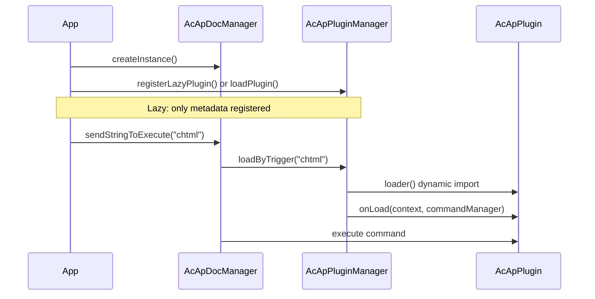

# Eklenti Sistemi

Bu sayfa, MLightCAD için bir **eklentinin** nasıl oluşturulacağını, kaydedileceğini ve kullanılacağını açıklar. Eklentiler, komut kaydederek, etkin belgeye ve görünüme erişerek ve kaldırıldığında temizlik yaparak görüntüleyiciyi genişletir.

Eklenti sistemi `@mlightcad/cad-simple-viewer` (`packages/cad-simple-viewer/src/plugin`) içinde yer alır. Resmi eklentiler (arayüz, yapay zekâ ajanı, betik konsolu, HTML/PDF/SVG dışa aktarma, OneDrive/Google Drive veri kaynakları) ayrı npm paketleri olarak sunulur — tam liste için [Yerleşik Eklentiler](./built-in-plugins) sayfasına bakın.

---

## Genel Bakış

Bir eklenti, `AcApPlugin` arayüzünü uygulayan küçük bir modüldür. **Eklenti yöneticisi** (`AcApPluginManager`) `AcApDocManager`'a aittir ve şunları yapar:

- Bir eklenti yüklendiğinde `onLoad()` çağrısı yapar (komutları, kancaları vb. kaydeder)
- Bir eklenti kaldırıldığında `onUnload()` çağrısı yapar (komutları kayıttan çıkarır, kaynakları serbest bırakır)
- **Tembel kaydı** destekler: eklenti kodu, kullanıcı bir **tetikleme komutu** çalıştırana kadar indirilmez



---

## Temel tipler

### `AcApPlugin`

Her eklenti şunları sağlamalıdır:

| Alan / metot | Açıklama |
|----------------|-------------|
| `name` | Benzersiz tanımlayıcı (zorunlu). Tembel yükleme kullanırken tembel kayıttaki `name` değeriyle eşleşmelidir. |
| `version?` | İsteğe bağlı sürüm metni |
| `description?` | İsteğe bağlı, insan tarafından okunabilir açıklama |
| `onLoad(context, commandManager)` | Komutları kaydeder ve kaynakları başlatır |
| `onUnload(context, commandManager)` | Komutları kaldırır ve kaynakları serbest bırakır |

`context`, `AcApContext`'tir (geçerli `doc` ve `view`). `commandManager`, `AcEdCommandStack`'tir — yerleşik komutların kullandığı aynı yığın.

Başvuru uygulaması: `packages/cad-simple-viewer/src/plugin/AcApPluginExample.ts` içindeki `AcApExamplePlugin`.

### `AcApLazyPluginRegistration`

Kod bölme için eklentiyi hemen yüklemek yerine bir tanımlayıcı kaydedin:

| Alan | Açıklama |
|-------|-------------|
| `name` | `loader` tarafından döndürülen `AcApPlugin.name` ile eşit olmalıdır |
| `triggers` | Bu eklentiyi yükleyen komut adları (büyük/küçük harf duyarsız) |
| `loader` | Bir eklenti örneği döndüren asenkron fabrika |

---

## Adım 1 — Bir komut uygulayın

Eklentiler genellikle bir veya daha fazla **komut** sunar. `AcEdCommand` sınıfını genişletin ve `execute(context)` metodunu uygulayın:

```typescript
import { AcApContext, AcEdCommand } from '@mlightcad/cad-simple-viewer'

export class AcApMyExportCmd extends AcEdCommand {
  async execute(context: AcApContext) {
    const fileName = context.doc.fileName || context.doc.docTitle
    // ... export logic using context.doc.database, context.view, etc.
  }
}
```

İstemler, düzenleyici erişimi ve varlık oluşturma için [Komut](./command) sayfasına bakın.

---

## Adım 2 — `AcApPlugin` uygulayın

`onUnload`'ın kaldırabilmesi için kaydettiğiniz her komutu izleyin:

```typescript
import {
  AcApContext,
  AcApPlugin,
  AcEdCommandStack
} from '@mlightcad/cad-simple-viewer'

import { AcApMyExportCmd } from './AcApMyExportCmd'

export class AcApMyPlugin implements AcApPlugin {
  name = 'MyPlugin'
  version = '1.0.0'
  description = 'My custom export command'

  private registeredCommands: Array<{ group: string; name: string }> = []

  onLoad(_context: AcApContext, commandManager: AcEdCommandStack): void {
    const group = AcEdCommandStack.SYSTEMT_COMMAND_GROUP_NAME
    commandManager.addCommand(group, 'myexport', 'myexport', new AcApMyExportCmd())
    this.registeredCommands.push({ group, name: 'myexport' })
  }

  onUnload(_context: AcApContext, commandManager: AcEdCommandStack): void {
    for (const cmd of this.registeredCommands) {
      commandManager.removeCmd(cmd.group, cmd.name)
    }
    this.registeredCommands = []
  }
}
```

Resmi eklentiler aynı deseni izler:

- `AcApHtmlPlugin` — `chtml` komutunu kaydeder
- `AcApPdfPlugin` — `cpdf`, `ipdf` komutlarını kaydeder
- `AcApSvgPlugin` — `csvg` komutunu kaydeder

Görüntüleyici genelindeki komutlar için (yakınlaştırma, katman vb. ile aynı grup) `AcEdCommandStack.SYSTEMT_COMMAND_GROUP_NAME` kullanın.

---

## Adım 3 — npm paketi olarak yayımlayın (isteğe bağlı)

`cad-html-plugin`, `cad-pdf-plugin` veya `cad-svg-plugin` yapısını yansıtın:

```
my-cad-plugin/
  package.json          # name: @myorg/cad-my-plugin
  src/
    AcApMyPlugin.ts
    AcApMyExportCmd.ts
    registerLazyMyPlugin.ts
    index.ts            # public exports
```

**`package.json` kuralları:**

- `"type": "module"` ayarlayın
- `@mlightcad/cad-simple-viewer` paketini **peerDependency** olarak listeleyin (ve gerekirse `@mlightcad/data-model`, `three` gibi diğer paylaşılan kütüphaneleri)
- Mevcut eklentiler gibi `tsc` + `vite` ile derleyin
- `src/index.ts` içinden yardımcıları dışa aktarın: eklenti sınıfı, `createMyPlugin`, `registerLazyMyPlugin`, tetikleyici sabitleri

**Tembel yükleyici modülü** (`registerLazyMyPlugin.ts`):

```typescript
import type { AcApPluginManager } from '@mlightcad/cad-simple-viewer'

export const MY_PLUGIN_NAME = 'MyPlugin'
export const MY_PLUGIN_TRIGGERS = ['myexport'] as const

export async function createMyPlugin() {
  const { AcApMyPlugin } = await import('./AcApMyPlugin')
  return new AcApMyPlugin()
}

export function registerLazyMyPlugin(pluginManager: AcApPluginManager): void {
  pluginManager.registerLazyPlugin({
    name: MY_PLUGIN_NAME,
    triggers: [...MY_PLUGIN_TRIGGERS],
    loader: createMyPlugin
  })
}
```

Dinamik `import('./AcApMyPlugin')`, `myexport` çalışana kadar ağır eklenti parçasını ilk paketten uzak tutar.

---

## Eklentileri kaydetme

Dört yaygın kayıt yolu vardır. Tembel yüklemeye ihtiyacınız olup olmadığına ve uygulama başlatmayı kimin üstlendiğine göre birini seçin.

### A. Tembel kayıt (isteğe bağlı özellikler için önerilir)

`AcApDocManager.createInstance()` sonrasında kaydedin. Eklenti modülü ilk tetikleme komutunda yüklenir.

```typescript
import { AcApDocManager } from '@mlightcad/cad-simple-viewer'
import { registerLazyHtmlPlugin } from '@mlightcad/cad-html-plugin'
import { registerLazyPdfPlugin } from '@mlightcad/cad-pdf-plugin'
import { registerLazySvgPlugin } from '@mlightcad/cad-svg-plugin'

AcApDocManager.createInstance({
  container: document.getElementById('cad-container')!,
  htmlViewerRuntimeUrl: './viewer-runtime.iife.js' // required for chtml export
})

const pm = AcApDocManager.instance.pluginManager
registerLazyHtmlPlugin(pm)
registerLazyPdfPlugin(pm)
registerLazySvgPlugin(pm)
```

Örnek uygulama: `packages/cad-simple-viewer-demo/src/main.ts`.

Kullanıcı bir tetikleme komutu çalıştırdığında, komut henüz kayıtlı değilse `AcApDocManager` otomatik olarak `loadByTrigger` çağırır:

```typescript
AcApDocManager.instance.sendStringToExecute('chtml')
AcApDocManager.instance.sendStringToExecute('cpdf')
```

`sendStringToExecute` kullanırken, eklentiyi yürütmeden önce önceden yüklemek istemediğiniz sürece `loadByTrigger` metodunu manuel olarak çağırmanız **gerekmez** (aşağıya bakın).

### B. Satır içi tembel kayıt (cad-viewer bileşeni)

`@mlightcad/cad-viewer`, PDF/HTML/SVG eklentilerini `registerLazyPlugins()` (`packages/cad-editor/src/app/register.ts`) içinde kaydeder; bu fonksiyon `app.ts` içindeki `initializeCadViewer()` tarafından çağrılır. Vue bileşeninin tüketicileri ek kurulum yapmadan tembel eklentilere sahip olur.

### C. `pluginManager.loadPlugin()` ile hemen yükleme

Belge yöneticisini oluşturduktan hemen sonra yükleyin:

```typescript
import { AcApDocManager } from '@mlightcad/cad-simple-viewer'
import { AcApExamplePlugin } from '@mlightcad/cad-simple-viewer' // AcApExamplePlugin export

AcApDocManager.createInstance({ container: el })
await AcApDocManager.instance.pluginManager.loadPlugin(new AcApExamplePlugin())
```

Eklenti küçükse veya herhangi bir kullanıcı eyleminden önce kullanılabilir olması gerekiyorsa kullanın.

### D. `createInstance({ plugins })` ile hemen yükleme

Eklentileri başlatma sırasında geçin; `AcApDocManager` bunları başlangıçta asenkron olarak yükler.

**Örneklerden veya fabrikalardan:**

```typescript
AcApDocManager.createInstance({
  container: el,
  plugins: {
    fromConfig: [
      new AcApExamplePlugin(),
      () => new AcApAnotherPlugin()
    ]
  }
})
```

**Bir klasörden (dinamik içe aktarma):**

```typescript
AcApDocManager.createInstance({
  container: el,
  plugins: {
    fromFolder: {
      folderPath: './plugins',
      pluginList: ['MyPlugin.js'],
      continueOnError: true
    }
  }
})
```

Tarayıcıda `pluginList` sağlamalısınız (dizin listeleme API'si yoktur). Her dosya varsayılan olarak bir eklenti örneği, eklenti sınıfı veya fabrika fonksiyonu dışa aktarmalıdır.

---

## Çalışma zamanında eklentileri kullanma

### Bir eklenti komutunu yürütme

Eklenti yüklendikten sonra (hemen veya tembel tetikleme yoluyla):

```typescript
// Command line / script style
AcApDocManager.instance.sendStringToExecute('chtml')

// Or via editor API
await AcApDocManager.instance.editor.executeCommand('cpdf')
```

### Tembel bir eklentiyi önceden yükleme (isteğe bağlı)

Bazı arayüz yolları, ilk çalıştırmadaki gecikmeyi önlemek için `sendStringToExecute` öncesinde ön yükleme yapar:

```typescript
const pluginManager = AcApDocManager.instance.pluginManager
await pluginManager.loadByTrigger('cpdf')
AcApDocManager.instance.sendStringToExecute('cpdf')
```

`cad-viewer`, şeritten PDF dışa aktarma için bu deseni kullanır (`MlRibbonCommands.vue` → `runLazyCommand`).

### Yükleme durumunu kontrol etme

```typescript
const pm = AcApDocManager.instance.pluginManager

pm.isPluginLoaded('HtmlPlugin')        // true after first chtml
pm.isLazyPluginTrigger('chtml')        // true if lazy registration exists
pm.getLoadedPlugins()                  // ['HtmlPlugin', ...]
await pm.unloadPlugin('HtmlPlugin')
await pm.unloadAllPlugins()            // called when destroying the view
```

### Kaldırma

```typescript
await AcApDocManager.instance.pluginManager.unloadPlugin('MyPlugin')
```

`onUnload`, `onLoad` içinde kaydedilen her komutu kaldırmalıdır. Aksi halde yığında bayat komutlar kalır.

---

## Yerleşik eklenti başvurusu

Monorepo birkaç resmi eklenti ile birlikte gelir: `AcApHtmlPlugin` (`chtml`), `AcApPdfPlugin` (`cpdf`, `ipdf`), `AcApSvgPlugin` (`csvg`), ayrıca arayüz, ajan, betik konsolu ve veri kaynağı eklentileri.

Komutları, genel API'si, yapılandırması ve her paketin README bağlantılarıyla birlikte tam liste için [Yerleşik Eklentiler](./built-in-plugins) sayfasına bakın.

---

## Entegrasyon kontrol listesi

1. **Bağımlı olun**: `@mlightcad/cad-simple-viewer` (yayımlanan eklentiler için peer dependency).
2. **Uygulayın**: `AcApPlugin` + `AcEdCommand`(ler).
3. **Dışa aktarın**: paket girişinden `registerLazy*Plugin` + `create*Plugin`.
4. **Kaydedin**: `AcApDocManager.createInstance()` sonrasında (veya `plugins.fromConfig` / `fromFolder` ile).
5. **Tetikleyin**: komutları `sendStringToExecute` veya aynı komut adlarını çağıran arayüzle tetikleyin.
6. **Paketleyin**: Vite/Rollup'ın eklenti parçasını bölmesi için tembel `loader` içinde dinamik `import()` kullanın.
7. **Temizlik**: `onUnload` içinde tüm komutları kaldırın.
8. **Benzersiz tetikleyiciler**: bir tetikleme komutu iki tembel eklentiye eşlenemez (`registerLazyPlugin` çakışmada hata fırlatır).
9. **Ad tutarlılığı**: `AcApLazyPluginRegistration.name`, `loader()` tarafından döndürülen `plugin.name` ile eşleşmelidir.

---

## Sorun giderme

| Belirti | Olası neden |
|---------|----------------|
| `Command 'chtml' not found` | Tembel eklenti kaydedilmemiş veya kayıt yok etme işleminden sonra yapılmış |
| Tembel eklenti hiç yüklenmiyor | Tetikleyici adı uyuşmuyor (büyük harfe normalleştirmeyi kontrol edin); yükleyicideki `name` ile kayıttaki ad farklı |
| HTML dışa aktarma çalışma zamanında başarısız | `htmlViewerRuntimeUrl` eksik veya `viewer-runtime.iife.js` bu URL'ye dağıtılmamış |
| `Plugin 'X' is already loaded` | `unloadPlugin` çağırmadan `loadPlugin` iki kez çağrılmış |
| Tetikleyici zaten kayıtlı | İki eklenti aynı tetikleme komutunu kaydetmiş |

---

## İlgili sayfalar

- [Yerleşik Eklentiler](./built-in-plugins) — MLightCAD ile birlikte sunulan tüm resmi eklentiler
- [Komut](./command) — komut yaşam döngüsü ve `AcEdCommand`
- [Veri Kaynağı Eklentisi](./data-source-plugin) — takılabilir çizim kaynakları (yerel, URL, OneDrive, …)
- [Simple Viewer Entegrasyonu](./integrate-simple-cad-viewer) — `cad-simple-viewer` gömme
- [Vue Bileşeni Entegrasyonu](./integrate-cad-viewer-component) — Vue bileşeni ve `initializeCadViewer`
- [Mimariye Genel Bakış](./architecture-overview) — modül düzeni
