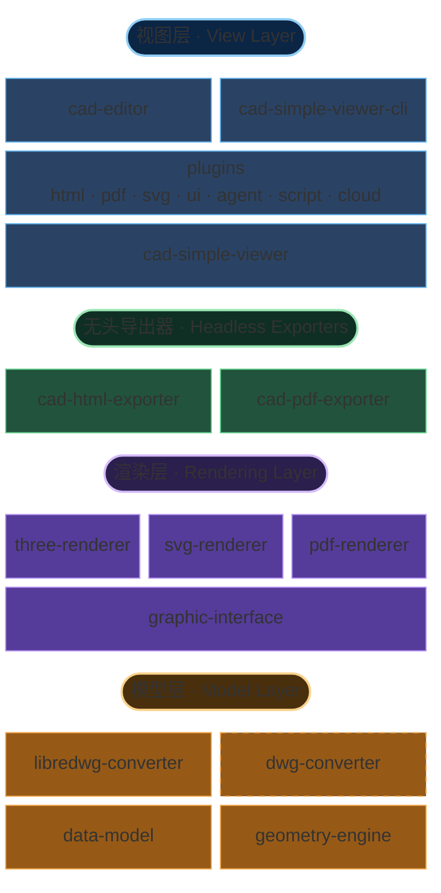

# 架构总览

MLightCAD 完全运行在浏览器中，**不依赖任何后端**。DWG/DXF 文件使用 WebAssembly 和 JavaScript 在本地解析和处理，从而确保：

- **零服务器要求** — 只需静态文件托管即可部署到任意环境
- **完整的数据隐私** — 文件永远不会离开用户的设备
- **即时集成** — 无需复杂的后端搭建或 API 配置
- **离线能力** — 在没有网络连接的情况下也能工作

本仓库是一个 `pnpm` + `nx` 的 TypeScript monorepo。与查看 / 编辑相关的主要包如下：

| 包 | 职责 |
| --- | --- |
| [`@mlightcad/cad-simple-viewer`](https://github.com/mlightcad/cad-viewer/tree/main/packages/cad-simple-viewer) | 文档管理、命令栈、插件管理器与画布；**不依赖任何 UI 框架** |
| [`@mlightcad/cad-editor`](https://github.com/mlightcad/cad-viewer/tree/main/packages/cad-editor) | 基于 `cad-simple-viewer` 的 Vue 3 完整 UI（菜单、Ribbon、命令行、状态栏） |
| [`@mlightcad/cad-simple-viewer-cli`](https://github.com/mlightcad/cad-viewer/tree/main/packages/cad-simple-viewer-cli) | 无头 CLI：在 Playwright / Chromium 中驱动 `cad-simple-viewer` 执行 `.scr` 脚本 |
| [`@mlightcad/three-renderer`](https://github.com/mlightcad/cad-viewer/tree/main/packages/three-renderer) | 基于 THREE.js 的交互式 2D/3D 渲染 |
| `svg-renderer`（[`cad-svg-plugin`](https://github.com/mlightcad/cad-viewer/tree/main/packages/cad-svg-plugin)） | 实现同一渲染接口的 SVG 矢量输出 |
| [`@mlightcad/pdf-renderer`](https://github.com/mlightcad/cad-viewer/tree/main/packages/pdf-renderer) | 实现同一渲染接口的矢量 PDF 输出后端 |
| [`@mlightcad/cad-html-exporter`](https://github.com/mlightcad/cad-viewer/tree/main/packages/cad-html-exporter) / [`@mlightcad/cad-pdf-exporter`](https://github.com/mlightcad/cad-viewer/tree/main/packages/cad-pdf-exporter) | Node 无头 HTML / PDF 导出（不依赖浏览器中的查看器） |
| `*-plugin` | 可选能力（UI、导出、脚本、智能体、云端数据源），由插件管理器延迟加载 |

分层原则：`data-model`（外部） → 渲染器 → `cad-simple-viewer` → UI / 插件 / CLI。**低层包不得依赖高层包。**

## 整体架构

系统按职责划分为**模型层、渲染层、视图层**；另有两条可独立部署的**无头导出**路径，以及驱动同一查看器核心的 CLI。

这种分层架构使 MLightCAD 能够在不同数据规模、渲染目标和部署形态（浏览器组件、无头 CLI、纯 Node 导出）下保持可扩展性。

### 模型层

模型层位于独立仓库 [`realdwg-web`](https://github.com/mlightcad/realdwg-web)，由本仓库作为外部依赖引用：

- [`@mlightcad/data-model`](https://github.com/mlightcad/realdwg-web) 定义统一的 **Data Model**，描述解析后的 CAD 数据（几何实体、图层、视图参数等）。
- [`AcDbDatabaseConverter`](https://github.com/mlightcad/realdwg-web/blob/main/packages/data-model/src/database/AcDbDatabaseConverter.ts) 提供统一的 CAD 文件转换接口，使不同转换器都能产出同一数据模型。
- [`@mlightcad/libredwg-converter`](https://github.com/mlightcad/realdwg-web) 提供基于 LibreDWG 的开源 DWG 解析（WebAssembly），将 DWG 转为统一数据模型。宿主需自行注册该转换器（`cad-simple-viewer` 本身不捆绑 GPL 解析器）。
- **`@mlightcad/dwg-converter`** 是**闭源商业** DWG 解析模块，实现同一 `AcDbDatabaseConverter` 接口，可作为 `libredwg-converter` 的替代品以获得更高兼容性与完整性。它通过 GitHub Packages 私有分发，不随本仓库开源发布。安装与注册步骤见[安装和使用私有 DWG 转换器](./install-and-use-proprietary-dwg-converter)；许可与试用说明见 [PROPRIETARY-PARSER.md](https://github.com/mlightcad/cad-viewer/blob/main/PROPRIETARY-PARSER.md)。
- DXF 解析由 `data-model` 内置转换管线完成（历史实现曾基于 [`@mlightcad/dxf-json`](https://github.com/mlightcad/dxf-json)）。
- [`@mlightcad/geometry-engine`](https://github.com/mlightcad/realdwg-web) 提供几何与数学运算（点、线、多段线、样条、圆/弧、椭圆，以及向量、矩阵等）。

关于为何定义 `AcDbDatabaseConverter`：市面上现有的 DXF/DWG 读写工具往往不够完整。开源路径使用 `libredwg-converter`；需要更高保真度时，可改用闭源的 `dwg-converter` 直接替换注册，无需改动上层查看器代码。底层亦可基于 [ODA](https://www.opendesign.com/products/drawings) 等商业引擎自行实现同一接口。

### 渲染层

- [`@mlightcad/graphic-interface`](https://github.com/mlightcad/realdwg-web)（`realdwg-web`）定义统一的实体渲染接口（`AcGiRenderer` 等）。
- [`@mlightcad/three-renderer`](https://github.com/mlightcad/cad-viewer) 实现该接口，用 THREE.js 做交互式画布渲染（批处理、线型/填充着色器等）。这是 `cad-simple-viewer` 的默认渲染后端。
- **`svg-renderer`**（`AcSvgRenderer`）实现同一接口，将实体输出为可缩放的 SVG。当前实现位于 [`@mlightcad/cad-svg-plugin`](https://github.com/mlightcad/cad-viewer/tree/main/packages/cad-svg-plugin)，由 `csvg` 等导出命令使用；PDF 矢量导出也会复用其中的部分绘制能力。
- [`@mlightcad/pdf-renderer`](https://github.com/mlightcad/cad-viewer) 实现同一接口，将实体输出为矢量 PDF 内容流；由 `cad-pdf-core` / `cad-pdf-plugin` / `cad-pdf-exporter` 使用。

### 视图层

- **`cad-simple-viewer`** 是核心：文档生命周期、命令栈、用户输入 / jig、与 `three-renderer` 的协作，以及 **`AcApPluginManager` 插件机制**。除画布外不提供应用 UI。
- **插件**以独立 npm 包发布，实现 `AcApPlugin`，经 `registerLazyPlugin` / `loadPlugin` 挂到同一插件管理器。官方插件包括 HTML / PDF / SVG 导出、简单 UI、脚本控制台、AI 智能体、OneDrive / Google Drive 等。详见[插件系统](./plugin-system)与[内置插件](./built-in-plugins)。
- **`cad-editor`**（原 `@mlightcad/cad-viewer`，自 1.8.0 起改名）在 `cad-simple-viewer` 之上提供完整 Vue 3 UI，并在引导时注册常用延迟加载插件。
- **`cad-simple-viewer-cli`** 用 Playwright 在无头 Chromium 中启动同一查看器核心，执行 AutoCAD 风格的 `.scr` 脚本（例如 `-chtml` / `-cpdf`），适合 CI 与转换服务。详见[构建云端 DWG Web 查看器](./cloud-dwg-web-viewer)。

### 无头导出器

浏览器插件与 Node 导出器共用「core」包中的导出管线，从而避免在服务端再拉起完整查看器：

| 路径 | 共享核心 | 渲染后端 | 典型入口 |
| --- | --- | --- | --- |
| HTML | `@mlightcad/cad-html-core` | `three-renderer`（生成快照后打包） | 浏览器：`cad-html-plugin`（`chtml`）；Node：`cad-html-exporter`（`exportFileToHtml`） |
| PDF | `@mlightcad/cad-pdf-core` | `pdf-renderer` | 浏览器：`cad-pdf-plugin`（`cpdf`）；Node：`cad-pdf-exporter`（`exportFileToPdf`） |

`*-core` **不**依赖 `cad-simple-viewer` / DOM；`*-exporter` 在 Node 中完成字体加载、DWG 注册与文件 I/O。若需要完整命令脚本能力（而不只是文件 → HTML/PDF），仍应使用 `cad-simple-viewer-cli`。

## 渲染引擎

渲染 DXF/DWG 面临几类挑战：

- 高性能渲染包含大量实体的图纸
- 复现 AutoCAD 的文字渲染效果
- 支持线型和填充图案

### 高性能渲染

对大型图纸，关键是合并点、线和面以减少 **Draw Call**。THREE.js 的 [BatchedMesh](https://threejs.org/docs/index.html?q=Mesh#api/en/objects/BatchedMesh) 只能部分解决三角网格合并，且不支持点/线合并。因此我们参考 `BatchedMesh` 实现了点、线、面的批处理类，见 [`packages/three-renderer/src/batch`](https://github.com/mlightcad/cad-viewer/tree/main/packages/three-renderer/src/batch)。

### 文字渲染

AutoCAD 使用 [`MText`](https://ezdxf.mozman.at/docs/dxfinternals/entities/mtext.html) 表示富文本，并用 [SHX](https://help.autodesk.com/view/OARX/2023/ENU/?guid=GUID-DE941DB5-7044-433C-AA68-2A9AE98A5713) 描边字体加速显示。相关能力分布在独立仓库：

- **解析 MText** — [`@mlightcad/mtext-parser`](https://github.com/mlightcad/mtext-parser)
- **解析 SHX** — [`@mlightcad/shx-parser`](https://github.com/mlightcad/shx-parser)
- **渲染 MText** — [`@mlightcad/mtext-renderer`](https://github.com/mlightcad/mtext-renderer)；解析后的字体缓存在浏览器 IndexedDB，避免重复下载与解析

调试文字渲染可使用基于 THREE.js 的富文本编辑器 [mtext-editor](https://github.com/mlightcad/mtext-editor)。

### 线型和填充图案

AutoCAD 支持自定义线型与填充图案。我们已实现其中一部分。交互式画布中的线型与填充效果使用 THREE.js 的 `ShaderMaterial`，见 [`packages/three-renderer/src/style`](https://github.com/mlightcad/cad-viewer/tree/main/packages/three-renderer/src/style)。PDF 路径则在 `pdf-renderer` 中按矢量方式复现对应外观。
