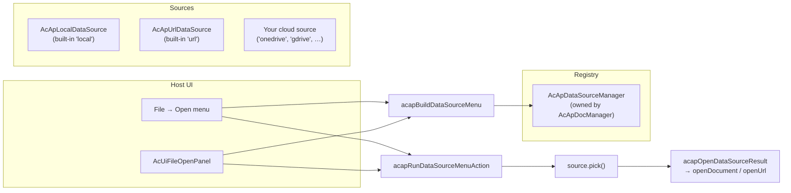

# 数据源插件

本页介绍 `@mlightcad/cad-simple-viewer` 中的**数据源插件**机制——决定**图纸来自哪里**（本地磁盘、HTTP URL、OneDrive、Google Drive 等）的可插拔层。内容涵盖该机制的工作方式、如何创建自己的数据源，以及如何注册和使用它。

该机制位于 `packages/cad-simple-viewer/src/app/dataSource`。完整的参考实现作为独立的 npm 包发布：`@mlightcad/cad-onedrive-plugin`（`packages/cad-onedrive-plugin`），由 `packages/cad-simple-viewer-example` 中的演示应用使用。

> 关于**命令插件**（如 `cpdf`、`chtml` 等导出命令），请参见[插件系统](./plugin-system)。数据源插件*本身*就是一个 `AcApPlugin`——它只是使用 `onLoad` 注册数据源而不是命令。

---

## 概览

**数据源**是实现 `AcApDataSource` 的对象：一个可插拔的 CAD 图纸来源。查看器核心对厂商一无所知——它只知道注册表（`AcApDataSourceManager`）和少量菜单辅助函数。所有厂商特定的逻辑（登录弹窗、文件选择器、下载）都保留在数据源**内部**。



关键设计规则：

- **宿主只负责编排。** 宿主 UI（功能区 Open 菜单、`AcUiFileOpenPanel`、工具栏）只能（1）通过 `AcApDataSourceManager` 列出数据源，（2）使用 `acapBuildDataSourceMenu` 构建标签，（3）使用 `acapRunDataSourceMenuAction` / `acapInvokeDataSourceMenuAction` 执行点击。它们**不得**打开厂商文件选择器、下载 URL 或显示服务商特定的登录界面。
- **登录和选取绝不串联。** 浏览器只允许在直接的用户手势 tick 中调用 `window.open`。如果点击处理器先 `await` MSAL 登录，*然后*再打开选择器弹窗，第二个弹窗会被拦截。因此菜单将**登录**和**从……打开**作为独立菜单项暴露。
- **自适应菜单。** `getAuthState()` 决定菜单显示的内容，因此宿主无需服务商特定的 UI。

---

## 核心类型

以下所有类型均从 `@mlightcad/cad-simple-viewer` 导出。

### `AcApDataSource`

每个数据源都必须实现的接口：

| 成员 | 必填 | 说明 |
|--------|----------|-------------|
| `id` | ✓ | 用于菜单和注册表查找的稳定 id（`local`、`url`、`onedrive` 等） |
| `labelKey` | ✓ | 显示名称的 i18n 键（例如 `main.dataSource.onedrive`） |
| `icon?` | | 可选的内联 SVG 字符串或 URL |
| `requiresAuth` | ✓ | 数据源是否需要用户认证 |
| `requiresUserGesture` | ✓ | 为 `true` 时，`pick()` 必须在直接点击 tick 中执行 `window.open`（云端文件选择器） |
| `getAuthState()` | ✓ | 返回 `'none'` \| `'signed-out'` \| `'signed-in'` |
| `getAccountLabel?()` | | 供菜单使用的简短已登录标签（邮箱 / 显示名） |
| `getAccountProfile?()` | | 供落地页 / 账户界面使用的 `{ displayName, email?, avatarUrl? }` |
| `restoreSession?()` | | 注册后恢复缓存的会话（MSAL 账户、令牌等）。完成时必须调用 `notifyAuthChanged`，以便 Open 菜单刷新 |
| `signIn()` | ✓ | 交互式登录。当 `requiresAuth` 为 `false` 时不执行任何操作 |
| `signOut()` | ✓ | 登出。当 `requiresAuth` 为 `false` 时不执行任何操作 |
| `pick()` | ✓ | 打开数据源特定的文件选择器 / 对话框，按需下载，并返回选中的图纸——用户取消时返回 `null` |

### `AcApDataSourceFile`

成功调用 `pick()` 的结果：

| 字段 | 说明 |
|-------|-------------|
| `name` | 包含扩展名的文件名（例如 `drawing.dwg`） |
| `content?` | 原始文件字节（`ArrayBuffer`）。在省略 `url` 时使用 |
| `url?` | 通过 `AcApDocManager.openUrl` 打开的远程 URL（带进度的 HTTP 抓取） |

对于已在内存中的字节优先使用 `content`；当数据源应通过 `openUrl` 打开时优先使用 `url`。

### `AcApDataSourceManager`

注册表，由 `AcApDocManager` 持有（`AcApDocManager.instance.dataSourceManager`）。`AcApDocManager.createInstance()` 会自动注册两个内置数据源：

- `local` — `AcApLocalDataSource`（针对 `.dwg` / `.dxf` 的 `<input type="file">` 选择器）
- `url` — `AcApUrlDataSource`（URL 对话框，通过 `openUrl` 打开）

云端插件在 `AcApPlugin.onLoad` 中自行注册，并在 `onUnload` 中注销。

| API | 说明 |
|-----|-------------|
| `register(source)` | 注册数据源（替换任何具有相同 id 的现有数据源） |
| `unregister(id)` | 按 id 移除数据源 |
| `list()` | 按注册顺序返回已注册的数据源 |
| `get(id)` | 按 id 查找数据源 |
| `notifyAuthChanged(sourceId)` | 云端插件在 `signIn` / `signOut` 成功后调用 |
| `on` / `off` | 订阅 `changed` 和 `auth-changed` 事件 |

---

## 菜单辅助函数

宿主不要手写 Open 菜单。三个辅助函数定义了契约：

### 1. `acapBuildDataSourceMenu(sources)`

从当前注册表构建 `AcApDataSourceMenuItem[]`。规则（对弹窗拦截安全）：

| 认证状态 | 菜单项 |
|------------|------------|
| 无需认证（`'none'`） | 一个 **pick** 项（例如*本地文件*、*从 URL*） |
| 需要认证，**已登出** | 仅一个**登录**项（绝不与 pick 串联） |
| 需要认证，**已登录** | **pick**（*从 OneDrive 打开*）+ **退出登录**（*退出 OneDrive 登录 (user@host)*） |

### 2. `acapRunDataSourceMenuAction(item, options?, manager?)`

执行菜单项对应的操作，并**自动打开 pick 结果**（`acapOpenDataSourceResult`：设置了 `file.url` 时使用 `openUrl`，否则使用 `file.content` 调用 `openDocument`）。在查看器内的 Open 菜单中使用此函数。它绝不会将登录与 pick 串联。

### 3. `acapInvokeDataSourceMenuAction(source, item)`

针对已解析的数据源执行操作，**不打开文件**。适用于在 `AcApDocManager` 存在之前就拥有数据源管理器的落地页，或你希望自行打开结果时。

### 辅助工具

| 辅助函数 | 用途 |
|--------|---------|
| `acapOpenCenteredPopup(name, width?, height?)` | 打开屏幕居中的命名弹窗——在 `pick()` 内部使用，以便弹窗在同一点击 tick 中打开 |
| `acapWithDataSourceBusy(work, message?)` | 将下载 / 选择后的工作包装在忙碌遮罩中（使用 DocManager 的忙碌指示器，或为落地页在 `document.body` 上创建临时 `AcApProgress`） |
| `acapOpenDataSourceResult(file, options?)` | 通过 DocManager 打开 `pick()` 的结果（`openUrl` / `openDocument`） |
| `acapIsSingleLocalOpen(sources)` | Open UI 是否应折叠为单个「打开」操作（仅有内置本地数据源时） |

---

## 创建数据源插件

数据源插件是一个普通的 `AcApPlugin`（参见[插件系统](./plugin-system)），其 `onLoad` 注册一个 `AcApDataSource`。推荐的包结构参照 `cad-onedrive-plugin`：

```
my-cad-datasource-plugin/
  package.json          # name: @myorg/cad-my-datasource-plugin
  src/
    AcApMyDataSource.ts # implements AcApDataSource
    AcApMyPlugin.ts     # implements AcApPlugin, registers the source
    myClient.ts         # vendor API client (auth, picker, download)
    register.ts         # registerMyPlugin(pluginManager, options)
    index.ts            # public exports
```

**`package.json` 约定：**

- 设置 `"type": "module"`
- 将 `@mlightcad/cad-simple-viewer`（以及按需的 `@mlightcad/data-model`）列为 **peerDependencies**
- 像现有插件一样使用 `tsc` + `vite` 构建

### 步骤 1 — 实现 `AcApDataSource`

```typescript
import {
  type AcApDataSource,
  type AcApDataSourceAccountProfile,
  type AcApDataSourceAuthState,
  type AcApDataSourceFile,
  type AcApDataSourceManager,
  acapOpenCenteredPopup,
  acapWithDataSourceBusy
} from '@mlightcad/cad-simple-viewer'

/** Stable id used in menus and registry lookups. */
export const ACAP_MY_DATA_SOURCE_ID = 'mycloud'

export class AcApMyDataSource implements AcApDataSource {
  readonly id = ACAP_MY_DATA_SOURCE_ID
  readonly labelKey = 'main.dataSource.mycloud'
  readonly requiresAuth = true
  // true because pick() opens a File Picker popup via window.open
  readonly requiresUserGesture = true

  private readonly dataSourceManager: AcApDataSourceManager

  constructor(dataSourceManager: AcApDataSourceManager) {
    this.dataSourceManager = dataSourceManager
  }

  getAuthState(): AcApDataSourceAuthState {
    return this.client.isAuthenticated ? 'signed-in' : 'signed-out'
  }

  getAccountLabel(): string | undefined {
    return this.client.userInfo?.email
  }

  getAccountProfile(): AcApDataSourceAccountProfile | undefined {
    if (!this.client.isAuthenticated) return undefined
    const info = this.client.userInfo!
    return { displayName: info.name || info.email, email: info.email }
  }

  /** Restore cached tokens after registration so menus show signed-in state. */
  async restoreSession(): Promise<void> {
    await this.client.initialize()
    this.notifyAuthChanged()
  }

  async signIn(): Promise<void> {
    await this.client.authenticate()
    this.notifyAuthChanged()
  }

  async signOut(): Promise<void> {
    await this.client.signOut()
    this.notifyAuthChanged()
  }

  async pick(): Promise<AcApDataSourceFile | null> {
    // Open the popup in this click tick. Any `await` first loses the gesture.
    const popup = acapOpenCenteredPopup('MyCloudPicker', 1080, 680)
    if (!popup) {
      throw new Error('Popup blocked. Allow popups for this site and try again.')
    }
    try {
      await this.client.initialize()
      if (!this.client.isAuthenticated) {
        throw new Error('Sign in first, then choose a file (popup blocker).')
      }
      const picked = await this.client.openFilePicker(popup)
      const content = await acapWithDataSourceBusy(() =>
        this.client.downloadFile(picked)
      )
      return { name: picked.name, content }
    } catch (error) {
      try {
        if (!popup.closed) popup.close()
      } catch {
        // ignore
      }
      if (error instanceof Error && error.message === 'Picker cancelled') {
        return null // user cancelled — not an error
      }
      throw error
    }
  }

  private notifyAuthChanged(): void {
    this.dataSourceManager.notifyAuthChanged(this.id)
  }
}
```

实现说明：

- **`pick()` 必须在点击 tick 中同步打开弹窗**（`requiresUserGesture = true`）。将任何 `await`（SDK 初始化、认证检查）放在 `window.open` *之后*。
- 在下载周围调用 `acapWithDataSourceBusy`，以便用户在查看器和落地页上都能获得进度反馈。
- 用户取消时返回 `null`；真实失败时抛出异常。
- 认证状态变化后，始终调用 `dataSourceManager.notifyAuthChanged(id)`，以便 Open 菜单刷新。
- 对于非弹窗数据源（例如页面内对话框），设置 `requiresUserGesture = false`。
- 将你的 `labelKey`（例如 `main.dataSource.mycloud`）添加到 i18n 资源中——参见[本地化](./localization)。

### 步骤 2 — 包装为 `AcApPlugin`

```typescript
import {
  AcApContext,
  AcApDocManager,
  AcApPlugin,
  AcEdCommandStack
} from '@mlightcad/cad-simple-viewer'

import packageJson from '../package.json'
import { ACAP_MY_DATA_SOURCE_ID, AcApMyDataSource } from './AcApMyDataSource'

export class AcApMyPlugin implements AcApPlugin {
  name = 'MyDataSourcePlugin'
  version = packageJson.version
  description = 'Open DWG/DXF files from MyCloud'

  private source: AcApMyDataSource | null = null
  private createdSource = false

  onLoad(_context: AcApContext, _commandManager: AcEdCommandStack): void {
    const dsm = AcApDocManager.instance.dataSourceManager
    const existing = dsm.get(ACAP_MY_DATA_SOURCE_ID)
    if (existing) {
      // Already registered (e.g. HMR or double load) — just restore the session.
      void existing.restoreSession?.().catch(() => undefined)
      return
    }
    this.source = new AcApMyDataSource(dsm)
    this.createdSource = true
    dsm.register(this.source)
    // Restore cached session so File → Open shows Open/Sign out, not Sign in.
    void this.source.restoreSession().catch(() => undefined)
  }

  onUnload(_context: AcApContext, _commandManager: AcEdCommandStack): void {
    if (this.createdSource) {
      AcApDocManager.instance.dataSourceManager.unregister(ACAP_MY_DATA_SOURCE_ID)
    }
    this.source = null
    this.createdSource = false
  }
}
```

### 步骤 3 — 导出注册辅助函数

数据源必须**立即可见**（Open 菜单在任何文档打开之前就会列出它们），因此要通过 `pluginManager.loadPlugin` 立即加载：

```typescript
// src/register.ts
import type { AcApPluginManager } from '@mlightcad/cad-simple-viewer'

import { AcApMyPlugin } from './AcApMyPlugin'

export const MY_PLUGIN_NAME = 'MyDataSourcePlugin'

export async function registerMyPlugin(
  pluginManager: AcApPluginManager,
  options: { clientId: string; /* … */ }
): Promise<void> {
  if (!options.clientId) {
    throw new Error('registerMyPlugin requires options.clientId')
  }
  await pluginManager.loadPlugin(new AcApMyPlugin(options))
}
```

> MSAL 风格的 SDK 仍然可以在 `signIn` / `pick` *内部*延迟导入——只有注册本身需要立即执行。

---

## 使用数据源插件

### 1. 在应用中注册

在 `AcApDocManager.createInstance()` 之后调用注册辅助函数：

```typescript
import { AcApDocManager } from '@mlightcad/cad-simple-viewer'
import { registerOneDrivePlugin } from '@mlightcad/cad-onedrive-plugin/register'

AcApDocManager.createInstance({ container: document.getElementById('cad-container')! })

await registerOneDrivePlugin(AcApDocManager.instance.pluginManager, {
  clientId: import.meta.env.VITE_MSAL_CLIENT_ID,
  tenantId: import.meta.env.VITE_MSAL_TENANT_ID || 'common',
  redirectUri: import.meta.env.VITE_MSAL_REDIRECT_URI // optional
})
```

通过从 `/register` 子路径导入并动态导入其余部分，将注册桩保留在初始 bundle 中（参见 `packages/cad-simple-viewer-example/src/register.ts`）：

```typescript
const { registerOneDrivePlugin } = await import('@mlightcad/cad-onedrive-plugin/register')
```

使用内置 UI（功能区 / 工具栏 / `AcUiFileOpenPanel`）时，应用只需做到这些：Open 菜单会从 `dataSourceManager` 重建，并显示例如：

| 认证状态 | 菜单项 |
|------------|------------|
| 已登出 | Sign in to OneDrive |
| 已登录 | Open from OneDrive, Sign out of OneDrive (user@contoso.com) |

### 2. 自定义宿主 UI（查看器内菜单）

如果你构建自己的 Open 菜单，请使用辅助函数——不要直接调用 `signIn` / `pick`：

```typescript
import {
  AcApDocManager,
  acapBuildDataSourceMenu,
  acapRunDataSourceMenuAction
} from '@mlightcad/cad-simple-viewer'

const dsm = AcApDocManager.instance.dataSourceManager

function rebuildOpenMenu() {
  const items = acapBuildDataSourceMenu(dsm.list())
  renderMenu(items, item => {
    void acapRunDataSourceMenuAction(item, openOptions)
  })
}

rebuildOpenMenu()
dsm.on('changed', rebuildOpenMenu)
dsm.on('auth-changed', rebuildOpenMenu)
```

### 3. 落地页（查看器存在之前）

落地页通常允许用户在 `AcApDocManager` 创建之前选择文件。`AcUiFileOpenPanel` 已经实现了这种模式：传入 `onDataSourceAction`，并在查看器就绪后执行该项。当你自己的落地页 UI 直接调用数据源时，使用 `acapInvokeDataSourceMenuAction` + `acapOpenDataSourceResult`：

```typescript
import { acapInvokeDataSourceMenuAction, acapOpenDataSourceResult } from '@mlightcad/cad-simple-viewer'

const source = myDataSourceManager.get('onedrive') // or the built-in 'local' / 'url'
const file = await acapInvokeDataSourceMenuAction(source, menuItem)
if (file) {
  await acapOpenDataSourceResult(file, openOptions)
}
```

**用户手势陷阱**（摘自 `cad-simple-viewer-example/src/main.ts`）：如果点击处理器必须先 `await` 查看器初始化，然后才执行 `pick` 操作，用户手势就会丢失，弹窗会被拦截。要么在已初始化时同步执行操作，要么为 `pick` 项显示*请先登录，然后打开*的提示（参见示例应用中的 `handleDataSourceMenuAction`）。

---

## 真实案例参考：OneDrive

`@mlightcad/cad-onedrive-plugin` 是标准的云端数据源：

| 部分 | 文件 | 作用 |
|-------|------|--------------|
| `AcApOneDriveDataSource` | `src/AcApOneDriveDataSource.ts` | 基于 Microsoft File Picker v8 + MSAL 实现 `AcApDataSource`；`pick` 同步打开弹窗，然后在忙碌遮罩下下载 |
| `AcApOneDrivePlugin` | `src/AcApOneDrivePlugin.ts` | 负责注册/注销数据源，并在加载时恢复缓存的 MSAL 会话的 `AcApPlugin` |
| `OneDriveClient` | `src/oneDriveClient.ts` | MSAL 认证 + File Picker v8 消息通信 + Graph 下载 |
| `registerOneDrivePlugin` | `src/register.ts` | 立即注册辅助函数（校验 `clientId`） |
| `createOneDrivePlugin` | `src/createOneDrivePlugin.ts` | 插件实例的异步工厂函数 |

示例应用通过环境配置将其接入（`packages/cad-simple-viewer-example/src/onedriveEnv.ts`）：当设置了 `VITE_MSAL_CLIENT_ID` 时，`registerOneDriveFromEnv` 会注册该插件；落地页面板通过 `AcUiFileOpenPanel` 的 `extraMenuItems` 列出*Sign in to OneDrive*项。

**Azure 应用设置**（用于 OneDrive）：在 Microsoft Entra ID 中注册一个 **Single-page application**，添加与你的应用来源匹配的重定向 URI，授予委托的 Graph 权限 `User.Read` + `Files.Read.All`（个人 OneDrive 选择器令牌也涵盖 `OneDrive.ReadOnly`）。

---

## 故障排查

| 现象 | 可能原因 |
|---------|----------------|
| Open 菜单中缺少数据源 | 插件未注册，或在 `AcApDocManager.createInstance()` 之前 / 销毁之后注册；或 `register` 替换了具有相同 id 的现有数据源 |
| 选择器弹窗被拦截 | `pick()` 在 `window.open` 之前执行了 `await`，或登录在同一点击处理器中与 pick 串联 |
| 登录后菜单仍显示*登录* | 认证状态变化后未调用 `notifyAuthChanged`；或加载时未调用 `restoreSession` |
| 注册/注销后菜单不更新 | 宿主缓存了菜单项列表，而不是在 `changed` / `auth-changed` 事件上重建 |
| 下载卡住且无反馈 | 下载未包装在 `acapWithDataSourceBusy` 中 |
| 打开的文件既没有字节也没有 URL 错误 | `pick()` 返回的文件既无 `content` 也无 `url` |

---

## 相关文档

- [插件系统](./plugin-system) — `AcApPlugin`、命令注册、延迟加载
- [集成 Simple Viewer](./integrate-simple-cad-viewer) — 嵌入 `cad-simple-viewer`
- [本地化](./localization) — 添加 `main.dataSource.*` 等 i18n 键
- [架构总览](./architecture-overview) — 模块结构
