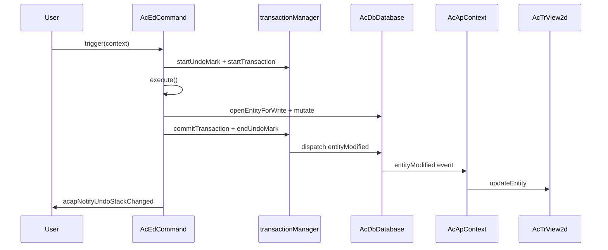

# 实体修改最佳实践

本页说明如何在 **CAD-Viewer** 中修改图纸实体，以确保更改被正确跟踪、**撤销/重做**按预期工作，并且**视图与数据库保持同步**。

数据库层来自 [`@mlightcad/data-model`](https://github.com/mlightcad/realdwg-web)。CAD-Viewer 添加了应用层辅助工具，并将数据库事件连接到渲染器。

---

## 概览

正确的实体编辑涉及三个层面：

| 层面 | 职责 |
|-------|----------------|
| **数据库**（`AcDbDatabase`） | 存储实体并记录变更 |
| **事务 / 撤销**（`transactionManager`） | 对更改进行分组并支持撤销/重做 |
| **视图**（`AcTrView2d`） | 渲染几何体；通过数据库事件更新 |

**经验法则：** 通过事务 API 修改数据库。让 `AcApContext` 将更改传播到视图。除非有特殊情况（例如临时预览几何体），否则在普通的数据库编辑之后不要调用 `view.updateEntity()`。

---

## 事务机制

`AcDbDatabase.transactionManager`（`AcDbDatabaseTransactionManager`）管理单张图纸的事务和撤销历史。其设计遵循 AutoCAD ObjectARX `AcDbTransactionManager` 的语义。

### 核心 API

| API | 用途 |
|-----|---------|
| `startTransaction()` | 开始记录变更 |
| `commitTransaction()` | 提交当前事务并派发事件 |
| `abortTransaction()` | 回滚当前事务中的所有更改 |
| `hasTransaction()` | 返回是否有活动事务 |
| `isRecording()` | 返回是否正在记录变更（撤销/重做回放期间为 false） |
| `openEntityForWrite(id \| entity)` | **通过**活动事务打开实体以进行写入 |

### 记录哪些内容

当 `isRecording()` 为 true 时，事务管理器会记录：

- 数据库对象上的**属性变更**（`kind: 'modify'`）
- 块表记录、符号表或字典中对象的**追加/移除**
- **系统变量**变更

当最外层事务提交时，记录的变更会被最终确定，并派发相关的数据库事件。

### 嵌套事务

事务可以嵌套。内部事务会将其记录器合并到父事务中。只有**最外层**的 `commitTransaction()` 会派发事件并将撤销历史入队。

### 打开对象进行写入

始终使用 `database.openEntityForWrite(...)`（或 `openObjectForWrite`），而不是直接修改缓存的实体引用：

```typescript
const opened = db.openEntityForWrite(entityOrObjectId)
if (!opened) return
opened.color = newColor
```

当有活动事务时，`openEntityForWrite` 会将对象路由到事务中，以便跟踪更改。没有活动事务时，该辅助方法会退回到直接查找，更改可能**无法**撤销。

### 严格模式

`transactionManager.strictMode`（data-model 中的默认值）可以要求所有变更都必须在活动事务内发生。撤销/重做回放不受此限制，以便更改应用器能够恢复状态。在实践中，CAD-Viewer 命令和 `acapRunDatabaseEdit` 总是在编辑前建立事务。

---

## 撤销 / 重做机制

撤销/重做基于**撤销标记**和**撤销记录**构建。

### 撤销标记

| API | 用途 |
|-----|---------|
| `startUndoMark(label?)` | 打开一个分组；一个标记内的多次提交合并为**一个**撤销步骤 |
| `endUndoMark()` | 关闭分组，并在存在更改时推入撤销记录 |
| `cancelUndoMark()` | 丢弃分组而不创建撤销记录 |

### 撤销 / 重做操作

| API | 用途 |
|-----|---------|
| `undo()` | 还原最近的撤销记录 |
| `redo()` | 重新应用最近被撤销的记录 |
| `canUndo()` / `canRedo()` | 查询栈状态 |
| `clearUndoStack()` | 清空两个栈 |

当执行撤销或重做时，`AcDbChangeApplier` 会按正向或逆向顺序回放存储的更改，并派发相应的实体事件，使视图自动更新。

### 命令如何自动获得撤销能力

当启用撤销记录时，`AcEdCommand.trigger()` 会将命令执行包装在一个撤销标记和一个事务中：

```typescript
// AcEdCommand.trigger() — simplified
if (recordUndo) {
  tm.startUndoMark(this.globalName || this.localName)
  tm.startTransaction()
}
try {
  await this.execute(context)
} catch (error) {
  if (undoTransactionActive) {
    tm.abortTransaction()
    tm.cancelUndoMark()
  }
  throw error
} finally {
  if (undoTransactionActive) {
    tm.commitTransaction()
    tm.endUndoMark()
    acapNotifyUndoStackChanged()
  }
}
```

当**以下所有条件**都成立时，撤销记录会被启用：

- `command.recordsUndoStack === true`（默认值）
- `context.doc.openMode >= AcEdOpenMode.Review`
- `command.mode >= AcEdOpenMode.Review`

对于不应创建自身撤销步骤的元命令（例如 `AcApUndoCmd` 和 `AcApRedoCmd`），请设置 `recordsUndoStack = false`。

### UI 通知

在撤销/重做可用性发生变化后，调用 `@mlightcad/cad-simple-viewer` 中的 `acapNotifyUndoStackChanged()`。它会在全局事件总线上发出 `undo-stack-changed`，以便 `useUndoRedo` 等组件刷新工具栏状态。

通过 `AcEdCommand.trigger()` 执行的命令会在成功提交时自动调用它。通过 `acapRunDatabaseEdit` 执行的独立编辑在创建新撤销标记时也会通知监听器。

---

## 实体相关事件

`AcDbDatabase.events` 暴露主要的数据库通知：

| 事件 | 触发时机 |
|-------|----------------|
| `entityAppended` | 实体被添加到模型/图纸空间 |
| `entityModified` | 实体属性或几何体发生变化 |
| `entityErased` | 实体从图纸中移除 |
| `layerAppended` | 创建新图层 |
| `layerModified` | 图层属性发生变化 |
| `layerErased` | 图层被移除 |
| `dictObjetSet` | 对象被存储到命名字典中 |
| `dictObjectErased` | 对象从字典中移除 |

### 事件载荷

`AcDbEntityEventArgs` 包含：

- `database` — 源数据库
- `entity` — 一个实体或实体数组

CAD-Viewer 为修改事件扩展了可选的 `changes` 字段（`AcApEntityUpdate` 中的 `AcDbEntityModifiedEventArgs`），以便视图能够应用轻量级更新（例如仅切换可见性）而无需重建几何体。

### 视图同步

`AcApContext` 订阅实体事件并保持视图一致：

- `entityAppended` → `view.addEntity(...)`
- `entityModified` → `view.updateEntity(...)`（或对于仅可见性变化使用 `updateEntityVisibility`）
- `entityErased` → `view.removeEntity(...)`

由于这种连接方式，**应用代码在数据库编辑提交后通常不应手动刷新场景**。

### 事件批处理

`database.beginEventBatch()` / `endEventBatch()` 会在批量操作期间抑制并合并事件。最外层的 `endEventBatch()` 会冲刷累积的 `entityAppended`、`entityErased` 和 `entityModified` 通知。在导入或重新生成大型图纸时，优先使用批处理。

### 从 UI 或插件中监听

你可以订阅相同的事件，用于属性面板、功能区状态或自定义工具：

```typescript
const db = AcApDocManager.instance.curDocument.database

const onModified = (args: AcDbEntityEventArgs) => {
  // React to entity changes
}

db.events.entityModified.addEventListener(onModified)

// Remember to remove the listener on teardown
db.events.entityModified.removeEventListener(onModified)
```

---

## 在命令内部修改实体

对于交互式编辑命令（移动、旋转、删除、绘制等），继承 `AcEdCommand`，并在 `execute()` 内执行所有持久化变更。

### 检查清单

1. **设置命令模式** — 修改类命令使用 `AcEdOpenMode.Review`，创建类命令使用 `AcEdOpenMode.Write`，以便允许撤销记录。
2. **保持 `recordsUndoStack` 为 `true`**，除非该命令本身就是撤销/重做。
3. **不要**手动调用 `startTransaction()` / `commitTransaction()` — `trigger()` 已经包装了你的 `execute()` 方法。
4. 在更改几何体或属性之前，**将实体打开以进行写入**。
5. **将 jig 仅用于预览** — 在 jig 中更新临时几何体；用户确认后再提交到数据库。

### 示例：移动命令

`AcApMoveCmd` 是几何体编辑的参考模式：

```typescript
export class AcApMoveCmd extends AcEdCommand {
  constructor() {
    super()
    this.mode = AcEdOpenMode.Review
  }

  async execute(context: AcApContext) {
    // ... selection and point prompts ...

    const matrix = new AcGeMatrix3d().makeTranslation(dx, dy, dz)
    sourceEntities.forEach(entity => {
      const opened = context.doc.database.openEntityForWrite(entity)
      if (!opened) return
      opened.transformBy(matrix)
    })
  }
}
```

### 示例：删除命令

```typescript
private eraseEntities(db: AcDbDatabase, objectIds: AcDbObjectId[]) {
  objectIds.forEach(objectId => {
    const entity = db.openEntityForWrite(objectId)
    entity?.erase()
  })
}
```

### 示例：创建命令

在 `execute()` 内通过块表记录追加新实体。活动命令的事务会记录这次追加：

```typescript
const segment = new AcDbLine(startPoint, endPoint)
db.tables.blockTable.modelSpace.appendEntity(segment)
```

`entityAppended` 会将该实体添加到视图中。额外调用 `view.addEntity` 是可选的，主要用于某些绘制命令以获得即时反馈；事件路径才是标准的同步机制。

### 预览与提交（jig）

在交互式输入期间，**不要**将预览变换写入数据库。使用 jig（例如 `AcApMovePreviewJig`）来变换临时或 GPU 驻留的预览几何体。只有在用户确认之后，才应调用 `openEntityForWrite` 并应用最终更改。

### 错误处理

如果 `execute()` 抛出异常，`AcEdCommand.trigger()` 会中止事务并取消撤销标记。在大多数命令中你不需要额外的回滚逻辑。

---

## 在命令外部修改实体

功能区的处理器、夹点编辑、内联文本编辑器和对话框回调**不**会被 `AcEdCommand.trigger()` 包装。请使用应用层辅助函数：

### `acapRunDatabaseEdit`

```typescript
import { acapRunDatabaseEdit } from '@mlightcad/cad-simple-viewer'

acapRunDatabaseEdit(db, 'Color', () => {
  const entity = db.openEntityForWrite(objectId)
  if (!entity) return
  entity.color = newColor
})
```

该函数会：

1. 委托给 data-model 中的 `db.runDatabaseEdit(label, fn)`
2. 在尚未记录时通过 `transactionManager.runUndoable` 创建**一个**撤销标记
3. 当从活动命令事务内部调用时，**跳过**嵌套的撤销标记
4. 在创建新的撤销记录时调用 `acapNotifyUndoStackChanged()`

请使用简短、面向用户的 `label`（例如 `'Grip Edit'`、`'Hatch Properties'`、`'Replace Image'`）——它用于在撤销历史中标识该步骤。

### 何时使用哪种 API

| 场景 | 推荐的 API |
|----------|-----------------|
| 交互式 CAD 命令 | 继承 `AcEdCommand`；在 `execute()` 中修改 |
| 夹点拖拽提交 | `acapRunDatabaseEdit` |
| 功能区 / 属性面板 | `acapRunDatabaseEdit` |
| 对话框确定处理器 | `acapRunDatabaseEdit` |
| UI 之外的编程式批处理 | `db.runDatabaseEdit` 或 `transactionManager.runUndoable` |
| 已经在命令的 `execute()` 内部 | 直接使用 `openEntityForWrite` / `appendEntity`（事务已处于活动状态） |

### 示例：夹点编辑会话

```typescript
acapRunDatabaseEdit(db, 'Grip Edit', () => {
  const entity = db.openEntityForWrite(this._entity)
  if (!entity) return
  entity.subMoveGripPointsAt([gripIndex], offset)
})
```

### 示例：功能区颜色变更

```typescript
acapRunDatabaseEdit(db, 'Color', () => {
  db.cecolor = value
  selectedIds.forEach(id => {
    const entity = db.openEntityForWrite(id)
    if (entity) entity.color = value
  })
})
```

### 更低层的替代方案

如果你仅基于 data-model 构建库代码（不使用 CAD-Viewer UI），请调用：

```typescript
db.runDatabaseEdit('My Operation', () => {
  // openEntityForWrite + mutations
})
```

或：

```typescript
db.transactionManager.runUndoable('My Operation', () => {
  // mutations
})
```

与 CAD-Viewer UI 集成时，记得自行调用 `acapNotifyUndoStackChanged()`。

---

## 常见错误

| 错误 | 失败原因 | 修复方法 |
|---------|--------------|-----|
| 在过期的引用上修改 `entity.color = ...` | 绕过了事务记录 | 使用 `openEntityForWrite` 后再修改 |
| 每次编辑后都调用 `view.updateEntity` | 重复工作；可能与事件驱动的更新冲突 | 依赖 `entityModified`，除非是在预览 |
| 在 jig 的 `update()` 中写入数据库 | 产生撤销噪音并导致提交缓慢 | 临时预览；确认时一次性提交 |
| 手动管理撤销栈（自定义克隆数组） | 绕过统一的撤销/重做；破坏合并机制 | 使用 `transactionManager` |
| 在命令外忘记使用 `acapRunDatabaseEdit` | 更改可能无法撤销 | 将编辑包裹在 `acapRunDatabaseEdit` 中 |
| 在普通编辑命令上设置 `recordsUndoStack = false` | 用户无法撤销该操作 | 保持默认值 `true` |

---

## 端到端流程



对于非命令编辑，请将 `AcEdCommand.trigger` 替换为 `acapRunDatabaseEdit`；事件和视图路径完全相同。

---

## 相关页面

- [命令](./command) — 命令生命周期和注册
- [Jig（动态预览）系统](./jig-system) — 不写入数据库的交互式预览
- [CAD Viewer 基础](./cad-viewer-basics) — 文档、数据库和视图概念
- [架构总览](./architecture-overview) — 模块之间如何连接

