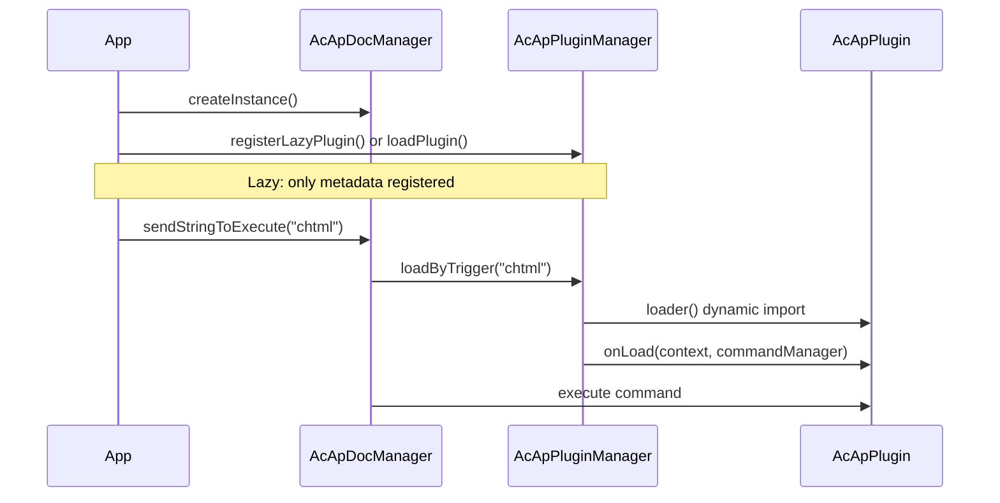

# 插件系统

本页介绍如何为 MLightCAD 构建、注册和使用**插件**。插件通过注册命令、访问活动文档和视图，以及在卸载时进行清理来扩展查看器。

插件系统位于 `@mlightcad/cad-simple-viewer`（`packages/cad-simple-viewer/src/plugin`）。官方插件（UI、AI 智能体、脚本控制台、HTML/PDF/SVG 导出、OneDrive/Google Drive 数据源）以独立的 npm 包形式发布 —— 完整列表请参阅[内置插件](./built-in-plugins)。

---

## 概览

插件是实现 `AcApPlugin` 的小型模块。**插件管理器**（`AcApPluginManager`）由 `AcApDocManager` 持有，并且：

- 在加载插件时调用 `onLoad()`（注册命令、钩子等）
- 在移除插件时调用 `onUnload()`（注销命令、释放资源）
- 支持**延迟注册**：在用户运行**触发命令**之前，不会下载插件代码



---

## 核心类型

### `AcApPlugin`

每个插件都必须提供：

| 字段 / 方法 | 说明 |
|----------------|-------------|
| `name` | 唯一标识符（必填）。使用延迟加载时必须与延迟注册中的 `name` 一致。 |
| `version?` | 可选的版本字符串 |
| `description?` | 可选的人类可读描述 |
| `onLoad(context, commandManager)` | 注册命令并初始化资源 |
| `onUnload(context, commandManager)` | 移除命令并释放资源 |

`context` 是 `AcApContext`（当前的 `doc` 和 `view`）。`commandManager` 是 `AcEdCommandStack`——与内置命令使用的同一个命令栈。

参考实现：`packages/cad-simple-viewer/src/plugin/AcApPluginExample.ts` 中的 `AcApExamplePlugin`。

### `AcApLazyPluginRegistration`

为了实现代码分割，可以注册一个描述符，而不是立即加载插件：

| 字段 | 说明 |
|-------|-------------|
| `name` | 必须等于 `loader` 返回的 `AcApPlugin.name` |
| `triggers` | 用于加载此插件的命令名（不区分大小写） |
| `loader` | 返回插件实例的异步工厂函数 |

---

## 步骤 1 — 实现命令

插件通常暴露一个或多个**命令**。继承 `AcEdCommand` 并实现 `execute(context)`：

```typescript
import { AcApContext, AcEdCommand } from '@mlightcad/cad-simple-viewer'

export class AcApMyExportCmd extends AcEdCommand {
  async execute(context: AcApContext) {
    const fileName = context.doc.fileName || context.doc.docTitle
    // ... export logic using context.doc.database, context.view, etc.
  }
}
```

有关提示、编辑器访问和实体创建，请参见[命令](./command)。

---

## 步骤 2 — 实现 `AcApPlugin`

跟踪你注册的每个命令，以便 `onUnload` 可以移除它们：

```typescript
import {
  AcApContext,
  AcApPlugin,
  AcEdCommandStack
} from '@mlightcad/cad-simple-viewer'

import { AcApMyExportCmd } from './AcApMyExportCmd'

export class AcApMyPlugin implements AcApPlugin {
  name = 'MyPlugin'
  version = '1.0.0'
  description = 'My custom export command'

  private registeredCommands: Array<{ group: string; name: string }> = []

  onLoad(_context: AcApContext, commandManager: AcEdCommandStack): void {
    const group = AcEdCommandStack.SYSTEMT_COMMAND_GROUP_NAME
    commandManager.addCommand(group, 'myexport', 'myexport', new AcApMyExportCmd())
    this.registeredCommands.push({ group, name: 'myexport' })
  }

  onUnload(_context: AcApContext, commandManager: AcEdCommandStack): void {
    for (const cmd of this.registeredCommands) {
      commandManager.removeCmd(cmd.group, cmd.name)
    }
    this.registeredCommands = []
  }
}
```

官方插件遵循相同的模式：

- `AcApHtmlPlugin` — 注册 `chtml`
- `AcApPdfPlugin` — 注册 `cpdf`、`ipdf`
- `AcApSvgPlugin` — 注册 `csvg`

对于查看器全局命令（与缩放、图层等属于同一组），请使用 `AcEdCommandStack.SYSTEMT_COMMAND_GROUP_NAME`。

---

## 步骤 3 — 发布为 npm 包（可选）

参照 `cad-html-plugin`、`cad-pdf-plugin` 或 `cad-svg-plugin` 的结构：

```
my-cad-plugin/
  package.json          # name: @myorg/cad-my-plugin
  src/
    AcApMyPlugin.ts
    AcApMyExportCmd.ts
    registerLazyMyPlugin.ts
    index.ts            # public exports
```

**`package.json` 约定：**

- 设置 `"type": "module"`
- 将 `@mlightcad/cad-simple-viewer` 列为 **peerDependency**（以及按需列出的其他共享库，如 `@mlightcad/data-model`、`three`）
- 像现有插件一样使用 `tsc` + `vite` 构建
- 从 `src/index.ts` 导出辅助内容：插件类、`createMyPlugin`、`registerLazyMyPlugin`、触发命令常量

**延迟加载器模块**（`registerLazyMyPlugin.ts`）：

```typescript
import type { AcApPluginManager } from '@mlightcad/cad-simple-viewer'

export const MY_PLUGIN_NAME = 'MyPlugin'
export const MY_PLUGIN_TRIGGERS = ['myexport'] as const

export async function createMyPlugin() {
  const { AcApMyPlugin } = await import('./AcApMyPlugin')
  return new AcApMyPlugin()
}

export function registerLazyMyPlugin(pluginManager: AcApPluginManager): void {
  pluginManager.registerLazyPlugin({
    name: MY_PLUGIN_NAME,
    triggers: [...MY_PLUGIN_TRIGGERS],
    loader: createMyPlugin
  })
}
```

动态 `import('./AcApMyPlugin')` 会将体积较大的插件代码块排除在初始 bundle 之外，直到运行 `myexport` 时才加载。

---

## 注册插件

共有四种常见的注册路径。根据是否需要延迟加载以及由谁负责应用启动来选择其一。

### A. 延迟注册（推荐用于可选功能）

在 `AcApDocManager.createInstance()` 之后注册。插件模块会在首次触发命令时加载。

```typescript
import { AcApDocManager } from '@mlightcad/cad-simple-viewer'
import { registerLazyHtmlPlugin } from '@mlightcad/cad-html-plugin'
import { registerLazyPdfPlugin } from '@mlightcad/cad-pdf-plugin'
import { registerLazySvgPlugin } from '@mlightcad/cad-svg-plugin'

AcApDocManager.createInstance({
  container: document.getElementById('cad-container')!,
  htmlViewerRuntimeUrl: './viewer-runtime.iife.js' // required for chtml export
})

const pm = AcApDocManager.instance.pluginManager
registerLazyHtmlPlugin(pm)
registerLazyPdfPlugin(pm)
registerLazySvgPlugin(pm)
```

示例应用：`packages/cad-simple-viewer-example/src/main.ts`。

当用户运行触发命令时，如果该命令尚未注册，`AcApDocManager` 会自动调用 `loadByTrigger`：

```typescript
AcApDocManager.instance.sendStringToExecute('chtml')
AcApDocManager.instance.sendStringToExecute('cpdf')
```

使用 `sendStringToExecute` 时，你**不需要**手动调用 `loadByTrigger`，除非你希望在执行前预加载插件（见下文）。

### B. 内联延迟注册（cad-viewer 组件）

`@mlightcad/cad-viewer` 在 `registerLazyPlugins()`（`packages/cad-viewer/src/app/register.ts`）中注册 PDF/HTML/SVG 插件，该函数由 `app.ts` 中的 `initializeCadViewer()` 调用。Vue 组件的使用者无需额外设置即可获得延迟插件。

### C. 通过 `pluginManager.loadPlugin()` 立即加载

在创建文档管理器后立即加载：

```typescript
import { AcApDocManager } from '@mlightcad/cad-simple-viewer'
import { AcApExamplePlugin } from '@mlightcad/cad-simple-viewer' // AcApExamplePlugin export

AcApDocManager.createInstance({ container: el })
await AcApDocManager.instance.pluginManager.loadPlugin(new AcApExamplePlugin())
```

适用于插件较小、或必须在任何用户操作之前就可用的场景。

### D. 通过 `createInstance({ plugins })` 立即加载

在初始化时传入插件；`AcApDocManager` 会在启动期间异步加载它们。

**从实例或工厂函数：**

```typescript
AcApDocManager.createInstance({
  container: el,
  plugins: {
    fromConfig: [
      new AcApExamplePlugin(),
      () => new AcApAnotherPlugin()
    ]
  }
})
```

**从文件夹（动态导入）：**

```typescript
AcApDocManager.createInstance({
  container: el,
  plugins: {
    fromFolder: {
      folderPath: './plugins',
      pluginList: ['MyPlugin.js'],
      continueOnError: true
    }
  }
})
```

在浏览器中你必须提供 `pluginList`（没有目录列表 API）。每个文件应默认导出一个插件实例、插件类或工厂函数。

---

## 在运行时使用插件

### 执行插件命令

插件加载后（无论是立即加载还是通过延迟触发）：

```typescript
// Command line / script style
AcApDocManager.instance.sendStringToExecute('chtml')

// Or via editor API
await AcApDocManager.instance.editor.executeCommand('cpdf')
```

### 预加载延迟插件（可选）

某些 UI 路径会在 `sendStringToExecute` 之前预加载，以避免首次运行时出现延迟：

```typescript
const pluginManager = AcApDocManager.instance.pluginManager
await pluginManager.loadByTrigger('cpdf')
AcApDocManager.instance.sendStringToExecute('cpdf')
```

`cad-viewer` 在功能区的 PDF 导出中使用了这种模式（`MlRibbonCommands.vue` → `runLazyCommand`）。

### 检查加载状态

```typescript
const pm = AcApDocManager.instance.pluginManager

pm.isPluginLoaded('HtmlPlugin')        // true after first chtml
pm.isLazyPluginTrigger('chtml')        // true if lazy registration exists
pm.getLoadedPlugins()                  // ['HtmlPlugin', ...]
await pm.unloadPlugin('HtmlPlugin')
await pm.unloadAllPlugins()            // called when destroying the view
```

### 卸载

```typescript
await AcApDocManager.instance.pluginManager.unloadPlugin('MyPlugin')
```

`onUnload` 必须移除在 `onLoad` 中注册的每个命令。否则会在命令栈上留下残留命令。

---

## 内置插件参考

本仓库随附多个官方插件：`AcApHtmlPlugin`（`chtml`）、`AcApPdfPlugin`（`cpdf`、`ipdf`）、`AcApSvgPlugin`（`csvg`），以及 UI、智能体、脚本控制台和数据源插件。

包含各插件命令、公开 API、配置及包 README 链接的完整列表，请参阅[内置插件](./built-in-plugins)。

---

## 集成检查清单

1. **依赖** `@mlightcad/cad-simple-viewer`（已发布插件应作为 peer dependency）。
2. **实现** `AcApPlugin` + 一个或多个 `AcEdCommand`。
3. 从包入口**导出** `registerLazy*Plugin` + `create*Plugin`。
4. 在 `AcApDocManager.createInstance()` 之后**注册**（或通过 `plugins.fromConfig` / `fromFolder`）。
5. 使用 `sendStringToExecute` 或调用相同命令名的 UI 来**触发**命令。
6. **打包**：在延迟 `loader` 中使用动态 `import()`，以便 Vite/Rollup 拆分插件代码块。
7. **清理**：在 `onUnload` 中移除所有命令。
8. **唯一触发命令**：一个触发命令不能映射到两个延迟插件（`registerLazyPlugin` 在冲突时会抛出异常）。
9. **名称一致**：`AcApLazyPluginRegistration.name` 必须与 `loader()` 返回的 `plugin.name` 匹配。

---

## 故障排查

| 现象 | 可能原因 |
|---------|----------------|
| `Command 'chtml' not found` | 延迟插件未注册，或在销毁之后才注册 |
| 延迟插件始终不加载 | 触发命令名不匹配（检查大写规范化）；loader 中 `name` 与注册时不一致 |
| HTML 导出在运行时失败 | 缺少 `htmlViewerRuntimeUrl`，或 `viewer-runtime.iife.js` 未部署到该 URL |
| `Plugin 'X' is already loaded` | 在未调用 `unloadPlugin` 的情况下调用了两次 `loadPlugin` |
| 触发命令已被注册 | 两个插件注册了相同的触发命令 |

---

## 相关文档

- [内置插件](./built-in-plugins) — MLightCAD 随附的所有官方插件
- [命令](./command) — 命令生命周期与 `AcEdCommand`
- [数据源插件](./data-source-plugin) — 可插拔的图纸来源（本地、URL、OneDrive 等）
- [集成 Simple Viewer](./integrate-simple-cad-viewer) — 嵌入 `cad-simple-viewer`
- [集成 Vue 组件](./integrate-cad-viewer-component) — Vue 组件与 `initializeCadViewer`
- [架构总览](./architecture-overview) — 模块结构
